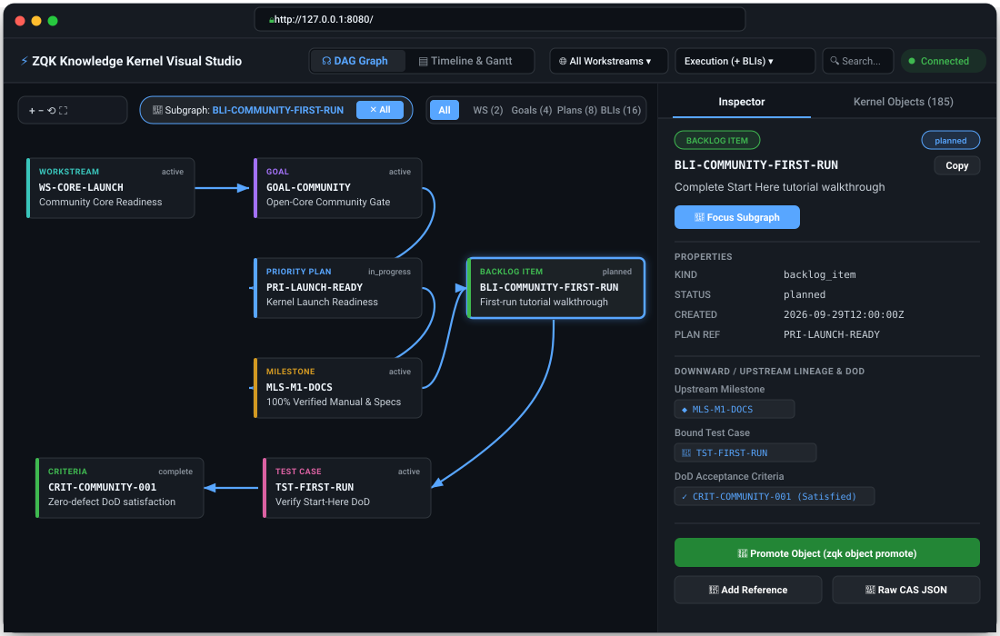

# ZQK: Git for AI Agent Memory and Task Truth

**The persistence, coordination, and verification substrate for Cursor, Claude Code, Cline, and Windsurf.**

[](LICENSE)
[](https://goreportcard.com/report/github.com/zqk-os/zqk)
[](https://docs.zqk.dev)
[](https://codespaces.new/zqk-os/zqk)

ZQK gives AI coding agents (Cursor Composer, Claude Code, Cline, Windsurf) persistent memory, verifiable task truth, and AST-guarded execution. Stop context drift, hallucinated tasks, and token blowouts.

Canonical portal: [Community First-Run Guide](docs/onboarding/COMMUNITY_FIRST_RUN.md) · Documentation: [docs.zqk.dev](https://docs.zqk.dev)

---

## Quickstart

### Installation (macOS & Linux)

```sh
# Single-command install (defaults to interactive choice: Go Fast or Walk Through)
curl -sSL https://raw.githubusercontent.com/zqk-os/zqk/main/scripts/install.sh | sh
```

Or install via Homebrew:
```sh
brew tap zqk-os/tap && brew install zqk
```

### 1-Click Instant Cloud Sandbox (GitHub Codespaces)

[](https://codespaces.new/zqk-os/zqk)

Experience ZQK instantly in your browser without installing Go or Docker locally:
- **Instant Pre-Warmed Toolchain:** Go 1.26 container pre-configured with required linters, formatters, and extensions.
- **Zero-Touch CLI Build:** `./bin/zqk` is automatically compiled and ready on launch.
- **Pre-Wired MCP & Agent Seating:** Automatic MCP daemon bootstrap and agent profile detection.
- **Security-First Isolation:** Hardened non-root `vscode` user with `--cap-drop=ALL` sandbox containment.

### 30-Second Greenfield Setup

```sh
# Initialize kernel in your repo
zqk init

# Scaffold zero-config GitHub Actions CI/CD and Homebrew formula
zqk ci init

# Launch the visual web studio
zqk ui -w

# Wire up MCP for Cursor / Claude Code
zqk mcp ensure

# Autonomously claim and execute work
zqk do

# Or execute work with autonomous multi-agent swarm
zqk swarm dispatch
```

### Visual Web Studio (`zqk ui -w`)

Inspect real-time swarm delivery, interactive DAG dependencies, and agent seating directly in your browser:

```sh
# Launch local Web Studio (auto-discovers open port between 8080-8095)
zqk ui -w
```

[](docs/guides/WEB_STUDIO_AND_VISUAL_GRAPH_EXPLORER_GUIDE.md)

- **Interactive DAG & Gantt View:** Live tracking of goals, milestones, requirements, and atomic backlog items.
- **Autonomous Swarm Seating:** Inspect agent pods, active tokens, and AST validation gates in flight.
- **Instant Day-Zero Telemetry:** Stream live execution events from `zqk do` directly into the web UI.

[](docs/guides/WEB_STUDIO_AND_VISUAL_GRAPH_EXPLORER_GUIDE.md)

---

### Choose Your Path: Go Fast vs. Walk Through

ZQK offers two paths for Polyglot projects (Go, Python, TypeScript, Rust):

#### Option 1: Go Fast (Immediate Token Savings)
*For developers who want immediate token savings with zero learning curve.*

Installs `zqk` and links `zgrep` (`zqk grep`) into your PATH. Drop it directly into Cursor, Claude Code, Cline, or Aider to stop context-window blowouts:

```sh
# Token-budgeted search via zqk grep / zgrep (default 500 tokens, sub-15ms)
zgrep "HandleRequest" --max-tokens 500 -f json

# Go AST structural search
zgrep --ast --kind struct MemoryStore
```

Add this to `.cursorrules`, `CLAUDE.md`, or `.clinerules`:
```markdown
- NEVER run raw recursive grep or find.
- ALWAYS use `zgrep <query> --max-tokens 500 -f json`.
- For Go syntax: `zgrep --ast --kind struct|func <name>`.
```

Full agent configuration reference: [Go Fast Agent Code Search Guide](docs/guides/GO_FAST_AGENT_CODE_SEARCH.md).

#### Option 2: Walk Through (Full Knowledge Kernel)
*For developers who want persistent task truth and autonomous swarm orchestration.*

Conducts an interactive walkthrough to capture intent, objectify goals, and experience the 5-layer cascade:

```sh
# Launch the interactive walkthrough
zqk system start-here
```

- **5-Layer Cascade:** Vision ➔ Goals ➔ Priority Plans ➔ Requirements ➔ Backlog Items.
- **Minting Kernel Objects:** Declare intent via `zqk new <kind>` (`zqk new goal`, `zqk new plan`, `zqk new req`, `zqk new bli`, `zqk new td`).
- **Fail-Closed Done Gates:** Automated AST verification and test execution before state transitions.
- **Visual Web Studio:** Real-time Gantt timeline and DAG visualization:
  ```sh
  zqk ui -w
  ```
- **Ambient MCP Server:** Expose local kernel tools to Cursor or Claude:
  ```sh
  zqk mcp ensure --tcp 127.0.0.1:8443
  ```

---

## Why ZQK: Autonomous Agents Code Blind

When using autonomous coding agents (Cursor Composer, Claude Code, Windsurf, Cline, Aider), developers run into the same painful failure modes:

- **Agent Amnesia & Context Drift:** Ephemeral chat sessions lose goals and constraints across prompts, causing agents to wander off-track.
- **Hallucinated Tasks:** Without an authoritative backlog, agents invent unnecessary work or tackle the wrong problems.
- **Silent Regressions:** Edits pass locally in a single file while breaking structural invariants across the broader repository.
- **Runaway Token Burn:** Blind `grep`, `find`, or dumping raw chat history into context windows burns millions of tokens on irrelevant noise.

### The Solution: Persistent Knowledge Kernel

ZQK provides the missing infrastructure layer between your LLMs and your code:

- **Git-Like Task Truth:** Goals, requirements, acceptance criteria, and backlog items are versioned, verifiable graph objects—not transient LLM prompts.
- **Fail-Closed AST Verification Gates:** Code changes must satisfy structural AST checks and automated test suites before work units can transition to done.
- **1-Command Universal MCP Discovery:** Wire up local kernel context to Cursor or Claude Code instantly via Model Context Protocol (`zqk mcp ensure` / `zqk mcp proxy`).
- **Token-Budgeted Search (`zgrep`):** Sub-15ms trigram indexing and Go AST search with strict token budgeting (default 500 tokens) to eliminate context blowouts.
- **Real-Time Visual Web Studio:** Interactive Gantt timelines, DAG dependency trees, and live task tracking with zero cloud dependencies (`zqk ui -w`).

---

## Architecture Deep-Dive: Biological Holonic Microkernel

For teams orchestrating complex multi-agent swarms, ZQK operates as a high-performance Go **Cellular Operating System (Cellular OS)**:

1. **The Cell / Holon (Sovereign Node):** Each ZQK kernel is an autonomous holon—simultaneously a complete, self-governing whole and an organic participant in the wider mesh. It maintains authoritative stewardship over its local codebase, tests, and private knowledge graph without relying on bloated global vector lakes.
2. **The Membrane (Deterministic Boundaries):** A strict multi-plane state machine (`Draft` → `Promoted` via CAS qualification) ensuring that zero unverified agent mutations ever pollute working code or canonical state.
3. **The Nervous System (Active Operational Graph):** An active, real-time synaptic state bus driving task execution, causal provenance lineage, and dependency trees—not a passive secondary data lake.
4. **The Organism (Inter-Cellular Mesh):** Domain-expert kernels communicating over a typed P2P wire protocol to achieve compound objectives without central micromanagement.

### The 3-Tier Layering Model

| Layer | System Tier | Responsibilities |
| :--- | :--- | :--- |
| **Layer 3** | **Domain Workflows & Applications** | Software Engineering Profile, Security Ops Enclaves, Custom Enterprise Swarms |
| **Layer 2** | **The Kernel Standard Library (Core DNA)** | `Goal` (Objective), `BacklogItem` (BLI / WorkUnit), `InvariantGate` (Verification), `Decision` (ADR) |
| **Layer 1** | **Microkernel Runtime Engine** | Graph State Bus, Multi-Plane Isolation (`Draft` vs `Promoted`), Deterministic Scheduler, IPC Protocol |

### Open-Core Boundary: Single Cell vs. Organism Mesh

ZQK follows the classical operating system boundary: **POSIX/Kernel primitives are 100% open-source; distributed multi-tenant mesh clustering and fleet governance are commercial.**

| Dimension | ZQK Core (Open-Source Community) | Enterprise Fleet Mesh |
| :--- | :--- | :--- |
| **Scope** | Single Autonomous Cell (Local Kernel) | Multi-Node Mesh Orchestration & Fleet Governance |
| **State & Engine** | Go microkernel, local hybrid file + graph store, local validation | Cross-cell routing, multi-tenant directory, global trust topology |
| **Task Lifecycle** | Self-contained task loop, local self-healing, deterministic planes | Fleet-wide apoptotic quarantine, cross-cell task delegation |
| **Codegen & Specs** | Core DNA schemas, public object parser, manual/template bindings | Fleet Spec-Driven Codegen Engine, automated AST synthesis |
| **Governance & Ops** | Single-node CLI dashboard, Git CAS integrity gates | Enterprise RBAC, cross-cell compliance audit trails, global telemetry |

## Core Capabilities

- **Cellular Epistemic Hygiene:** Cryptographic provenance (`parent_hash`, `agent_id`, `signature`) attached to all mutations.
- **Autonomous Project Awareness:** Agents query the graph to discover objectives, constraints, and architecture without manual prompting.
- **Native Code Search:** High-performance in-process AST and trigram search via `./bin/zqk grep` (alias `zgrep`).
- **Local-First & Offline-Ready:** Pure Go with filesystem & embedded graph storage—zero external cloud dependency required.
- **Deterministic Traceability:** Every commit and diff links back to verified invariants and backlog work units.

## Documentation & Guides

- **[Community First-Run Guide](docs/onboarding/COMMUNITY_FIRST_RUN.md)** ([Web Portal](https://docs.zqk.dev/docs/onboarding/COMMUNITY_FIRST_RUN.html)) — Recommended starting point for humans and agents.
- **[First-Run Object Tutorial](docs/onboarding/FIRST_RUN_OBJECT_TUTORIAL.md)** ([Web Portal](https://docs.zqk.dev/docs/onboarding/FIRST_RUN_OBJECT_TUTORIAL.html)) — Creating and managing kernel objects.
- **[Quickstart & MCP Setup](docs/onboarding/QUICKSTART.md)** ([Web Portal](https://docs.zqk.dev/docs/onboarding/QUICKSTART.html)) — Connecting Cursor, Claude Code, and other LLMs.
- **[Architecture Guide](docs/architecture/README.md)** ([Web Portal](https://docs.zqk.dev/docs/architecture/README.html)) — Deep dive into the cellular microkernel architecture.
- **[Contributing](CONTRIBUTING.md)** — Development guidelines and PR policies.
- **[Security Policy](SECURITY.md)** — Vulnerability reporting and fail-closed security guarantees.

## Connect & Community

- **Website:** [zqk.dev](https://zqk.dev)
- **Documentation Portal:** [docs.zqk.dev](https://docs.zqk.dev)
- **General Inquiries:** [inquiry@zqkos.com](mailto:inquiry@zqkos.com)
- **Technical Support:** [support@zqkos.com](mailto:support@zqkos.com)
- **Schedule a Call:** [Book a ZQK Inquiry](https://calendar.app.google/VhhrKgXqrukr48Kg7)
- **GitHub:** [zqk-os/zqk](https://github.com/zqk-os/zqk)

## License

Open-Core Community Kernel: [Apache License 2.0](LICENSE) (see `NOTICE`). Enterprise modules and multi-node fleet mesh capabilities are licensed separately.
