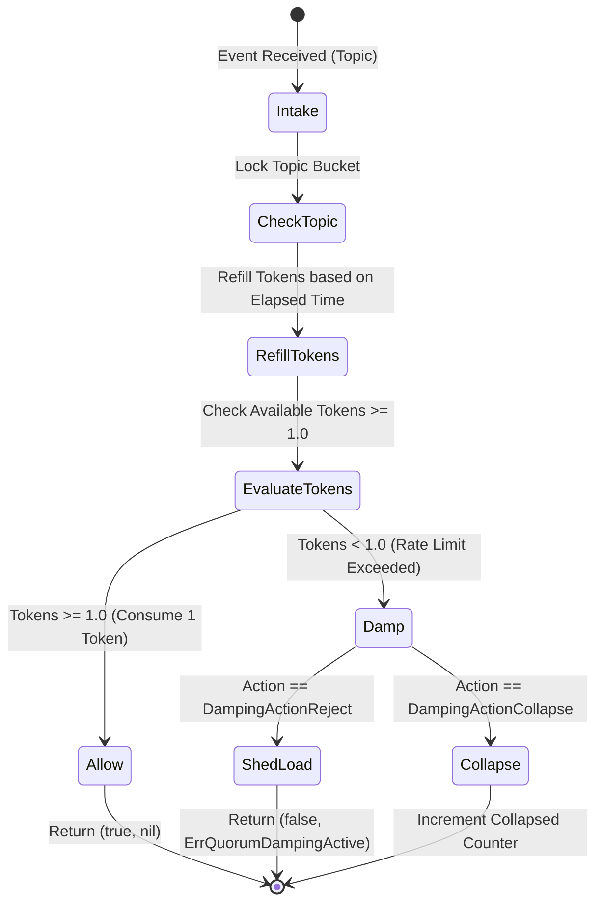

# Adaptive Backoff Exponential Jitter and Event Storm Quorum Damping

## Executive Summary
In distributed agentic swarms, multi-node Knowledge Kernel clusters, and asynchronous callback pipelines, sudden bursts of failures, downstream outages, or load spikes can trigger synchronized retry cascades known as **thundering herds**. Without decorrelated jitter and event storm damping, retrying agents synchronize on common retry intervals, flooding cluster resources, overwhelming databases, and creating cascading cluster outages.

This specification details the architecture, design, and mathematical mechanics of:
1. `AdaptiveBackoffCalculator`: A zero-allocation, bounded exponential backoff calculator with decorrelated jitter entropy (`cmd/zqk/callback/backoff.go`).
2. `QuorumDampener`: A thread-safe, memory-bounded sliding window token bucket rate limiter and storm suppression engine.
3. `DampedSubscriber`: An event bus subscriber decorator wrapping `Subscriber` with automatic retries, backoff delays, and storm shedding guards.

---

## Architectural Topology

```mermaid
flowchart TD
    subgraph CallbackBus ["Knowledge Kernel Callback Bus"]
        IncomingEvents["Callback Entries / Swarm Events"] --> Dispatcher["Event Dispatcher"]
        Dispatcher --> DampedSub["DampedSubscriber (Subscriber Decorator)"]
    end

    subgraph DampingLayer ["Sliding Window Quorum Dampener"]
        DampedSub --> QD["QuorumDampener.AllowEntry(ctx, entry)"]
        QD --> TokenBucket["Per-Topic Sliding Window Token Bucket"]
        TokenBucket -->|Intake Rate Exceeded| DampingAction{"Damping Action"}
        DampingAction -->|Reject| DropFailFast["ErrQuorumDampingActive (Fail Fast)"]
        DampingAction -->|Collapse| CollapseAggregate["Collapse / Coalesce Events"]
        TokenBucket -->|Within Quorum Limit| PassDampener["Pass to Inner Worker"]
    end

    subgraph RetryLayer ["Adaptive Backoff Calculator & Retry Engine"]
        PassDampener --> InnerWorker["Execute Inner Subscriber.Notify()"]
        InnerWorker -->|Error (Retryable)| Calc["AdaptiveBackoffCalculator.Calculate(attempt, prevSleep)"]
        Calc --> FullJitter["Decorrelated Jitter: min(maxDelay, rand(baseDelay, sleep * multiplier))"]
        FullJitter --> MonotonicCeiling["Enforce Monotonic Delay Ceiling"]
        MonotonicCeiling --> Sleep["Context-Aware Sleep (ctx.Done / Timer)"]
        Sleep --> InnerWorker
        InnerWorker -->|Success| Complete["Acknowledge Event"]
        InnerWorker -->|Exhausted Max Retries| Exhausted["ErrMaxRetriesExceeded (DLQ Redrive)"]
    end
```

---

## 1. Mathematical Mechanics: Decorrelated Jitter

The backoff engine implements AWS-standard Decorrelated Jitter:
$$t_{next} = \min\left(MaxDelay, \text{UniformRandom}\left(MinDelay, t_{prev} \times Multiplier\right)\right)$$

### Invariants:
1. **Strict Monotonic Delay Ceiling**: For attempt index $k$, the upper ceiling $C(k) = \min(MaxDelay, MinDelay \cdot 2^k)$ is guaranteed to be non-decreasing with respect to $k$.
2. **Bounds Invariant**: For all attempts $k$, $MinDelay \le t_{next} \le MaxDelay$.
3. **Zero Heap Allocation**: `Calculate(attempt int, prevSleep time.Duration) time.Duration` allocates 0 bytes on the heap, ensuring microsecond execution latency without garbage collection pressure.
4. **Entropy & Decorrelation**: Independent random number generator instances (`math/rand/v2`) ensure concurrent swarm workers avoid phase-locked retry resonance.

---

## 2. Sliding Window Quorum Damping

The `QuorumDampener` protects downstream workers from event storms using sliding window token buckets partitioned by topic:



### Quorum Damping Properties:
- **Bounded Memory Footprint**: Maximum topic registry bounded by `DefaultQuorumMaxTopics` (default: 1,000 topics). Excess topics undergo LRU / TTL eviction (`DefaultQuorumTopicTTL`).
- **Configurable Damping Actions**:
  - `DampingActionReject`: Fails fast immediately with `ErrQuorumDampingActive` to protect workers from saturation.
  - `DampingActionCollapse`: Coalesces redundant storm events into aggregated counters.
  - `DampingActionThrottle`: Blocks temporarily until token refill or context cancellation.

---

## 3. DampedSubscriber Resiliency Layer

`DampedSubscriber` composes the `QuorumDampener` and `AdaptiveBackoffCalculator` around any `Subscriber`:

- **Fail-Fast Storm Detection**: Checks topic admission before scheduling work.
- **Context-Bound Retry Loop**: Aborts retry backoff immediately if the parent context cancels or hits a deadline.
- **Classified Errors**: Differentiates retryable transient errors from non-retryable fatal faults via `Retryable(err error) bool`.
- **Metrics Observability**: Thread-safe atomic counters tracking `totalProcessed`, `totalRetries`, `totalDamped`, `totalDropped`, and `totalSuccesses`.

---

## 4. Verification & Conformance

The implementation is verified by:
- `cmd/zqk/callback/backoff_test.go`: Unit tests for jitter distribution, ceiling monotonicity, zero-allocation enforcement, and token bucket refills.
- `cmd/zqk/callback/backoff_jitter_integration_test.go`: End-to-end multi-agent swarm simulation, concurrent entropy verification across 16 parallel workers, and burst event storm shedding.
