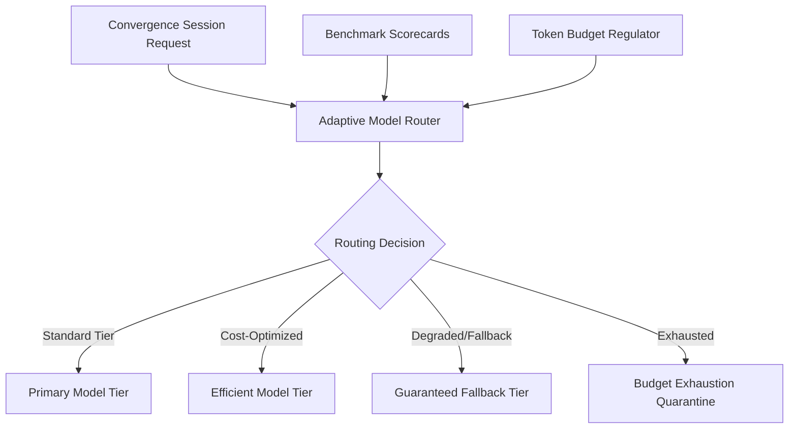

# Adaptive Model Routing & Cost-Optimized Convergence Session Dispatcher

## Executive Summary
The Adaptive Model Routing & Cost-Optimized Convergence Session Dispatcher provides dynamic runtime model selection and token budget governance for convergence sessions. By integrating benchmark scorecard performance percentiles and dynamic cost metrics, the engine routes tasks to the most cost-effective model capable of satisfying quality and latency constraints while enforcing strict budget invariants and degradation fallbacks.

## Architecture & Component Topology

### Core Primitives & Invariants
1. **Model Tier Taxonomy**:
   - `TierPrimary`: High-capacity frontier models designated for complex multi-file architectural synthesis.
   - `TierFast`: Low-latency models designated for single-file implementation, unit tests, and structural triage.
   - `TierFallback`: Deterministic baseline model ensuring session progression under API degradation or rate-limiting.
2. **Routing Table & Rules**:
   - Each scenario profile maps target quality thresholds (PassRate $\ge 0.90$, MaxLatencyMs $\le 5000$) to candidate model tiers.
   - Dynamic routing evaluates latest composite scorecards to select the lowest cost model satisfying scenario constraints.
3. **Budget Governance**:
   - Explicit session token budgets prevent runaway multi-agent orchestration.
   - If accumulated token consumption exceeds the declared budget threshold, subsequent dispatches are quarantined with a budget-exhaustion error rather than silently failing.

## Three-Fold Verification Strategy

### 1. Static Floor Invariant
- Routing rules, tier configurations, and token budgets must conform strictly to typed schemas with non-negative costs and non-empty tier definitions.
- Model tiers must contain valid provider and identifier mappings.

### 2. Operational Dynamic Proof
- Dispatcher routes convergence session requests to the optimal model based on scenario complexity and benchmark scorecards.
- Under balanced policy, standard tasks route to cost-optimized tiers while complex tasks escalate to primary tiers.

### 3. Negative Adversarial Boundary
- If a preferred model tier reports degradation, rate-limits, or anomalous score drops, the router automatically fails over to the fallback tier.
- If total token consumption exceeds the allocated session budget, requests are rejected with a structured `ErrBudgetExhausted` quarantine event.
