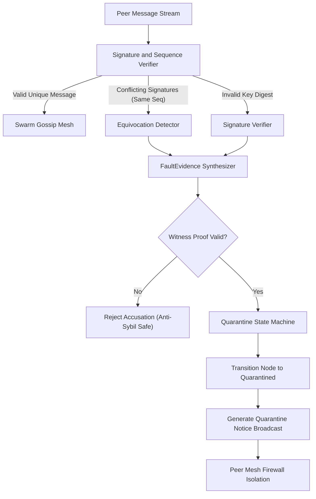

# ADR-0146: Swarm Byzantine Fault Detector and Malicious Actor Quarantining

## Status
Accepted

## Context
In decentralized multi-cluster swarm deployments, peer nodes exchange gossip events, leader heartbeats, and causal shockwave state assertions. In adversarial or partitioned environments, compromised, misconfigured, or malfunctioning nodes may exhibit Byzantine faults:
1. **Equivocation**: Transmitting conflicting state assertions or competing block commitments for the identical view and sequence counter to different peers.
2. **Signature Tampering or Mismatch**: Emitting payload structures where the cryptographic assertion digest fails to reconcile with the sender's public identity key.
3. **State Divergence & Protocol Desynchronization**: Asserting illegitimate epoch hops or invalid causal histories.

Without an autonomous, zero-latency detection and isolation engine, Byzantine actors can induce split-brain conditions, degrade cluster consensus, and pollute downstream CRDT convergence.

## Decision
We implement a zero-allocation, thread-safe Swarm Byzantine Fault Detector (`pkg/community/byzantine_detector.go`).

Key architectural components:
1. **Evidence Verification Engine**:
   - `ByzantineFaultType`: Strict typed taxonomy (`Equivocation`, `SignatureMismatch`, `StateDivergence`).
   - `FaultEvidence`: Holds conflicting signed messages, view number, sequence index, accused node identifier, reporter node identifier, and evidence timestamp.
   - Enforces witness verification: requires authentic cryptographic proofs before penalty application to eliminate false accusation spoofing.

2. **Quarantine State Machine**:
   - Node quarantine lifecycle transitions:
     - `NodeStateHealthy`: Normal participation, trusted for consensus voting and gossip propagation.
     - `NodeStateSuspect`: Anomalous telemetry detected; gossip assertions demoted to provisional observation.
     - `NodeStateQuarantined`: Immediate eviction from leader election quorum and gossip propagation pools. Peer connections severed.
     - `NodeStateExpelled`: Cryptographically revoked node identity; permanent rejection from the swarm cluster.

3. **Automated Peer Mesh Isolation Broadcast**:
   - Upon fault validation, the detector updates the node quarantine record, increments the Byzantine detection metric, and generates a signed `QuarantineNotice` broadcast.
   - Peer nodes verify the enclosed `FaultEvidence` and apply reciprocal firewall boundaries.

## Architecture and Flow

## Consequences
- **Positive**:
  - Deterministic sub-millisecond isolation of malfunctioning or malicious agents.
  - Immune to Sybil accusation attacks through cryptographic witness validation.
  - Fully decoupled and compatible with Raft-Lite consensus and CRDT state convergence.
- **Negative**:
  - Requires maintaining bounded history buffers of recent message signatures per peer node to detect equivocation.
