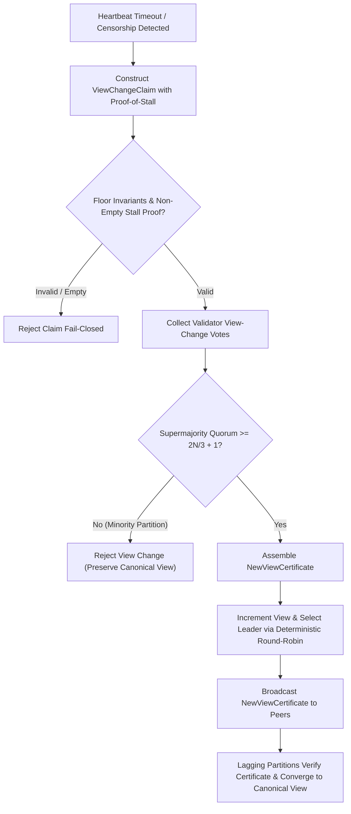

# ADR: Adversarial Byzantine Leader Election & Partition Recovery

## Status
Accepted

## Context
In decentralized multi-cluster swarm deployments, leader-coordinated consensus requires uninterrupted liveness and strict safety guarantees even when nodes experience Byzantine faults, message censorship, or network partitions. Traditional crash-fault-tolerant leader election (such as basic heartbeat-timeout Raft) cannot safely tolerate malicious or equivocating leaders that selectively withhold proposals (censorship), forge view transitions, or exploit asymmetric network partitions to induce dual-leader split-brain states.

Without an adversarial, cryptographically verifiable view-change and partition-recovery protocol:
1. A stalled or censoring leader can block cluster progress indefinitely without triggering deterministic succession.
2. A minority partition can attempt illegitimate view changes, risking divergent state histories.
3. Concurrent or overlapping view-change proposals can produce split-brain dual leaders across partitioned sub-clusters.
4. Rejoining or lagging partitions can fail to reconcile back to the canonical supermajority view.

## Decision
We design and implement the Adversarial Byzantine Leader Election & Partition Recovery engine in `pkg/community/byzantine_leader_election.go`.

Key architectural components and invariants:

1. **View Change Claims & Proof-of-Stall Invariants**:
   - A view-change claim is represented as a typed structure carrying the challenger node identifier, cluster identifier, target view number, heartbeat timeout threshold, and a non-empty cryptographic proof-of-stall payload (e.g., signed silence/timeout attestations or censorship evidence).
   - Static floor invariants validate all identifiers (non-blank cluster, challenger, and validator IDs), strictly positive view numbers and heartbeat timeout durations, and non-empty stall proofs before any state transition occurs.
   - Claims lacking valid stall proofs or referencing non-advancing views fail closed immediately.

2. **Supermajority New-View Certificates & Deterministic Round-Robin Rotation**:
   - View succession requires collecting distinct, valid view-change votes from a Byzantine quorum supermajority of $2f + 1$ (or $\lfloor 2N/3 \rfloor + 1$) replicas in an $N = 3f + 1$ validator set to form a `NewViewCertificate`.
   - Upon certificate verification, the cluster atomically increments the active view number and selects the next leader deterministically via round-robin rotation over the canonical sorted validator roster (`validators[view % len(validators)]`), eliminating non-deterministic election races.

3. **Split-Brain Dual-Leader Immunity**:
   - Only a single canonical leader is permitted per view number. Any heartbeat, proposal, or leader assertion from a node that does not match the deterministic round-robin leader for the current certified view—or that originates from a stale view—is rejected fail-closed.
   - Equivocating or competing leader claims within the same view are detected and rejected, preventing dual-leader split-brain execution across concurrent goroutines via mutex-guarded state transitions.

4. **Minority Partition Rejection & Canonical View Convergence**:
   - View-change attempts originating from partitioned minorities (fewer than $\lfloor 2N/3 \rfloor + 1$ distinct validator attestations) are rejected without mutating the active view or leader state.
   - When a network partition heals and a lagging node or minority partition observes a valid `NewViewCertificate` for a higher view, it verifies the supermajority quorum signatures, fast-forwards its local view and deterministic leader assignment, and converges to the canonical cluster state.

## Architecture and Flow

## Consequences
- **Positive**:
  - Guarantees safety against split-brain dual-leader states under $f < N/3$ Byzantine faults and arbitrary network partitions.
  - Prevents malicious or premature view-change disruption by requiring non-empty proof-of-stall evidence and supermajority quorum certificates.
  - Eliminates election nondeterminism through canonical round-robin leader rotation keyed by view number.
  - Enables deterministic, self-healing convergence when partitioned or lagging replicas reconnect and observe a valid `NewViewCertificate`.
- **Negative**:
  - Requires at least $3f + 1$ replicas with $\lfloor 2N/3 \rfloor + 1$ availability to advance views; if more than $f$ replicas are simultaneously offline, view succession halts safely rather than risking split-brain.
  - Adds quorum certificate verification overhead during view transitions and partition recovery.
- **Verification**:
  - Verified via Static Floor Invariant tests (view-change claim schema, heartbeat timeout bounds, and non-empty stall proof enforcement), Operational Dynamic Proof tests (supermajority new-view certificate assembly, view incrementation, and deterministic round-robin leader rotation), and Negative Adversarial Boundary tests (minority partition rejection, dual-leader split-brain immunity, and lagging partition convergence).
