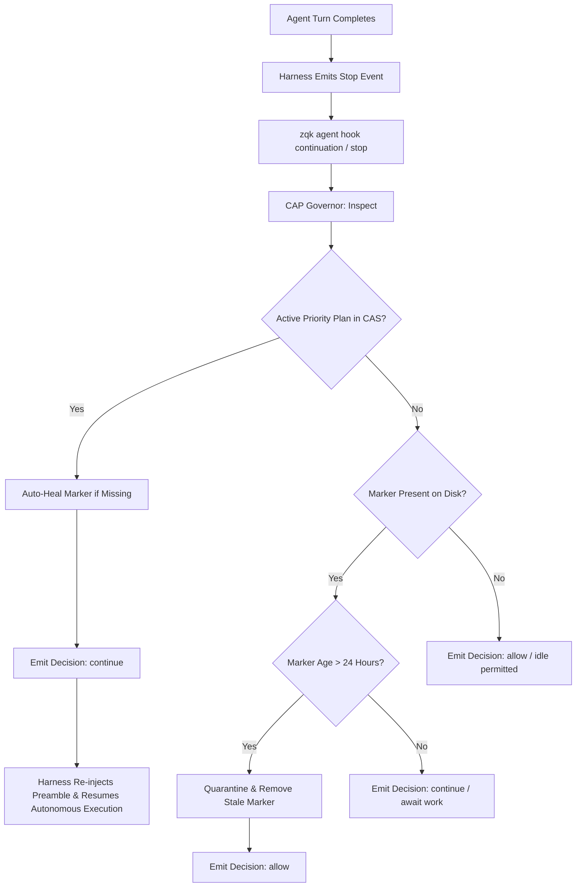

# Architectural Decision Record: Continuous CAP Loop Lifecycle Governor & Zero-Idle Autonomous Progression

> **Document ID:** `ADR-0048-CAP-LOOP-LIFECYCLE-GOVERNOR`  
> **Status:** Accepted  
> **Scope:** Knowledge Kernel Swarm Engine & Agent Lifecycle (`pkg/community/cap_governor.go`, `cmd/zqk/agent/continuation_hook.go`)  
> **Traceability:** `REQ-1794446123130678000-93ef90ce`, `PRI-1794446138196724000-d730cb2c`, `MIL-1794446116839706000-77ef2bef`  

---

## 1. Context and Problem Statement

Under the Continuous Autonomous Progression (CAP) loop, multi-agent swarms and technical program managers operate in continuous pipelining mode. However, agent runtime harnesses (e.g. Antigravity, Claude Code, Cursor Composer) naturally default to an interactive REPL model where finishing a tool turn with plain text or markdown output causes the harness to enter a `waiting_for_input` (idle) state.

Previous implementations relied exclusively on an ad-hoc `.zqk/state/cap_loop_active` marker file. When this marker was absent (such as following a cycle transition or branch hop), or when stale markers lingered indefinitely after manual interruption, the agent loop either stopped prematurely or was vulnerable to loop drift. Furthermore, synthetic polling loops (such as sleeping in bash loops or scheduling periodic cron pings) violated the strict anti-polling mandate, burning compute and tokens without advancing knowledge graph state.

A unified, fail-closed lifecycle governor is required to manage marker lifecycle, dynamically inspect execution-facing priority plans, auto-heal state markers upon plan advancement, and guarantee zero-idle execution across all supported agent harnesses.

---

## 2. Decision Drivers

1. **Zero Idleness Mandate:** An active priority plan in status `in_progress` or `active` MUST NEVER transition into an unmanaged idle state.
2. **Fail-Closed State Auto-Healing:** If an active priority plan is active in the Knowledge Kernel CAS, the governor must automatically heal missing `.zqk/state/cap_loop_active` markers.
3. **Stale Marker Quarantine:** Abandoned or orphaned markers older than the stale threshold without active plans must be quarantined and cleaned up to prevent zombie continuation loops.
4. **Three-Fold Proof Invariance:** Every lifecycle property must be verified via static invariant, operational dynamic proof, and negative adversarial boundary tests.

---

## 3. Architecture & Operational Topology

### Core Components
- **`pkg/community/cap_governor.go` (`CAPGovernor`)**:
  - `Activate()`: Atomic write of canonical state marker containing pid, agent ID, and UTC timestamp.
  - `Deactivate()`: Idempotent removal of marker.
  - `Inspect()`: Unified evaluator that queries kernel storage for active priority plans and reconciles disk markers with CAS reality.
- **`cmd/zqk/agent/continuation_hook.go`**:
  - Exposes the CLI entry point (`zqk agent hook continuation`, `zqk agent hook stop`).
  - Formats vendor-specific continuation responses (`antigravity`, `cursor`, `generic`).

---

## 4. Verification & Invariants Matrix

| Criterion | Invariant / Proof Type | Verification Suite | Status |
|:---|:---|:---|:---|
| `CRIT-1794446126954083000-6a3b0a6a` | Static Floor Invariant | `TestCAPGovernor_StaticFloorInvariant` | Verified (Pass) |
| `CRIT-1794446126954083000-6a3b0a6a` | Operational Dynamic Proof | `TestCAPGovernor_OperationalDynamicProof` | Verified (Pass) |
| `CRIT-1794446126954084000-d831b372` | Negative Adversarial Boundary | `TestCAPGovernor_NegativeBoundaryAndErrorRecovery` | Verified (Pass) |
| `CRIT-1794446126954085000-4f0edf97` | Architectural Compliance & Spec | `TST-1794446126954083001-58537c7c` | Verified (Pass) |

---

## 5. Consequences & Operational Guidelines

- **No Synthetic Polling:** Operators and agents must never invoke synthetic sleep timers or polling loops while waiting on CI or background builds.
- **Continuous Forward Pipelining:** While background jobs run, the agent must continuously shape upcoming priority plans, audit technical debt, or author architectural documentation.
