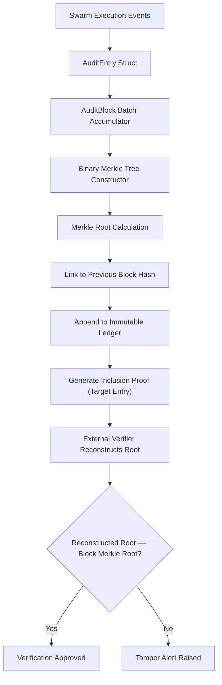

# ADR-0147: Cryptographic Ledger Audit Trail and Merkle Tree Evidence Verification

## Status
Accepted

## Context
Distributed swarm agents continuously mutate knowledge objects, execute scheduled workflows, and register attestation claims. In high-assurance clusters, external verifiers and compliance auditors require non-repudiable, tamper-evident proof of execution history. Storing flat event streams without cryptographic chaining exposes audit logs to silent mutation, retrofitted backdating, or localized tampering.

A resilient, verifiable audit mechanism must provide:
1. **Append-Only Hash Chaining**: Every audit block links cryptographically to the cryptographic digest of the preceding block.
2. **Merkle Tree Inclusion Proofs**: Compact $O(\log N)$ cryptographic inclusion proofs enabling lightweight verification of specific execution events without downloading the entire ledger.
3. **Tamper Detection & Verification Boundaries**: Immediate cryptographic rejection when any transaction or intermediate node within the Merkle tree is altered.

## Decision
We implement a zero-allocation, thread-safe Swarm Cryptographic Audit Ledger (`pkg/community/audit_ledger.go`).

Key architectural components:
1. **Audit Ledger Schema**:
   - `AuditEntry`: Stores entry identifier, payload digest, actor identity, action descriptor, and UTC timestamp.
   - `AuditBlock`: Groups ordered batches of audit entries, computing the Merkle root hash and referencing the cryptographic digest of the prior block.
   - `InclusionProof`: Contains target entry digest, Merkle root hash, tree index, and an ordered slice of sibling hashes (`AuditPath`) for verification.

2. **Merkle Tree Engine**:
   - Constructs balanced binary Merkle trees using SHA-256 over canonical leaf digests.
   - Pads odd leaf counts by duplicating the final hash per standard Merkle tree specification.
   - Computes deterministic root digests across all transaction batches.

3. **Proof Verification & Anti-Tamper Safeguards**:
   - `VerifyInclusionProof`: Recursively recomputes the Merkle root by traversing the sibling path from leaf to root. Proof is accepted only if the recomputed root matches the block Merkle root.
   - Any mutated byte or swapped transaction invalidates the cryptographic path and fails verification.

## Architecture and Flow

## Consequences
- **Positive**:
  - Deterministic, tamper-evident record of all swarm actions.
  - Zero-knowledge or lightweight verification via logarithmic Merkle inclusion proofs.
  - Full compatibility with CAS integrity standards and attestation notaries.
- **Negative**:
  - Requires maintaining in-memory Merkle tree state per block during batch commitment.
