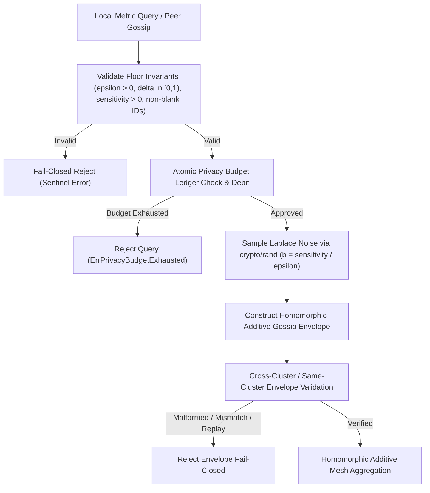

# ADR-0151: Differential Privacy Mesh Synchronization & Homomorphic Gossip Aggregation v0.4.2

## Status
Accepted (Milestone v0.4.2, Cycle 151)

## Context
As autonomous swarms synchronize telemetry, capacity metrics, and execution statistics across decentralized peer-to-peer meshes, raw metric sharing leaks sensitive node-level operational state, workload distributions, and organizational activity patterns. Standard gossip protocols propagate exact local counters or unmasked aggregates, enabling reconstruction attacks by curious or semi-honest peers.

To support privacy-preserving cross-cluster observability and federated coordination without a trusted central aggregator, the Knowledge Kernel requires a differential privacy mesh synchronization layer that provides:
1. **Strict Parameter & Schema Floor Invariants**: Mathematical bounds on privacy loss parameters ($\epsilon$, $\delta$), query sensitivity, and cluster/peer identifiers before any computation or gossip emission occurs.
2. **Cryptographically Secure Laplace Perturbation**: Calibrated noise injection backed by `crypto/rand` rather than deterministic or predictable pseudo-random number generators.
3. **Thread-Safe Privacy Budget Governance**: Atomic accounting of cumulative privacy expenditure across concurrent queries and synchronization epochs.
4. **Homomorphic Additive Gossip Aggregation**: Secure combination of perturbed or masked peer contributions into cluster-wide aggregates without exposing individual node inputs.
5. **Fail-Closed Adversarial Boundary Enforcement**: Immediate rejection of budget-exhausted requests and malformed or cross-cluster gossip envelopes.

## Decision
We design and implement the Differential Privacy Mesh Synchronization and Homomorphic Gossip Aggregation engine in `pkg/community/differential_privacy_gossip.go`:

1. **Epsilon, Delta, and Sensitivity Floor Invariants**:
   - All privacy configurations and metric queries must satisfy strict static floor invariants prior to execution:
     - Privacy loss $\epsilon > 0$ (finite, non-NaN, non-Inf).
     - Failure probability $\delta \in [0, 1)$ (finite, non-NaN, non-Inf).
     - Global $L_1$ sensitivity $\Delta f > 0$ (finite, non-NaN, non-Inf).
     - Non-blank `ClusterID`, `PeerID`, and `MetricKey` validated declaratively via `strutil.ErrorOnBlank`.
   - Violations fail closed immediately with explicit typed sentinel errors before touching the privacy budget or sampling noise.

2. **Calibrated Laplace Noise Perturbation via `crypto/rand`**:
   - Local metric values are perturbed using the Laplace mechanism with scale parameter $b = \Delta f / \epsilon$.
   - Uniform variates $U \in (-0.5, 0.5)$ are derived from `crypto/rand` (64-bit cryptographic entropy mapped away from exact zero boundaries to prevent $\ln(0)$ singularities) and transformed via the inverse Laplace cumulative distribution function:
     $$\text{Lap}(b) = -b \cdot \text{sgn}(U) \cdot \ln(1 - 2|U|)$$
   - Using `crypto/rand` prevents seed-prediction or state-recovery attacks against noise generation across mesh peers.

3. **Thread-Safe Privacy Budget Ledger**:
   - Maintain a concurrency-safe privacy budget ledger guarded by `sync.RWMutex` (or `sync.Mutex` on atomic check-and-debit paths) tracking allocated ceiling, consumed $\epsilon$, consumed $\delta$, and remaining budget per cluster/epoch scope.
   - Budget checks and deductions are executed atomically under lock so concurrent goroutines cannot race past the configured privacy ceiling (sequential composition).

4. **Homomorphic Additive Gossip Envelope Aggregation**:
   - Peers encapsulate perturbed metric shares inside typed gossip envelopes carrying `ClusterID`, `PeerID`, `Epoch`, `MetricKey`, perturbed/masked value, and privacy metadata ($\epsilon$, $\delta$).
   - The homomorphic additive aggregator combines envelopes from distinct peers within the same `ClusterID` and `Epoch` using additive composition, yielding a cluster-level estimate without requiring raw unperturbed peer values to be revealed or persisted.
   - Duplicate peer contributions within the same aggregation epoch are deduplicated or rejected to prevent weight-skewing and replay inflation.

5. **Fail-Closed Adversarial Boundary Rejection**:
   - Queries whose requested $\epsilon$ or $\delta$ would exceed the remaining privacy budget are rejected immediately without partial execution or state mutation.
   - Malformed gossip envelopes (blank identifiers, non-finite values, negative sensitivity, mismatched `ClusterID`, stale or invalid epochs, or duplicate peer submissions) are rejected fail-closed at the ingestion boundary.

## Architecture and Flow

## Consequences
- **Positive**:
  - Guarantees $(\epsilon, \delta)$-differential privacy for swarm telemetry and metric synchronization across untrusted or semi-honest peer meshes.
  - Eliminates predictable PRNG vulnerabilities by sourcing entropy exclusively from `crypto/rand`.
  - Prevents privacy budget exhaustion races under high concurrency via atomic ledger accounting.
  - Supports decentralized additive aggregation without centralizing raw node metrics.
- **Negative**:
  - Introduces calibrated statistical variance proportional to $\Delta f / \epsilon$ into aggregated mesh metrics.
  - Requires explicit epoch and budget lifecycle management so long-running clusters replenish or rotate privacy budgets across epochs.
- **Verification**:
  - Verified via Static Floor Invariant tests (parameter bounds and blank ID rejection), Operational Dynamic Proof tests (Laplace noise calibration, budget ledger accounting, and concurrent `-race` aggregation), and Negative Adversarial Boundary tests (budget exhaustion and malformed envelope rejection).
