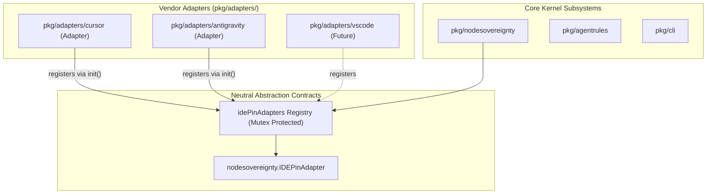

# Architecture Decision Record: IDE Host Adapter Abstraction & Zero-Vendor Hardcoding Invariant

## Status
Accepted

## Context
In open-core distributed multi-agent systems, developers and autonomous agents interact through diverse IDE hosts, CLI harnesses, and editor environments (e.g., Cursor, VSCode, Antigravity, JetBrains). Historically, vendor-specific assumptions and configuration paths (e.g., `.cursor/mcp.json`, hardcoded vendor flags, vendor directory structures) risked leaking into core packages such as `pkg/nodesovereignty`, `pkg/agentrules`, or `pkg/cli`.

Hardcoded third-party vendor logic in core packages violates our architecture principles:
1. It creates tight coupling to external vendor proprietary formats and directory paths.
2. It breaks neutrality and modularity for community adopters using alternate editors or headless runtime harnesses.
3. It creates unmaintainable conditional trees and ad-hoc string comparisons across the core codebase.

## Decision

We establish a strict architectural boundary and invariant:
1. **Zero Vendor-Specific Hardcoding in Core Packages**:
   Core kernel packages (`pkg/nodesovereignty`, `pkg/kernel`, `pkg/storage`, `pkg/agentrules`, etc.) MUST NEVER contain hardcoded vendor product names, hardcoded third-party configuration file paths, or vendor-specific heuristics.
2. **Dedicated Adapter Subpackages**:
   All vendor-specific configurations, pin readers, directory patterns, and IDE interactions must reside strictly within `pkg/adapters/<vendor>/` (e.g., `pkg/adapters/cursor/`, `pkg/adapters/antigravity/`, `pkg/adapters/gemini/`).
3. **Pluggable Interface Registry Pattern**:
   Core subsystems define clean, vendor-neutral contracts (e.g., `nodesovereignty.IDEPinAdapter`). Adapters register themselves via a thread-safe registry function (`nodesovereignty.RegisterIDEPinAdapter(adapter)`):

```go
type IDEPinAdapter interface {
    Vendor() string
    IsGlobalConfig(projectRoot, configPath string) bool
    ReadPin(configPath string) string
    GlobalConfigPath() string
}
```

4. **Dynamic Delegation & Fail-Closed Fallback**:
   Core validation routines (such as `IsGlobalMCPConfig`, `ReadGlobalMCPPin`, and `RefuseGlobalMCPPinRewrite`) iterate registered adapters dynamically. If no registered adapter claims the path, core logic falls back to neutral path heuristics (e.g. standard workspace relative comparisons and generic filename matching) without referencing vendor identities.

## Architecture



## Consequences

- **Decoupled Core**: Core packages remain pure, neutral, and testable without mock third-party environments.
- **Extensibility**: Adding support for a new IDE host requires only authoring an adapter under `pkg/adapters/<new-vendor>/` that registers with the core registry.
- **Verification Integrity**: AST and code audit gates can strictly prohibit vendor string literals in `pkg/kernel`, `pkg/nodesovereignty`, and core command parsers.
