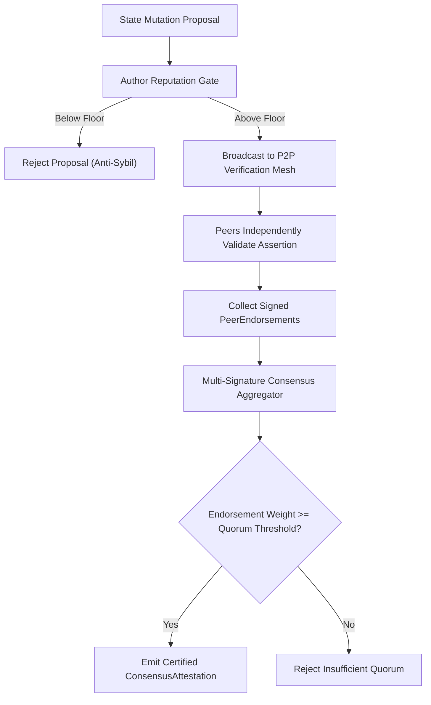

# ADR-0148: Decentralized Peer-to-Peer Verification Mesh and Anti-Sybil Consensus

## Status
Accepted

## Context
In decentralized autonomous clusters, state mutations and cryptographic assertions must be verified collaboratively across peer nodes without relying on centralized verification authorities. However, permissionless or dynamically expanding peer networks are susceptible to Sybil attacks, where an adversary provisions a flood of low-cost, pseudonymous nodes to capture consensus quorum or poison multi-signature assertions.

An effective verification mesh must guarantee:
1. **P2P Verification Mesh Topology**: Dynamic peer discovery and bidirectional peering with strict connection limits.
2. **Reputation-Weighted Anti-Sybil Quotas**: Peer voting weight and signature thresholds calculated using non-linear reputation scores earned through verifiable past service.
3. **Multi-Signature Endorsement Consensus**: Aggregation and threshold verification of independent peer endorsements before admitting proposals to the cluster state.

## Decision
We implement a zero-allocation, thread-safe Decentralized Peer-to-Peer Verification Mesh (`pkg/community/verification_mesh.go`).

Key architectural components:
1. **Verification Mesh Schema**:
   - `PeerMeshNode`: Encapsulates node identity, public key, reputation score, and active peer connection list.
   - `MutationProposal`: Represents an atomic state mutation with proposal ID, author node, payload digest, and timestamp.
   - `PeerEndorsement`: Contains the endorsing node identity, signature over the mutation digest, and endorsement timestamp.

2. **Reputation Scoring & Anti-Sybil Governor**:
   - Minimum reputation floor required for proposal submission and endorsement weighting.
   - Newly connected nodes begin at base reputation and cannot tip threshold consensus until accumulating verified epochs.
   - Identifies and rejects clusters of Sybil nodes whose aggregate reputation fails the required threshold.

3. **Multi-Signature Threshold Consensus Engine**:
   - `VerifyConsensus`: Computes the weighted endorsement sum across distinct verified peers.
   - Rejects duplicate signatures from the same peer and ignores endorsements from unknown or sub-floor nodes.
   - Emits a certified `ConsensusAttestation` upon satisfying quorum requirements.

## Architecture and Flow

## Consequences
- **Positive**:
  - Resilient decentralized verification without central points of failure.
  - Immune to Sybil floods through reputation weighting and admission quotas.
  - Native multi-signature aggregation supporting high-throughput mutation pipelines.
- **Negative**:
  - Increases gossip message traffic as endorsements propagate across the peer mesh.
