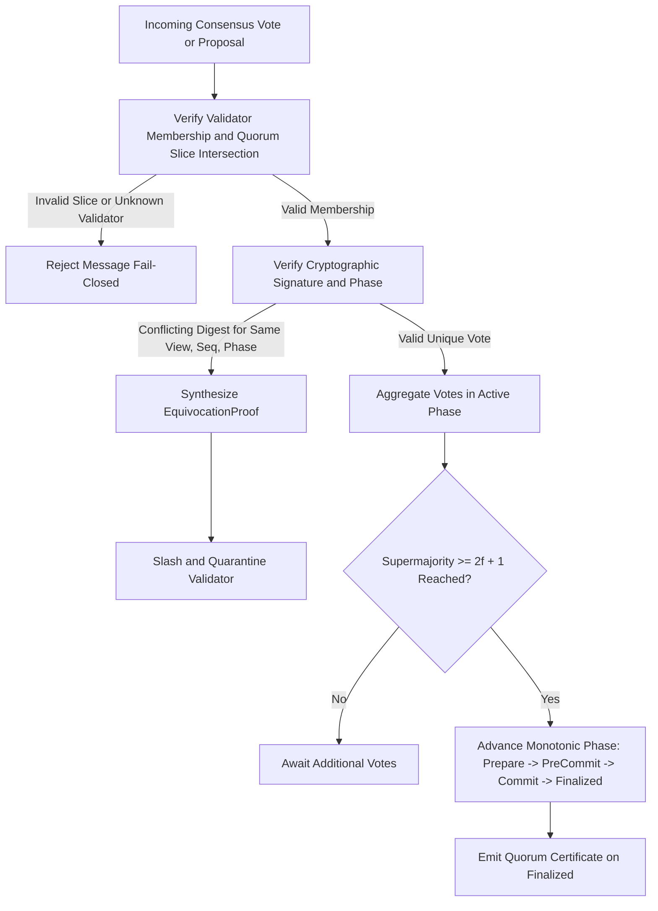

# ADR-0153: Planetary Swarm BFT Consensus Protocol and Quorum Slicing

## Status
Accepted

## Context
In planet-scale decentralized swarm deployments spanning federated regions and heterogeneous trust boundaries, autonomous agent clusters must reach deterministic agreement on shared state proposals, ledger checkpoints, and cross-cluster commitments despite network partitions, asynchronous message delays, and malicious or compromised validators.

Simple crash-fault-tolerant protocols (such as Raft-style leader replication) cannot survive Byzantine faults—where compromised nodes actively equivocate, forge votes, or collude across regions. Conversely, flat all-to-all Byzantine Fault Tolerant (BFT) voting does not scale across planetary topologies without structured trust delegation.

To guarantee both safety (zero conflicting finalizations) and liveness under up to $f$ Byzantine actors, the swarm requires a deterministic consensus engine that combines federated quorum slicing with multi-phase supermajority commit validation and automated equivocation slashing.

## Decision
We implement the Planetary Swarm BFT Consensus Engine (`pkg/community/bft_consensus.go`) to govern multi-phase consensus rounds, federated quorum slice intersection verification, supermajority vote aggregation, and Byzantine equivocation slashing.

Key architectural components:

1. **Quorum Slice Intersection Invariants**:
   - Validators organize trust dependencies into `QuorumSlice` definitions specifying a set of peer validator identifiers and a local threshold.
   - **Intersection Invariant**: Any two valid quorum slices $Q_1$ and $Q_2$ within the consensus domain must share a non-empty intersection ($Q_1 \cap Q_2 \neq \emptyset$) containing at least $f + 1$ validators (guaranteeing at least one honest overlapping validator under $f$ Byzantine faults).
   - Slice topologies violating quorum intersection are rejected fail-closed prior to round participation to prevent split-brain forks.

2. **Supermajority Validation ($3f + 1$ / $2f + 1$)**:
   - A consensus domain tolerating $f$ Byzantine validators requires a minimum validator set size of $N \ge 3f + 1$.
   - Quorum advancement in every voting phase requires a supermajority of at least $2f + 1$ distinct, cryptographically verified validator signatures (or weighted equivalent).
   - Because any two supermajorities of size $2f + 1$ in a set of $3f + 1$ nodes overlap in at least $(2f + 1) + (2f + 1) - (3f + 1) = f + 1$ nodes, at least one honest validator witnesses both quorums, preserving safety across views.

3. **Multi-Phase Consensus State Machine**:
   - Consensus proposals advance strictly monotonically through four phases per `(view, sequence)` tuple:
     - `PhasePrepare`: Leader or proposer broadcasts a proposal digest; validators verify proposal validity and emit signed `Prepare` votes.
     - `PhasePreCommit`: Upon collecting $\ge 2f + 1$ valid `Prepare` votes, validators lock on the proposal digest and broadcast signed `PreCommit` votes.
     - `PhaseCommit`: Upon collecting $\ge 2f + 1$ valid `PreCommit` votes, validators enter the `Commit` phase and broadcast signed `Commit` votes.
     - `PhaseFinalized`: Upon collecting $\ge 2f + 1$ valid `Commit` votes, the proposal transitions to `Finalized`, sealing an immutable quorum certificate and preventing any competing proposal at the same sequence.
   - Phase skipping, backward transitions, and duplicate votes from the same validator in the same `(view, sequence, phase)` are rejected fail-closed.

4. **Byzantine Equivocation Detection and Slashing**:
   - The consensus engine indexes every observed vote by `(validatorID, view, sequence, phase)`.
   - If a validator emits two distinct proposal digests for the same `(view, sequence, phase)` with valid signatures, the engine immediately constructs an `EquivocationProof` containing both conflicting signed votes.
   - Upon proof verification, the validator is marked slashed and quarantined: its voting weight is zeroed, its active votes are excluded from supermajority tallying, and a slashing record is emitted for downstream peer mesh isolation.

## Architecture and Flow

## Consequences
- **Positive**:
  - Guarantees deterministic safety and zero conflicting finalizations with up to $f$ Byzantine validators when $N \ge 3f + 1$ and quorum slice intersection holds.
  - Prevents phase-skipping and equivocation attacks through strict monotonic state transitions and cryptographic slashing proofs.
  - Enables federated planetary scaling via structured quorum slices rather than flat unstructured broadcast.
- **Negative**:
  - Multi-phase commit introduces additional round-trip coordination latency compared to crash-fault-only replication.
  - Requires maintaining bounded per-round vote indices to detect equivocation across active views.
