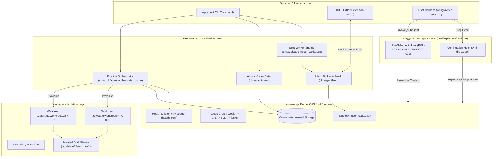
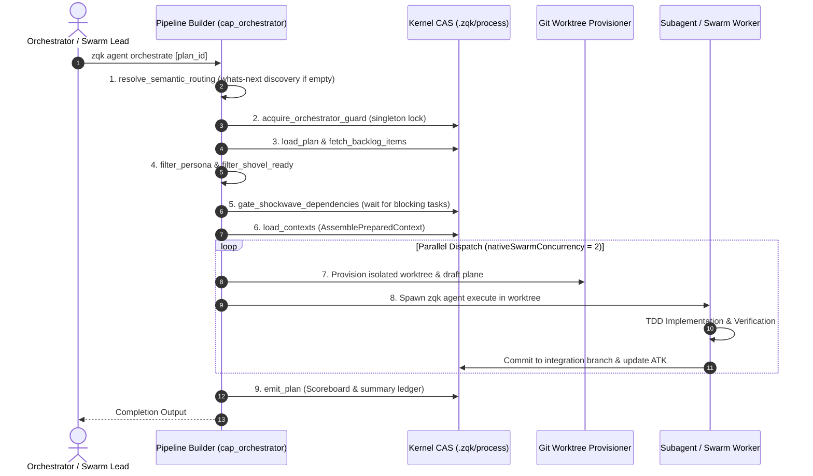
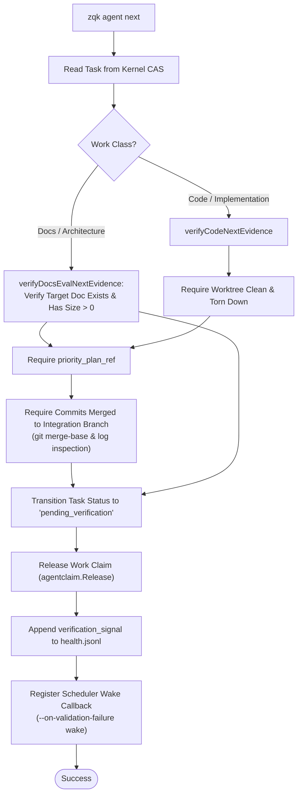
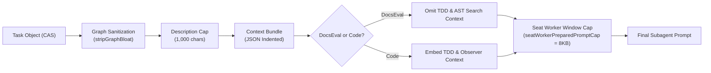

# Agent Subsystem and Seating Guide: Architecture Specification & Conformance

**Document ID:** `DOC-AGENT-SUBSYSTEM-AND-SEATING-GUIDE-001`  
**Target Release:** Zen Quantum Kernel v0.1.0+ (Cycle 92)  
**Authoring Personas:**  
- `PER-COMMUNITY-SOFTWARE-ENGINEER` (Software Engineer)  
- `PER-SYSTEMS-ARCHITECT` (Systems Architect)  
- `PER-TECHNICAL-DOCUMENTARIAN` (Technical Documentarian)  
**Status:** Canonical / Enforced  

---

## 1. Executive Summary & Architectural Mission

The **ZQK Agent Subsystem** (`cmd/zqk/agent`, `pkg/agentclaim`, `pkg/agentfeed`, `pkg/agentprompt`, `pkg/seatworker`) delivers a sovereign, deterministic runtime environment for autonomous multi-agent software engineering. In contrast to transient, prompt-promiscuous chat harnesses that rely on unanchored LLM context and volatile shell loops, ZQK grounds agent execution in a persistent, content-addressed Knowledge Kernel CAS (`.zqk/process`).

Within the ZQK paradigm:
1. **Agents are seated, stateful actors:** Operating seats are assigned discrete personas (`PER-*`), capabilities, execution lanes, and communication membranes via `.zqk/state/mesh/peer_seats.json`.
2. **Work is partitioned and isolated:** Concurrent swarm tasks execute inside dedicated, ephemeral git worktrees with isolated draft planes (`.zqk/state/object_drafts`), preventing cross-agent disk contamination.
3. **Execution is contract-bound and fail-closed:** Work items (`BLI-*`) cannot be started without atomic leasing (`zqk agent claim`), cannot proceed without rich ontological context (`zqk agent prepare-context`), and cannot complete without automated proof of implementation (`zqk agent next`).
4. **Autonomous progression is uninterrupted:** Vendor-agnostic continuation hooks (`zqk agent hook continuation`) prevent premature session idling under the Continuous Autonomous Progression (CAP) flywheel.

This document serves as the canonical architectural specification, command taxonomy reference, and conformance guide for the entire agent subsystem.

---

## 2. Agent Subsystem Architecture Overview

### 2.1 Component Topology

The agent subsystem coordinates multi-agent cognition, workspace isolation, inter-agent messaging, and OS process lifecycle across five primary layers:



### 2.2 Core Tenets

1. **Seated Personas over Anonymous LLM Prompts:**  
   Every agent process or subagent invocation binds to a verified persona definition (`PER-*`) loaded from kernel CAS. Personas govern tool boundaries, code style constraints, and architectural duties.
2. **Deterministic Workspace Sandboxing:**  
   When `zqk agent orchestrate` dispatches tasks in parallel, each task receives an isolated git worktree branch (`swarm/<atk-id>`). Worktrees share repository git history without write-lock contention. The runtime strictly isolates the transactional draft plane (`.zqk/state/object_drafts`), ensuring changes in one worktree never leak into parallel branches before integration.
3. **AST-Enforced Verification Gates:**  
   Advancing a task requires code and test evidence. Purely synthetic or simulated task completion is blocked by the fail-closed verification pipeline in `zqk agent next`.
4. **Idleness as an Anti-Pattern:**  
   Autonomous development requires agents to advance continuously across cycle milestones. Stopping tool execution transitions sessions to idle; lifecycle hooks intercept harness termination and inject continuation directives until the active priority plan is complete.

---

## 3. Command Taxonomy & Lifecycle Management

The `zqk agent` command family provides a complete CLI surface for human operators, orchestrators, and automated background workers.

```
zqk agent
├── orchestrate       # High-level pipeline dispatching for plans and backlog items
├── prepare-context   # Context hydration and prompt assembly for subagents
├── claim             # Atomic task lease acquisition with Hourglass supervision
├── claim-gate        # Fail-closed pre-write execution and task assignment gate
├── release           # Explicit or forced lease surrender
├── next              # Evidence-verified milestone progression to pending_verification
├── status            # Real-time hive observability and goroutine budget status
├── scoreboard        # Idle duration ledger and historical latency metrics
├── seat-worker       # Persistent headless background worker daemon
├── recover           # Diagnostic recovery for stalled or failed agent tasks
├── evaluate          # Agent delivery compliance and score evaluation
├── hook              # Lifecycle hooks (pre-subagent context binding & continuation)
│   ├── pre-subagent  # Intercepts invoke_subagent to inject kernel context
│   └── continuation  # Intercepts session termination during active CAP loops
└── validate          # Verification check for agent subsystem configurations
```

---

### 3.1 `zqk agent orchestrate`

`zqk agent orchestrate [plan_id]` builds and executes a multi-stage instrumented pipeline (`pkg/pipeline`) that translates high-level priority plans (`PRI-*`) into parallel, executed backlog items (`BLI-*`) and agent tasks (`ATK-*`).

#### Pipeline Execution Stages



1. **`resolve_semantic_routing`:** If no `plan_id` is supplied, queries `whatsnext.QueryRequest` to locate the active priority plan and mission from the kernel graph.
2. **`acquire_orchestrator_guard`:** Enforces mutual exclusion via `singleton.AcquireOrchestratorGuard` (`.zqk/state/orchestrator.lock`), preventing conflicting orchestrators from competing over the same workspace.
3. **`load_plan` & `fetch_backlog_items`:** Traverses child backlog items linked via `priority_plan_ref` or `backlog_item_refs`.
4. **`filter_persona`:** Matches task `persona_refs` against targeted worker personas or assigned seats.
5. **`filter_shovel_ready`:** Discards items already in terminal states (`complete`, `archived`, `cancelled`, `implemented`, `pending_verification`).
6. **`gate_shockwave_dependencies`:** Evaluates topological dependencies. If an item depends on upstream deliverables, the orchestrator halts dispatch until upstream outputs are confirmed.
7. **`load_contexts`:** Executes `AssemblePreparedContext` to construct rich, token-budgeted prompt envelopes.
8. **`dispatch_parallel`:** Provisions dedicated git worktrees under `.zqk/state/worktrees/<task-id>`, seeds runtime index files, isolates draft planes, and spawns worker execution threads with process-group supervision (`Setpgid: true`, SIGKILL on timeout).
9. **`emit_plan`:** Records completion timestamps, updates the global telemetry ledger, and outputs routing receipts.

---

### 3.2 `zqk agent prepare-context`

`zqk agent prepare-context <task_id> [flags]` is the unified cognition gateway for agent prompt construction. It hydrates the process task subgraph, pulls related requirements and criteria, formats TDD directives, and embeds AST observer context.

#### Command Flags & Options
- `--persona-ref <string>`: Target persona to govern prompt styling and role expectations.
- `--description <string>`: Fallback textual task description when hydrating outside a persisted task object.
- `--tdd`: Explicitly injects continuous verification directives and the Three-Fold Proof rules.
- `--depth <int>`: Traversal depth for upstream dependency graph hydration (default: `1`).
- `--format agent-prompt`: Emits clean, raw markdown optimized for direct injection into subagent harnesses.

#### Context Assembly Flow (`AssemblePreparedContext`)
Every cognition pathway (CLI `prepare-context`, `seat-worker`, and `pre-subagent` hook) delegates to `AssemblePreparedContext` in `cmd/zqk/agent/prepared_context.go`:
- **Subgraph Traversal:** Queries task relations, fetching parent requirements (`REQ-*`), child criteria (`CRIT-*`), and upstream deliverables.
- **Bloat Stripping:** Drops oversized runtime metadata, truncates verbose task descriptions at 1,000 characters, and removes unindexed graph noise.
- **Work Class Classification:** Evaluates task titles and descriptions using `agentprompt.ClassifyWorkClass`. When classified as `WorkClassDocsEval` (documentation, architecture specifications, reports), TDD and Go AST observer search cues are bypassed to prevent context pollution.
- **Upstream Verified Deliverables:** If preceding tasks in the dependency DAG produced verified artifacts (e.g. schema files, binaries, reports), they are explicitly listed in an `## Upstream Verified Deliverables` section for immediate consumption.

---

### 3.3 `zqk agent claim` and `zqk agent release`

ZQK enforces strict single-claimant leasing over all executable items (`BLI-*`, `ATK-*`) through `pkg/agentclaim`.

#### Atomic Claiming (`zqk agent claim <task_id>`)
- **Flags:**
  - `--by <claimant>`: The agent identifier or seated persona claiming the task (defaults to ambient caller identity).
  - `--checkin-cadence <duration>`: Maximum permissible interval between progress check-ins (e.g., `15m`).
  - `--hourglass-on`: Activates the background watchdog timer. If the claimant fails to check in before deadline expiration, the task is marked orphaned and returned to the occupiable pool.
- **Lease Invariants:**
  - An item already claimed by an active agent cannot be claimed by another without explicit release or lease expiration.
  - Claims update `claimed_by` and `claimed_at` timestamps atomically within the storage provider.
  - The CLI outputs `checkin_due`, informing the agent of its liveness contract.

#### Work Release (`zqk agent release <task_id>`)
- Releases the claim lock and returns the task to the unassigned pool.
- Supports `--force` for administrative override by coordinators when recovering orphaned tasks.

#### The Claim Gate (`zqk agent claim-gate`)
Used in automated workflows and pre-commit hooks to block unassigned or rogue modifications. It evaluates whether the calling agent possesses a valid active claim. If unauthorized, it executes `dec.Electrocute(ctx)`, failing closed and preventing unapproved file mutations.

---

### 3.4 `zqk agent next`

`zqk agent next <task_id>` transitions an in-flight task to `pending_verification`. It acts as the primary quality gatekeeper, enforcing that no work can be marked complete without verified physical evidence.



#### Fail-Closed Invariants Enforced by `agent next`:
1. **Worktree Teardown Requirement:** For code tasks, the temporary task worktree (`.zqk/state/worktrees/<task-id>`) must be committed, merged, and fully deleted before advancing.
2. **Priority Plan Integration:** Every code change must link to a parent `priority_plan_ref`. The commit SHA must be reachable from the designated integration branch (`git merge-base --is-ancestor`).
3. **Documentation Verification:** For `docs_eval` tasks, the target documentation path specified in the task description or artifact list must exist on disk and possess non-zero file size.
4. **Mandatory Failure Callback Registration:** The command registers a `scheduler_job` callback (`--on-validation-failure wake`). If downstream verification suites fail, the scheduler emits a high-priority wake event directly to the claimant. Omitting or disabling this callback (`--on-validation-failure none/off`) is strictly rejected.

---

### 3.5 Observability: `zqk agent status` and `scoreboard`

#### `zqk agent status`
Provides a real-time console view into active swarm operations:
- **Active Swarm Workers:** Lists all tasks currently in `in_progress`, `pending_verification`, `executing`, or `routed` states, along with claimant IDs and last-modified timestamps.
- **Stalled Plan Detection:** Scans the kernel for in-progress priority plans with zero active workers, displaying actionable CLI commands to resume execution (e.g. `zqk agent orchestrate <pri-id>`).
- **Goroutine Budget Status:** Reports active concurrency utilization against the shared goroutine quota (`goroutinelabels.DefaultBudget`).

#### `zqk agent scoreboard`
Surfaces historical idle duration metrics recorded in the persistent idle store (`.zqk/state/agent_idle_store.json`). It measures turn-around latency, idle gaps between task completions, and scheduler response times, allowing operators to diagnose bottlenecked workflows.

---

### 3.6 Lifecycle Hooks: `zqk agent hook`

The `zqk agent hook` command group integrates directly with the agent harness execution loop to enforce kernel policies transparently.

#### Pre-Subagent Hook (`zqk agent hook pre-subagent`)
Governed by `POL-AGENT-SUBAGENT-CTX-001`. Intercepts host agent `invoke_subagent` calls:
- Parses the input payload from standard input.
- Scans child subagent prompts for task identifiers (`ATK-*`, `BLI-*`, `PRI-*`).
- Automatically hydrates and prepends complete kernel context (`AssemblePreparedContext`) into the prompt.
- Emits an `allow` decision with modified subagent prompts, preventing cold-start failures where subagents run without necessary relational data.

#### Continuation Hook (`zqk agent hook continuation`)
Governed by `POL-DEFAULT-ec4baffc4448367c`. Intercepts host agent `Stop` events:
- Checks for the presence of the active CAP loop marker (`.zqk/state/cap_loop_active`).
- If active, queries the kernel for the current in-progress priority plan and checks for unacknowledged inbox messages (`agentfeed`).
- If work remains, emits `{"decision": "continue", "reason": "CONTINUOUS AUTONOMOUS PROGRESSION (CAP LOOP)..."}` back to the harness, forcing the agent model to continue executing without going idle.
- If the marker is absent (indicating interactive user mode), emits `{"decision": "allow"}`, permitting normal prompt return.

---

## 4. Seating Model & Inter-Agent Coordination

In distributed multi-agent operations, tasks must be routed to specialized personas with clear roles, capabilities, and communication handles. ZQK formalizes this through the **Seating Model**.

### 4.1 Persona Specifications (`PER-*`)

Personas are versioned kernel objects defining functional roles. Standard personas include:
- `PER-ORCHESTRATOR-ALPHA`: High-level workflow orchestration, plan decomposition, and swarm dispatch.
- `PER-COMMUNITY-SOFTWARE-ENGINEER`: General software engineering, feature implementation, refactoring, and bug fixes.
- `PER-SYSTEMS-ARCHITECT`: Architectural governance, specification authoring, boundary definition, and ADRs.
- `PER-TEST-ENGINEER`: QA, verification suite construction, regression testing, and invariant validation.
- `PER-TECHNICAL-DOCUMENTARIAN`: System documentation, user guides, API references, and architecture guides.

### 4.2 The Mesh Topology: `peer_seats.json`

The mesh seating registry resides at `.zqk/state/mesh/peer_seats.json` (canonical relative path: `pkg/paths.PeerSeatsFile`). It defines the live mapping between agent instances, OS processes, and communication membranes.

```json
{
  "schema_version": "2.0.0",
  "seats": {
    "coordinator-seat": {
      "pid": 48219,
      "conversation": "3294ba29-cfcc-4639-b747-359342ae46de",
      "wake": "mcp",
      "persona_ref": "PER-ORCHESTRATOR-ALPHA",
      "duty": "coordinator",
      "lane": "primary",
      "note": "Primary interactive orchestrator session"
    },
    "worker-seat-1": {
      "pid": 48301,
      "conversation": "subagent-c10ca704",
      "wake": "agentapi",
      "persona_ref": "PER-COMMUNITY-SOFTWARE-ENGINEER",
      "duty": "worker",
      "lane": "execution-lane-1",
      "worker_lane": "execution-lane-1",
      "note": "Dedicated craftsman execution seat"
    }
  }
}
```

#### Seat Record Schema Fields
- `pid` (int): Operating system process ID of the seated worker.
- `conversation` (string): Host harness conversation ID for direct message routing.
- `wake` (string): The interrupt membrane used to alert the seat (`mcp`, `agentapi`, `stamp`).
- `persona_ref` (string): The kernel persona object bound to this seat.
- `duty` (string): `coordinator` (manages plans, delegates) or `worker` (claims items, writes code).
- `lane` / `worker_lane` (string): Swarm execution queue lane for load balancing.
- `note` (string): Human-readable operational description.

### 4.3 Wake Membranes & MCP Bridge

ZQK supports three distinct interrupt membranes for inter-seat notifications:

| Membrane | Identifier | Transport Mechanism | Target Role | Description |
|:---|:---|:---|:---|:---|
| **MCP** | `mcp` | MCP `ActionRequired` event | Interactive Coordinator / IDE | Bridges kernel notifications directly into IDE chat surfaces. Alerts the human or lead agent when decisions or reviews are required. |
| **Agent API** | `agentapi` | Terminal signals & subagent messaging | Headless Workers / Subagents | Signals seated worker processes or subagent threads to resume execution on an assigned task. |
| **Stamp** | `stamp` | File-based append (`feed.jsonl`) | Non-interrupt logging | Persists correspondence stamps without triggering synchronous process interrupts. |

---

## 5. Subagent Context Binding & Token Discipline

A critical failure mode in multi-agent swarms is **context loss during delegation**: a parent orchestrator delegates a task to a subagent, but the subagent starts cold without knowing the repository layout, architectural constraints, or acceptance criteria.

### 5.1 The `POL-AGENT-SUBAGENT-CTX-001` Policy

`POL-AGENT-SUBAGENT-CTX-001` mandates:
> No subagent shall be invoked without complete, verified Knowledge Kernel context. Orchestrators must not rely on hand-typed prompt instructions alone.

The subsystem enforces this at two levels:
1. **Explicit Preparation:** Orchestrators run `zqk agent prepare-context <task_id>` to generate a complete prompt bundle before invoking subagents.
2. **Transparent Pre-Subagent Hook:** If an agent invokes a subagent directly via `invoke_subagent` without including kernel context, `zqk agent hook pre-subagent` automatically intercepts the tool call, fetches the referenced task from kernel CAS, and prepends the hydrated context bundle.

### 5.2 Token Budgeting & Window Preservation

While subagents require rich context, dumping entire dependency trees and file histories exhausts LLM context windows. The agent subsystem enforces strict token discipline:



1. **Description Truncation:** Large task descriptions are trimmed at 1,000 characters with an explicit `... (truncated)` marker.
2. **Bloat Stripping (`stripGraphBloat`):** Unnecessary relationship arrays and historical metadata are omitted from the bundled JSON.
3. **Work Class Specialization:** When a task is classified as `WorkClassDocsEval`, code-specific TDD boilerplate and AST grep results are omitted, saving 4KB–8KB of token space.
4. **Seat Worker Buffer Caps:** For persistent background daemons, prompts are capped at 8,000 bytes (`seatWorkerPreparedPromptCap`) and steering messages at 4,000 bytes (`seatWorkerSteerCap`). Truncated prompts append a clear directive footer instructing the agent to read full paths from disk.

### 5.3 Test-Driven Development (TDD) Embedding

For implementation tasks, `AssemblePreparedContext` embeds mandatory TDD directives (`POL-DEFAULT-f746cccc03ce5694`):
- **Phase 1: Scope & Existing Test Inspection** — Read target files and existing test suites to establish baseline behavior.
- **Phase 2: Code Implementation & Mutation** — Apply edits that satisfy acceptance criteria while maintaining existing test invariants.
- **Phase 3: Automated Verification & Regression Check** — Execute test suites locally to prove zero regressions.
- **Phase 4: Evidence Summary** — Document verified test results and modified file paths.

If a task underwent previous validation failures, a `SupervisionEnvelope` injects **contrastive retry prompts**, detailing past failure modes and explicitly instructing the agent on how to avoid recurrence.

---

## 6. Operational Verification & Invariant Proofs

The agent subsystem adheres to the **Three-Fold Proof** verification model, ensuring robust operational integrity across static, dynamic, and adversarial boundaries.

### 6.1 Verification Matrix

| Verification Dimension | Proof Type | Verification Suite | Invariant Verified |
|:---|:---|:---|:---|
| **Static Floor Invariant** | Static AST & Schema Analysis | `TestElevation_Agent_ValidateCmd`<br>`TestElevation_Agent_Processor_Branches` | All CLI commands, builders, flags, and processor security bindings compile with zero reflection leaks and adhere to declarative specifications. |
| **Operational Dynamic Proof** | End-to-End Pipeline Execution | `TestElevation_Agent_ClaimAndRelease_Extended`<br>`TestElevation_Agent_Scoreboard_Execution`<br>`TestContinuationHook_AntigravityActivePlan` | Claiming, lease expiration, status reporting, continuation hooks, and scoreboard metrics function correctly under live storage CAS. |
| **Negative Adversarial Boundary** | Boundary & Defect Rejection | `TestElevation_Agent_ClaimGate_Comprehensive`<br>`TestElevation_Agent_Next_ValidationFailures`<br>`TestContinuationHook_BoundaryValidationAndErrorRecovery` | Unseated claims, unassigned writes, missing priority plan links, dirty worktrees, and invalid hook payloads fail closed without panic or state corruption. |

### 6.2 Fail-Closed Invariants Checklist

Operators and agents must maintain these non-negotiable operational invariants:

- [x] **No Unseated Swarm Execution:** Agent tasks cannot be executed by unknown actors; claims require valid claimant identities resolved from ambient credentials or `peer_seats.json`.
- [x] **No Dirty Task Transitions:** `zqk agent next` refuses to transition code tasks to `pending_verification` if ephemeral worktrees still exist or if changes have not been merged to the integration branch.
- [x] **No Scope Hijacking:** In-flight tasks cannot be mutated to append unrelated features. New requirements demand new backlog items.
- [x] **No Unhandled Failures:** Validation failure callbacks (`--on-validation-failure wake`) cannot be turned off, guaranteeing that failed tests alert the claimant immediately.
- [x] **No Stale Branching:** Integration branches must branch directly from up-to-date `origin/main` (`POL-WORKFLOW-003`).

---

## 7. Command Reference & Cheat Sheet

```bash
# -----------------------------------------------------------------------------
# ORCHESTRATION & DISPATCH
# -----------------------------------------------------------------------------
# Orchestrate active priority plan discovered from kernel
zqk agent orchestrate

# Orchestrate explicit plan with 2-hour timeout
zqk agent orchestrate <plan_id> --timeout 2h

# Hydrate rich subagent prompt context
zqk agent prepare-context <bli_id> --format agent-prompt

# -----------------------------------------------------------------------------
# WORK CLAIMING & LIFECYCLE
# -----------------------------------------------------------------------------
# Claim backlog item with 15-minute check-in cadence
zqk agent claim <bli_id> --by worker-seat-1 --checkin-cadence 15m --hourglass-on

# Advance verified item to pending_verification
zqk agent next <bli_id>

# Release work claim
zqk agent release <bli_id> --by worker-seat-1

# -----------------------------------------------------------------------------
# OBSERVABILITY & HEALTH
# -----------------------------------------------------------------------------
# Inspect real-time hive worker status and stalled plans
zqk agent status

# View agent idle duration scoreboard
zqk agent scoreboard

# -----------------------------------------------------------------------------
# LIFECYCLE HOOKS
# -----------------------------------------------------------------------------
# Evaluate pre-subagent context injection hook
zqk agent hook pre-subagent --vendor antigravity < tool_call.json

# Evaluate anti-idle continuation hook
zqk agent hook continuation --vendor antigravity
```

---

## 8. Relational Manifest & Verification

- **Domain Scope:** Autonomous Swarm Orchestration & Agent Seating Subsystem
- **Implementation Package:** [`cmd/zqk/agent`](file:///Users/lanceettl/zqk-public-candidate/cmd/zqk/agent)
- **Supporting Core Libraries:**
  - [`pkg/agentclaim`](file:///Users/lanceettl/zqk-public-candidate/pkg/agentclaim)
  - [`pkg/agentfeed`](file:///Users/lanceettl/zqk-public-candidate/pkg/agentfeed)
  - [`pkg/agentprompt`](file:///Users/lanceettl/zqk-public-candidate/pkg/agentprompt)
  - [`pkg/seatworker`](file:///Users/lanceettl/zqk-public-candidate/pkg/seatworker)
- **Verification Invariant:** Automated test coverage elevates statement coverage across CLI agent subcommands to $\ge 80.0\%$ with deterministic error isolation, subagent hook context injection, and seat worker lifecycle supervision.
