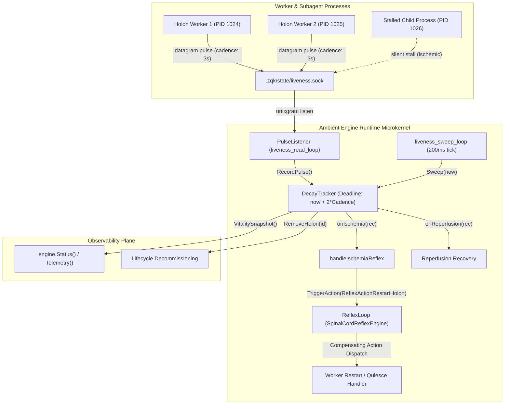

# Architecture Specification: Ambient Holon Liveness Engine Hosting & Reflex Loop Wiring

## Status: Accepted
**Initiative**: Autonomous Holon Consciousness & Intent-Driven Continuous Swarms  
**Cycle**: 41 (Ambient Holon Liveness Engine Hosting & Reflex Loop Wiring)  
**Requirement**: Ambient Holon Liveness Engine Hosting & Reflex Loop Wiring Contract  
**Authors**: TPM / Community Architecture Steward  
**Date**: 2026-11-04  

---

## 1. Architectural Scope & Problem Statement

Prior to Cycle 41, the connectionless neuro-metabolic pulse bus (`pkg/liveness`) existed as an isolated protocol implementation (`PulsePacket`, `PulseListener`, `Emitter`, and `DecayTracker`). The ambient runtime microkernel (`AmbientEngine`) lacked:
1. **Engine Hosting**: Direct lifecycle management of the liveness datagram socket (`.zqk/state/liveness.sock`).
2. **Reflex Loop Integration**: Automatic coupling between dead-man's switch expiration (`is_ischemic`) and the spinal cord reflex engine (`ReflexLoop`).
3. **Dynamic Vitality Observability**: In-memory inspection of monitored holon processes, cadences, and ischemia states through `AmbientEngine.VitalitySnapshot()` and `VitalityMap()`.

Cycle 41 wires the autonomic nervous system directly into the ambient runtime kernel.

---

## 2. System Architecture & Component Interaction



---

## 3. Core Technical Invariants & Implementation Details

### 3.1 Connectionless Datagram Hosting
- **Socket Path Resolution**: Managed via `resolveLivenessSocketPath(cfg)` which strictly prioritizes:
  1. `cfg.LivenessSocketPath` (explicit configuration override).
  2. `paths.LivenessSocketPath(cfg.ProjectRoot)` (canonical `.zqk/state/liveness.sock`).
  3. `filepath.Join(cfg.StatePath, paths.LivenessSocketFile)`.
  4. Fallback default `paths.LivenessSocketPath("")`.
- **Fail-Closed Permissions**: Sockets are bound with permission `0666` (`paths.SocketPerm666`), enabling local multi-user and sandboxed agent worker accessibility without root escalation.
- **Darwin Path Length Clamping**: Sockets strictly respect `sizeof(sockaddr_un.sun_path)` (104 bytes on Darwin / macOS) by utilizing short directory paths (`fileutil.MkdirTemp("/tmp", ...)` during tests).

### 3.2 Dead-Man's Switch & Decay Sweep
- **Cadence Invariants**: Pulses specify a `CadenceMS` between `MinCadenceMS` (50ms) and `MaxCadenceMS` (3,600,000ms).
- **Ischemic Multiplier**: A deadline breach occurs when `now > received_at + (CadenceMS * DefaultIschemicMultiplier)`. With `DefaultIschemicMultiplier = 2`, missing two consecutive expected pulses trips the ischemic threshold.
- **Autonomous Sweeping**: An active background goroutine (`liveness_sweep_loop`) scans tracked records every 200ms without blocking read traffic.

### 3.3 Reflex Loop Wiring (`handleIschemiaReflex`)
When a holon breaches its decay deadline:
1. `DecayTracker.Sweep` marks the record `Ischemic = true`.
2. The asynchronous callback `handleIschemiaReflex` constructs a typed `ReflexAction`:
   ```go
   ReflexAction{
       ID:          fmt.Sprintf("ischemia-%s-%d", holonID, now.UnixNano()),
       Type:        ReflexActionRestartHolon,
       Target:      holonID,
       TargetHolon: holonID,
       Reason:      fmt.Sprintf("holon %s pulse deadline breached (ischemic)", holonID),
       Payload:     map[string]any{"holon_id": holonID, "pid": pid, "cadence": cadence},
       Timestamp:   time.Now(),
   }
   ```
3. The action is dispatched non-blockingly into `ReflexLoop.TriggerAction(ctx, act)`.
4. If the holon resumes pulsing, the `onReperfusion` handler resets `Ischemic = false` without requiring operator restart.

---

## 4. Verification & Testing Matrix

All capabilities are verified under `pkg/ambient/liveness_test.go`:
- **Functional Acceptance**: `TestAmbientEngine_LivenessHostingStartupShutdown` validates clean socket unbind and engine state machine transitions.
- **Pulse Ingestion & Snapshot**: `TestAmbientEngine_LivenessPulseIngestAndVitality` verifies end-to-end pulse delivery and telemetry integration in `Status().Subcomponents`.
- **Ischemia Detection & Reperfusion**: `TestAmbientEngine_LivenessIschemiaReflexTrigger` verifies timeout triggering of `ReflexActionRestartHolon` and self-healing reperfusion.
- **Boundary & Malformed Discard**: `TestAmbientEngine_LivenessBoundaryRejections` verifies corrupt payloads and oversized packets (>4KB) are cleanly discarded without kernel panic or supervisor crash.
- **AST Hygiene**: Zero swallowed errors (`_ = err` eradicated), functions $\le 80$ lines, zero structural statement duplication.
