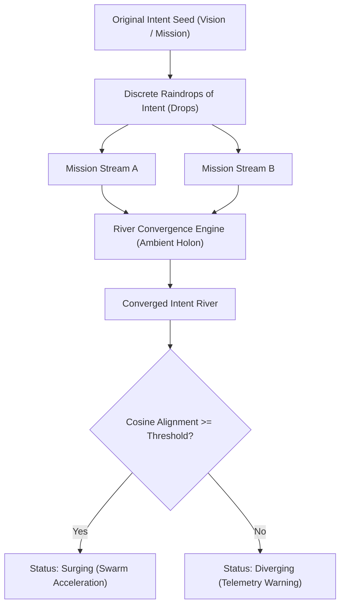

# Ambient Spinal Cord & Intent River Convergence Engine

## Overview

The **Ambient Spinal Cord & Intent River Convergence Engine** embodies the biological metaphor of rudimentary consciousness forming across the ZQK Knowledge Kernel. Initial human intent serves as the seed planted on the mountain. Individual actions, agent tasks, and swarm initiatives act like raindrops pooling into rivulets and streams. 

As these streams gather volume, the **River Convergence Engine** merges them into powerful, cohesive rivers of intention and preference, ensuring multi-mission alignment with the root vision without premature rigid lock-in.

## Architectural Components

### 1. Intent Drops (`IntentDrop`)
The atomic unit of intention emitted by human operators, background daemons, or swarm worker subagents.
- **Attributes**: `ID`, `Source`, `MissionID`, `IntentVector`, `Timestamp`, `Weight`, `Tags`.
- **Bounded Ingestion**: Ingested via non-blocking, bounded channels (`DefaultIntentQueueCapacity = 2048`).

### 2. Intent Rivers (`IntentRiver`)
The converged directional channel formed when discrete drops gather consensus.
- **Dynamic Pooling**: Vector averaging weighted by drop confidence and age.
- **Alignment Evaluation**: Real-time cosine similarity against the `RootVisionVector`.
- **Status Lifecycle**:
  - `forming`: Accumulating initial consensus drops (`< DefaultMinConsensusDrops`).
  - `surging`: High alignment (`>= DefaultAlignmentThreshold`), driving autonomous swarm momentum.
  - `diverging`: Directional drift detected; triggers non-blocking warning telemetry.
  - `quiescent`: Inactive streams retained for historical and drift telemetry.

### 3. Convergence Engine (`RiverConvergenceEngine`)
An autonomous middle-brain holon running concurrently within the ambient subsystem.
- **Concurrency Hygiene**: Zero unmanaged goroutines; managed strictly via `goroutinelabels.NewGoroutine`.
- **Memory Invariant**: Hardened fixed buffer ceilings with named constants. Zero dynamic memory allocation leakage.
- **Clean Teardown**: Guaranteed flush upon `Close()` via `context.Context` and `sync.WaitGroup`.

## Operational Integration

The convergence engine exposes real-time telemetry accessible via `zqk ambient status` and programmatic APIs:
- `TotalDropsIngested`: Total raindrops processed.
- `TotalRiversFormed`: Cohesive intention rivers established.
- `DivergenceWarnings`: Telemetry alerts triggered when subagent streams stray.
- `AverageAlignment`: System-wide alignment score against the root vision seed.
