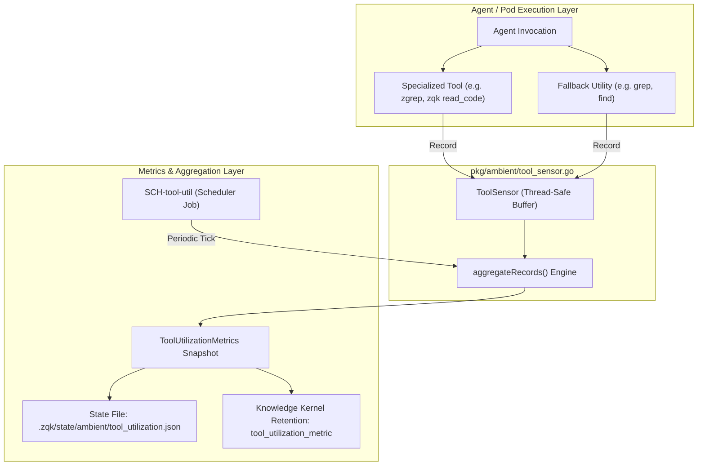

# Ambient Tool Utilization Sensor & Effectiveness Metrics

## Architectural Specification & Operational Guide

### 1. Overview & Motivation

Autonomous and human-paired agents within the ZQK ecosystem execute hundreds of commands and tools during development cycles—including specialized AST-aware searchers (`zgrep`), kernel object stewards (`zqk object`, `zqk new`), test runners (`zqk test run`), and fallback shell primitives (`grep`, `find`, `cat`, `go test`).

DEF-ZQK-AMBIENT-TOOL-SENSOR-001 identified a critical observability gap: while retention configurations and scheduler timer definitions specified telemetry policies for `tool_utilization_metric` (`SCH-tool-util`), the underlying telemetry sensor, runtime metrics aggregators, and data structures were missing.

The **Ambient Tool Utilization Sensor** provides zero-overhead, thread-safe runtime telemetry capturing tool executions, computing specialized vs fallback adoption rates, latency averages, and token savings.

---

### 2. Core Telemetry Data Structures

#### `ToolExecutionRecord`
Point-in-time record for a discrete tool invocation:
- `ToolName` (string): Canonical tool name or CLI subcommand.
- `Duration` (time.Duration): Execution wall-clock latency.
- `ExitCode` (int): Process exit code.
- `TokensUsed` (int): Tokens consumed in prompt/response context.
- `TokensSaved` (int): Estimated tokens conserved by using indexed or AST-budgeted tools.
- `IsSpecialized` (bool): True if classified under kernel-native or AST-aware tools.
- `IsFallback` (bool): True if classified under generic or unbudgeted shell tools.
- `Success` (bool): Execution success indicator (`ExitCode == 0` or verified status).
- `Timestamp` (time.Time): Execution timestamp in UTC.
- `AgentID` (string, optional): Originating agent or seat identifier.
- `Metadata` (map[string]string, optional): Contextual metadata tags.

#### `ToolUtilizationMetrics`
Aggregated rollup across all recorded tool executions:
- `TotalInvocations` (int64): Count of all tool executions.
- `SpecializedAdoptionRate` (float64): Ratio of specialized tool calls over total invocations ($0.0 - 1.0$).
- `FallbackRate` (float64): Ratio of fallback tool calls over total invocations ($0.0 - 1.0$).
- `SuccessRate` (float64): Ratio of successful calls over total invocations.
- `AverageDuration` (time.Duration): Mean latency across executions.
- `TotalTokensUsed` (int64): Sum of tokens consumed.
- `TotalTokensSaved` (int64): Sum of tokens preserved through AST/indexed tools.
- `AverageTokensSavedPerSpecializedCall` (float64): Efficiency leverage ratio.
- `ByTool` (map[string]ToolAggregatedStats): Granular per-tool breakdown.

---

### 3. Tool Classification Rubric

The sensor auto-classifies tools when explicit flags are omitted:

| Category | Tools & Patterns | Architectural Rationale |
| :--- | :--- | :--- |
| **Specialized** | `zgrep`, `zqk grep`, `zqk read_code`, `zqk test`, `zqk object`, `zqk new`, `zqk agent`, `zqk docman`, `zqk-vet` | Sub-15ms AST indexing, structured token budgeting, kernel CAS enforcement. |
| **Fallback** | `grep`, `egrep`, `fgrep`, `rgrep`, `rg`, `find`, `cat`, `sed`, `awk`, `head`, `go test` | Unbudgeted raw file dumps, unbounded context expansion, shell bypassing. |

---

### 4. Scheduler Job Integration (`SCH-tool-util`)

The aggregator job `SCH-tool-util` executes on a scheduled interval (e.g. 15 minutes) via `RunToolUtilizationAggregatorJob`:
1. Ingests current sensor records from the runtime memory buffer.
2. Applies time window filtering if configured (`AggregateWindow`).
3. Computes zero-division safe utilization metrics.
4. Persists the JSON snapshot atomically to disk.
5. Emits kernel metrics under the `tool_utilization_metric` kind, subject to the 14-day retention policy configured in `.zqk/specs/configs/retention_tolerance.yaml`.

---

### 5. Memory & Concurrency Hygiene

- **Thread-Safety**: Protected by `sync.RWMutex` allowing concurrent high-throughput recording with non-blocking reads.
- **Bounded Buffer**: Configurable rolling capacity (`DefaultMaxSensorRecords = 20000`) with FIFO eviction preventing unbounded memory growth in long-running ambient daemons.
- **Zero-Division Proof**: Safe default calculations ensure zero panics, NaN, or undefined values when zero executions are recorded.
