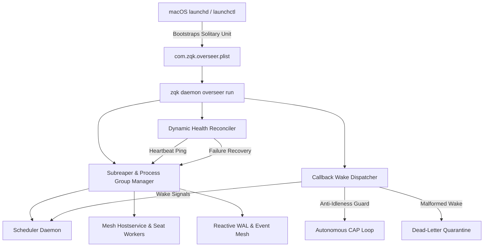

# Autonomous Daemon Overseer Supervision & Callback-Driven Wake Invariants

## Executive Summary
The Autonomous Daemon Overseer architecture establishes a centralized, solitary supervision framework under macOS `launchctl` (and Unix system supervisors) for managing background system daemons. Instead of registering fragmented, independent launchd agents for every subsystem (which leads to orphan drift, stale sockets, and cascade failures), ZQK mandates a unified overseer model (`com.zqk.overseer.plist`). The overseer acts as a subreaper and process group manager, hosting dynamic health reconciliation loops and callback-driven wake dispatchers to enforce strict anti-idleness invariants across the autonomous CAP execution pipeline.

## Architectural Topology & Lifecycle

## Solitary LaunchAgent Design & Plist Invariants

### 1. Solitary Supervision vs. Plist Proliferation
- **Historical Failure Mode**: Fragmented per-daemon LaunchAgents (`com.zqk.scheduler.*`, `com.zqk.privileged-writer.*`, `com.zqk.mesh.*`) suffered from desynchronized startup order, socket collisions, and zombie child processes when parent terminals exited.
- **Architectural Solution**: A single persistent supervisor (`com.zqk.overseer.plist`) is registered in `~/Library/LaunchAgents`. All child services are spawned under monitored process groups with explicit subreaper reaping (`PR_SET_CHILD_SUBREAPER` on Linux; kqueue EVFILT_PROC / wait4 tracking on Darwin).

### 2. Static Plist Specification Invariants
All generated plist configurations must strictly adhere to the following invariants:
- **Solitary Label**: Exactly `com.zqk.overseer` (or test override `com.zqk.overseer.test.<id>`).
- **WorkingDirectory**: Rooted to the canonical user installation directory or project root.
- **ProgramArguments**: Absolute executable path to `zqk` followed by canonical arguments `["daemon", "overseer", "run"]`.
- **StandardOutPath / StandardErrorPath**: Directed to designated rotation-ready log paths (`~/.zqk/logs/overseer.stdout.log`, `~/.zqk/logs/overseer.stderr.log`) with strict 0600 file permissions.
- **KeepAlive Invariants**: Configured with `SuccessfulExit=false` or path-based triggers to prevent respawn thrashing on intentional administrative shutdown.
- **Teardown Invariants**: Lifecycle termination must invoke `launchctl bootout` rather than unmanaged `launchctl stop` to disarm launchd respawn mechanics cleanly.

## Callback-Driven Wake Invariants & Anti-Idleness

### 1. Reactive Wake Mesh
- System daemons and agent seats communicate via reactive callback events and file-descriptor notifications rather than polling sleep loops.
- Event arrivals (e.g. task state change, background CI completion, PR merge event, external human input) issue an immediate callback wake payload to the active overseer session.

### 2. Malformed Wake Quarantine & Circuit Breaking
- Wake payloads carry cryptographically signed or structurally validated correlation tokens.
- Payloads failing schema validation, carrying stale timestamps, or originating from untrusted channels are isolated into a Dead-Letter Quarantine (`DLQ`) without panicking the supervisor or interrupting healthy child daemons.

## Three-Fold Verification Strategy

### 1. Static Floor Invariant (CRIT 1)
- `CRIT-OVERSEER-PLIST-VALIDATION`: Verifies that overseer plist templates and active configurations conform to schema validations, path invariants, and absence of orphaned or legacy daemon plists.

### 2. Operational Dynamic Proof (CRIT 2)
- `CRIT-OVERSEER-LIFECYCLE-EXECUTION`: Verifies live supervisor lifecycle execution: dynamic heartbeat probes, synthetic crash injection, exponential backoff recovery, and graceful process group drain.

### 3. Negative Adversarial Boundary (CRIT 3)
- `CRIT-OVERSEER-FAIL-CLOSED-RECOVERY`: Verifies fail-closed behavior under malformed wake payloads, corrupt plists, and unrecoverable child process crash loops without compromising supervisor stability or autonomous loop progress.
