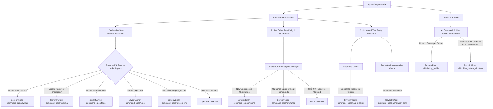

# Command Specification Parity and Semantic Architecture Governance

> **Technical Specification:** `TSP-COMMAND-SPEC-PARITY-GOVERNANCE-001`  
> **Status:** Implemented & Verified  
> **Target Release:** Zen Quantum Kernel v0.1.0  
> **Architecture Domain:** CLI Ergonomics, Declarative Taxonomy & Static Governance  

---

## 1. Executive Summary & Problem Statement

In autonomous multi-agent systems and high-throughput command-line orchestration, the CLI serves as the authoritative interface between human engineers, autonomous swarms, and the Knowledge Kernel. Taxonomy drift, missing declarative specifications, orphaned command fragments, and argument/flag inconsistencies across runtime Cobra definitions and static specifications introduce acute operational hazards:

1. **Semantic Taxonomy Drift:** Runtime commands defined without backing declarative specifications in `.zqk/cli/specs/` cannot be verified by static analysis gates, schema validators, or automated documentation generators.
2. **Schema & Semantic Link Degradation:** Subcommand link references (`spec_ref`) that point to missing or renamed specifications break semantic link graph traversal and isolate sub-spec trees from verification.
3. **Flag & Annotation Divergence:** Discrepancies between declared flags/annotations and runtime Cobra implementations lead to runtime invocation errors, broken agent prompt context generation, and inaccurate help golden generation.
4. **Permissive Legacy Leakage:** Failure to enforce strict fail-closed AST verification allows new un-specced commands to slip past commit checks, reversing ratcheting baseline progress.

Cycle 49 establishes comprehensive **fail-closed command specification parity and semantic architecture governance** within the ZQK Verification Engine (`zqk-vet`), enforcing 100% specification parity, semantic link graph integrity, flag and annotation conformance, and fail-closed schema validation.

---

## 2. Architectural Topology & Verification Engine

The verification pipeline operates across both static AST inspection and dynamic runtime command tree analysis:



---

## 3. Specification Governance Rules & Schema Contracts

### Rule 1: Declarative Specification Existence & Parity
Every command registered in the runtime root command hierarchy (`cmd/zqk/`) must have a corresponding declarative specification located under `.zqk/cli/specs/<domain>/<command>_command.yaml`. Unspecced commands generate a fail-closed `SeverityError` unless grandfathered in `.zqk/cli/command_spec_coverage_baseline.json`.

### Rule 2: Semantic Link Graph Integrity
When a parent command declares subcommands with `spec_ref` links (e.g. `mcp/svc/cursor_adapter_command.yaml`), the target spec file must exist relative to `.zqk/cli/specs/` or the parent spec directory. Any dangling reference emits a fail-closed `command_spec/broken_link` error.

### Rule 3: Argument & Flag Schema Validation
- **Args Types:** Must declare a recognized argument constraint: `exact`, `minimum`, `maximum`, `range`, `no_args`, `none`, `arbitrary`, `arbitrary_args`, or `any`.
- **Flag Objects:** Each item in `flags` must specify a non-empty `name`, `type`, and `description`. Single-character shorthands must not exceed length 1.
- **Required Traits:** Spec-level traits declared in `required_traits` must be non-empty strings.

### Rule 4: Orchestration Annotation Governance
Runtime commands must conform to declared specification security and orchestration traits:
- `requires_storage: true` $\leftrightarrow$ `zqk.requires_storage: "true"`
- `requires_session: true` $\leftrightarrow$ `zqk.requires_session: "true"`
- `requires_scheduler_check: true` $\leftrightarrow$ `zqk.requires_scheduler_check: "true"`

---

## 4. Verification Runbook & Command Inventory

Engineers and agents verify command specification parity and governance through standard tooling:

1. **Run Full Verification Engine:**
   ```bash
   ./bin/zqk-vet --suite hygiene
   ```
2. **Execute Full Suite Matrix:**
   ```bash
   ./bin/zqk-vet --suite all
   ```
3. **Run Command-Spec Parity Unit Suite:**
   ```bash
   go test -v ./pkg/vet -run TestCheckCommandSpecs
   go test -v ./cmd/zqk/app -run TestCommandSpecParity
   ```
4. **Trigger VDS Test Verification:**
   ```bash
   ./bin/zqk test run <tst-id>
   ```

---

## 5. Architectural Invariants Enforced

| Invariant ID | Target Dimension | Verification Mechanism | Severity |
| :--- | :--- | :--- | :--- |
| `INV-SPEC-SYNTAX-001` | YAML Well-Formedness | `CheckCommandSpecs` YAML Unmarshal | `SeverityError` |
| `INV-SPEC-SCHEMA-002` | Mandatory Schema Fields | `validateCommandSpecMap` | `SeverityError` |
| `INV-SPEC-LINK-003` | Semantic Link Graph (`spec_ref`) | Target File Existence Check | `SeverityError` |
| `INV-SPEC-DRIFT-004` | Zero Unspecced Commands | `AnalyzeCommandSpecCoverage` | `SeverityError` |
| `INV-SPEC-BUILDER-005` | Generated Builder Usage | `CheckCLIBuilders` AST Parser | `SeverityError` |
| `INV-SPEC-FLAGS-006` | Flag & Annotation Parity | `verifyCommandTreeParity` | `SeverityWarn` |
