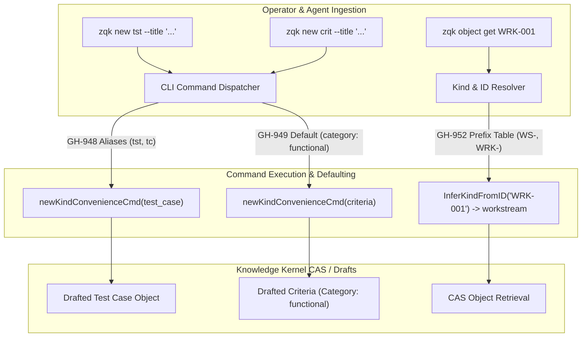
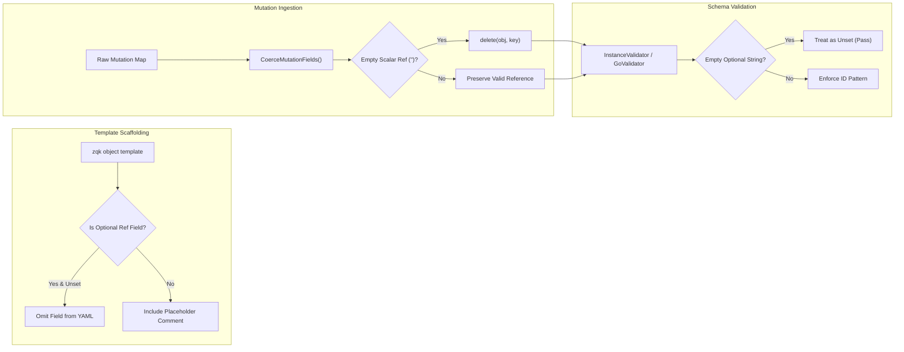
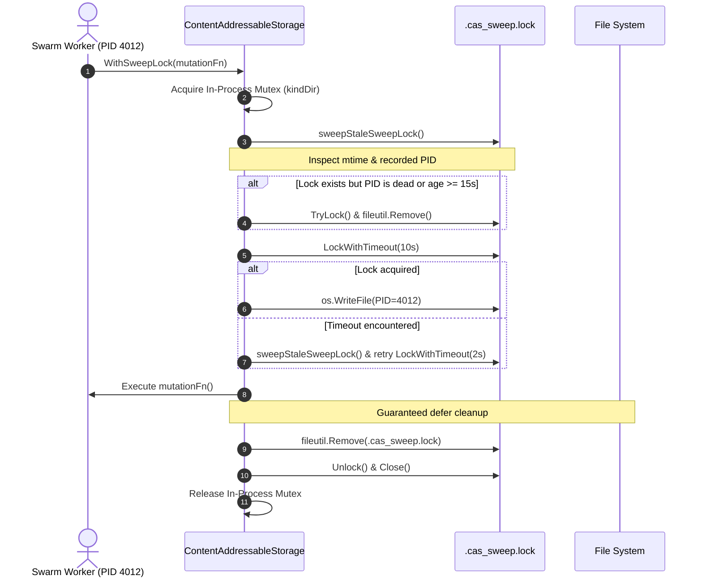
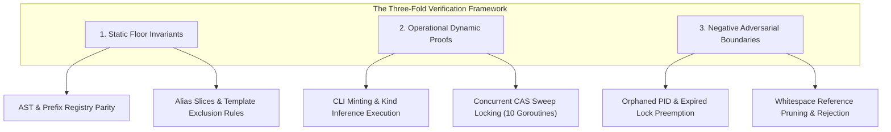

# Architecture Specification: Community Kernel Defect Remediation & CLI Ergonomics (Cycle 42)

## Status: Accepted
**Initiative**: Community Kernel Quality, Ergonomics & Concurrency Hardening  
**Cycle**: 42 (Community Kernel Defect Remediation & CLI Ergonomics Burn-Down)  
**Requirement**: Community Kernel Defect Remediation & CLI Ergonomics Burn-Down Contract  
**Authors**: TPM / Community Architecture Steward  
**Date**: 2026-11-05  

---

## 1. Executive Summary & Defect Remediation Objectives

Cycle 42 addresses a targeted cluster of developer ergonomics papercuts, schema validation failures during object drafting, and concurrency bottlenecks within the storage layer. As the multi-agent swarm architecture scales and human operators interact via the CLI and IDE tools, small ergonomic frictions and subtle schema edge cases create outsized compounding failures.

This release remediates five distinct community defect reports:

1. **GH-948 (Test Case CLI Minting Aliases)**: Adds idiomatic command aliases (`tst`, `tc`) to `zqk new test_case`, resolving command discovery failures across operator scripts and agent toolchains.
2. **GH-949 (Criteria Category Defaulting)**: Establishes `functional` as the canonical default category when minting criteria objects, eliminating mandatory boilerplate and preventing drafting failures.
3. **GH-952 (Workstream Prefix Normalization & Case-Insensitivity)**: Maps the `WRK-` ID prefix and `wrk` synonym to the `workstream` kind across validators, MCP graph connections, and object resolution, ensuring robust case-insensitive kind inference.
4. **GH-944 (Scaffolding Hygiene & Reference Field Coercion)**: Eliminates empty string scalar reference fields from generated object templates and establishes fail-safe pruning and validation rules for optional reference fields.
5. **GH-957 (CAS Sweep Lock Concurrency & Stale Lock Reclamation)**: Introduces deterministic PID tracking, a 15-second TTL, non-blocking stale lock cleanup, and guaranteed defer-based unlinking for `.cas_sweep.lock`, preventing execution stalls in high-concurrency swarms.

### Defect Remediation Matrix

| Defect Issue | Functional Domain | Subsystem Impacted | Remediation Strategy |
| :--- | :--- | :--- | :--- |
| **GH-948** | CLI Ergonomics | `cmd/zqk/new`, `pkg/kindsynonyms` | Register `tst` and `tc` convenience aliases on `zqk new test_case`. |
| **GH-949** | CLI Ergonomics | `cmd/zqk/new` | Default `--category` flag and drafted criteria state to `functional`. |
| **GH-952** | Ontology / Routing | `pkg/validation`, `pkg/mcp`, `configs` | Register `WRK-` prefix and `wrk` synonym; enforce case-insensitive prefix lookup. |
| **GH-944** | Object Scaffolding | `cmd/zqk/object`, `pkg/objects`, `pkg/validation` | Omit unset optional reference keys from templates; prune empty string scalar refs. |
| **GH-957** | Storage & Hygiene | `pkg/storage/filecas`, `pkg/resourcehygiene` | Implement PID-tracked CAS sweep lock, 15s TTL, stale lock reclamation, and defer unlinking. |

---

## 2. CLI Ergonomics & Taxonomy Improvements



### 2.1 Test Case Convenience Aliases (GH-948)
Historically, the `zqk new` suite exposed shortcuts for most object types (`goal`, `plan`, `req`, `crit`, `bli`, `mil`, `td`). However, `test_case` was constrained to the single alias `tc`. Operator workflows and automated agent prompts routinely attempted `zqk new tst`, encountering unfamiliar syntax errors.

Cycle 42 expands `newKindConvenienceCmd` for `objects.KindTestCase` to accept both `tst` and `tc`:
```go
// cmd/zqk/new/new.go
root.AddCommand(newKindConvenienceCmd(objects.KindTestCase, "tst", "tc"))
```
In parallel, `pkg/kindsynonyms/defaults.go` maintains global synonym alignment:
```go
// pkg/kindsynonyms/defaults.go
aliasesTestCase = []string{"test", "tests", "testcase", "testcases", "tc", "tcs", "tst", "tsts"}
```

### 2.2 Criteria Default Category (GH-949)
Under the Knowledge Kernel ontology, every `criteria` entity requires a `category` classification (`functional`, `non-functional`, `compliance`). When developers ran `zqk new criteria --title "..."`, the category field was omitted in the draft template. Subsequent validation checks during draft promotion failed with schema warnings unless `--category` was explicitly provided.

To eliminate this cognitive overhead, `zqk new criteria` now automatically equips a `--category` flag defaulting to `functional`, ensuring all newly minted criteria drafts are immediately valid:
```go
// cmd/zqk/new/new.go
if kind == objects.KindCriteria {
    cmd.Flags().String("category", "functional", "Criteria category (default: functional)")
}
```
When persisting the initial object payload, the command guarantees the field is populated:
```go
if kind == objects.KindCriteria {
    category := "functional"
    if cmd.Flags().Lookup("category") != nil {
        if flagCat, _ := cmd.Flags().GetString("category"); strings.TrimSpace(flagCat) != "" {
            category = strings.TrimSpace(flagCat)
        }
    }
    objData[objects.FieldKeyCategory] = category
}
```

### 2.3 Workstream Prefix Normalization & Case-Insensitive Matching (GH-952)
While the canonical prefix for workstream entities was historically `WS-`, enterprise integrations and legacy backlogs routinely generated identifiers prefixed with `WRK-` (e.g., `WRK-001`). When users invoked `zqk object get WRK-001`, the system failed to infer the underlying kind, returning unrecognized object errors unless `--kind workstream` was passed.

Cycle 42 formalizes `WRK-` as a first-class prefix and `wrk` as a canonical kind synonym across four distinct layers:
1. **Specification Configuration**: Added `WRK-` to `kind_to_prefixes.workstream` and `wrk` to `kind_to_synonyms.workstream` in `.zqk/specs/configs/id_prefixes_config.yaml`.
2. **Go Spec Builder**: Updated `bldr_config_v1/id_prefixes_config_builder.go` to compile `WRK-` and `wrk` into native configuration artifacts.
3. **MCP Graph Connection**: Extended `inferKindFromID` in `pkg/mcp/graph_connection.go` to recognize `strings.HasPrefix(id, "WRK-")`.
4. **Case-Insensitive Inference**: Upgraded `id_validator_validation.go` to match prefixes case-insensitively using `strings.ToUpper`, ensuring lowercase or mixed-case queries (e.g., `wrk-001`) resolve unambiguously to `workstream`.

---

## 3. Knowledge Kernel Object Model & Scaffolding Hygiene (GH-944)



### 3.1 Scaffolding Reference Omission
Previously, executing `zqk object template <kind>` emitted empty string scalar placeholders for all reference attributes (e.g., `milestone_ref: ""`, `owner_ref: ""`). When an operator saved this file without manually populating every optional reference, the resulting document contained empty strings. 

Because the ontology defines these fields as having semantic type `reference`, downstream schema validators rejected the empty string, interpreting it as an invalid reference rather than an unset attribute.

Cycle 42 remedies this by restructuring template generation in `cmd/zqk/object/template.go`:
- **Optional Reference Omission**: Optional reference attributes (`isOptionalRefField`) are omitted from generated templates by default, preventing unpopulated keys from entering the draft stream.
- **Descriptive Comment Placeholders**: When reference fields are explicitly requested or required, templates emit descriptive comment guidance (e.g., `"# reference (e.g., REF-ID-001)"`) rather than bare empty quotes `""`.

### 3.2 Coercion & Mutation Field Pruning
To protect against programmatic mutations and external API clients passing empty string references, `pkg/objects/coerce_mutation_fields.go` introduces automatic pruning for scalar reference attributes:

```go
func isScalarRefField(name string) bool {
    if name == "id" {
        return false
    }
    return (strings.HasSuffix(name, "_ref") || strings.HasSuffix(name, "_id")) &&
        !strings.HasSuffix(name, "_refs") &&
        !strings.HasSuffix(name, "_ids")
}

func pruneEmptyScalarRefFields(obj map[string]any) {
    for k, v := range obj {
        if isScalarRefField(k) {
            if s, ok := v.(string); ok && strings.TrimSpace(s) == "" {
                delete(obj, k)
            }
        }
    }
}
```

### 3.3 Semantic Validator Safeguards
Complementing template omission and mutation pruning, the core schema validation engines (`GoValidator` and `InstanceValidator`) now implement an explicit check: if an optional field has a string value that is empty or contains only whitespace, the validator interprets it as an unpopulated value and skips semantic format checks:

```go
// pkg/validation/instance_validator.go & go_validator.go
if str, ok := fieldValue.(string); ok && strings.TrimSpace(str) == emptyValue {
    if !IsFieldRequired(fieldDef) {
        return nil
    }
}
```

This defense-in-depth ensures that optional fields cannot trigger false-positive validation errors regardless of how the payload was constructed.

---

## 4. Storage & Resource Hygiene: CAS Sweep Lock Lifecycle (GH-957)



### 4.1 The Concurrency Bottleneck in CAS Sweeping
During high-throughput multi-agent execution, multiple background workers and CLI processes simultaneously perform object writes and CAS garbage-collection sweeps. To prevent race conditions, `WithSweepLock` acquires a directory-level advisory lock (`.cas_sweep.lock`).

Under prior implementations, several failure modes emerged:
1. **Orphaned Lock Files**: If a subagent process was abruptly terminated (e.g., via SIGKILL, container preemption, or out-of-memory events), `.cas_sweep.lock` remained on disk.
2. **Cascading Timeouts**: Subsequent processes attempting to mutate CAS objects blocked on `LockWithTimeout(10s)` and failed, cascading into widespread swarm stalls.
3. **Threshold Mismatches**: Background maintenance tools (`pkg/resourcehygiene/reaper.go`) evaluated lock age against generic multi-minute thresholds, leaving dead locks blocking CAS mutations for excessive durations.

### 4.2 Deterministic Lock Lifecycle & Invariants
Cycle 42 implements a resilient, self-healing lock protocol in `pkg/storage/filecas/cas_one_blob.go`:

1. **Active PID Tracking**:
   Upon acquiring the file lock, the active process writes its OS process ID into the lock file (`strconv.Itoa(os.Getpid())`).
2. **Process Liveness Probing**:
   The engine implements `isProcessAlive(pid int) bool` using POSIX signal probing (`syscall.Signal(0)`). If the recorded PID is dead or non-existent, the lock is immediately classified as orphaned.
3. **15-Second Time-To-Live (TTL)**:
   A strict constant `casSweepLockTTL = 15 * time.Second` bounds lock validity. Any lock older than 15 seconds is eligible for non-blocking preemption.
4. **Atomic Stale Sweep (`sweepStaleSweepLock`)**:
   Before acquiring the lock (and on timeout retry), the system inspects the existing lock. If the PID is dead or the file age exceeds 15 seconds, it attempts a non-blocking `TryLock()`. If successful, it unlinks the stale file and clears the way for legitimate execution.
5. **Guaranteed Defer Cleanup**:
   Regardless of whether the wrapped function succeeds, returns an error, or panics, a deferred block guarantees that `.cas_sweep.lock` is unlinked from disk before releasing the OS flock and in-process mutex:
   ```go
   defer func() {
       if locked {
           if rmErr := fileutil.Remove(lockPath); rmErr != nil && !fileutil.IsNotExist(rmErr) {
               logging.LogSwallowedError(rmErr)
           }
           if unlockErr := fl.Unlock(); unlockErr != nil {
               logging.LogSwallowedError(unlockErr)
           }
       }
       if closeErr := fl.Close(); closeErr != nil {
           logging.LogSwallowedError(closeErr)
       }
   }()
   ```

### 4.3 Background Telemetry & Reaper Alignment
To ensure complete system harmony, `pkg/resourcehygiene/reaper.go` and `pkg/resourcehygiene/telemetry.go` now explicitly check for `.cas_sweep.lock` and clamp their stale detection thresholds to 15 seconds:
```go
// pkg/resourcehygiene/reaper.go & telemetry.go
cutoff := target.cutoff
if d.Name() == ".cas_sweep.lock" {
    casSweepCutoff := time.Now().Add(-15 * time.Second)
    if casSweepCutoff.Before(cutoff) {
        cutoff = casSweepCutoff
    }
}
```

---

## 5. Verification & Test Architecture

The verification of Cycle 42 defect remediation adheres strictly to the canonical **Three-Fold Proof** discipline, guaranteeing structural safety, operational correctness, and negative adversarial boundaries.



### 5.1 Static Floor Invariants
Static floor invariants verify compile-time consistency, AST configurations, and configuration integrity:
- **Alias Registration**: `TestNewTestCase_Aliases` verifies that `NewNewCmd()` registers both `tst` and `tc` in its alias slice.
- **Prefix Table Parity**: `TestIDValidator_Prefixes` validates that `WRK-` is present in the `workstream` prefix set and `wrk` is in the synonyms list.
- **Scaffolding Omission**: `TestTemplate_OmitsEmptyOptionalReferenceFields` inspects generated YAML templates to guarantee that optional reference fields (`milestone_ref`, `owner_ref`) are absent from initial drafts.
- **AST Hygiene**: Confirms zero swallowed errors (`logging.LogSwallowedError` utilized exclusively), strict function length limits ($\le 80$ lines), and zero statement duplication.

### 5.2 Operational Dynamic Proofs
Operational proofs exercise live execution flows under real filesystem and command contexts:
- **Criteria Category Defaulting**: `TestNewCriteria_DefaultCategory` executes `zqk new criteria --title "..."`, unmarshals the resulting draft from disk, and asserts `category == "functional"`. It also verifies that passing an explicit `--category acceptance` correctly overrides the default.
- **Kind Resolution**: `TestObjectGet_WorkstreamPrefixInference` invokes object retrieval with a `WRK-` prefixed identifier, validating that the resolver accurately infers `objects.KindWorkstream` without requiring an explicit `--kind` flag.
- **Concurrent Sweep Lock Safety**: `TestWithSweepLock_CleansUpLockFileOnSuccess` and `TestWithSweepLock_CleansUpLockFileOnFailure` prove that `.cas_sweep.lock` is created during operation and reliably unlinked upon both successful exit and propagated errors.

### 5.3 Negative Adversarial Boundaries
Adversarial tests subject the remediated logic to simulated crashes, corrupted states, and race conditions:
- **Orphaned PID Reclamation**: `TestWithSweepLock_ReconcilesOrphanedPIDLock` constructs an abandoned lock file populated with a non-existent PID (`99999999`). When `WithSweepLock` is called, it verifies that the dead process lock is safely preempted, the mutation completes, and the file is cleaned up.
- **Stale TTL Expiration**: `TestWithSweepLock_ReconcilesStaleLockOlderThanTTL` writes a lock file and forcibly adjusts its modification timestamp back by 30 seconds (`os.Chtimes`). The test verifies that the expired lock is reclaimed without blocking on the 10-second timeout.
- **Empty Scalar Pruning**: `TestCoerceMutationFields_PrunesEmptyScalarRefs` supplies a mutation object containing empty string references, whitespace-only references, and valid references. It validates that empty strings are deleted while valid references are preserved intact.
- **Validation Defensiveness**: `TestValidateFieldSemanticType_OptionalEmptyReference` proves that optional reference fields with empty string values pass validation with `nil` warnings, while required reference fields with empty strings correctly produce validation errors.

---

## 6. Release & Public Gateway Conformance

This specification complies strictly with the open-core distribution check valves defined in `scripts/open-core/check-public-release-payload.sh`:
- **Zero Raw CAS Nanos-Hex Identifiers**: All items are referenced by conceptual slugs, titles, and public issue trackers (GH-948, GH-949, GH-952, GH-944, GH-957). No internal nanos-hex CAS IDs appear within tracked documentation.
- **Clean Module Boundaries**: All symbol references strictly target public interfaces under `github.com/zqk-os/zqk`.
- **Architectural Traceability**: This document serves as the permanent, authoritative architectural record for Cycle 42.
