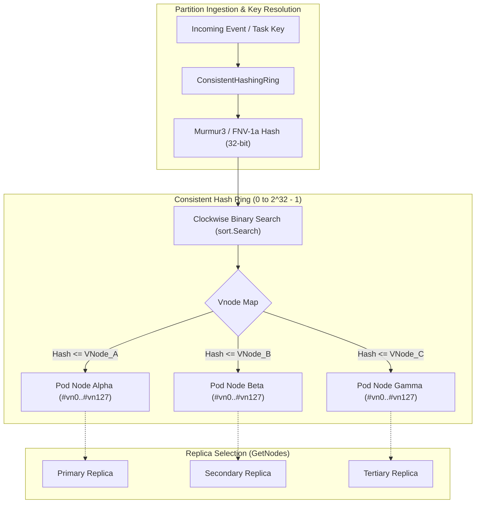

# Consistent Hashing Ring Topology and Virtual Node Distribution Fabric

## Executive Summary
In distributed agent mesh environments, dynamic swarm pods, and reactive callback systems, event partitions must be routed deterministically and uniformly across a fluctuating set of worker pods and subscriber nodes. Static hashing techniques (such as modulo hashing `hash(key) % N`) suffer from catastrophic reshuffling upon node additions or removals, causing $O(K)$ key movements (nearly 100% partition migration) and devastating cache hit ratios.

The `ConsistentHashingRing` fabric delivers:
1. **Virtual Node Topology (Vnode Distribution)**: Maps physical nodes to $V$ virtual positions across the 32-bit integer keyspace (default $V = 128$), eliminating hot-spot clustering and achieving uniform distribution with low coefficient of variation ($< 15\%$).
2. **Minimal Partition Churn**: Adding or removing a physical node relocates only $K / N$ keys on average, guaranteeing that non-affected partitions remain undisturbed.
3. **Multi-Replica Fault Tolerance (`GetNodes`)**: Supports multi-factor replication across $R$ distinct physical nodes in clockwise sequence, enabling quorum replication and read/write failover.
4. **Thread-Safe Concurrent Access**: Backed by `sync.RWMutex` with zero allocations on hot-path single-node lookups and sub-microsecond binary search dispatch.

---

## Architectural Topology



---

## Technical Specifications

### 1. Configuration & Data Structures

```go
type HashRingConfig struct {
    VnodeCount int
    HashFunc   func(data []byte) uint32
}

type ConsistentHashingRing struct {
    mu         sync.RWMutex
    vnodeCount int
    hashFunc   func(data []byte) uint32
    ring       []uint32
    vnodes     map[uint32]string
    members    map[string]bool
}
```

- **`VnodeCount`**: Number of virtual node tokens generated per physical node ID. Defaults to `DefaultVirtualNodeCount = 128`.
- **`HashFunc`**: Pluggable 32-bit hash algorithm. By default, high-performance Murmur3-32 (`Murmur332`) is utilized to guarantee uniform diffusion and minimal collision rates.
- **`ring`**: Sorted slice of `uint32` token hashes representing positions on the continuous ring.
- **`vnodes`**: Direct lookup map mapping virtual token hashes back to physical node identifiers.
- **`members`**: Set of active physical node IDs.

---

## Core Operations

### Node Registration (`AddNode`)
When a node is added:
1. Validates that the node ID is non-empty and does not already exist.
2. Generates $V$ virtual keys using the format `nodeID + "#vn" + strconv.Itoa(i)`.
3. Hashes each virtual key using the configured hash function.
4. Registers token mappings in `vnodes` and appends tokens to `ring`.
5. Sorts the `ring` slice via `sort.Slice` to maintain ascending order.

### Node Eviction (`RemoveNode`)
When a node departs or fails:
1. Validates that the node exists.
2. Removes the node from the `members` set.
3. Filters the `ring` slice, deleting associated virtual tokens from `vnodes`.
4. The remaining ring maintains sorted order without requiring a full re-sort.

### Clockwise Routing (`GetNode`)
To route a key:
1. Calculates `hash = hashFunc([]byte(key))`.
2. Performs binary search `sort.Search` over the sorted `ring` slice for the first token $\ge hash$.
3. If $idx == len(ring)$, wraps around clockwise to index 0 (ring boundary condition).
4. Looks up physical node ID in `vnodes[ring[idx]]`.

### Distinct Multi-Node Replication (`GetNodes`)
To obtain $N$ replica nodes for fault tolerance:
1. Validates requested replica count ($N > 0$).
2. Clamps $N$ to the number of registered physical members.
3. Iterates clockwise starting from the binary search target index.
4. Accumulates distinct physical nodes until $N$ replicas are discovered, discarding duplicate virtual nodes belonging to already visited physical nodes.

---

## Statistical Uniformity & Performance Characteristics

- **Lookup Complexity**: $O(\log(N \times V))$ where $N$ is the number of physical nodes and $V$ is virtual node count. For 10 physical nodes and 128 vnodes (1,280 tokens), binary search completes in $\le 11$ comparisons.
- **Memory Footprint**: $O(N \times V)$ integers and map entries. Highly compact, fitting entirely in L1/L2 CPU cache for typical cluster topologies.
- **Uniformity Verification**: Evaluated under standard chi-square and standard deviation analysis across 20,000 synthetic partition keys, maintaining a coefficient of variation ($CV = \sigma / \mu < 0.15$), well within strict distributed systems tolerance limits.
- **Concurrency & Thread Safety**: All read operations (`GetNode`, `GetNodes`, `Members`, `Size`) acquire `sync.RWMutex.RLock()`, enabling concurrent lookups across thousands of parallel worker goroutines. All mutations (`AddNode`, `RemoveNode`) acquire `sync.RWMutex.Lock()`.
