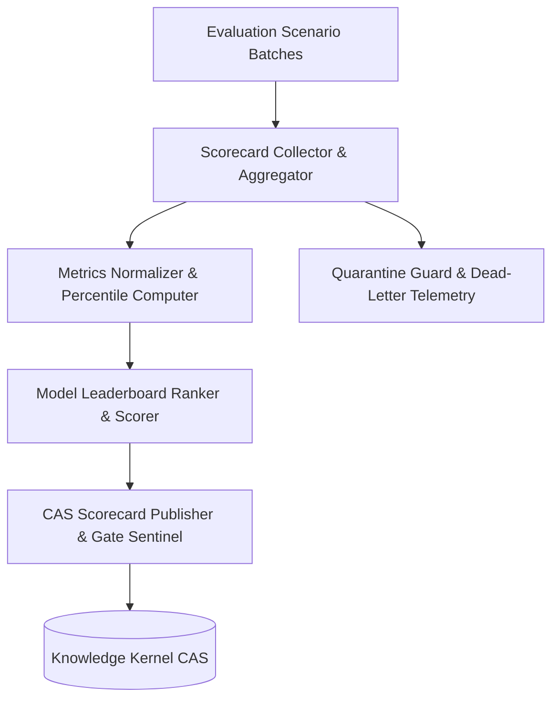

# Architecture Specification: Continuous Benchmark Scorecard & Model Evaluation Leaderboard

## 1. Overview & System Context
The Continuous Benchmark Scorecard and Model Evaluation Leaderboard subsystem extends the core ZQK evaluation framework (`pkg/eval`) to provide automated aggregation, cross-model ranking, and deterministic scorecard generation from multi-scenario evaluation batches.

As evaluation sessions run across models (e.g. Flash, Pro, reasoning models), the scorecard synthesizer aggregates raw metrics (success rate, latency, token consumption, variance), calculates composite performance scores, and publishes a versioned `benchmark_scorecard_v1` leaderboard into the Knowledge Kernel CAS.



---

## 2. Core Architectural Components

### 2.1 Scorecard Synthesizer (`ScorecardSynthesizer`)
Aggregates evaluation results across multiple evaluation runs. Computes:
- **Pass Rate**: Percentage of evaluation scenarios meeting acceptance criteria.
- **Latency Percentiles**: P50, P90, P99 evaluation runtimes.
- **Token Efficiency Score**: Composite metric weighting completion quality against total tokens consumed.
- **Stability Index**: Inverse of variance across repeated convergence runs.

### 2.2 Leaderboard Publisher (`LeaderboardPublisher`)
Sorts models according to configurable ranking policies (e.g. `balanced`, `latency_critical`, `quality_first`) and generates ranked entries. Enforces determinism in tie-breaking using lexicographical model identifiers.

### 2.3 Out-of-Bounds Quarantine Guard (`MetricQuarantineGuard`)
Detects and isolates malformed runs:
- Unparseable timestamps or duration $\le 0$.
- NaN, Inf, or negative metric values.
- Truncated or corrupted failure traces.
- Duplicate scenario runs within the same scorecard epoch.

---

## 3. Schema Specification: `benchmark_scorecard_v1`

```json
{
  "schema_version": "benchmark_scorecard_v1",
  "scorecard_id": "BSC-UUID",
  "created_at": "ISO-8601 UTC",
  "epoch_window": {
    "start_time": "ISO-8601 UTC",
    "end_time": "ISO-8601 UTC"
  },
  "ranking_policy": "balanced",
  "leaderboard": [
    {
      "rank": 1,
      "model_id": "model-identifier",
      "composite_score": 94.5,
      "scenarios_evaluated": 12,
      "pass_rate": 0.98,
      "latency_p50_ms": 420.0,
      "latency_p99_ms": 1150.0,
      "token_cost_per_thousand": 0.002,
      "stability_index": 0.99
    }
  ],
  "quarantined_runs_count": 0
}
```

---

## 4. Invariants & Three-Fold Proof Verification

The subsystem adheres strictly to the canonical Three-Fold Proof discipline:

1. **Static Floor Invariant**:
   - Scorecard payloads MUST declare valid `schema_version = "benchmark_scorecard_v1"`.
   - All composite scores and pass rates MUST reside in the closed interval $[0.0, 100.0]$ and $[0.0, 1.0]$.
   - Model entries MUST contain non-empty `model_id` and positive `scenarios_evaluated`.

2. **Operational Dynamic Proof**:
   - End-to-end synthesis correctly processes batch run samples, computes percentiles, ranks models deterministically, and serializes a compliant scorecard.
   - Leaderboard ranks MUST strictly descend by composite score.

3. **Negative Adversarial Boundary**:
   - Out-of-bounds metrics (NaN, negative latency, infinity) are isolated to the quarantine log without halting scorecard generation.
   - Malformed run payloads do not crash the synthesizer (fail-closed containment).
