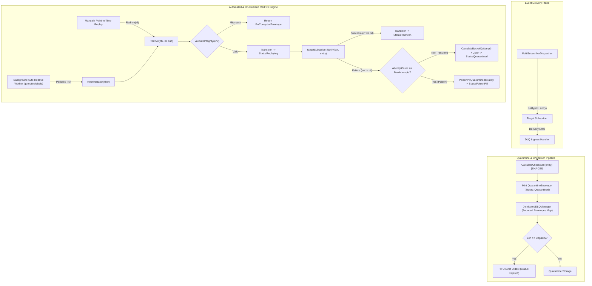
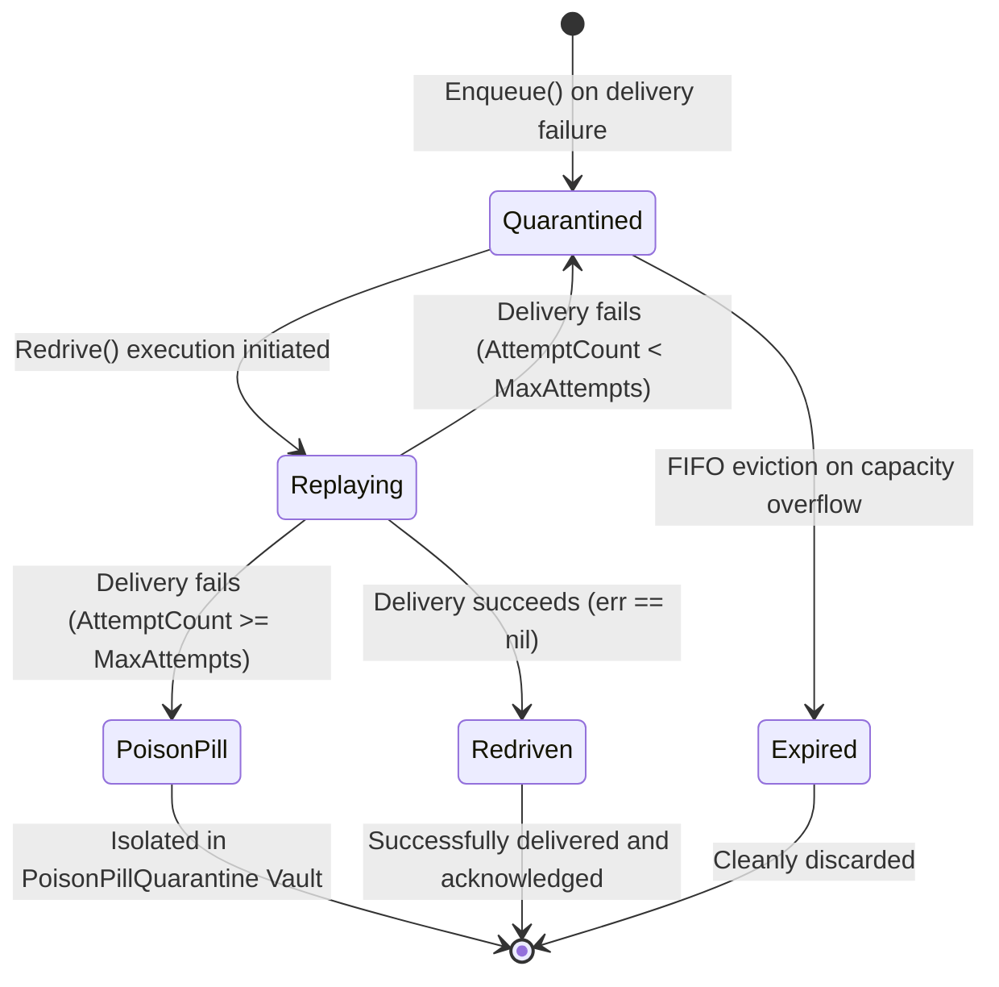

# Distributed Dead-Letter Queue (DLQ), Poison Pill Quarantine, and Automated Event Redrive Engine

## Executive Summary

In distributed asynchronous event fabrics, multi-agent systems, and reactive callback dispatchers, message delivery failures are inevitable due to transient network interruptions, downstream service outages, database locks, or schema evolution mismatches. However, unhandled or naively retried delivery failures introduce two critical failure modes:
1. **Head-of-Line (HoL) Blocking & Resource Exhaustion**: Retrying a failing event in-place stalls downstream processing, depletes ring buffer capacity, and starves healthy workloads.
2. **The Poison Pill Retry Cascade**: Malformed payloads, corrupt inputs, or logic errors that trigger deterministic subscriber panics or fatal exceptions can cause catastrophic infinite retry loops ("poison pills"), consuming CPU and saturating network links without forward progress.
3. **Payload Tampering and Bit Rot**: Unverified payloads held in memory or staged across buffers risk silent corruption or unauthorized tampering prior to redelivery.

To solve these systemic challenges, this architecture establishes:
- **`QuarantineEnvelope`**: A tamper-evident cryptographic container securing failed callback events with deterministic SHA-256 checksums, comprehensive execution lineage, and retry counters.
- **`PoisonPillQuarantine`**: A bounded, thread-safe isolation vault that auto-isolates repeatedly failing events (exceeding `MaxAttempts`) to protect active subscribers from toxic inputs.
- **`DistributedDLQManager`**: A bounded dead-letter queue orchestrator providing FIFO overflow eviction, point-in-time single-event replay, batch filtered redelivery, and an automated background redrive engine with exponential backoff and jitter.

---

## Architectural Topology



---

## 1. Quarantine Lifecycle State Machine

The lifecycle of quarantined callback entries is modeled as a 5-state deterministic finite state machine (FSM).



### State Descriptions
- **`Quarantined`**: The event failed subscriber delivery and is safely parked outside the primary processing pipeline. It holds a deterministic cryptographic checksum, error reason, and scheduled `NextRedriveAt` timestamp.
- **`Replaying`**: The event is actively undergoing redelivery to the target subscriber. Lock contention is prevented by releasing the manager mutex during subscriber notification.
- **`Redriven`**: Re-delivery succeeded without error. The envelope is finalized and recorded in throughput telemetry.
- **`PoisonPill`**: Consecutive re-delivery attempts reached `MaxAttempts` (default: 5) or triggered unrecoverable fatal conditions. The envelope is permanently quarantined in the `PoisonPillQuarantine` vault, shielding consumers from repeated crashes.
- **`Expired`**: Active quarantine storage reached bounded capacity (`DefaultDLQCapacity = 1000`), triggering deterministic FIFO eviction of the oldest un-replayed event.

---

## 2. Cryptographic Envelope Schema & Tamper Detection

To prevent payload tampering or silent memory corruption while stored in quarantine, every envelope is protected with a deterministic cryptographic SHA-256 digest:

$$\text{Digest} = \text{SHA-256}\Big(\text{JobID} \parallel \text{":"} \parallel \text{Seq} \parallel \text{":"} \parallel \text{JSON}(\text{Payload})\Big)$$

### Quarantine Envelope Schema

```go
type QuarantineEnvelope struct {
    ID              string           `json:"id"`
    EnvelopeID      string           `json:"envelope_id"`
    Entry           *CallbackEntry   `json:"entry"`
    Topic           string           `json:"topic"`
    SubscriberID    string           `json:"subscriber_id"`
    Reason          string           `json:"reason"`
    AttemptCount    int              `json:"attempt_count"`
    MaxAttempts     int              `json:"max_attempts"`
    PayloadChecksum string           `json:"payload_checksum"`
    FirstFailedAt   time.Time        `json:"first_failed_at"`
    LastFailedAt    time.Time        `json:"last_failed_at"`
    NextRedriveAt   time.Time        `json:"next_redrive_at"`
    Status          QuarantineStatus `json:"status"`
}
```

### Tamper-Evident Fail-Closed Verification

Prior to executing any redrive attempt (`Redrive` or `RedriveBatch`), `ValidateIntegrity(env)` recalculates the canonical SHA-256 digest of `env.Entry` and matches it against `env.PayloadChecksum`:
```go
func ValidateIntegrity(env *QuarantineEnvelope) error {
    if env == nil || env.Entry == nil {
        return ErrInvalidEnvelope
    }
    if env.PayloadChecksum == "" {
        return ErrCorruptedEnvelope
    }
    calculated := CalculateChecksum(env.Entry)
    if env.PayloadChecksum != calculated {
        return ErrCorruptedEnvelope
    }
    return nil
}
```
If any payload field, job ID, sequence number, or digest string has been modified, the operation fail-closes immediately with `ErrCorruptedEnvelope`, preventing damaged or manipulated data from reaching downstream subscribers.

---

## 3. Exponential Backoff and Jitter Formulation

To prevent "thundering herd" retry storms when downstream services recover, redrive attempts are scheduled according to exponential backoff with bounded decorrelated jitter:

$$B(n) = \min\left(B_{\max},\, B_{\text{base}} \cdot 2^{n-1}\right)$$

$$T_{\text{next}} = T_{\text{now}} + \max\left(B_{\text{base}},\, B(n) - \frac{J_{\text{window}}}{2} + \text{jitter}\right)$$

Where:
- $n = \text{AttemptCount} \ge 1$
- $B_{\text{base}} = 50\text{ms}$ (configurable via `WithBackoff`)
- $B_{\max} = 5\text{s}$ (configurable via `WithBackoff`)
- $J_{\text{window}} = \lfloor B(n) / 5 \rfloor$ (20% bidirectional jitter window)
- $\text{jitter} = \text{UnixNano}() \pmod{J_{\text{window}}}$

This mathematical guarantee yields smooth dispersion across retry schedules, mitigating synchronized network traffic spikes.

---

## 4. Replay Protocols

### Point-in-Time Single Replay (`Redrive`)
Point-in-time replay targets a specific envelope by identifier:
1. **Validation**: Looks up envelope by ID in `m.envelopes`. If present in `m.poisonPills`, returns `ErrMaxAttemptsExceeded`. If missing, returns `ErrEnvelopeNotFound`.
2. **Integrity Check**: Executes `ValidateIntegrity(env)` under lock. Rejects corrupted envelopes with `ErrCorruptedEnvelope`.
3. **Execution Decoupling**: Transitions status to `StatusReplaying` and releases the manager mutex before invoking `targetSubscriber.Notify(ctx, env.Entry)`. This guarantees that slow or blocking subscriber handlers never lock the DLQ orchestrator.
4. **Outcome Evaluation**: Re-acquires mutex:
   - On success (`err == nil`): Transitions to `StatusRedriven`, increments `redrivenCount`.
   - On error: Increments `AttemptCount`, sets `LastFailedAt`. If `AttemptCount >= MaxAttempts`, isolates envelope in `PoisonPillQuarantine` with status `StatusPoisonPill`. Otherwise, schedules `NextRedriveAt` with backoff and returns status to `StatusQuarantined`.

### Filtered Batch Replay (`RedriveBatch`)
Enables targeted bulk redelivery constrained by topic, subscriber identity, maximum age, or capacity limit:
```go
type DLQFilter struct {
    Topic        string
    SubscriberID string
    Status       QuarantineStatus
    MaxAge       time.Duration
    Limit        int
}
```
`RedriveBatch` iterates over matching candidates, safely respecting context cancellation (`ctx.Done()`), collecting successfully redriven envelopes, and reporting aggregate progress.

### Automated Event Redrive Engine
When activated via `StartAutoRedrive(ctx, interval, subscriber)`:
- Spawns a dedicated background goroutine managed via `goroutinelabels.NewGoroutine("dlq_auto_redrive", ...)`
- Ticks at the specified duration (default: 100ms) to scan for eligible `Quarantined` envelopes.
- On shutdown (`Stop()` / `Close()`), signals `stopCh`, stops tickers, and blocks on `sync.WaitGroup` to guarantee zero goroutine leaks and clean termination under `-race`.

---

## 5. Thread Safety, Bounded Storage & Memory Invariants

1. **Snapshot Cloning**: All retrieval operations (`Get`, `List`, `PoisonPillQuarantine.Get`, `PoisonPillQuarantine.List`) return shallow clones via `env.Clone()`. This completely isolates caller read access from concurrent internal mutations, guaranteeing race freedom under the Go race detector (`-race`).
2. **Bounded FIFO Storage**: Total active quarantine envelopes are strictly bounded by `capacity` (default: 1000). When full, `evictOldestLocked()` evicts the head of the FIFO ordering queue, setting `StatusExpired` and updating `evictedCount`.
3. **Zero Swallowed Returns**: In full alignment with the ZQK AST hygiene standards, all function return values, hash write calls, and slice mutations are bound to named variables or asserted with test invariants—zero assignments to blank identifiers (`_`).
