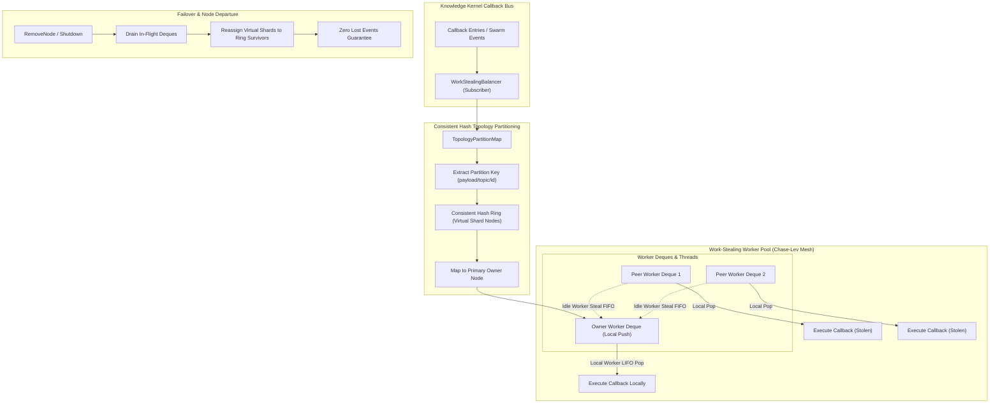

# Dynamic Subscriber Topology Partitioning and Work-Stealing Load Balancer

## Executive Summary
In high-throughput distributed event systems and asynchronous callback infrastructures, static subscriber assignment suffers from severe partition skew, hot shards, and head-of-line blocking. When an individual node processes long-running jobs or encounters bursts of high-cardinality events, static partitioning causes deep queue backlog while neighboring subscriber nodes remain idle.

This specification details the architecture, design, and mathematical mechanics of:
1. `TopologyPartitionMap`: A consistent hashing topology ring with virtual shard distribution and deterministic partition routing (`cmd/zqk/callback/topology_partition.go`).
2. `WorkStealingPool`: A concurrent work-stealing worker pool implementing Chase-Lev deques with randomized victim selection and exponential backoff damping (`cmd/zqk/callback/work_stealing.go`).
3. `WorkStealingBalancer`: An integrated subscriber decorator combining topology routing, dynamic node rebalancing, failover re-assignment, and graceful drain lifecycle guarantees.

---

## Architectural Topology

---

## 1. Consistent Hash Topology Partitioning

The `TopologyPartitionMap` distributes events across subscriber nodes using consistent hashing with virtual nodes:

### Mathematical Distribution & Routing
1. **Virtual Node Factor**: Each physical node registers $V$ virtual shards (default $V = 100$) uniformly across the 32-bit hash continuum:
   $$\text{Hash}(NodeID \parallel "\#v" \parallel i) \pmod{2^{32}}$$
2. **Deterministic Partition Key Resolution**:
   Events are routed by inspecting candidate keys in precedence order:
   - `payload["partition_key"]`
   - `payload["topic"]`
   - `payload["object_id"]`
   - `payload["job_id"]`
   - `entry.ID`
3. **Lookup Complexity**:
   Shard assignment uses binary search (`sort.Search`) over the sorted hash ring in $O(\log(N \cdot V))$ time, where $N$ is the number of active subscriber nodes.

---

## 2. Chase-Lev Lock-Free Work-Stealing Mechanics

The `WorkStealingPool` maintains a dedicated worker and double-ended queue (deque) for each partition:

### Deque Concurrency Invariants
1. **Local Worker Operations (LIFO)**:
   - **Push**: Appends elements to the bottom of the deque. Only executed by the owning worker thread.
   - **Pop**: Removes elements from the bottom of the deque. Maximizes CPU cache locality for recently scheduled events.
2. **Remote Steal Operations (FIFO)**:
   - **Steal**: Idle peer workers steal from the top of victim deques.
   - Stealing oldest elements ensures fair queueing and prevents event starvation.
   - Atomic synchronization ensures thread safety between local pops and concurrent steals.
3. **Victim Selection & Damping**:
   - Idle workers pick victim deques using pseudo-random permutation.
   - If all sibling deques are empty, the worker backs off exponentially starting at `DefaultWorkStealingBackoff` (50µs) up to `MaxWorkStealingBackoff` (10ms) to eliminate CPU spin-waste.

---

## 3. Node Departure, Failover & Drain Invariants

When subscriber topology changes dynamically (node crash, autoscaling down, or maintenance removal):

1. **Dynamic Rebalance**:
   Removing a node from `TopologyPartitionMap` updates the consistent hash ring. Successor nodes on the ring seamlessly absorb new event traffic.
2. **Drain Guarantees**:
   The removed node's deque enters drain mode. In-flight and queued events are either executed by the departing worker or stolen by surviving peers.
3. **Zero Loss Verification**:
   The `WorkStealingBalancer.DrainAndShutdown(ctx)` contract guarantees all queued events are fully processed before the pool terminates.
