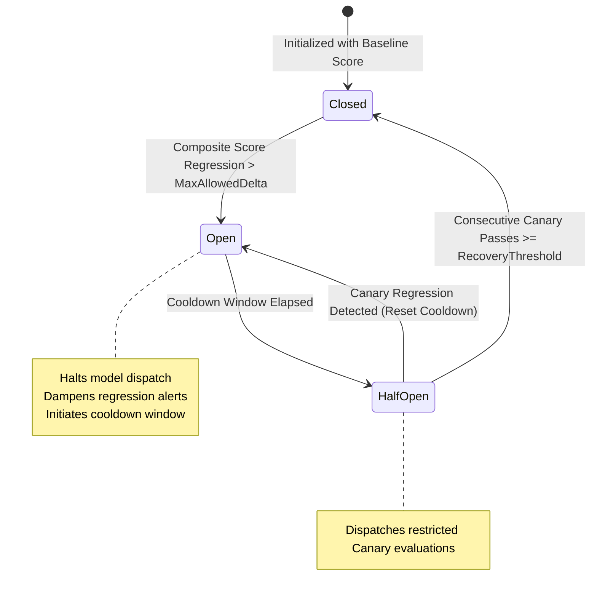

# Architecture Specification: Evaluation Benchmark Regression Gate & Autonomous Quality Circuit Breaker

## Executive Summary

As autonomous agent swarms generate, optimize, and iterate upon internal codebases and model dispatch topologies, continuous automated evaluation becomes a safety-critical boundary. Without deterministic regression gating, subtle behavioral degradation, prompt drift, or routing instability can cascade through multi-agent collaboration loops undetected.

This specification establishes the **Evaluation Benchmark Regression Gate and Autonomous Quality Circuit Breaker** within `pkg/eval`. The architecture couples benchmark score comparative analysis with a state machine circuit breaker (`Closed`, `HalfOpen`, `Open`) to quarantine non-conforming model dispatch configurations, dampen flapping regressions, and safely auto-recover through canary verification.

---

## Architectural Topology

---

## Core Components & Invariants

### 1. Benchmark Regression Evaluation Engine (`RegressionGate`)
- **Comparative Baseline Tracking**: Maintains baseline evaluation matrices (`BenchmarkScorecard`) across latency, accuracy, safety, and token efficiency.
- **Deterministic Delta Thresholds**: Rejects models exhibiting regressions beyond configurable percentage deltas (`MaxAllowedRegressionDelta`, default 5.0%).
- **Zero/Missing Baseline Guard**: When baseline scorecards are absent or uninitialized, the gate safely establishes the current run as the initial baseline rather than failing closed or panicking.

### 2. Quality Circuit Breaker State Machine (`QualityCircuitBreaker`)
- **`Closed`**: All model dispatches permitted. Benchmark runs continuously evaluate delta metrics.
- **`Open`**: Circuit tripped due to significant score regression. Model dispatches to the regressed provider or model tier are halted and routed to fallbacks.
- **`HalfOpen`**: Cooldown window has elapsed. Restricted canary evaluation probes are dispatched to verify if the regression condition has resolved.

### 3. Flapping Regression Dampener & Canary Recovery Pipeline
- **Exponential Dampening**: Prevents rapid oscillating trips between `Open` and `HalfOpen` states caused by noisy benchmark workloads.
- **Canary Quorum Recovery**: Requires $N$ consecutive successful canary evaluations (`CanaryConsecutivePassThreshold`, default 3) before transitioning back to `Closed`.
- **Thread Safety & Nil Hygiene**: Zero-allocation state queries, immutable score representations, and strict thread-safe mutex protections.

---

## Three-Fold Verification Strategy

### 1. Static Floor Invariant
- Verifies default regression thresholds, circuit breaker state enums (`Closed`, `HalfOpen`, `Open`), configuration bounds, and deterministic error floors.

### 2. Operational Dynamic Proof
- Verifies live circuit breaker state transitions from `Closed` to `Open` when composite benchmark scores drop below regression thresholds, ensuring non-conforming model dispatches are intercepted.

### 3. Negative Adversarial Boundary
- Verifies flapping regression dampening under volatile score oscillations, safe fallback when baselines are zero or unparseable, and canary recovery to `HalfOpen` and `Closed`.
