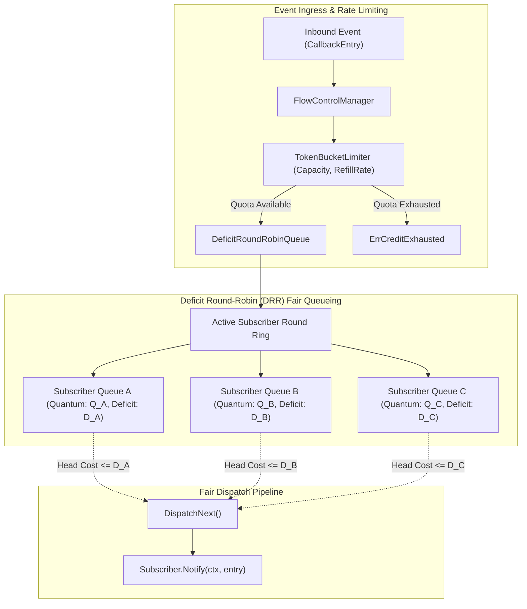

# High-Throughput Event Mesh Flow Control, Token Bucket Rate Limiting, and Starvation Prevention

## Executive Summary
In the ZQK Knowledge Operating System (KOS), asynchronous callback streams propagate critical events across scheduler jobs, lifecycle state transitions, agent coordination swarms, WAL persistence pipelines, and TUI renderers. Under high-throughput burst workloads, uncontrolled event submission produces two critical failure modes:
1. **Unbounded Burst Ingestion**: High-velocity producers flood subscriber ingestion queues, triggering memory exhaustion, buffer bloat, and cascading latency spikes across unrelated consumers.
2. **Multi-Tenant Starvation (Noisy-Neighbor Effect)**: In multi-tenant environments with heterogeneous workloads (e.g. high-frequency lightweight logging versus compute-intensive AST indexers), greedy producers monopolize shared dispatch workers, starving slower or lower-volume subscribers.

To solve these failure modes, this subsystem introduces three cooperating primitives in `cmd/zqk/callback/token_bucket_flow.go`:
- **`TokenBucketLimiter`**: A thread-safe, continuous-replenishment token bucket rate limiter providing burst allowance, atomic non-blocking testing (`TryAcquire`), blocking context-aware reservation (`Acquire`), and instantaneous capacity inspection (`AvailableTokens`).
- **`DeficitRoundRobinQueue`**: A multi-tenant fair queueing engine implementing Shreedhar & Varghese's Deficit Round-Robin (DRR) algorithm with per-subscriber quantum allocations and deficit accumulation, preventing starvation across heterogeneous packet cost distributions.
- **`FlowControlManager`**: An integrated coordinator connecting token bucket rate limiters and deficit round-robin queues to subscriber dispatch routines.

---

## Architectural Topology

---

## 1. Token Bucket Rate Limiting Algorithm

The `TokenBucketLimiter` controls event intake burstiness and sustained rate using a continuous time-elapsed token model.

### Replenishment Mechanics
Rather than relying on periodic background ticker goroutines that introduce scheduling overhead and timer drift, the limiter calculates token replenishment on demand based on elapsed monotonic time:
$$\Delta t = t_{\text{now}} - t_{\text{last}}$$
$$\text{tokens}_{\text{current}} = \min\left(\text{Capacity}, \text{tokens}_{\text{current}} + \Delta t \times \text{RefillRate}\right)$$

### Acquisition Interfaces
- `TryAcquire(tokens int64) bool`: Atomic, non-blocking check. If current tokens $\ge \text{tokens}$, deducts tokens and returns `true`; otherwise increments rejected metrics and returns `false`.
- `Acquire(ctx context.Context, tokens int64) error`: Blocking acquisition. Computes required sleep time $\delta t = (\text{tokens} - \text{current}) / \text{RefillRate}$ and awaits timer expiration or token notification broadcast (`notifyCh`), failing immediately if context is canceled or the limiter is closed.
- `AvailableTokens() int64`: Thread-safe floor of current available tokens.

---

## 2. Deficit Round-Robin Fair Queueing (DRR)

Standard round-robin queueing unfairly favors producers that submit large or expensive payloads. Deficit Round-Robin resolves packet length / cost bias by tracking an accumulated deficit credit per tenant.

### Mathematical Model
For each subscriber queue $i$:
1. When queue $i$ is serviced in round $r$, its accumulated deficit $D_i$ is credited with its quantum $Q_i$:
   $$D_i \leftarrow \min\left(\text{MaxDeficit}, D_i + Q_i\right)$$
2. While queue $i$ is non-empty and the head item cost $C(e) \le D_i$:
   - The head item is dequeued and emitted.
   - $D_i \leftarrow D_i - C(e)$.
3. If $C(e) > D_i$, queue $i$ yields execution to the next active subscriber in the ring. Its remaining deficit $D_i$ is preserved for the next round.
4. If queue $i$ becomes completely empty, its deficit is reset to 0 ($D_i \leftarrow 0$) and it is pruned from the active rotation ring to eliminate empty-poll overhead.

### Starvation Prevention Guarantees
- Low-volume or small-packet subscribers are guaranteed prompt service on each round because their cost $C(e) \le Q_i$.
- High-volume or large-packet subscribers cannot monopolize worker threads because once their deficit is exhausted, the scheduler rotates to peer subscribers.

---

## 3. Flow Control Manager Coordination

The `FlowControlManager` binds rate limiting, queueing, and subscriber dispatch:
- **`RegisterSubscriber(sub Subscriber, quantum, maxDeficit int64, maxDepth int) error`**: Registers tenant worker queues with customized fairness weights.
- **`Submit(subscriberID string, entry *CallbackEntry, cost int64) error`**: Validates global/pool rate limiter capacity before enqueuing to DRR.
- **`DispatchNext(ctx context.Context) (*CallbackEntry, error)`**: Fairly extracts the next eligible item from the DRR queue and dispatches to `sub.Notify()`.
- **`Close() error`**: Gracefully terminates limiters and queues, waking any blocked consumers.

---

## 4. Verification and Concurrency Correctness

The implementation is verified under `cmd/zqk/callback/token_bucket_flow_test.go` with `-race` enabled:
1. **Static Invariants & Configuration**: Zero or negative capacity/rate rejection, bounded initial tokens.
2. **Burst & Continuous Replenishment**: Verified burst consumption up to capacity, non-overflowing continuous elapsed refills.
3. **Blocking & Timeouts**: Context cancellation and timeout adherence during token acquisition.
4. **DRR Fair Scheduling**: Interleaved round-robin sequence verification between heavy ($C=100$) and light ($C=50$) subscribers.
5. **Starvation Resistance**: Accumulation across multiple rounds for items exceeding single quantum allocation.
6. **Concurrent Stress Safety**: Zero race conditions under concurrent multi-tenant producers and dispatchers.
7. **Boundary Validation & Error Recovery**: Comprehensive rejection of unconfigured subscribers, closed queue submissions, and idempotent multi-close termination.
