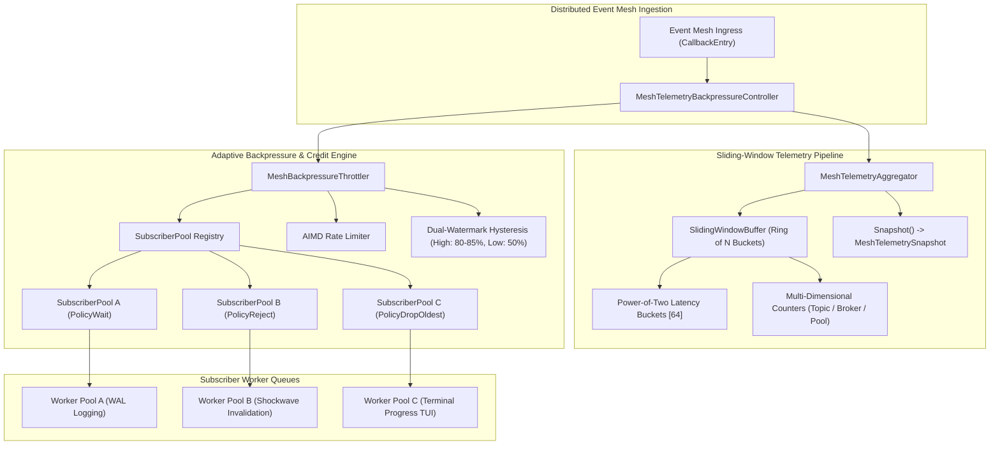
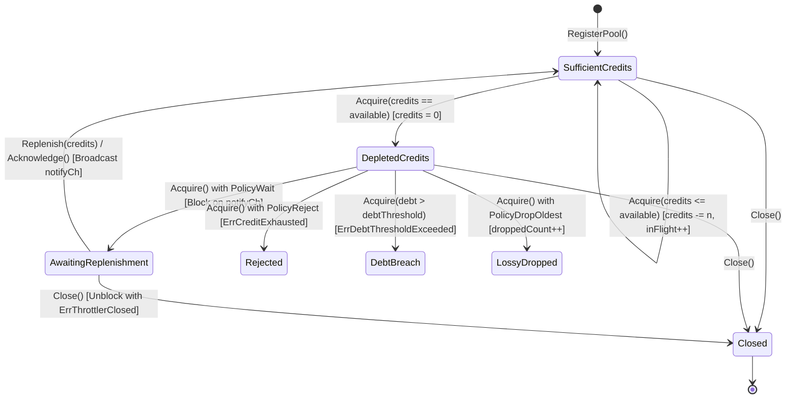

# Distributed Event Mesh Telemetry Aggregation and Adaptive Backpressure Throttling

## Executive Summary
In the ZQK Knowledge Operating System (KOS), asynchronous callback streams propagate critical events across scheduler jobs, lifecycle state transitions, agent coordination swarms, WAL persistence pipelines, and TUI renderers. Under extreme burst workloads (such as parallel multi-agent test runs or batch object mutations), uncontrolled event dispatch leads to:
1. **Consumer Buffer Overrun**: Fast publishers saturate downstream subscriber ring buffers, inducing unmanaged packet drops or memory exhaustion.
2. **Cascading Dispatch Starvation**: Slow or blocked subscribers hold shared dispatch semaphores, stalling the entire event mesh.
3. **Flapping Congestion Cycles**: Simple threshold triggers toggle rapidly around capacity boundaries, causing oscillating throughput drops.
4. **Telemetry Heap Contention**: Naive telemetry collectors allocate intermediate envelopes and maps in hot dispatch paths, triggering GC latency spikes.

This specification details the architecture of **`MeshTelemetryAggregator`**, **`SlidingWindowBuffer`**, **`MeshBackpressureThrottler`**, and **`MeshTelemetryBackpressureController`** (implemented in `cmd/zqk/callback/mesh_telemetry_backpressure.go`). Together, they provide zero-allocation sliding-window metrics, multi-tenant credit accounting, dual-watermark hysteresis, and Additive Increase / Multiplicative Decrease (AIMD) rate limiting across distributed event mesh subscribers.

---

## Architectural Topology



---

## 1. Sliding-Window Telemetry Aggregation Algorithm

### Mathematical Discretization & Ring Buffer
To observe event throughput and queue latencies without unbounded memory growth or expensive garbage collection, `SlidingWindowBuffer` discretizes a continuous time window $W$ (default: 10 seconds) into $K$ discrete sub-buckets (default: 10 sub-buckets of duration $D = W / K = 1\text{s}$).

Each bucket $k \in [0, K-1]$ maintains:
- `startTime`: Timestamp marking the floor of the sub-bucket interval.
- `dispatched`: Total events dispatched within the bucket.
- `received`: Total events successfully received within the bucket.
- `dropped`: Total events discarded due to backpressure or queue saturation.
- `latencyBuckets`: 64-element power-of-two logarithmic nanosecond histogram.

#### O(1) Slot Resolution
Given timestamp $t$, the bucket index is resolved in $O(1)$ operations via modular arithmetic:
$$\text{slot} = \left( \left\lfloor \frac{t_{\text{nano}}}{D_{\text{nano}}} \right\rfloor \right) \pmod K$$
$$\text{bucketStart} = \left\lfloor \frac{t_{\text{nano}}}{D_{\text{nano}}} \right\rfloor \times D_{\text{nano}}$$

When writing to `buckets[slot]`, if `bucket.startTime != bucketStart`, the bucket has expired from the previous sliding cycle. The accumulator resets `bucket` in place with zero heap allocation.

#### Sliding Horizon Aggregation
Upon calling `Aggregate(now)` or `Snapshot()`:
1. The aggregator iterates across all $K$ buckets under an `RLock`.
2. A bucket $b$ is included if:
   $$0 \le (\text{now} - b.\text{startTime}) < W$$
3. Metrics are summed across valid buckets, yielding point-in-time throughput:
   $$\text{ThroughputPerSec} = \frac{\sum b.\text{dispatched}}{W_{\text{seconds}}}$$

### Power-of-Two Nanosecond Latency Histogram
Latencies are mapped to logarithmic power-of-two buckets using the CPU instruction `math/bits.Len64`:
$$\text{bucketIdx} = \min(63, \text{bits.Len64}(\text{latency}_{\text{ns}}))$$
This avoids float conversions, logarithmic math, or dynamic slice allocation in the hot dispatch path. P50, P95, and P99 percentiles are calculated via cumulative rank interpolation across the aggregated 64 buckets.

### Multi-Dimensional Telemetry Mapping
`MeshTelemetryAggregator` extracts metadata from `CallbackEntry.Payload` to aggregate metrics across three primary dimensions:
- `Topics`: Event message domain (e.g. `orders`, `payments`, `telemetry-feed`).
- `Brokers`: Message ingress source or coordinator instance.
- `Subscribers`: Target consumer worker pool identifier.

---

## 2. Credit-Based Backpressure Protocol & Bucket State Machine

### Credit Budget Accounting
Consumer worker queues in distributed event meshes fail when unbounded ingress overruns subscriber memory. The credit protocol prevents overrun by requiring callers to acquire discrete processing credits before dispatching to a worker pool.

Each `SubscriberPool` maintains:
- `credits`: Currently available execution tokens.
- `maxCredits`: Upper ceiling on available credits.
- `inFlight`: Active concurrently executing events.
- `debtThreshold`: Maximum allowable over-draft when operating in soft-rejection mode.

### State Transitions



### Protocol Operations
1. **`Acquire(ctx, poolID, credits)`**:
   - Deducts `credits` from `pool.credits` if available and increments `inFlight`.
   - If credits are insufficient:
     - `PolicyReject`: Returns `ErrCreditExhausted` (or `ErrDebtThresholdExceeded` if request exceeds `debtThreshold`).
     - `PolicyDropOldest`: Increments `droppedCount`, records telemetry drop, and returns `nil` (lossy path).
     - `PolicyWait`: Blocks on `notifyCh` until replenished, context expires (`ctx.Done()`), or throttler closes (`closeCh`).
2. **`Replenish(poolID, credits)`**:
   - Adds `credits` up to `maxCredits`.
   - Broadcasts to all waiters by closing and reallocating `notifyCh`.
3. **`Acknowledge(poolID, credits, latency)`**:
   - Decrements `inFlight`.
   - Replenishes `credits` (capped at `maxCredits`).
   - Broadcasts unblocking signal via `notifyCh`.

---

## 3. Backpressure Hysteresis & AIMD Congestion Control

### Dual-Watermark Hysteresis
To prevent oscillation ("flapping") around buffer saturation thresholds, `MeshBackpressureThrottler` enforces a dual-watermark hysteresis band:

```
Buffer Fill Ratio:
0% ───────────────────── 50% ────────────────────────── 85% ───────────────────── 100%
      [ Normal Mode ]     │       [ Hysteresis Deadband ]  │    [ Throttled Mode ]
                          │                                │
                    Low Watermark                    High Watermark
                 (Resumes Execution)               (Activates Backpressure)
```

1. **High Watermark ($H = 0.85$)**: When queue utilization $\ge H$, backpressure is activated (`throttling = true`). New acquisitions in `PolicyReject` or `PolicyWait` are gated.
2. **Low Watermark ($L = 0.50$)**: When queue utilization $\le L$, backpressure is cleared (`throttling = false`). Waiting workers are signaled to resume.
3. **Deadband ($L < \text{utilization} < H$)**: State remains unchanged from the previous cycle, absorbing micro-bursts without inducing control-loop jitter.

### Additive Increase / Multiplicative Decrease (AIMD)
When subscriber pools operate dynamic rate limiters, `RecordDrain` adjusts `rateLimit` using network-grade AIMD congestion control:
- **Congestion Detected ($\text{utilization} \ge \text{HighWatermark}$)**:
  $$\text{Rate}_{t+1} = \max(\text{Rate}_t \times \beta, \text{MinRateLimit})$$
  *(Default $\beta = 0.50$ Multiplicative Decrease)*
- **Buffer Drained ($\text{utilization} \le \text{LowWatermark}$)**:
  $$\text{Rate}_{t+1} = \min(\text{Rate}_t + \alpha, \text{MaxRateLimit})$$
  *(Default $\alpha = 100.0$ Additive Increase)*

---

## 4. Load Shedding Strategies & Worker Pool Isolation

### Shedding Policy Matrix

| Policy | Behavior under Exhaustion | Return Error | Use Case |
| :--- | :--- | :--- | :--- |
| `PolicyReject` | Fast fail-closed rejection | `ErrCreditExhausted` / `ErrDebtThresholdExceeded` | Critical transactional events requiring upstream back-off or compensatory retry. |
| `PolicyWait` | Context-bounded non-spinning wait | `nil` (or `ctx.Err()`) | Smooth batch pipelines where bounded latency is acceptable. |
| `PolicyDropOldest` | Lossy drop of incoming entry | `nil` | Soft real-time streams (terminal TUI updates, metrics) where dropped frames are preferred. |

### Multi-Tenant Isolation
Subscriber pools are partitioned by `PoolID`. Each pool maintains isolated synchronization primitives (`sync.Mutex`), credit counters, and rate limits. A backlog or stall in `worker-pool-tui` cannot deplete credits or exhaust semaphores in `worker-pool-wal`.

---

## 5. Defensive Boundaries & Invariant Enforcement

1. **Configuration Parameter Validation**:
   - Window duration and bucket counts must be $> 0$; otherwise rejected with `ErrInvalidConfiguration`.
   - Watermarks must satisfy $0 \le \text{LowWatermark} < \text{HighWatermark} \le 1.0$.
   - Credit acquisition and replenishment must specify amount $> 0$; otherwise rejected with `ErrInvalidCreditAmount`.
2. **Fail-Closed Nil Safety**:
   - `Notify(ctx, nil)` defensively returns `ErrNilTelemetryEntry` without panic.
   - Canceled contexts (`ctx.Done()`) return immediately without consuming credits or leaking channels.
3. **Clean Lifecycle Shutdown**:
   - `Close()` is strictly idempotent.
   - All waiting goroutines across all registered pools are unblocked immediately with `ErrThrottlerClosed`.
   - Post-close operations immediately return `ErrThrottlerClosed`.
4. **Zero-Leak Goroutine Management**:
   - Waiters block exclusively on channel selects (`<-notifyCh`, `<-closeCh`, `<-ctx.Done()`).
   - Condition broadcast uses channel closure (`close(notifyCh)`) followed by atomic reassignment. No auxiliary polling goroutines are spawned.

---

## 6. Verification Traceability Matrix

| Requirement / Criterion | Component | Verification Test Case |
| :--- | :--- | :--- |
| **CRIT-TELEMETRY-STATIC-001** (Static Invariants) | `SlidingWindowBuffer`, `MeshTelemetryAggregator` | `TestMeshTelemetry_StaticInvariants_LayoutAndBuffer`<br>`TestMeshTelemetry_SlidingWindowBucketingAndPercentiles`<br>`TestMeshTelemetry_DimensionalAggregationAndSnapshots` |
| **CRIT-TELEMETRY-DYNAMIC-BURST-002** (Dynamic Proof & Burst) | `MeshBackpressureThrottler`, `SubscriberPool` | `TestMeshBackpressure_CreditDeductionAndReplenishment`<br>`TestMeshBackpressure_PolicyWaitAndReplenishmentWakeup`<br>`TestMeshBackpressure_AdaptiveRateLimiter_AIMD`<br>`TestMeshBackpressure_ConcurrentBurstAndRaceDetector` |
| **CRIT-TELEMETRY-BOUNDARY-003** (Negative Boundaries & Spec) | Error Handling, Shutdown, Controller | `TestMeshBackpressure_NegativeBoundariesAndDefensiveRejection`<br>`TestMeshBackpressure_LifecycleCleanShutdownAndNoGoroutineLeaks`<br>`TestMeshController_UnifiedSubscriberIntegration`<br>`docs/architecture/EVENT_MESH_TELEMETRY_BACKPRESSURE.md` |
