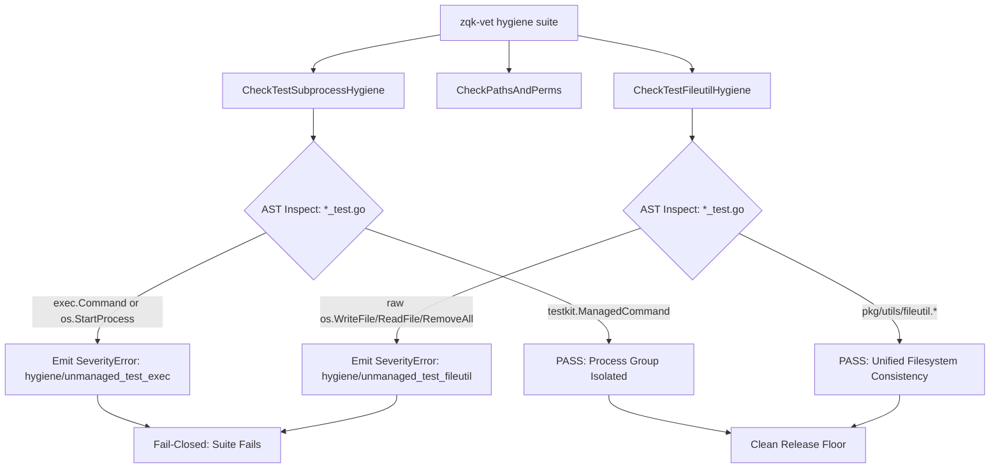

# Fail-Closed AST Enforcement for Test Isolation and Fileutil Consistency

> **Technical Specification:** `TSP-FAIL-CLOSED-AST-TEST-ISOLATION-001`  
> **Status:** Implemented & Verified  
> **Target Release:** Zen Quantum Kernel v0.1.0  
> **Architecture Domain:** Static Analysis & Verification Governance

---

## 1. Executive Summary & Problem Statement

In high-concurrency, long-running agentic swarms and multi-threaded testing environments, subprocess execution and unmanaged filesystem operations present substantial architectural risks:

1. **Orphaned Process Leaks:** Test suites invoking naked standard library `exec.Command` or `os.StartProcess` lack deterministic deadline contexts, process group bindings, and teardown traps. When tests time out or terminate abruptly, child processes linger in the operating system process table, leaking CPU cycles and port bindings.
2. **Filesystem Inconsistency & Test Isolation Breaches:** Uncoordinated invocations of raw `os.*` file operations (`os.WriteFile`, `os.ReadFile`, `os.MkdirAll`, `os.RemoveAll`) bypass the atomic, permission-controlled, and telemetry-monitored abstractions provided by `pkg/utils/fileutil` (such as umask normalization and secure octal modes `paths.FilePerm600` / `paths.DirPerm755`).
3. **Fail-Closed Static Floor (Shift-Left Guard):** Allowing subprocess and filesystem violations as mere compiler warnings (`SeverityWarn`) fails to prevent regressions from slipping past CI and pre-commit checks.

Cycle 48 eliminates these hazards by establishing **fail-closed Abstract Syntax Tree (AST) static verification** within the ZQK Verification Engine (`zqk-vet`), enforcing `testkit.ManagedCommand` process group isolation and `fileutil` consistency across the codebase without test file exemptions.

---

## 2. Architecture & AST Inspection Engine



### Static Analysis Rules

| Check ID | Target Scope | Violation Condition | Required Replacement | Severity |
| :--- | :--- | :--- | :--- | :--- |
| `hygiene/unmanaged_test_exec` | `*_test.go` | Naked `exec.Command(...)` or `os.StartProcess(...)` | `testkit.ManagedCommand(t, ctx, ...)` | `ERROR` (Fail-Closed) |
| `hygiene/unmanaged_test_fileutil` | `*_test.go` | Direct `os.WriteFile`, `os.ReadFile`, `os.Open`, `os.OpenFile`, `os.RemoveAll` | `pkg/utils/fileutil.*` | `ERROR` (Fail-Closed) |
| `hygiene/magic-perms` | `**/*.go` | Unsymbolized octal literals (`0755`, `0644`, `0600`) in file/dir creation | `paths.FilePerm644`, `paths.FilePerm600`, `paths.DirPerm755` | `ERROR` (Fail-Closed) |

---

## 3. Subprocess Isolation Mechanism (`testkit.ManagedCommand`)

`testkit.ManagedCommand` guarantees three invariants across every spawned test child:
1. **Process Group Membership (`Setpgid: true`):** Spawns the child in its own unique process group, ensuring that any sub-children spawned by compilers, daemons, or scripts are tracked within the same OS process tree.
2. **Cancellation Signal Cascade:** Wires `cmd.Cancel` to send `SIGKILL` to the entire process group (`-pgid`) rather than just the direct PID.
3. **Deterministic Cleanup Hook (`t.Cleanup`):** Registers an automatic process group kill handler with the active testing context (`testing.TB`), guaranteeing clean termination even upon panic or test failure.

```go
func ManagedCommand(t testing.TB, ctx context.Context, name string, args ...string) *exec.Cmd {
    t.Helper()
    cmd := exec.CommandContext(ctx, name, args...)
    setProcessGroup(cmd)
    cmd.Cancel = func() error {
        return killProcessGroup(cmd)
    }
    cmd.WaitDelay = 2 * time.Second
    t.Cleanup(func() {
        _ = killProcessGroup(cmd)
    })
    return cmd
}
```

---

## 4. Verification & Continuous Enforcement

The AST enforcement engine is baked into the standard verification gates:
- **Pre-Commit Check-Valve (`tools/git-hooks/pre-commit`):** Invokes `zqk-vet --suite hygiene` and rejects any commit introducing naked execution or file operations.
- **Continuous Integration (`.github/workflows/ci.yml`):** Runs `make vet` (`./bin/zqk-vet --suite all`), failing closed on any finding.
- **Self-Hosting Unit Verification (`pkg/vet/test_exec_guard_test.go`):** Validates AST parsing, boundary conditions (non-existent directories, syntax error resilience, production file non-interference), and clean fileutil compliance.
