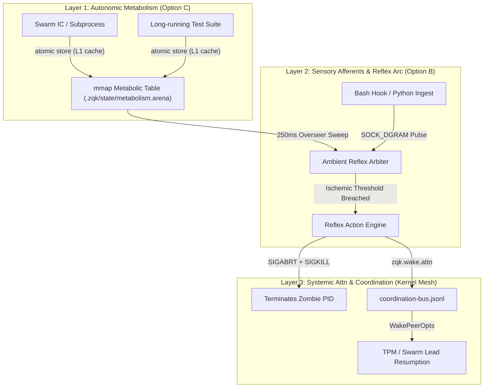

# Architecture Decision Record (ADR): Generic Liveness Status Listener & Subprocess Apoptosis

## Status: Accepted
**Author**: TPM / Community Architecture Steward  
**Context**: Root-cause resolution of execution stalls caused by child process IPC deadlocks and subprocess blindness.  
**Decision**: Implement the Neuro-Metabolic Synthesis: Phased deployment of Option B (Ambient Datagram Pulse Bus) followed by Option C (Shared-Memory Metabolic Arena).

---

## 1. Problem Anatomy & Root Cause Analysis

### The Subprocess Blindness Dilemma (The "Zombie Limb")
In distributed and agentic environments, coordinators and workers frequently fork child processes (`git fetch`, `ssh-add`, `go test`, compilers, or sandboxed subagents):
1. **Synchronous Thread Starvation**: The parent goroutine blocks on `cmd.Wait()` or `io.ReadAll(stdout)`. If the child process freezes on an unmonitored channel (e.g. an unresponsive UNIX domain socket or a dead TCP pipe), the parent is completely paralyzed.
2. **Heartbeat Inversion**: The current Hourglass checker examines top-level checkin files (`.zqk/state/checkins/`) or process table PIDs. Because the parent thread is frozen awaiting the child, it cannot refresh its own lease. Alternatively, if a static global timeout is configured, it fails to differentiate between legitimate high-compute cycles (a 90s full test matrix compile) and immediate deadlocks (a 2s socket handshake freeze).
3. **The IPC Paradox**: If a liveness mechanism relies on the very resources that are constrained or deadlocked (e.g., synchronous file locks, CAS WAL writes, or blocking pipes), the reporting mechanism itself deadlocks.

```mermaid
flowchart TD
    subgraph Stalled_Model["Current Vulnerability: Subprocess Blindness"]
        Parent["Parent Agent / TPM"] -->|"fork & wait"| Child["Child Process (e.g. ssh-add)"]
        Child -->|"hangs on stale socket"| Deadlock["Silent Stall"]
        Parent -.->|"blocked thread cannot emit heartbeat"| Hourglass["Disk-Based Checkin"]
        Hourglass -->|"unhandled timeout or false assumption of life"| Hang["Loop Paralyzed"]
    end

    subgraph Autonomous_Metabolism["Target: Decentralized Autonomic Nervous System"]
        Worker["Worker Holon / Process"] -->|"Zero-blocking pulse"| Sensory["Sensory Receptor (Datagram / Shared Mem)"]
        Sensory -->|"Continuous Gradient"| Arbiter["Ambient Reflex Arbiter"]
        Arbiter -->|"Ischemic Threshold Breached"| Apoptosis["Local Apoptosis (SIGABRT + Kill)"]
        Apoptosis -->|"Event Injection"| CoordinationBus["coordination-bus.jsonl (zqk.wake.attn)"]
    end
```

---

## 2. Biological Paradigms & Natural Alignment

Biological organisms maintain integrity across vast temporal and spatial scales through hierarchical, decentralized mechanisms:

1. **Cardiovascular & Myogenic Vascular Tone**:
   - The heart generates a central sinoatrial rhythm, but individual organ beds regulate their own blood flow via myogenic auto-regulation. If an arteriole detects low shear stress or hypoxia, local pre-capillary sphincters react autonomously without waiting for instructions from the cerebral cortex.
2. **Refractory Periods & Action Potentials**:
   - Neurons transmit information through quantized action potentials separated by absolute refractory periods. Synaptic clearance is strictly rate-limited; neurotransmitters left in the synaptic cleft are actively degraded by enzymes or reabsorbed by transporters, preventing infinite tonic depolarization.
3. **Cellular Autophagy & Mitochondrial Apoptosis**:
   - A healthy cell continuously maintains a mitochondrial membrane potential ($\Delta\Psi_m$). If cellular respiration ceases, the proton gradient collapses, releasing Cytochrome C and activating caspase cascades. The cell undergoes *programmed self-destruction (apoptosis)* quietly from within, preserving the health of surrounding tissue without triggering systemic sepsis.
4. **Immune Missing-Self Recognition (Natural Killer Cells)**:
   - NK cells constantly patrol tissue surfaces, checking for the presence of MHC Class I molecules. If a cell stops presenting its periodic surface markers (due to viral hijack or malignant stall), the NK cell releases perforin and granzymes to lyse it immediately.

---

## 3. Comprehensive Evaluation of Architectural Options

### Option A: The "Reflex Arc" Subprocess Envelope (`zqkexec.Envelope`)

*Classical Unix process-group containment wrapping `os/exec.Cmd` with typed execution profiles.*

| Category | Assessment |
| :--- | :--- |
| **Mechanism** | Centralized Go wrapper function `zqkexec.Run(ctx, profile, cmd)` enforcing class-based deadlines: `ProfileFastIPC` (3s), `ProfileStreaming` (sliding byte window), `ProfileBuild` (120s with progress pulse). |
| **Pros** | • **Zero infrastructure**: Runs in-process; requires no daemon, socket, or shared memory file. • **Immediate stack diagnostic**: Sends `SIGABRT` before `SIGKILL`, dumping goroutines and OS threads to stderr. • **Drop-in replacement**: Can replace `testkit.ManagedCommand` and raw `exec.Command` directly. |
| **Cons** | • **Imperative / Monolithic**: Solves the symptom, not the architecture. Applies only to code paths explicitly wrapped in Go; does not monitor external background processes, subagents, or independent CLI instances. • **No Ambient Telemetry**: Operates in isolation; does not publish events to the Knowledge Kernel, coordination bus, or agent feed. • **Violates ZQK DNA**: Reverts ZQK's decentralized, event-driven philosophy to procedural defensive programming. |
| **Architectural Score** | **5 / 10** (Tactical, but philosophically misaligned with ZQK Swarm Architecture). |

---

### Option B: The "Ambient Holon Pulse Bus" (Connectionless Datagram Listener)

*A connectionless, non-blocking UNIX domain datagram socket (`SOCK_DGRAM`) hosted by the Ambient Overseer.*

| Category | Assessment |
| :--- | :--- |
| **Mechanism** | Ambient daemon maintains `.zqk/state/liveness.sock`. Any process, worker, or script emits asynchronous, fire-and-forget UDP/Unix datagrams: `{"holon_id": "worker-1", "pid": 4812, "cadence_ms": 3000, "phase": "git_fetch"}`. The listener maintains an in-memory decay table and emits `zqk.wake.attn` events when a pulse expires by `2 * cadence_ms`. |
| **Pros** | • **Zero Lock Contention**: `SOCK_DGRAM` writes are memory-buffered by the OS kernel and non-blocking (`MSG_DONTWAIT`). Workers never block on CAS locks, WAL availability, or disk I/O. • **Polyglot & Universal**: Any language or process (Go, Python scripts, bash hooks, subagents) can emit a pulse with a single UDP/UDS write. • **Native Event-Driven Alignment**: Integrates directly with `pkg/ambient/reflex_loop.go` and `agentfeed.WakePeerOpts`. • **Decoupled Architecture**: Workers do not know who is listening; the ambient arbiter handles triage and recovery. |
| **Cons** | • **Daemon Dependency**: Requires the ambient overseer process to be alive to harvest pulses. • **Socket Lifecycle**: Unix domain socket files must be cleanly managed and unlinked across reboot/daemon restart. |
| **Architectural Score** | **9 / 10** (Highly aligned with ZQK's event-driven philosophy and ambient reflex loops). |

---

### Option C: The "Metabolic Lease & Apoptosis Arena" (Shared-Memory `mmap` Field)

*A fixed-size memory-mapped ring table (`.zqk/state/metabolism.arena`) with atomic sequence counters.*

| Category | Assessment |
| :--- | :--- |
| **Mechanism** | A 64KB memory-mapped file provides 1,024 slots of 64 bytes each: `[HolonID (16B) | PID (4B) | Generation (4B) | DeadlineEpoch (8B) | AtomicSequence (8B) | PhaseCode (8B) | Checksum (8B)]`. Workers increment their `AtomicSequence` via CPU atomic instructions (`atomic.AddUint64`). A background reaper sweeps the arena every 250ms via atomic loads. |
| **Pros** | • **Zero Syscalls**: Updating liveness takes sub-nanosecond CPU instruction time (L1/L2 cache write), making it viable for tight inner loops. • **Total I/O Immunity**: Completely immune to disk exhaustion, full file descriptors, pipe deadlocks, or socket buffer overflows. • **Zero-Cost External Inspectability**: Any external CLI (`zqk system vitality --mmap`) can inspect the real-time metabolic pulse of all processes with zero IPC overhead. |
| **Cons** | • **Implementation Complexity**: Requires rigorous struct byte-alignment, memory fences, and atomic bitmap slot management. • **Platform Variance**: Memory-mapping semantics can have minor edge cases across macOS, Linux, and Windows (though Darwin/Linux POSIX mmap is mature). • **Harder Polyglot Access**: Simple bash or Python scripts cannot easily manipulate raw binary mmap memory without helper bindings. |
| **Architectural Score** | **8.5 / 10** (Extreme biological fidelity and performance; higher implementation complexity). |

---

## 4. Comparative Trade-Off Matrix

| Evaluation Criterion | Option A (Envelope) | Option B (Pulse Bus) | Option C (Metabolism `mmap`) |
| :--- | :---: | :---: | :---: |
| **Event-Driven Philosophy** | Low (Procedural) | **Native (Event Stream)** | **High (Continuous Field)** |
| **Zero-Deadlock Guarantee** | Moderate (Local only) | **High (Non-blocking DGRAM)** | **Absolute (Atomic Memory)** |
| **Polyglot & Script Accessibility** | Low (Go-only) | **High (Standard Socket Write)**| Moderate (Requires C/Go FFI) |
| **Overhead on Hot Path** | Syscall per read/write | ~1 syscall per pulse | **Zero syscalls (atomic store)** |
| **Swarm & Subagent Scalability** | Fails (Point-to-point) | **High (Distributed Bus)** | **High (Concurrent Arena)** |
| **Diagnostic Fidelity** | High (Stack traces) | Moderate (Event logs) | **High (Real-time memory map)** |
| **Recovery Latency** | Command-bound | **Event-bound (<200ms)** | **Cycle-bound (<100ms)** |

---

## 5. Strategic Architectural Recommendation: The Neuro-Metabolic Synthesis

Rather than viewing B and C as mutually exclusive, biological architecture reveals that they represent the **two natural layers of nervous regulation**:

### Phased Roadmap:
1. **Phase 1 (Immediate - Cycle 39/40)**: Deploy **Option B (Ambient Datagram Pulse Bus)** in `pkg/ambient/`. It directly integrates with `coordination-bus.jsonl` and provides an immediate, universal, non-blocking socket that both Go processes and scripts (`import_github_issues.py`, git hooks, test runners) can write to.
2. **Phase 2 (Performance & Core Engine - Cycle 41)**: Layer **Option C (Shared-Memory Metabolic Arena)** under the high-frequency execution engine (`pkg/testkit/`, `zqk do`, `pkg/ambient/reflex_loop.go`) to give sub-nanosecond pulse capabilities to deep compilation loops and storage operations.
3. **Option A Tactical Guard**: Retain class-based deadline timeouts in `testkit.ManagedCommand` as a defense-in-depth static floor invariant, while treating Option B as the sovereign dynamic liveness authority.
