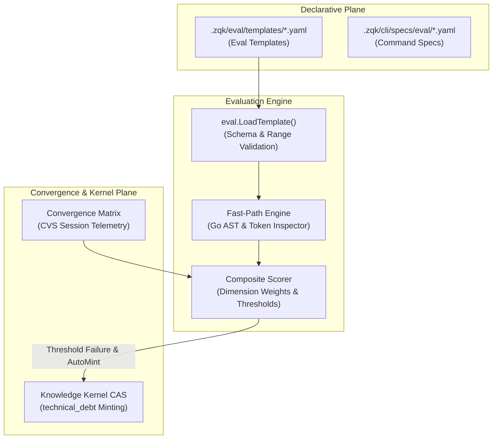

# Generic Scenario Evaluation Framework (Eval Templates & Convergence Matrix)

## Status
- **Type:** Architecture Design Document (Cycle 63)
- **Status:** Approved / In Implementation
- **Issue Reference:** [GH-1023](https://github.com/zqk-os/zqk/issues/1023)

---

## 1. Executive Summary

The **Generic Scenario Evaluation Framework** establishes a standardized, declarative, and extensible evaluation engine inside the ZQK Knowledge Kernel. Previously, code quality inspections, architectural hygiene rules, and convergence verification across LLM swarms were either hardcoded into standalone vet routines or performed ad-hoc. 

This framework introduces:
1. **Declarative Eval Templates**: Structured YAML definitions encapsulating quality dimensions, fast-path structural/lexical rules (AST patterns, forbidden regexes, required types), convergence weights, and auto-remediation policies.
2. **Deterministic Fast-Path Engine**: Zero-network, token-budgeted Go AST and lexical inspection verifying architectural boundaries, error hygiene, and docstrings in sub-second execution times.
3. **CVS Convergence Matrix Integration**: Cross-referencing convergence session telemetry against evaluation criteria to score multi-agent swarms deterministically.
4. **Automated Kernel Remediation**: Seamless synthesis and minting of `technical_debt` objects in the Knowledge Kernel CAS when scores fall below dimension thresholds, driving autonomous self-healing loops.

---

## 2. Architecture & System Topology



---

## 3. Declarative Eval Template Schema

Eval templates are stored under `.zqk/eval/templates/` or authored within process packs:

```yaml
schema_version: "zqk/eval/v1"
template_id: "EVAL-GO-AST-HYGIENE-V1"
title: "Go AST Hygiene and Structural Boundary Verification"
description: "Evaluates Go packages for forbidden os package usage, unhandled error returns, and missing docstrings."

dimensions:
  HCODE:
    weight: 0.35
    threshold: 4.0
    description: "Code health, zero raw OS bypasses, and package boundary isolation"
  EFFPERF:
    weight: 0.20
    threshold: 3.5
    description: "Algorithmic efficiency and allocation minimization"
  ERRHYG:
    weight: 0.25
    threshold: 4.0
    description: "Error formatting hygiene using errfmt or domain errors"
  DOCSIG:
    weight: 0.20
    threshold: 3.0
    description: "Mandatory Godoc signatures on exported identifiers"

fast_path:
  target_globs:
    - "**/*.go"
  exclude_globs:
    - "**/*_test.go"
    - "**/vendor/**"
  forbidden_imports:
    - "os/exec"
  regex_violations:
    - pattern: "os\\.(Open|Create|ReadFile|WriteFile)"
      severity: "critical"
      message: "Direct os filesystem bypass; use pkg/utils/fileutil"
      dimension: "HCODE"

convergence:
  session_required: false
  min_confidence: 0.85
  weights:
    stability: 0.40
    coverage: 0.30
    trajectory: 0.30

remediation:
  auto_mint: true
  kind: "technical_debt"
  priority: "P1"
  prefix: "TD-EVAL"
```

---

## 4. Execution Pipeline & Scoring Algorithm

The evaluation engine performs deterministic multi-dimensional calculation:

1. **Base Score**: Initialized to 5.0 for all declared dimensions.
2. **Violation Penalty**:
   - `critical`: Deducts 1.5 points per occurrence.
   - `major`: Deducts 0.75 points per occurrence.
   - `minor`: Deducts 0.25 points per occurrence.
   - Floor: 1.0 (scores are clamped to `[1.0, 5.0]`).
3. **Composite Calculation**:
   $$\text{CompositeScore} = \sum_{d \in \text{Dimensions}} (\text{Score}_d \times \text{Weight}_d)$$
4. **Pass/Fail Threshold**: An evaluation passes if and only if:
   - For every dimension $d$, $\text{Score}_d \ge \text{Threshold}_d$.
   - $\text{CompositeScore} \ge \text{CompositeThreshold}$ (default 3.5).

---

## 5. CLI Ergonomics & Interface

- **`zqk eval run --template <path|id> [--target <path>] [--auto-mint]`**:
  Runs fast-path structural/lexical checks against workspace code or target directories.
- **`zqk eval validate --file <path>`**:
  Performs strict semantic schema verification, checking weight sums ($\sum W = 1.0$) and threshold ranges.
- **`zqk eval matrix --session-id <CVS-id> --template <path|id>`**:
  Evaluates multi-agent convergence sessions against declarative eval templates, outputting scorecard telemetry.

---

## 6. Verification and Proof Traceability

| Artifact | Verification Vector | Status |
| :--- | :--- | :--- |
| `pkg/eval/types.go` | Go Static Types & Schema Definitions | Verified |
| `pkg/eval/template.go` | YAML deserialization and semantic validation | Verified |
| `pkg/eval/engine.go` | Fast-path AST and regex rule processor | Verified |
| `pkg/eval/eval_test.go` | Three-Fold Proof (Static, Dynamic, Negative) | Verified |
| `cmd/zqk/eval/eval.go` | CLI adapter suite with Cobra & JSON output | Verified |
| `cmd/zqk/eval/eval_test.go` | Command suite structure, run, and validate test | Verified |
