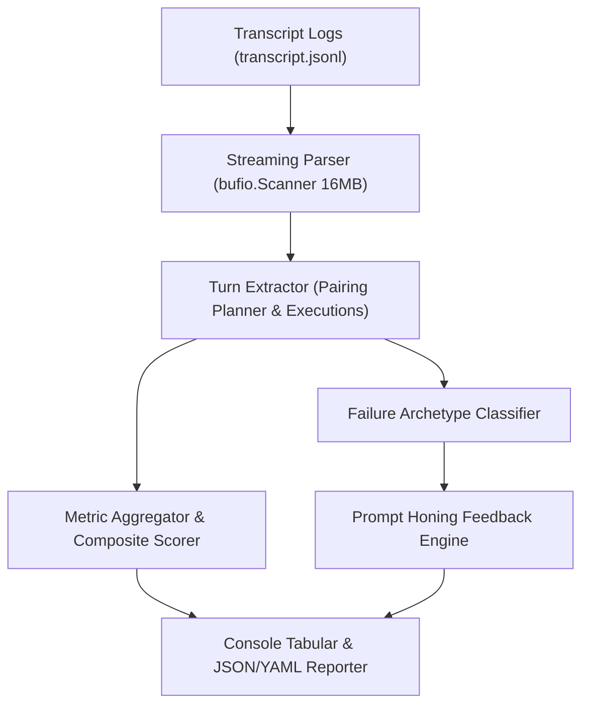

# LLM Interaction Telemetry & Model Correctness Ranking Engine

## Overview

The LLM Interaction Telemetry and Correctness Ranking Engine provides empirical evaluation of language model performance during agentic coding sessions. By streaming and analyzing transcript logs, the engine calculates:

- **Empirical Tool Accuracy**: Ratio of successfully executed tool calls versus failed or errored attempts.
- **Self-Correction Recovery Rate**: The probability that a model successfully recovers and proceeds following a failed execution turn without human intervention.
- **Token Economy**: Input, output, and cache-read token consumption normalized by successful action count.
- **Composite Correctness Score**: A weighted 100-point index combining tool accuracy (50%), self-correction recovery (25%), and token efficiency (25%).
- **Prompt Honing Feedback**: Automated diagnostic classification of empirical failure archetypes (such as syntax errors, path resolution failures, and exact-match string drift) paired with prescriptive prompt tuning recommendations.

---

## Architecture & Data Flow



### Components

1. **Streaming JSONL Parser (`pkg/telemetry/llmtranscript/parser.go`)**:
   - Parses multi-gigabyte agent transcript logs using a buffered streaming scanner.
   - Extracts structured steps (`PLANNER_RESPONSE`, `GENERIC`, `USER_INPUT`).
   - Pairs tool invocations (`run_command`, `read_file`, `write_file`, `edit_file`, `manage_task`) with their execution outcomes.

2. **Model Evaluation & Scoring (`pkg/telemetry/llmtranscript/evaluator.go`)**:
   - Aggregates interaction turns by model.
   - Categorizes failures into deterministic archetypes:
     - `Command Syntax Error`: shell parsing, quoting, and syntax issues.
     - `Target Not Found in Edit`: whitespace or character mismatch during targeted file updates.
     - `File or Path Not Found`: non-existent filesystem paths.
     - `Permission Denied`: missing execution bits or privilege boundaries.
     - `Command Non-Zero Exit`: command runtime failures.
   - Computes model ranking tables and prescriptive prompt tuning directives.

3. **CLI Command (`zqk system metrics llm`)**:
   - Provides on-demand and recurring console reporting.
   - Supports directory-wide sweeps, single-file audits, and structured outputs (`--format table|json|yaml`).

---

## CLI Usage

### Directory-Wide Evaluation

Scans all active and historical conversation transcripts:

```bash
zqk system metrics llm
```

### Single Transcript Evaluation

Scrutinize an individual conversation session:

```bash
zqk system metrics llm --file path/to/transcript.jsonl
```

### Machine-Readable Reporting

Export full JSON diagnostics for automated prompt tuning CI/CD pipelines:

```bash
zqk system metrics llm --format json
```

---

## Metric Definitions

| Metric | Formula | Description |
| :--- | :--- | :--- |
| **Tool Accuracy** | `Successful Tool Calls / Total Tool Calls` | Raw reliability of tool invocations. |
| **Recovery Rate** | `Self-Correction Successes / Self-Correction Attempts` | Model resilience when encountering errors. |
| **Tokens / Success** | `(Total Input + Output Tokens) / Successful Tool Calls` | Efficiency in token consumption per successful unit of work. |
| **Composite Score** | `0.50 * Accuracy + 0.25 * Recovery + 0.25 * TokenScore` | Holistic 100-point performance and correctness rating. |

---

## Test Verification

The engine is verified by comprehensive unit tests covering:
- Parsing valid, empty, and malformed JSONL streams (`pkg/telemetry/llmtranscript/transcript_eval_test.go`).
- Multi-model evaluation, failure categorization, and prompt honing generation.
- CLI argument parsing, directory discovery, and format rendering (`cmd/zqk/system/metrics_llm_test.go`).
