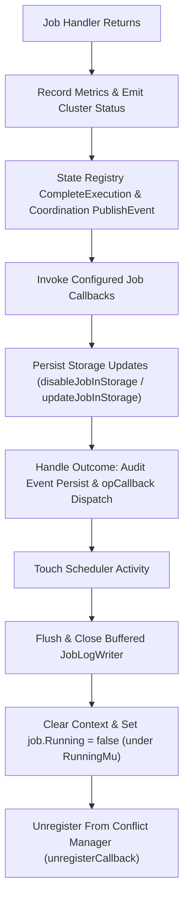

# Scheduler Lifecycle Finalization and Teardown Synchronization

## Executive Summary

The ZQK scheduler coordinates periodic, event-driven, and on-demand job executions across multi-agent runtimes, verification suites, and system maintenance tasks. In distributed or high-concurrency environments, non-deterministic job finalization and test fixture teardown can cause subtle race conditions:
1. **Premature Completion Signalling:** If in-memory flags (`job.Running = false`) or concurrency conflict registrations are cleared before storage persistence, audit journaling, and log file flushing finish, external observers or subsequent jobs observe stale states or race with in-flight I/O.
2. **Asynchronous Teardown Resource Contention:** If test fixtures shut down storage providers or remove temporary directories (`t.TempDir()`) while background scheduler workers, log writers, or CAS write-behind queues are still active, OS-level filesystem unlink operations fail with `unlinkat ...: directory not empty` or resource contention errors.

This specification formalizes the strict synchronization invariants governing the scheduler job execution lifecycle and test fixture teardown across the Knowledge Kernel.

---

## 1. Job Execution Lifecycle Finalization Invariant

### 1.1 Problem Analysis
In `pkg/scheduler/job_execution.go`, `executeJobAfterHandlerReturns` is responsible for recording execution metrics, publishing coordination events, persisting the job's new state (`last_run_at`, `status`, `enabled`), writing job log entries, and releasing execution locks.

Previously, `job.Running = false` and `unregisterCallback()` (which unregisters the job from the conflict manager) were executed immediately after handler return, prior to:
- State registry execution completion (`s.stateRegistry.CompleteExecution`)
- Coordination channel event publication (`s.coordinationChannel.PublishEvent`)
- Storage persistence (`s.updateJobInStorage` and `s.disableJobInStorage`)
- Job log writing and audit event recording (`s.handleJobExecutionOutcome`)
- Operation callback dispatch (`opCallback.OnComplete` / `opCallback.OnError`)
- Job log writer flushing and closure (`CloseJobLogWriter`)

Consequently, external callers and test assertions awaiting completion via `waitForJobFinalized` (which polls `job.Running == false`) or via `opCallback` would resume execution and initiate teardown while storage writes and log file flushes were still active in the background.

### 1.2 Ordered Finalization Sequence
To eliminate this race, `executeJobAfterHandlerReturns` enforces a strict linear completion pipeline:



### 1.3 Key Invariants
- **Storage-Before-Callback Invariant:** Job state in storage (including updated `last_run_at`, `next_run_at`, and disabled state for one-time jobs) is guaranteed to be persisted before `opCallback.OnComplete` is dispatched.
- **Log-Flush-Before-Running-Clear Invariant:** `CloseJobLogWriter(s.getProjectRoot(), job.ID)` runs before `job.Running = false`. Callers inspecting the filesystem immediately upon `job.Running == false` are guaranteed that all buffered job logs are flushed and closed.
- **Conflict-Deregistration-at-Tail Invariant:** The job remains registered in the concurrency conflict manager until all background writes and state updates have completed. Subsequent jobs with conflicting locks will never be admitted while the prior job's teardown is in flight.

---

## 2. Test Fixture Teardown Synchronization Invariant

### 2.1 Problem Analysis
In `pkg/scheduler/scheduler_test.go`, tests create isolated testing environments using `setupTestScheduler(t)`. The test fixture instantiates an in-memory or filesystem-backed `ObjectStorageProvider`, sets up project roots, and initializes a `Scheduler` instance.

Previously, two issues led to flaky directory cleanup in CI:
1. **Uncalled Teardown on Ignored Return:** Callers ignoring the 3rd return value (`sched, _, _ := setupTestScheduler(t)`) failed to execute `env.Cleanup()`, leaving storage provider write-behind threads and CAS index queues alive during `t.TempDir()` removal.
2. **Teardown Inversion on Deferred Cleanup:** If a test executed `defer cleanup()`, `env.Cleanup()` ran before `t.Cleanup(func() { sched.Stop() })`, shutting down storage while the scheduler's background tickers were still running.

### 2.2 Unified Idempotent Teardown Pattern
`setupTestScheduler` provides a centralized, idempotent teardown closure governed by `sync.Once`, registered directly with `t.Cleanup`:

```go
var teardownOnce sync.Once
teardown := func() {
    teardownOnce.Do(func() {
        if sched != nil {
            sched.Stop()
        }
        CloseAllJobLogWriters(env.TestRoot)
        _ = caspkg.GetGlobalListingIndexWriteQueue().FlushKind("scheduler_job", 2*time.Second)
        _ = caspkg.GetGlobalListingIndexWriteQueue().FlushKind("audit_event", 2*time.Second)
        storagepkg.FlushListingIndexForProjectRoot(env.TestRoot, "scheduler_job")
        if env.Cleanup != nil {
            env.Cleanup()
        }
        _ = fileutil.RemoveAll(datacell.ProcessPrimaryDir(env.TestRoot))
        _ = fileutil.RemoveAll(filepath.Join(env.TestRoot, paths.ProjectDataDir))
    })
}
t.Cleanup(teardown)
return sched, env.TestRoot, teardown
```

### 2.3 Teardown Execution Order
Regardless of whether a test explicitly invokes `defer cleanup()`, registers `t.Cleanup(cleanup)`, or omits calling cleanup, the teardown executes exactly once in deterministic sequence:
1. **`sched.Stop()`:** Halts all scheduler cron engines, job dispatcher queues, and worker goroutines.
2. **`CloseAllJobLogWriters(env.TestRoot)` (Scoped by `projectRoot`):** Closes, flushes, and evicts only active file handles for `env.TestRoot`. Writers for concurrent tests sharing the process are preserved, preventing cross-test writer eviction and race conditions during parallel execution.
3. **Queue Draining:** Flushes global CAS listing index queues and local storage listing index queues.
4. **Idempotent Storage Shutdown (`FileObjectStorage.Shutdown`):** Protected by `shutdownOnce sync.Once`. Subsequent or duplicate cleanup calls (from test teardown and `t.Cleanup`) are safely ignored, preventing re-entrant CAS directory re-creation.
5. **Pre-Pipeline Async Draining (`RunProjectTestTeardown`):** Drains Darwin CAS sync queues (`DrainDarwinSyncQueue`), stops reverse reference indexing, and shuts down hash registries *before* running project root scrubbing and process artifact stripping.
6. **LIFO StripRoot Cleanup:** Empties `.zqk/process` and `.zqk/` after all storage components have completely terminated, guaranteeing clean `os.RemoveAll(t.TempDir())` execution without `unlinkat ...: directory not empty` flakes.

---

## 3. Storage Provider & Writer Invariants

### 3.1 Scoped Log Writer Eviction Invariant
In `pkg/scheduler/job_log_writer.go`, `CloseAllJobLogWriters(projectRoot string)` restricts eviction to entries whose key starts with `projectRoot + "\x00"`. When `projectRoot` is provided, active writers belonging to other running tests remain untouched in the global registry.

### 3.2 Idempotent Storage Shutdown Invariant
In `pkg/storage/object_storage_file.go`, `FileObjectStorage.Shutdown` wraps execution in `f.shutdownOnce.Do(...)`. Calling `Shutdown` repeatedly will neither re-enter pending cache dumps nor re-create `.zqk` directory structures after teardown has completed.

### 3.3 Pre-Scrub Component Drain Invariant
In `pkg/storage/project_test_teardown.go`, `drainStorageAsyncComponents` is invoked prior to executing the standard teardown pipeline. Background Darwin fsync goroutines and hash registry workers complete all disk I/O before any directory scrubbing begins.

---

## 4. Zero-Flake Compliance & Verification

- **Automated Verification Suite:** `pkg/scheduler/scheduler_test.go` and `pkg/scheduler/job_lock_integration_test.go`.
- **Concurrency Safety:** Race detector (`go test -race`) and parallel execution suites run cleanly without goroutine leaks, `unlinkat` failures, or lock acquisition timeouts.
- **Fail-Closed Invariants:** Any panic occurring during job execution is caught by `recover()`, correctly publishing a `job_execution_failed` coordination event and invoking `executeJobAfterHandlerReturns` to guarantee lock release and clean state teardown.
