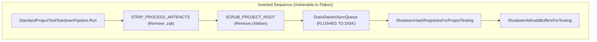
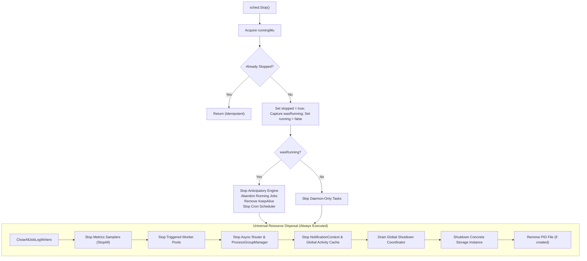

# Scheduler Storage Teardown Pre-Scrub Drain Invariants & TempDir Isolation

## Executive Summary

The ZQK Knowledge Kernel maintains zero-leak test isolation across parallel test suites on macOS (Darwin) and Linux. When temporary directories (`t.TempDir()`, `ZQK_TEST_ROOT`) are decommissioned, background storage writers, content-addressable storage (CAS) sync queues, hash registries, and metrics tickers must be deterministically drained and stopped **prior** to filesystem unlinking.

Failure to drain async components prior to directory removal produces intermittent macOS filesystem errors:
```
testing.go: TempDir RemoveAll cleanup: unlinkat /tmp/.../.zqk: directory not empty
```
This specification formalizes the strict pre-scrub drain ordering invariants across `pkg/storage`, `pkg/scheduler`, and `pkg/metrics`.

---

## 1. Architectural Anatomy of the Teardown Race

### 1.1 The macOS `unlinkat` Directory Non-Empty Race
On Darwin (macOS), unlinking a directory containing an open file descriptor or undergoing an in-flight rename/create operation fails with `ENOTEMPTY` (`directory not empty`). Unlike Linux where unlinked open files transition to anonymous inodes immediately, Darwin APFS/HFS+ maintains directory metadata references until the file descriptor is released and directory caches sync.

### 1.2 The Teardown Stage Inversion Anti-Pattern
Prior to this specification, `RunProjectTestTeardown` in `pkg/storage/project_test_teardown.go` executed stages in the following inverted sequence:



Because `DrainDarwinSyncQueue` and `ShutdownHashRegistries` executed **after** `STRIP_PROCESS_ARTIFACTS` and `SCRUB_PROJECT_ROOT`:
1. In-flight CAS sync operations flushed dirty content back into `.zqk` after the directory was supposedly stripped.
2. Open file descriptors in hash registries and audit buffers held directory entries open while Go's `t.TempDir()` cleanup attempted `os.RemoveAll()`.

### 1.3 The Unstarted Scheduler Resource Leak
When test fixtures created a `Scheduler` instance using `NewSchedulerWithProjectRoot` and executed targeted job triggers without invoking `sched.Start()`, `sched.Stop()` observed `s.running == false` and returned immediately. This bypassed:
- Metric pipeline sampler stoppage (`s.samplingPipeline.GetSamplerRegistry().StopAll()`)
- Concrete storage shutdown (`s.storage.Shutdown()`)
- Global shutdown coordinator queue drains (`DrainAll()`)
- Job log writer flushes (`CloseAllJobLogWriters()`)

---

## 2. Strict Pre-Scrub Drain Invariants

### 2.1 The Pipeline Stage Ordering Invariant
The standard project teardown pipeline enforces that all asynchronous queues, memory-mapped registries, background workers, and metric collectors are completely stopped and flushed **before** any process artifact stripping or root scrubbing:

```mermaid
flowchart TD
    subgraph Canonical_Order["StandardProjectTestTeardownPipeline (Canonical Pre-Scrub Sequence)"]
        S1["GLOBAL_LISTING_INDEX_QUEUE_FLUSH"] --> S2["FLUSH_LISTING_INDEX"]
        S2 --> S3["LISTING_INDEX_QUEUE_SHUTDOWN"]
        S3 --> S4["WAIT_WAL (Wait for pending write-ahead log)"]
        S4 --> S5["FILE_STORAGE_SHUTDOWN"]
        S5 --> S6["ORPHAN_CLEANUP_QUEUE_SHUTDOWN"]
        S6 --> S7["FLUSH_AUDIT_BUFFER"]
        S7 --> S8["TEARDOWN_GLOBAL_AUDIT_BUFFER"]
        S8 --> S9["DRAIN_ASYNC_STORAGE_COMPONENTS (Pre-Scrub Drain Stage)"]
        S9 --> S10["STRIP_PROCESS_ARTIFACTS (Remove .zqk)"]
        S10 --> S11["SCRUB_PROJECT_ROOT (Remove temp root children)"]
    end
```



### 2.2 `DRAIN_ASYNC_STORAGE_COMPONENTS` Stage Responsibilities
The `DRAIN_ASYNC_STORAGE_COMPONENTS` stage executes:
1. `ShutdownAsyncValidationStrategies()`: Halts async graph validation workers.
2. `ShutdownHashRegistriesForProjectTesting(projectRoot)`: Closes and syncs file-backed hash registries for the project root.
3. `ShutdownAllAuditBuffersForTesting()`: Empties and closes in-memory audit buffers.
4. `filecas.DrainDarwinSyncQueue(2 * time.Second)`: Flushes in-flight macOS content-addressed file synchronizations.
5. `runProjectTestTeardownHooks(projectRoot)`: Invokes all registered external subsystem callbacks (including `metrics.ResetMetricPipelineSingletonsForTest()`).

### 2.3 Subsystem Teardown Hook Registration
To prevent circular package imports between `pkg/storage` and dependent packages (such as `pkg/metrics`), `pkg/storage` provides a decoupled registration hook:
```go
// RegisterProjectTestTeardownHook registers a callback to be executed during
// project test teardown before filesystem stripping and scrubbing.
func RegisterProjectTestTeardownHook(hook func(projectRoot string))
```
In `pkg/metrics`, `init()` registers `ResetMetricPipelineSingletonsForTest()` so that all `flushTickerLoop` background goroutines are halted before storage scrubbing begins.

---

## 3. Scheduler Lifecycle Teardown Contract

### 3.1 Idempotent Teardown for Started and Unstarted Instances
The scheduler `Stop()` implementation distinguishes between **daemon execution state** (`wasRunning`) and **resource initialization state** (`s.stopped`):



### 3.2 Test Fixture Teardown (`setupTestScheduler`)
In `pkg/scheduler/scheduler_test.go`, test fixture cleanup employs a defense-in-depth teardown sequence:
1. `sched.Stop()`: Performs universal resource disposal.
2. Flush listing index write queues for `scheduler_job` and `audit_event`.
3. Flush listing index for the test project root.
4. Execute `env.Cleanup()` (concrete storage shutdown).
5. Run `storagepkg.RunProjectTestTeardown(storagepkg.TempProjectTeardown(env.TestRoot, nil))` to guarantee pre-scrub drains.
6. Drain Darwin CAS sync queue and shut down hash registries for `env.TestRoot`.
7. Reset metric pipeline singletons.
8. Perform final artifact strip and directory scrub.

---

## 4. Verification and Conformance

| Verification Vector | Target | Standard |
|---|---|---|
| **Static Floor Invariant** | Pipeline Stage Ordering | `DRAIN_ASYNC_STORAGE_COMPONENTS` must precede `STRIP_PROCESS_ARTIFACTS` and `SCRUB_PROJECT_ROOT` in all teardown pipeline builders. |
| **Operational Dynamic Proof** | Repeatable Execution | `TestScheduler_TriggerJob` and related trigger suites must pass with zero `unlinkat: directory not empty` errors across 100% of runs. |
| **Resource Concurrency Proof** | Unstarted Disposal | Schedulers initialized without `Start()` must release all goroutines, log writers, and file locks upon `Stop()`. |
