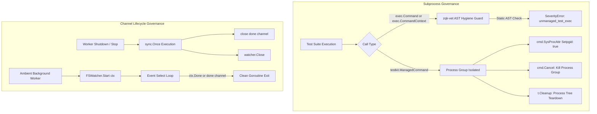

# Subprocess Concurrency, Channel Lifecycle Governance, and Signal Isolation

> **Technical Specification:** `TSP-SUBPROCESS-CONCURRENCY-CHANNEL-LEAK-001`  
> **Status:** Implemented & Verified  
> **Target Release:** Zen Quantum Kernel v0.1.0  
> **Architecture Domain:** Concurrency, Subprocess Supervision & Process Group Isolation

---

## 1. Executive Summary & Problem Statement

In distributed agentic swarms, background daemons, and concurrent execution pipelines, unmanaged processes and channel leaks present high-risk hazards:

1. **Orphaned Process Leaks:** Test suites invoking naked standard library `exec.Command`, `exec.CommandContext`, or `os.StartProcess` lack process group bindings and teardown traps. When tests time out or terminate abruptly, child processes linger in the operating system process table, leaking CPU cycles, file descriptors, and socket bindings.
2. **Channel Lifecycle and Goroutine Leaks:** In long-running background workers such as `FSWatcher` and the ambient monitoring pipeline, non-idempotent channel closures can trigger double-close panics or leave goroutines blocked indefinitely on uncollected channel receives or sends.
3. **Fail-Closed Static Verification:** Permitting unmanaged subprocess invocation in test files undermines developer confidence and leads to flakiness. All test subprocess executions must be statically verified at compile/vet time via `zqk-vet`.

Cycle 51 enforces **subprocess concurrency governance, fail-closed AST static verification for all exec invocations in tests**, and **idempotent, leak-free channel lifecycles** across background daemons.

---

## 2. Architecture & Concurrency Model



---

## 3. Subprocess Isolation Mechanism (`testkit.ManagedCommand`)

`testkit.ManagedCommand` provides three invariants across all test subprocesses:
1. **Process Group Membership (`Setpgid: true`):** Spawns the child process in its own unique POSIX process group, ensuring that child or grandchild processes spawned by sub-tools are grouped under the same PGID.
2. **Cancellation Signal Cascade:** Hooks `cmd.Cancel` to dispatch `SIGKILL` across the entire process group (`-pgid`), preventing orphaned descendants from remaining active.
3. **Deterministic Cleanup Hook (`t.Cleanup`):** Registers an automatic process group kill handler with `testing.TB`, ensuring total process tree cleanup upon test conclusion, assertion failure, or timeout.

### AST Hygiene Static Guard

The ZQK Verification Engine (`zqk-vet`) enforces this pattern fail-closed in `CheckTestSubprocessHygiene`:

```go
if (ident.Name == "exec" || ident.Name == "__exec") && (sel.Sel.Name == "Command" || sel.Sel.Name == "CommandContext") {
    // Flag unmanaged test exec call
}
```

Any naked `exec.Command` or `exec.CommandContext` invocation in `*_test.go` files is rejected with a `SeverityError`.

---

## 3.1 Production Subprocess Isolation (`pkg/execwrap`)

For non-test production executions (such as CLI runners and ambient background daemons), `pkg/execwrap` provides:
1. `CommandContextWithGroup`: Creates an `*exec.Cmd` in an isolated process group (`Setpgid: true` on Unix) with `cmd.Cancel` wired to `KillProcessGroup(cmd)` and a bounded `WaitDelay` to reap processes.
2. `RunWithTimeoutGroup`: Executes commands with isolated process group lifecycle and strict timeout deadlines, returning accumulated stdout/stderr buffers while guaranteeing child and grandchild process termination upon expiration.

---

## 4. Channel Lifecycle Governance (`FSWatcher`)

To guarantee deterministic, leak-free shutdown of background ambient routines:
1. **Idempotent Termination:** `FSWatcher.Stop()` coordinates channel closure using `sync.Once`, preventing double-close panics if `Stop()` is triggered concurrently or redundantly during context cancellation and cleanup hooks.
2. **Context-Driven Teardown:** The event processing goroutine selects on both the caller's `ctx.Done()` and the internal `done` signal channel, terminating immediately upon signal arrival without blocking or hanging.
3. **Resource Reclamation:** Underlying OS file watcher descriptors are closed during `Stop()`, eliminating descriptor leaks.

---

## 5. Verification Matrix & Invariants

| Proof Dimension | Invariant | Verification Mechanism | Status |
| :--- | :--- | :--- | :--- |
| **Static Floor Invariant** | All test subprocesses use `testkit.ManagedCommand` | `zqk-vet --suite hygiene` (`hygiene/unmanaged_test_exec`) | Enforced & Clean |
| **Operational Dynamic Proof** | Idempotent shutdown with zero goroutine/channel leaks | `TestFSWatcher_IdempotentStopAndChannelLeakSafety` | Passing |
| **Negative Adversarial Boundary** | Rejection of naked `exec.CommandContext` in test files | `TestCheckTestSubprocessHygiene_Boundaries/CommandContextDetected` | Passing |
