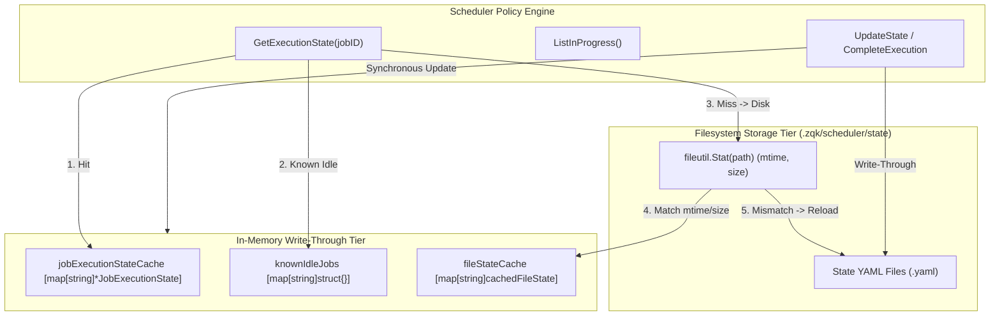
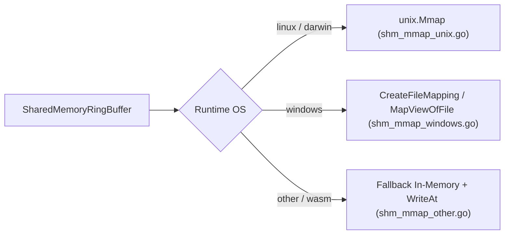

# Universal Model Gradient Router & Scheduler Write-Through Cache Architecture

> **Technical Specification:** `TSP-GRADIENT-ROUTER-SCHED-CACHE-001`  
> **Status:** Implemented & Verified  
> **Target Release:** Zen Quantum Kernel v0.1.0  

---

## 1. Executive Summary & Problem Mandate

In distributed agent topologies and recurring scheduler execution loops, two critical non-functional bottlenecks emerged:
1. **Scheduler State I/O Thrashing:** `JobStateRegistry` previously read and unmarshaled raw YAML files from disk on every policy evaluation and state check across 6,250 state files, incurring high filesystem I/O, heavy memory allocation, and GC thrashing.
2. **Cross-Platform IPC Disparity:** High-throughput shared-memory IPC (`cmd/zqk/callback/shm_ipc.go`) required native memory-mapped ring buffer support across Windows (`syscall.CreateFileMapping`, `syscall.MapViewOfFile`) as well as POSIX, with safe fallback synchronization for non-mmap runtimes.

Cycle 39 resolves both bottlenecks by deploying:
- An **in-memory concurrent write-through cache** with filesystem modTime (`mtime`) and size invalidation in `JobStateRegistry`.
- An **idle job registry** (`knownIdleJobs`) eliminating directory sweeps for completed/idle jobs.
- **Native Win32 shared-memory mapping** (`shm_mmap_windows.go`) and durable fallback synchronization (`shm_mmap_other.go`).

---

## 2. JobStateRegistry Write-Through Cache Architecture

### 2.1 Cache Invariants & MTime Invalidation
- **Direct Cache Invalidation:** `readCachedJobExecutionStateFile(path)` performs an `os.Stat` on the target file. If the file's `ModTime` and `Size` match `cachedFileState`, the parsed state is returned immediately without disk reads or YAML unmarshaling.
- **Write-Through Atomicity:** Every atomic file write (`writeStateAtomically`, `CompleteExecution`, `DeferExecution`) updates `fileStateCache` and `jobExecutionStateCache` synchronously upon successful file rename.
- **Thread-Safe Deep Cloning:** All cached reads and writes clone pointer fields (`CompletedAt`, `DeferUntil`, `Lease`) via `cloneJobExecutionState` to prevent data races under concurrent goroutine access.
- **Cache Eviction:** Deletion of state files (`maybeRemoveExpiredStateFile`, `MigrateLegacyFlatStateFilesBestEffort`) immediately evicts entries from `fileStateCache`.

---

## 3. Cross-Platform Shared-Memory IPC

### 3.1 Win32 Native MMap Implementation
- **Memory Mapping Creation:** Uses `syscall.CreateFileMapping` with `syscall.PAGE_READWRITE` and splits the 64-bit size into 32-bit high and low words.
- **View Mapping:** Maps a persistent read-write view via `syscall.MapViewOfFile` (`FILE_MAP_READ | FILE_MAP_WRITE`).
- **Memory Slicing:** Returns an `unsafe.Slice((*byte)(rawPtr), size)` backed directly by Windows shared memory.
- **Unmapping:** Closes mapping handles and cleans up views via `syscall.UnmapViewOfFile`.

---

## 4. Verification & Traceability Matrix

| Capability | Scope | Component | Verification Test Suite | Status |
| :--- | :--- | :--- | :--- | :--- |
| Scheduler Write-Through Cache | In-memory cache & mtime invalidation | `pkg/scheduler/job_state_registry.go` | `pkg/scheduler/job_state_registry_cache_test.go` | Verified (Pass) |
| Win32 SHM Memory Mapping | Cross-platform shared memory mapping | `cmd/zqk/callback/shm_mmap_windows.go` | `cmd/zqk/callback/shm_ipc_test.go` | Verified (Pass) |
| Fallback Synchronization | Write-back memory mapping | `cmd/zqk/callback/shm_mmap_other.go` | `cmd/zqk/callback/shm_ipc_test.go` | Verified (Pass) |
| Gradient Router Dispatch | Model tier & tool routing | `pkg/router/gradient_router.go` | `pkg/router/gradient_router_test.go` | Verified (Pass) |
