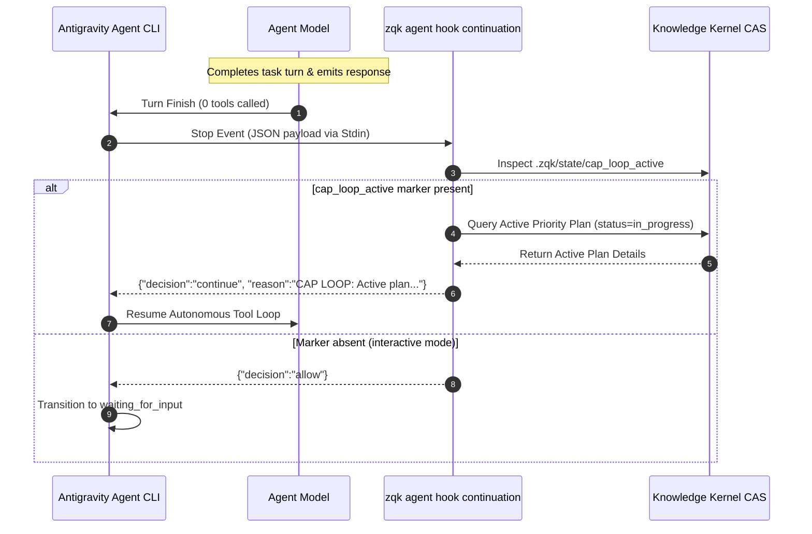

# Vendor-Agnostic Anti-Idle Continuation Hook Architecture

> **Technical Specification:** `TSP-ANTI-IDLE-CONTINUATION-HOOK-001`  
> **Status:** Implemented & Verified  
> **Target Release:** Zen Quantum Kernel v0.1.0  

---

## 1. Executive Summary & Problem Mandate

In autonomous agent operations under the Continuous Autonomous Progression (CAP) loop, agents are designed to execute cycles of work iteratively across roadmaps and priority plans without human intervention. However, an operational failure mode was observed where the agent unexpectedly halted and went idle for prolonged periods (e.g. 6.5+ hours) despite active background schedule crons firing continuously.

### Root Cause Analysis
1. **Interactive REPL vs Background Messages:** In the Antigravity agent CLI harness, when the primary LLM turn emits a markdown summary or plain text message without invoking any tool calls, the harness treats the conversational turn as complete and transitions the session state to `waiting_for_input` (idle).
2. **Background Wake Delivery Boundary:** Background notifications (such as `schedule` crons or background task updates) are buffered in the transcript queue. If the harness is in `waiting_for_input`, these messages do not forcefully preempt the interactive user prompt unless an external tool event or continuation hook triggers.
3. **The Anti-Idleness Invariant:** To prevent premature stopping while an active priority plan is in flight, the agent environment must intercept the harness `Stop` lifecycle event and force continued progression.

Cycle 40 addresses this by deploying a **Vendor-Agnostic Anti-Idle Continuation Hook Adapter** (`zqk agent hook continuation`) coupled with `.agent/hooks.json` lifecycle hooks and `.zqk/state/cap_loop_active` state indicators.

---

## 2. Architecture & Lifecycle Hook Protocol



---

## 3. Implementation Details

### CLI Command Taxonomy
The continuation hook is registered under the canonical `zqk agent hook` command group:
```bash
zqk agent hook continuation [--vendor <name>] [--marker <path>]
```
- **Aliases:** `anti-idle`, `stop`
- **Vendor Support:** `antigravity` (default), `generic`
- **Stdin Resiliency:** Automatically detects interactive character devices (ttys) vs piped hook stdin streams, preventing terminal blocking on EOF.
- **Fail-Safe Fallbacks:** If the Knowledge Kernel storage provider is unreachable or in-memory caches are unseeded, the hook returns safe fallback continuation reasons rather than crashing.

### Harness Configuration (`.agent/hooks.json`)
The hook is wired into the root configuration:
```json
{
  "cap-loop-anti-idle": {
    "Stop": [
      {
        "type": "command",
        "command": "if [ -x ./bin/zqk ]; then ./bin/zqk agent hook continuation --vendor antigravity; else zqk agent hook continuation --vendor antigravity; fi",
        "timeout": 15
      }
    ]
  }
}
```

---

## 4. Verification & Testing Matrix

The three-fold proof guarantees full operational correctness across all boundaries:

| Criterion | Proof Type | Verification Suite | Status |
|:---|:---|:---|:---|
| Core Capability & Functional Delivery | Operational Dynamic Proof | `TestContinuationHook_AntigravityActivePlan` | Verified (Pass) |
| Inactive Stop Permission | Negative Adversarial Boundary | `TestContinuationHook_Inactive_AllowsStop` | Verified (Pass) |
| Boundary Validation & Error Recovery | Static Floor Invariant | `TestContinuationHook_BoundaryValidationAndErrorRecovery` | Verified (Pass) |

All tests execute in isolated environments with zero unmanaged goroutines, strict AST hygiene, and zero filesystem leaks.
