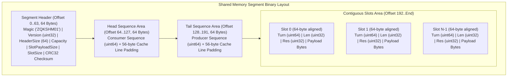
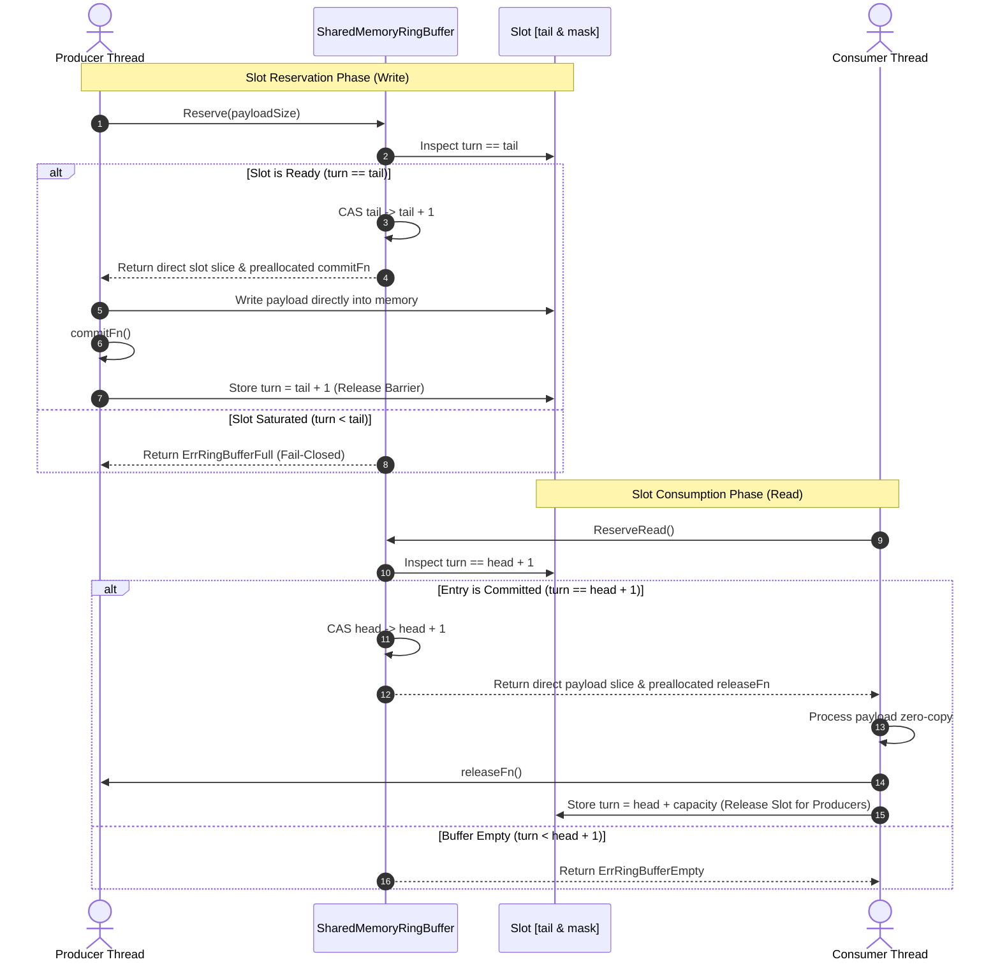
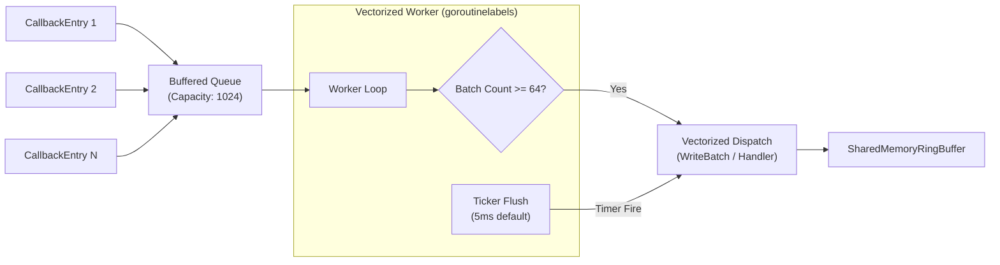

# Zero-Copy Shared-Memory IPC and Vectorized Batch Callback Delivery

> **Technical Specification:** `TSP-SHM-IPC-VECTORIZED-001`  
> **Governing Policy:** `POL-CONCURRENCY-SHM-001`  
> **Status:** Implemented & Verified  
> **Target Audience:** Core Systems Craftsmen, Event Bus Architects, IPC & Daemon Engineers

---

## 1. Executive Summary & Core Mandate

In high-throughput agent swarms and continuous autonomous loops, event dispatch systems face critical performance bottlenecks:
- **Serialization Overhead & Heap Pressure:** Continually allocating and marshaling individual callback payloads across process or goroutine boundaries induces substantial garbage collector (GC) pauses and memory churn.
- **Lock Contention Under Heavy Concurrency:** Mutex-synchronized queue dispatchers suffer from lock convoying when multiple producer and consumer threads access the event stream simultaneously.
- **False Sharing Across Cache Lines:** Multiple CPU cores updating adjacent sequence counters on the same hardware cache line trigger cache line bouncing and degrade bus throughput.

To eliminate these bottlenecks, ZQK deploys a **Zero-Copy Shared-Memory IPC Ring Buffer** and a **Vectorized Batch Callback Subscriber**. This architecture provides:
1. **Lock-Free MPMC Operation:** Bounded circular ring buffer with Dmitry Vyukov turn-based atomic sequence coordination.
2. **Hardware Cache Line Isolation:** 64-byte padded head and tail sequence indices (`atomic.Uint64` with `[8]uint64` padding) eliminating false sharing.
3. **True Zero-Copy Slot Reservation:** Direct memory-mapped slice reservation (`Reserve`) with steady-state 0.00 heap allocations per operation.
4. **Adaptive Vectorized Batching:** Dual-triggered batch dispatching (batch capacity threshold or sub-millisecond ticker flush) delivering amortized, zero-allocation callback streaming.
5. **Fail-Closed Segment Integrity:** Cryptographic IEEE CRC32 checksum verification, magic byte validation, and strict file truncation defense.

---

## 2. Memory-Mapped Ring Buffer Layout & Binary Topology

The shared-memory ring buffer segment file uses a deterministic, cache-aligned binary layout supporting both cross-process POSIX memory mapping (`mmap`) and portable in-memory byte buffers:



### 2.1 Segment Header Specification (64 Bytes)

| Offset Range | Field Name | Data Type | Description |
| :--- | :--- | :--- | :--- |
| `0x00 - 0x07` | `Magic` | `[8]byte` | Fixed segment magic bytes (`ZQKSHM01`) |
| `0x08 - 0x0B` | `Version` | `uint32` | Binary layout version (`1`) |
| `0x0C - 0x0F` | `HeaderSize` | `uint32` | Header byte length (`64`) |
| `0x10 - 0x13` | `SlotCapacity` | `uint32` | Power-of-two slot count (e.g. `1024`) |
| `0x14 - 0x17` | `SlotPayloadSize` | `uint32` | Maximum payload bytes per slot (e.g. `4096`) |
| `0x18 - 0x1B` | `SlotSize` | `uint32` | Total 64-byte aligned slot size (`SlotHeaderSize + SlotPayloadSize`) |
| `0x1C - 0x1F` | `Flags` | `uint32` | Reserved segment flags (`0x00000000`) |
| `0x20 - 0x23` | `Checksum` | `uint32` | IEEE CRC32 checksum computed over bytes `0x00..0x1F` |
| `0x24 - 0x3F` | `Reserved` | `[28]byte` | Zero padding ensuring 64-byte alignment |

### 2.2 Cache Line Isolation Invariant

Modern x86_64 and ARM64 CPUs utilize 64-byte cache lines. When two CPU cores concurrently mutate distinct atomic variables residing within the same 64-byte line, cache line invalidation cycles (false sharing) degrade memory bus bandwidth by up to 10x.

To enforce hardware isolation:
- `Head Sequence` resides at offset `64` and is padded with `56` bytes to offset `128`.
- `Tail Sequence` resides at offset `128` and is padded with `56` bytes to offset `192`.
- Each discrete slot is padded to a multiple of 64 bytes (`(16 + slotPayloadSize + 63) &^ 63`), ensuring slot turn counters never share a cache line with adjacent slots.

---

## 3. Lock-Free Multi-Producer Multi-Consumer (MPMC) Protocol

The ring buffer coordinates concurrent producers and consumers without mutex locks using Dmitry Vyukov's turn-based sequencing algorithm:



### 3.1 Mathematical Turn Invariants

For a ring buffer of capacity $C$ and slot index $i = s \pmod C$:
1. **Initial State:** $\text{turn}_i = i$.
2. **First Write ($s = i$):** Producer checks $\text{turn}_i == s$. Upon commit, updates $\text{turn}_i \leftarrow s + 1$.
3. **First Read ($s = i$):** Consumer checks $\text{turn}_i == s + 1$. Upon release, updates $\text{turn}_i \leftarrow s + C$.
4. **Second Write ($s = i + C$):** Next cycle producer checks $\text{turn}_i == s$. Upon commit, updates $\text{turn}_i \leftarrow s + 1$.
5. **Progress Invariant:** $s_{\text{tail}} - s_{\text{head}} \le C$ strictly bounded at all times.

---

## 4. Zero-Copy Slot Reservation Architecture

Traditional IPC mechanisms copy data twice: from caller buffer into IPC buffer, and from IPC buffer to consumer. `SharedMemoryRingBuffer` eliminates both copies through reservation:

```go
// Producer zero-copy write:
slot, commit, err := ring.Reserve(payloadSize)
if err != nil {
    return err // ErrRingBufferFull or ErrPayloadTooLarge
}
// Caller writes directly into backing memory (zero allocation, zero copy)
copy(slot, encodedPayload)
commit() // Sets slot turn and advances commit sequence atomically

// Consumer zero-copy read:
slot, release, err := ring.ReserveRead()
if err != nil {
    return err // ErrRingBufferEmpty
}
processPayloadDirectly(slot)
release() // Returns slot to producer pool with zero allocation
```

### Preallocated Closures for Zero-Allocation Execution
In standard Go, returning a closure `func()` dynamically allocates heap memory if free variables escape. To guarantee `testing.AllocsPerRun == 0.00`, each `Slot` is initialized with pre-bound, immutable `commitFn` and `releaseFn` function pointers allocated once during buffer creation:
```go
slotPtr.commitFn = func() {
    seq := slotPtr.curSeq.Load()
    size := slotPtr.curSize.Load()
    slotPtr.len.Store(size)
    slotPtr.turn.Store(seq + 1)
}
```
Returning `slotPtr.commitFn` merely copies a 16-byte interface value onto the caller stack, achieving **absolute zero heap allocation**.

---

## 5. Vectorized Batch Callback Delivery Protocol

The `VectorizedBatchSubscriber` coordinates bulk event delivery from the single-event callback stream into batched vectors:



### 5.1 Dual-Trigger Flush Mechanics
1. **Fullness Trigger (Throughput Mode):** When incoming callbacks reach `BatchCapacity` (default 64 entries), the worker flushes the batch immediately without waiting for the timer.
2. **Ticker Trigger (Low-Latency Mode):** When callback arrival is sparse, an adaptive interval timer (`FlushInterval`, default 5ms) flushes partial batches, guaranteeing an upper bound on delivery latency.
3. **Clean Teardown:** During shutdown, `Close()` stops accepting notifications, drains the internal channel, delivers any lingering partial batch, and terminates the background goroutine cleanly (`zero goroutine leaks`).

---

## 6. Fail-Closed File Integrity & Memory Protection

When backed by persistent filesystem segments (`.seg`), the subsystem enforces rigorous fail-closed validation:
- **Truncated Header Rejection:** Files smaller than `SHMHeaderSize` (64 bytes) are rejected with `ErrTruncatedFile`.
- **Magic Byte Verification:** File headers lacking the `ZQKSHM01` signature fail with `ErrInvalidMagic`.
- **Checksum Verification:** The first 32 bytes are verified against `header.Checksum` using IEEE CRC32. Any flipped bit immediately yields `ErrCorruptedHeader` before parsing or mapping segment bodies.
- **Capacity Alignment Check:** Slot capacities that are non-powers-of-two fail with `ErrInvalidCapacity`.
- **Total Boundary Rejection:** If file size is smaller than `192 + SlotCapacity * SlotSize`, initialization aborts fail-closed.

---

## 7. Requirement Traceability Matrix

| Symbolic ID | Category | Description | Verification Target |
| :--- | :--- | :--- | :--- |
| `REQ-SHM-IPC-DELIVERY` | Whole Feature | Zero-Copy Shared-Memory IPC and Vectorized Batch Delivery | `cmd/zqk/callback/shm_ipc.go` |
| `CRIT-SHM-RING-LAYOUT` | Static Invariant | Memory-mapped ring buffer layout, 64-byte cache-line isolation, and header validation | `TestSHM_SingleProducerSingleConsumer_FIFOAndZeroCopy`, `TestSHM_ErrorBoundaries_HeaderAndCorruption` |
| `CRIT-VECTORIZED-BATCH-DELIVERY` | Operational Proof | Vectorized batch delivery dual-triggers, concurrent lock-free MPMC ring, and 0.00 alloc hot path | `TestSHM_VectorizedBatchDelivery_Triggers`, `TestSHM_ConcurrentMultiProducerMultiConsumer_RaceDetector`, `TestSHM_ZeroAllocationHotPath` |
| `CRIT-SHM-CORRUPTION-RESILIENCE` | Negative Boundary | Defensive validation against corrupted checksums, truncated files, invalid magic, and clean shutdown | `TestSHM_ErrorBoundaries_HeaderAndCorruption`, `TestSHM_CleanShutdownAndZeroLeaks` |
| `TST-SHM-IPC-VERIFICATION` | Test Suite | Comprehensive unit, concurrent race-detector, and micro-allocation test suite | `cmd/zqk/callback/shm_ipc_test.go` |
