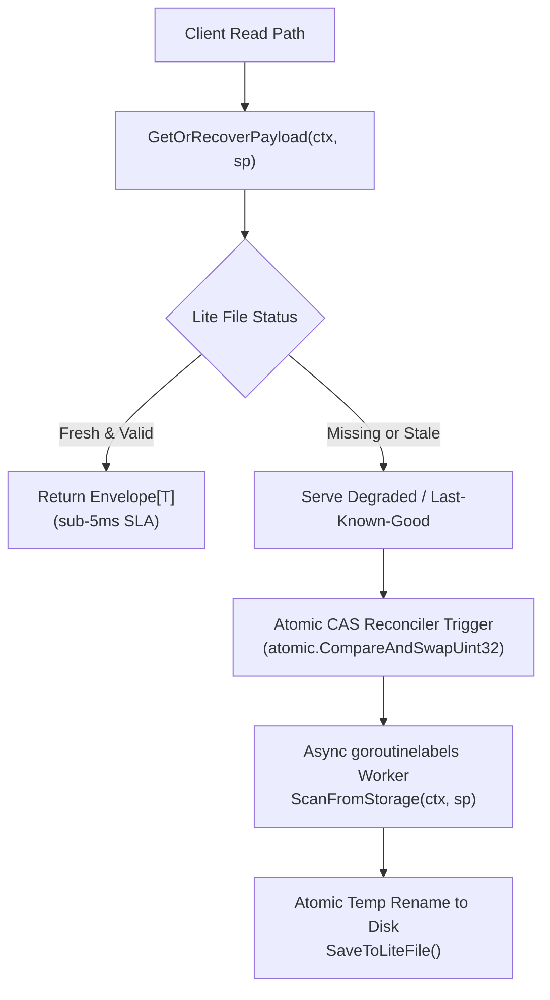
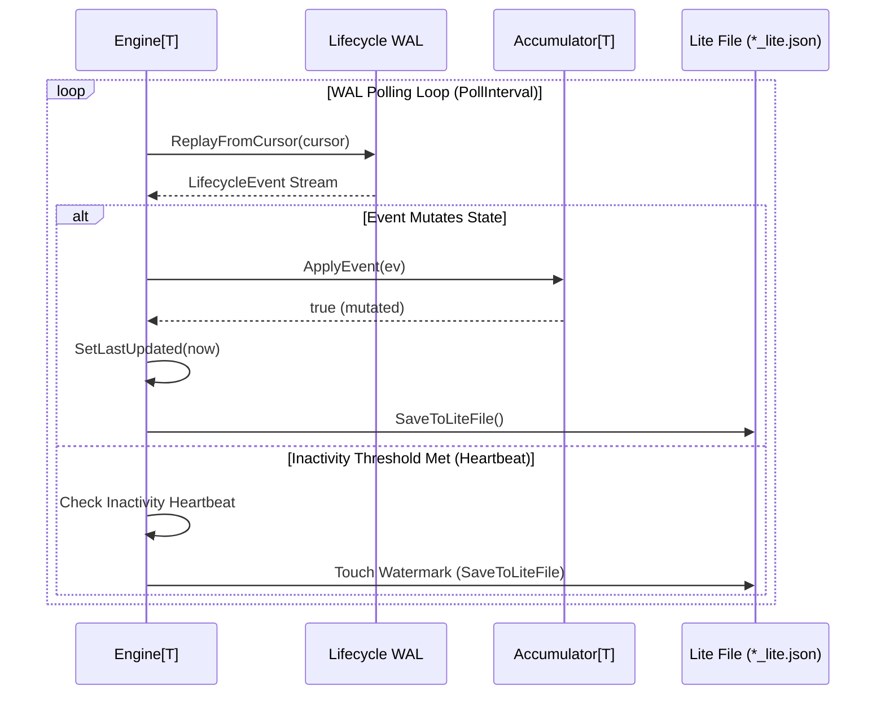
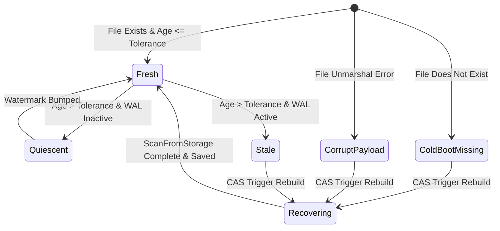

# Real-Time State Accumulator Subsystem Architectural Guide (`pkg/accumulator`)

## 1. Executive Summary & Design Philosophy

The `pkg/accumulator` subsystem provides a cellular, generic projection and caching engine designed to enforce the **Zero Hot-Path Scan Invariant** within the ZQK Knowledge Kernel.

In high-concurrency microkernel architectures, repetitive queries across large object sets (such as active priority plans, agent feed status, and runtime health summaries) can cause CPU degradation and cache thrashing if computed directly against Content-Addressed Storage (CAS) on every read. The accumulator pattern decouples reads from writes:
- **Hot-Path Reads ($\le 5\text{ms}$):** Fast disk reads of pre-computed, atomically flushed JSON lite files (`<data_dir>/state/<name>_lite.json`).
- **Cold Boot & Degraded Recovery:** Automatic serving of default skeletons or last-known-good projections when lite files are missing, corrupted, or stale.
- **Asynchronous Rebuild Circuit Breaker:** Non-blocking background worker reconciliation triggered out-of-band via atomic compare-and-swap (`atomic.CompareAndSwapUint32`) debounce.
- **Quiescent Inactivity Refresh:** Watermark renewal without storage scans if the lifecycle Write-Ahead Log (`lifecycle_events.wal`) has had no new event appends.
- **Dual-Format Deserialization:** Transparent unmarshaling of canonical envelopes and legacy flat JSON structures.

---

## 2. Core Architectural Components & Topology

The accumulator subsystem is organized around a clean separation of concerns:



### Component Breakdown

1. **`Accumulator[T any]` Interface:**
   Defines domain logic for state accumulation:
   - `Name() string`: Unique identifier for the projection.
   - `DefaultPayload() T`: Initial zero-state payload returned during cold boots.
   - `ApplyEvent(ev *lifecycle.LifecycleEvent) bool`: In-memory incremental event application.
   - `BuildPayload() T`: Renders current accumulated domain state.
   - `ScanFromStorage(ctx context.Context, sp storage.ObjectStorageProvider) error`: Full reconciliation pass against CAS storage.

2. **`Engine[T any]` Orchestrator:**
   The generic concurrency controller managing disk I/O, staleness evaluation, WAL checkpointing, and thread-safe lock management.

3. **`Envelope[T any]` Universal Carrier:**
   Standard transport metadata envelope holding:
   - `SchemaVersion`: Schema compatibility contract (e.g. `2.0.0`).
   - `MaterializedAt`: UTC timestamp marking snapshot point in time.
   - `Stale`: Boolean flag indicating whether the watermark exceeds `StalenessTolerance`.
   - `Recovering`: Boolean flag indicating an out-of-band background rebuild is in flight.
   - `DegradedReason`: Human-legible diagnostic reason if degraded.
   - `Payload`: Strongly typed domain model `T`.

4. **`AccumulatorBuilder[T any]`:**
   Fluent builder enforcing type-safe construction, sensible defaults, and parameter validation.

5. **`WALSubscriber` & Registry:**
   Global registration fabric allowing subsystem daemons to attach background listeners to `lifecycle_events.wal`.

---

## 3. Accumulation Lifecycle & Batch Dynamics

The accumulator engine supports both on-demand read-path recovery and continuous background streaming via WAL events:



### Batch Dynamics & Watermark Hygiene
- **Time-Based Flushes:** Updates are written atomically whenever mutating events are processed or when the staleness heartbeat interval expires (`StalenessTolerance / 2`).
- **Quiescent Graph Detection:** When no WAL events have been appended since the last materialization, the engine touches the disk watermark forward without scanning CAS storage, avoiding redundant disk I/O.
- **Atomic Replace:** Writes are staged in `<targetPath>.tmp.<timestamp>` before an OS-level atomic rename to `<targetPath>`, preventing partial read anomalies.

---

## 4. Staleness Circuit Breaker & Fallback Resilience

The staleness circuit breaker prevents cascading latency spikes during storage degradation or cold cache scenarios:



### Resilience Guarantees
- **Non-Blocking Rebuilds:** If an existing rebuild worker is in flight (`atomic.CompareAndSwapUint32(&e.isReconciling, 0, 1)` fails), subsequent callers return immediately with degraded or cached payloads without waiting.
- **Graceful Fallbacks:** In cold boot or corrupt file scenarios, `DefaultPayload()` is returned with `Stale: true` and `Recovering: true` rather than blocking or returning fatal errors to callers.
- **Bounded Execution Time:** Background rebuilds execute within a dedicated context bounded by `RebuildTimeout`.

---

## 5. Concurrency & Thread-Safety

Thread-safety is maintained across all read, write, and rebuild paths:
- **Fine-Grained Mutex Locking:** `e.mu.Lock()` protects in-memory accumulator mutations (`ApplyEvent`, `BuildPayload`, `lastUpdated`).
- **Lock-Free Read Fast-Path:** Disk reads via `LoadEnvelopeFromLiteFile` execute without acquiring Go-level mutex locks, allowing concurrent goroutines to read disk caches simultaneously.
- **Debounced Rebuild CAS:** Atomic flag prevents thundering herds when multiple callers detect a stale state simultaneously.
- **Context-Bound Cancellation:** Subscriptions and background workers respect caller `context.Context` cancellation during engine shutdown.

---

## 6. Verification Evidence & Test Execution

### 6.1 Statement Coverage Invariant
The `pkg/accumulator` subsystem enforces a strict statement test coverage floor of **>= 85.0%** (achieved: **91.9%**).

### 6.2 Test Execution Commands

Run the comprehensive unit test suite:
```bash
go test -v -cover ./pkg/accumulator/...
```

Run race detection:
```bash
go test -race ./pkg/accumulator/...
```

Execute Knowledge Kernel test case:
```bash
./bin/zqk test run <test-case-id>
```
