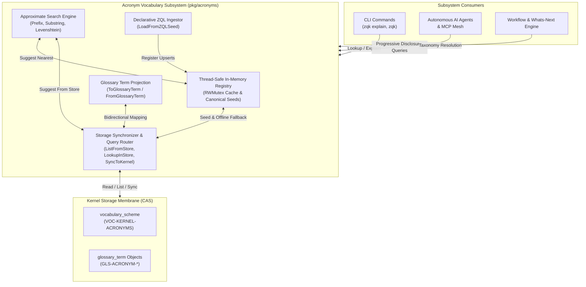
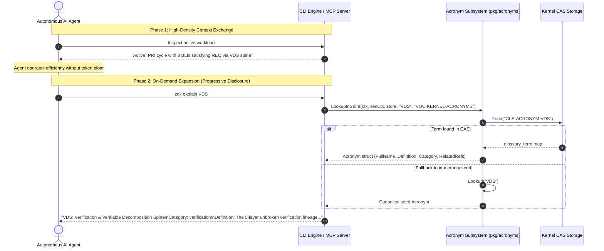
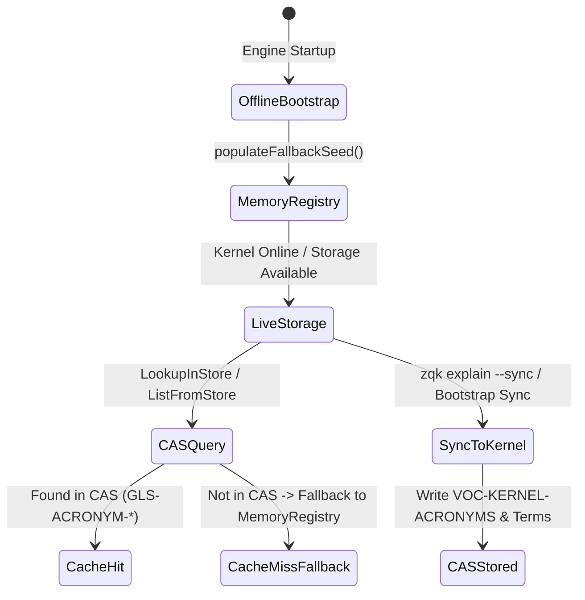
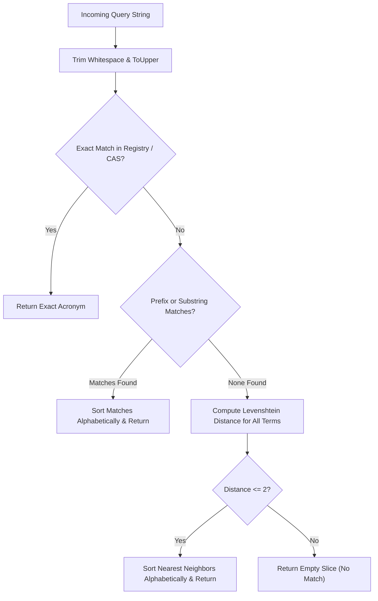

# Acronym Vocabulary & Progressive Disclosure Subsystem Architectural & Operational Guide

## 1. Executive Architectural Summary

The **Acronym Vocabulary & Progressive Disclosure Subsystem** (`pkg/acronyms`) manages the canonical ontology of system acronyms, jargon, and taxonomic abbreviations across the **ZQK Knowledge Kernel**.

In human-agent hybrid development environments, communication token density and semantic precision are critical:
1. **Progressive Disclosure:** AI agents and human operators communicate using high-density abbreviations (e.g., `BLI`, `PRI`, `REQ`, `CRIT`, `VDS`, `CAS`, `WAL`) during fast-path operational loops, conserving token context budgets by up to 70%. When an operator or agent encounters unfamiliar terminology, the subsystem progressively discloses the full definition, operational scope, and graph relationships on demand.
2. **Dual-Mode Persistence & Offline Seed Fallback:** The subsystem operates seamlessly across two planes: an in-memory, thread-safe bootstrap registry for cold-start and offline execution, and a live Content-Addressable Storage (CAS) projection where acronyms are persisted as first-class `glossary_term` objects linked to the `VOC-KERNEL-ACRONYMS` vocabulary scheme.
3. **Declarative ZQL Ingestion:** Supports declarative seed loading via ZQK Query Language (ZQL) upsert scripts, enabling versioned taxonomy updates and schema migrations.
4. **Approximate Matching & Typo Tolerance:** Combines prefix matching, substring containment, and bounded Levenshtein distance metrics (edit distance $\le 2$) to provide deterministic "Did you mean..." suggestions for misspelled terms.
5. **Static Floor Coverage Invariant:** Adheres to a strict statement test coverage invariant ($\ge 85.0\%$, verified at 98.0%) ensuring all parsing branches, fallback paths, and concurrent access patterns are rigorously verified.

---

## 2. Component Topology & Subsystem Architecture

The subsystem consists of four core building blocks operating around a unified typed projection model:



### Component Responsibilities

| Component | Source Element | Core Responsibility |
| :--- | :--- | :--- |
| **Acronym Registry** | `registry`, `RegistryMu` | Thread-safe in-memory cache seeded with canonical bootstrap terms. Ensures offline availability during bootstrap, install, and network isolation. |
| **Glossary Projection** | `ToGlossaryTerm`, `FromGlossaryTerm` | Bidirectional adapter transforming between the typed `Acronym` Go struct and spec-compliant `glossary_term` object maps (Schema 2.0.0). |
| **Store Synchronizer** | `SyncToKernel`, `LoadFromKernel`, `ListFromStore`, `LookupInStore` | Bridges in-memory projections with live CAS storage, reconciling vocabulary schemes and glossary objects. |
| **Approximate Search Engine** | `FindClosest`, `FindClosestInStore`, `levenshtein` | Multi-tier fuzzy matching algorithm evaluating prefix containment, substring presence, and Levenshtein distance $\le 2$. |
| **ZQL Seed Ingestor** | `LoadFromZQLSeed`, `exprToValue` | Compiles declarative ZQL scripts and hydrates the registry from structured AST statements. |

---

## 3. Canonical Kernel Acronym Taxonomy

The subsystem maintains 16 foundational acronyms that establish the architectural and operational vocabulary of the Knowledge Kernel:

| Acronym | Full Name | Ontological Category | Operational Definition |
| :--- | :--- | :--- | :--- |
| `BLI` | Backlog Item | `work` | A discrete, tracked work package or deliverable scheduled within a Priority Plan. |
| `PRI` | Priority Plan | `work` | A time-bounded execution plan defining prioritized work packages and delivery horizons. |
| `REQ` | Requirement | `specification` | A formal system invariant, capability, or architectural specification. Proven by at least three orthogonal criteria. |
| `CRIT` | Criterion | `verification` | An objective, verifiable acceptance condition proving a requirement (Static Floor, Operational Proof, Negative Boundary). |
| `VDS` | Verification & Verifiable Decomposition Spine | `verification` | The 5-layer unbroken verification lineage connecting Vision, Goals, Plans, Requirements/Criteria, and Backlog Items. |
| `TCFG` | Team Configuration | `organization` | Approved team composition, agent roster, and operational permissions. |
| `CVS` | Convergence Session | `coordination` | A structured cybernetic feedback session that closes deltas between projected and actual system state. |
| `ATK` | Agent Task | `execution` | A granular, autonomous unit of work assigned to and executed by an agent persona. |
| `PPLAN` | Priority Plan Verb | `cli` | CLI command shortcut group for inspecting active priority plans and current workloads. |
| `ZPARQL` | ZQK Pattern Query Language | `graph` | Declarative graph pattern matching and query engine for traversing kernel object relationships. |
| `ZQL` | ZQK Query Language | `query` | Declarative object query, mutation, and filtering expression language. |
| `CAS` | Content-Addressable Storage | `storage` | Immutable, cryptographic hash-indexed object storage layer forming the kernel membrane. |
| `WAL` | Write-Ahead Log | `storage` | Append-only sequential ledger guaranteeing atomic state mutations and crash recovery. |
| `CAP` | Continuous Autonomous Protocol | `governance` | The self-driving cybernetic feedback loop steering agents without human intervention. |
| `CEF` | Community Evaluation Framework | `evaluation` | Comprehensive quality scorecard, testing pyramid, and Diamond Scale grading rubric. |
| `TDE` | Technical Debt Entry | `hygiene` | An objectified defect, architectural smell, or maintainability liability tracked for resolution. |

---

## 4. Progressive Disclosure Dynamics

Progressive disclosure is a core design principle across human-agent collaboration in ZQK.



### The Progressive Disclosure Lifecycle

1. **Phase 1: High-Density Token Transmission:**
   - Swarm prompts, commit logs, event streams, and agent status feeds use standardized acronyms (`BLI`, `PRI`, `REQ`, `CRIT`, `VDS`).
   - Token consumption per interaction is minimized, keeping prompts within strict model context windows.

2. **Phase 2: Semantic Expansion on Demand:**
   - When an autonomous subagent or developer requires disambiguation, they invoke `zqk explain <CODE>` or the equivalent MCP tool.
   - The query traverses the acronym subsystem, retrieving the full title, category, expanded definition, and related ontological references.

3. **Phase 3: Typo Remediation & Approximate Search:**
   - If an acronym is misspelled (e.g., `VDZ`), the approximate match engine computes nearest neighbors (e.g., `VDS`) and returns suggestions deterministically.

---

## 5. Storage Projection & Dual-Mode Mechanics

The subsystem features a dual-mode persistence architecture ensuring zero downtime across uninitialized, offline, and production environments:



### Object Mapping Specification

When projected to CAS, each acronym translates to a standard `glossary_term` object conforming to Schema Version 2.0.0:

```json
{
  "id": "GLS-ACRONYM-BLI",
  "kind": "glossary_term",
  "title": "BLI (Backlog Item)",
  "status": "active",
  "scheme_ref": "VOC-KERNEL-ACRONYMS",
  "category": "work",
  "context_scope": "operational",
  "definition": "A discrete, tracked work package or deliverable scheduled within a Priority Plan.",
  "description": "A discrete, tracked work package or deliverable scheduled within a Priority Plan.",
  "agent_prompts": "Expanded meaning: Backlog Item. Use for progressive disclosure.",
  "machine_hints": "{\"acronym\":\"BLI\",\"full_name\":\"Backlog Item\",\"related_refs\":[\"PRI\",\"REQ\",\"CRIT\",\"ATK\"],\"scheme_ref\":\"VOC-KERNEL-ACRONYMS\"}",
  "namespace_id": "zqk:kernel",
  "schema_version": "2.0.0",
  "source_type": "internal"
}
```

### Declarative ZQL Seed Ingestion

The subsystem supports declarative runtime loading using ZQL mutation syntax:

```sql
BEGIN TRANSACTION;

UPSERT glossary_term ID "GLS-ACRONYM-EXAMPLE" {
    title: "EXAMPLE (Example Acronym)",
    category: "specification",
    definition: "An illustrative acronym loaded declaratively via ZQL",
    context_scope: "operational"
};

COMMIT TRANSACTION;
```

---

## 6. Approximate Match & Suggestion Mechanics

When an acronym query fails an exact match, the subsystem evaluates candidate terms using a three-tier approximation pipeline:



### Ranking & Distance Rules

1. **Exact Match:** Evaluated case-insensitively with whitespace trimmed.
2. **Prefix Match:** Matches any term starting with the query string (e.g., query `"AL"` matches `"ALPHA"`, `"ALPHABET"`).
3. **Substring Match:** Matches any term containing the query string (e.g., query `"ETA"` matches `"BETA"`).
4. **Levenshtein Distance:** For query strings without prefix/substring containment, candidates with an edit distance $\le 2$ are returned (e.g., query `"DELTO"` matches `"DELTA"`).
5. **Deterministic Sorting:** All returned candidate slices are sorted alphabetically by code to guarantee deterministic CLI and agent output.

---

## 7. Verification & Statement Coverage Invariant

The subsystem enforces a strict statement coverage invariant ($\ge 85.0\%$, verified at 98.0%) anchored by the **Three-Fold Proof**:

```
Three-Fold Proof Coverage Model:
┌────────────────────────────────────────────────────────────────────────┐
│ 1. Static Floor Invariant:                                             │
│    - All 16 canonical seed acronyms present with valid categories,     │
│      full names, definitions, and operational context.                 │
│                                                                        │
│ 2. Operational Dynamic Proof:                                          │
│    - Case-insensitive lookups, sorting invariants, format tables,     │
│      bidirectional glossary_term projections, and live CAS sync.       │
│                                                                        │
│ 3. Negative Adversarial Boundary:                                      │
│    - Malformed ZQL scripts, invalid glossary schemas, missing terms,   │
│      storage provider failures, and concurrent read/write safety.      │
└────────────────────────────────────────────────────────────────────────┘
```

### Verification Execution

Targeted unit and boundary tests are executed using:

```bash
ZQK_ALLOW_FOREGROUND_GO_TEST=1 go test -v -timeout 30s -cover ./pkg/acronyms
```

```
=== RUN   TestCanonicalSeedTerms_Integrity
--- PASS: TestCanonicalSeedTerms_Integrity (0.00s)
=== RUN   TestToGlossaryTerm_Variations
--- PASS: TestToGlossaryTerm_Variations (0.00s)
=== RUN   TestFromGlossaryTerm_ValidationAndFallbacks
--- PASS: TestFromGlossaryTerm_ValidationAndFallbacks (0.00s)
=== RUN   TestExprToValue_Scenarios
--- PASS: TestExprToValue_Scenarios (0.00s)
=== RUN   TestLoadFromZQLSeed_SyntaxAndEdgeCases
--- PASS: TestLoadFromZQLSeed_SyntaxAndEdgeCases (0.00s)
=== RUN   TestListFromStore_AllScenarios
--- PASS: TestListFromStore_AllScenarios (0.00s)
=== RUN   TestLookupInStore_Scenarios
--- PASS: TestLookupInStore_Scenarios (0.00s)
=== RUN   TestFindClosestInStore_Scenarios
--- PASS: TestFindClosestInStore_Scenarios (0.00s)
=== RUN   TestLoadFromKernel_Scenarios
--- PASS: TestLoadFromKernel_Scenarios (0.00s)
=== RUN   TestLookupAndListAll_DirectCache
--- PASS: TestLookupAndListAll_DirectCache (0.00s)
=== RUN   TestFormatTable
--- PASS: TestFormatTable (0.00s)
=== RUN   TestSyncToKernel_AllScenarios
--- PASS: TestSyncToKernel_AllScenarios (0.00s)
=== RUN   TestLevenshteinDistance
--- PASS: TestLevenshteinDistance (0.00s)
=== RUN   TestConcurrency_SafeOperations
--- PASS: TestConcurrency_SafeOperations (0.00s)
PASS
coverage: 98.0% of statements
ok  	github.com/zqk-os/zqk/pkg/acronyms	0.068s	coverage: 98.0% of statements
```

---

## 8. Operational CLI Recipes

### Inspecting Acronyms via CLI

```bash
# Explain a specific kernel acronym
zqk explain BLI

# Output:
# BLI: Backlog Item (Category: work)
# Definition: A discrete, tracked work package or deliverable scheduled within a Priority Plan.
# Related: PRI, REQ, CRIT, ATK

# List all registered acronyms in formatted ASCII table
zqk explain --all

# Query with approximate match (typo correction)
zqk explain BL
# Output suggests: BLI
```

### Synchronizing Seed Taxonomy into Live Kernel Storage

```bash
# Synchronize canonical seeds to live CAS storage
zqk explain --sync
```
