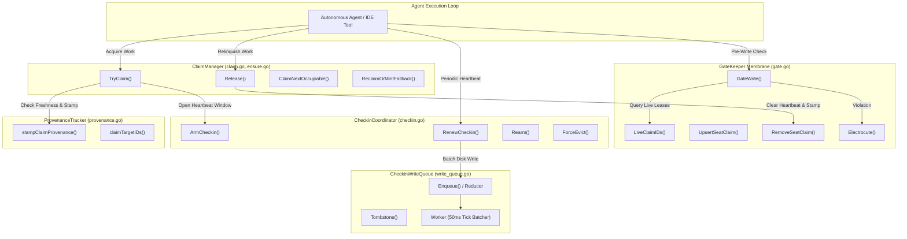
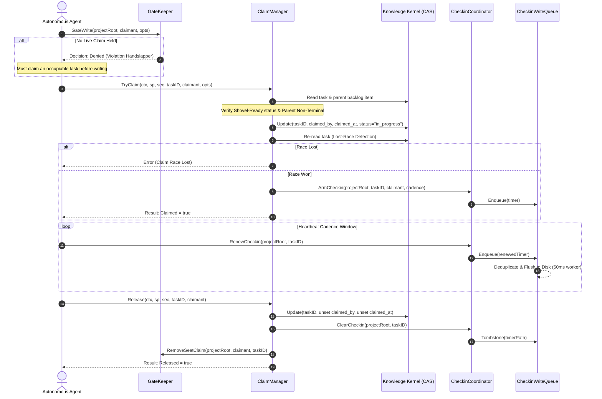
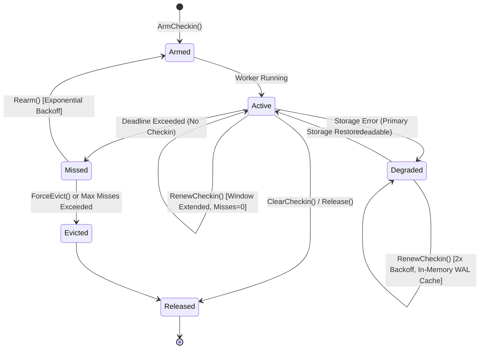
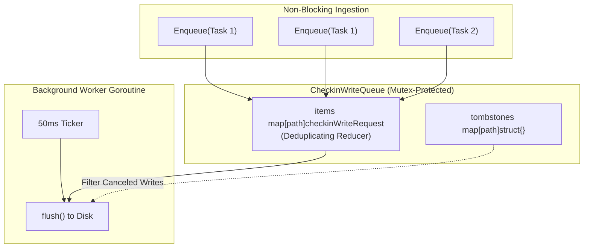

# Atomic Work Claiming & Session Checkin Subsystem Guide

Comprehensive architectural, operational, and concurrency reference for the `pkg/agentclaim` subsystem in ZQK Core.

---

## 1. Architectural Overview

In a multi-agent swarm development environment, multiple autonomous software engineers and tools may interact simultaneously with repository files and Knowledge Kernel graph objects. Without strict single-claimant guarantees and continuous proof-of-life heartbeats, autonomous swarms risk concurrent file collisions, duplicated compute spend, and orphaned work locks.

The **Atomic Work Claiming and Session Checkin Subsystem** (`pkg/agentclaim`) implements the operational membrane that enforces single-lease occupancy and write gating across the system (governed by `POL-DEFAULT-ec693f64f7c81640`).

### Core Invariants

1. **Fail-Closed Write Gate (No Write Before Claim)**:
   Mutating tool calls (e.g. IDE file writes, code generation) are blocked unless the calling agent seat holds a verified, non-expired lease on an occupiable task (`agent_task`). Unclaimed write attempts result in standardized handslapper interrupts (`GateDecision.Electrocute`).
2. **Single Claimant Leases**:
   An occupiable task can only be claimed by one agent at any point in time. Contended claims fail closed with descriptive ownership diagnostics.
3. **Continuous Cadence & Eviction Heartbeats**:
   Held claims require periodic renewal within a configurable cadence window. Silent or crashing agents miss heartbeats, triggering exponential backoff triage, eventual eviction, and release of the lease.
4. **Git Trunk-Tip Freshness & Provenance Chain**:
   Claiming a task records branch provenance (`branch_name` and `base_sha`) on the task, its parent backlog item, and its overarching priority plan. Branching must originate from the latest trunk tip (`main`) to guarantee mergeability.
5. **Asynchronous Non-Blocking Write Queue with Degraded WAL Fallback**:
   Frequent check-in disk writes are batched and deduplicated through an in-memory queue to eliminate I/O hot spots. If filesystem or CAS storage degrades, check-ins fall back to a localized write-ahead log (WAL) and memory cache without dropping active agent sessions.

---

## 2. Component Topology

The subsystem is composed of five core collaborative components:



### Component Roles

- **GateKeeper (`gate.go`)**:
  Interprets incoming write requests from agent tools. Evaluates claimant seat credentials, resolves live claim indices from `.zqk/state/agent_claims/<claimant>.json`, checks write queue in-flight updates, and denies unauthorized writes before disk modification can occur.
- **ClaimManager (`claim.go`, `ensure.go`)**:
  Governs lifecycle transitions on `agent_task` objects (`approved` ➔ `in_progress`). Enforces pre-claim invariants (preventing preliminary or terminal claims and terminal parent backlog claims), performs optimistic concurrency updates, and detects lost races.
- **CheckinCoordinator (`checkin.go`)**:
  Maintains check-in deadline timers stored at `.zqk/state/checkin_timers/<task-id>.json`. Computes expirations, tracks missed heartbeat counts, manages exponential backoff during agent silence, and facilitates forced eviction.
- **CheckinWriteQueue (`write_queue.go`)**:
  Thread-safe singleton worker that batches and deduplicates check-in timer disk writes across a 50ms polling ticker. Provides tombstoning to invalidate pending writes upon lease release or eviction.
- **ProvenanceTracker (`provenance.go`)**:
  Queries Git state (`HEAD` commit and current branch) and immutably records branch provenance across all associated graph objects extracted from task attributes.

---

## 3. Atomic Claim Lifecycle

The claim lifecycle follows a deterministic path from preliminary gating through lease execution to release or eviction:



### Pre-Claim Invariant Gating

Before updating storage, `TryClaim` validates:
1. **Occupiability**: The object kind must declare the `TraitOccupiable` trait (e.g. `agent_task`).
2. **Preliminary Realign Prevention**: Tasks in `conceptual` or draft states cannot be claimed until approved.
3. **Terminal Lockout**: Tasks in `implemented` or `archived` states cannot be re-claimed.
4. **Parent Backlog Status**: If the task references a parent backlog item, that parent must not be in a terminal lifecycle role.
5. **Trunk-Tip Freshness**: Unless explicit test bypass is activated, the local branch merge-base with `main` must equal either `HEAD` or `main`.

---

## 4. Heartbeat Renewal, Backoff & Degraded WAL Mode

Check-in timers establish an operational deadline for active agent work:



### Degraded Mode Operation

If the primary check-in storage file becomes corrupt or the host storage engine is unresponsive:
1. `RenewCheckin` catches the read error.
2. It attempts recovery by inspecting the in-memory sync map (`walCache`) or reading the localized emergency WAL file (`fallbackWALPath(taskID)`).
3. Upon discovering cached timer state, the timer enters **Degraded Mode** (`DegradedMode = true`).
4. The expiration window automatically expands using a 2x backoff multiplier (capped at 1 hour) to protect the agent from premature eviction while recovery occurs.
5. State is updated in both memory and the emergency disk WAL, guaranteeing continuous operation.

---

## 5. Concurrency, Serialization & Thread-Safety

### CheckinWriteQueue Architecture

To eliminate disk churn during high-frequency heartbeat renewals, `pkg/agentclaim` utilizes a serialized write queue:



- **Deduplicating Reducer**: Rapid calls to `Enqueue` for the same task overwrite earlier unwritten updates in the in-memory `items` map. Only the latest timestamp and expiry are written to disk.
- **Tombstone Semantics**: When a task is released (`ClearCheckin`) or evicted (`ForceEvict`), the path is added to the `tombstones` set and purged from `items` and `flushing`. Any in-flight disk writes discard tombstoned files and immediately unlink them.
- **Hermetic Testing Support**: Callers can invoke `FlushWait()` to synchronously drain all pending queue writes before executing assertions or initiating test directory cleanup.

---

## 6. Provenance & Chain of Custody

Every successful claim immutably binds source-tree coordinates to the knowledge graph:

1. **Target Identification (`claimTargetIDs`)**:
   Inspects the claimed task for cross-references:
   - `for_ref` options and task fields
   - `related_object_refs` collections
   - `backlog_item_refs` links
   - Regular expression pattern matches for standard object identifiers in the task title.
2. **Branch & SHA Pinning**:
   Queries `git rev-parse --abbrev-ref HEAD` and `git rev-parse HEAD`.
   Writes `branch_name` and `base_sha` onto the backlog item and propagates them upstream to the referenced priority plan.
3. **Idempotent Retention**:
   If provenance fields are already recorded on a target object, subsequent re-claims by the same agent preserve the original coordinates, ensuring the historical baseline remains tamper-proof.

---

## 7. Verification & Coverage Invariant

The `pkg/agentclaim` package enforces a strict statement coverage invariant of **>= 85.0%**.

### Targeted Test Suite Execution

All unit, boundary, and concurrency tests must be executed with test scoping and timeout guards:

```bash
# Execute package tests with race detection and statement coverage
ZQK_ALLOW_FOREGROUND_GO_TEST=1 go test -v -race -timeout 30s -cover ./pkg/agentclaim
```

### Engineering Invariants

- **Zero Swallowed Errors**: Every error returned from kernel or file operations must be validated or cleanly propagated.
- **Named Goroutines**: All spawned background threads must use `goroutinelabels.NewGoroutine(...)` to preserve runtime diagnostics and supervision tracking.
- **Hermetic Cleanup**: Tests generating filesystem state must utilize `t.TempDir()` and call `GetGlobalCheckinWriteQueue().FlushWait()` prior to teardown.
