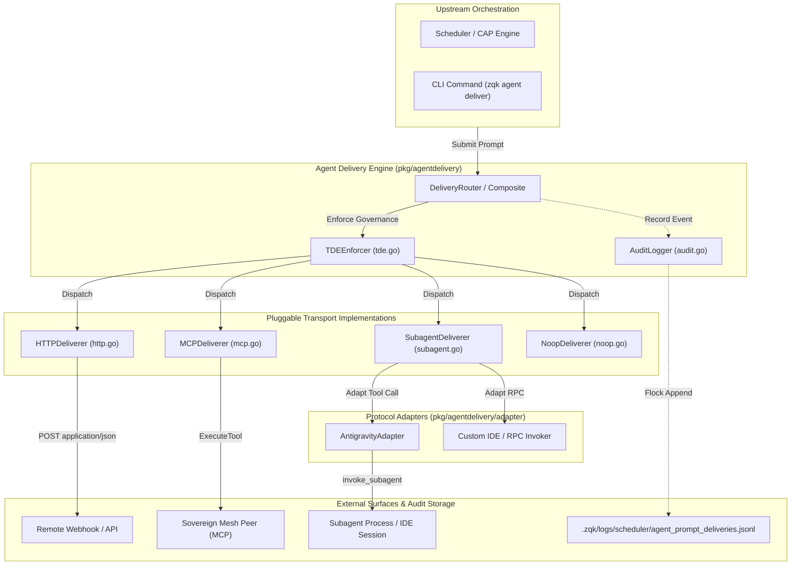
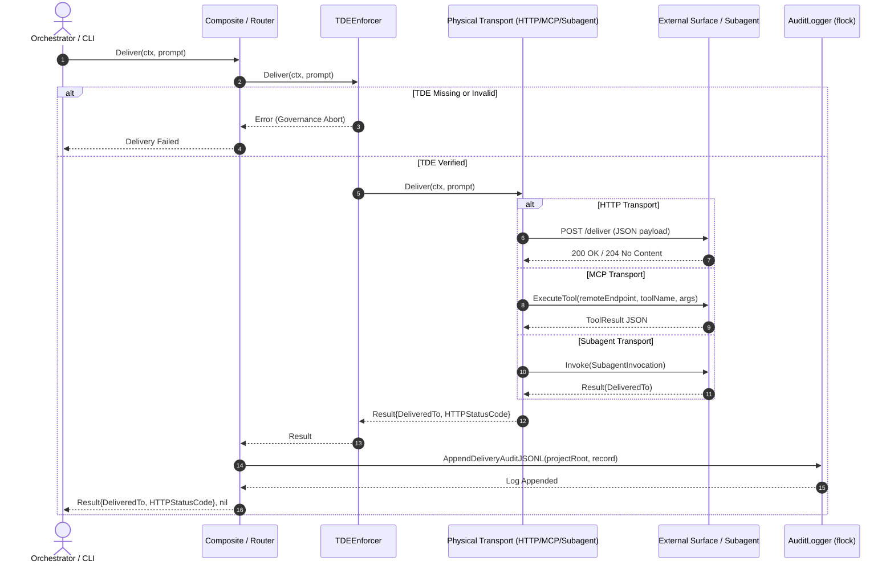
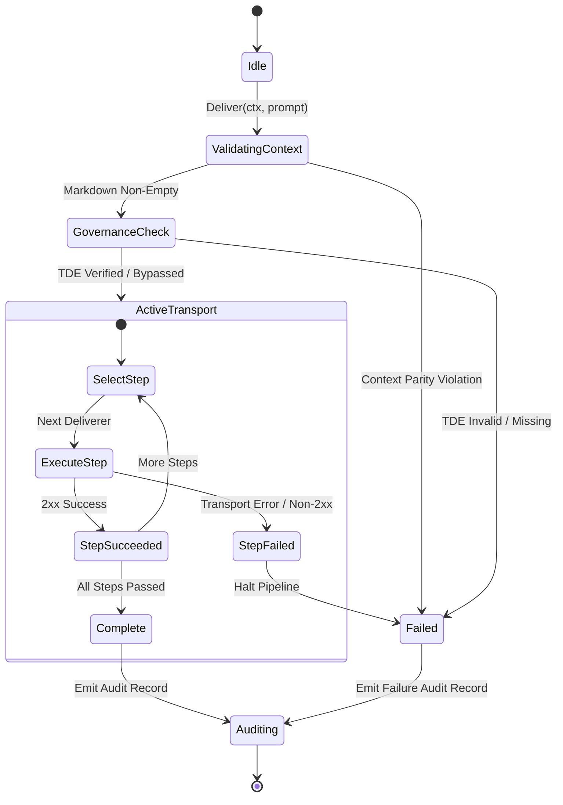

# Multi-Transport Agent Delivery & Protocol Adapters Subsystem Guide

Comprehensive architectural, operational, and protocol reference for the `pkg/agentdelivery` subsystem in ZQK Core.

---

## 1. Architectural Overview

In the ZQK autonomous agent architecture, generating context-bound instructions (e.g. from the convergence engine or scheduler) is intentionally decoupled from physical payload delivery. Autonomous software engineers, verification daemons, and background workers consume prompts through diverse operational modalities: local file writes, IDE-integrated subagents, remote HTTP microservices, Model Context Protocol (MCP) tool endpoints, or dry-run test loops.

The **Multi-Transport Agent Delivery and Protocol Adapters Subsystem** (`pkg/agentdelivery`) provides the transport abstraction layer responsible for dispatching prompt markdown, session identifiers, and neurological governance metadata to designated execution targets without hardcoding platform or vendor dependencies.

### Core Subsystem Invariants

1. **Transport Pluggability & Separation of Concerns**:
   Prompt generation produces neutral context payloads (`Prompt`). The delivery subsystem translates these into transport-specific wire formats (HTTP POST JSON, MCP JSON-RPC tool parameters, direct Go memory invocation) without mutating prompt content.
2. **Context Parity Enforcement**:
   Every deliverer verifies that incoming prompt markdown is non-empty and uncorrupted before transmission. Subagent and remote invocations enforce context parity to ensure downstream reasoning engines receive full architectural directives.
3. **Neurological Governance & TDE Interception**:
   Governed delivery pipelines wrap transport targets with the Trust-Domain Envelope (`TDEEnforcer`). Inbound envelopes are cryptographically verified for schema integrity, signature authenticity, and confidence floor thresholds prior to release.
4. **Append-Only Delivery Audit Trails**:
   Every prompt delivery event—whether successful or failed—is recorded to `.zqk/logs/scheduler/agent_prompt_deliveries.jsonl` under cross-process file locks, establishing complete end-to-end traceability across autonomous cycles.
5. **Resilient Fallback & Composite Sequencing**:
   The `Composite` deliverer chains multiple delivery targets sequentially. Non-destructive telemetry and logging steps execute alongside primary handoffs, halting fail-closed on unrecoverable transmission errors.

---

## 2. Component Topology

The subsystem is modularized into distinct deliverers, decorators, and protocol adapters:



### Component Roles & Responsibilities

- **`Deliverer` (`delivery.go`)**:
  Foundational interface defining `Name() string` and `Deliver(ctx context.Context, p Prompt) (Result, error)`. Standardizes the contract for all physical transports.
- **`Composite` (`delivery.go`)**:
  Pipeline deliverer that iterates over an ordered slice of `Deliverer` implementations. Executes each step sequentially, preserving the latest successful `Result` and aborting immediately upon encountering an error.
- **`HTTPDeliverer` (`http.go`)**:
  Transmits prompt payloads to remote webhooks or HTTP services via `POST` requests. Formats payloads as `{"format": "...", "convergence_session_id": "...", "markdown": "..."}`, injects optional Bearer authorization headers, and integrates with the shared APISpec client for timeout and retry policies.
- **`MCPDeliverer` (`mcp.go`)**:
  Routes prompts across the Sovereign Mesh to remote kernel nodes using the Model Context Protocol. Wraps prompt parameters into tool call arguments and invokes `federation.Transport.ExecuteTool`.
- **`SubagentDeliverer` (`subagent.go`)**:
  Dispatches prompts to in-process or IDE-managed subagent execution engines. Validates context parity (blocking empty markdown), injects trust domain metadata, and forwards invocations through pluggable `SubagentInvoker` adapters.
- **`AntigravityAdapter` (`adapter/antigravity.go`)**:
  Concrete adapter bridging `SubagentInvocation` to the IDE subagent tool interface (`invoke_subagent`), defaulting type, role, model, and workspace configurations when omitted.
- **`TDEEnforcer` (`tde.go`)**:
  Middleware decorator intercepting deliveries to validate `policy.TrustDomainEnvelope`. Rejects unauthenticated, unsigned, or low-confidence envelopes before they reach physical network or process transports.
- **`NoopDeliverer` (`noop.go`)**:
  Lightweight transport implementation that records skipped delivery without performing network or filesystem I/O, ideal for dry-run testing and headless linting.
- **`AuditLogger` (`audit.go`)**:
  Serializes `DeliveryAuditRecord` structures to line-delimited JSON (`agent_prompt_deliveries.jsonl`) protected by flock-based file locking (`paths.LockFileSuffix`).

---

## 3. Multi-Transport Dispatch Lifecycle

The delivery lifecycle coordinates upstream prompt generation with downstream network and process execution:



### Lifecycle Phases

1. **Submission & Context Hydration**:
   The caller passes a `Prompt` containing rendered markdown, convergence session identifier, delivery format, and optional `TrustDomainEnvelope`.
2. **Governance Interception**:
   If wrapped with `TDEEnforcer`, the payload's signature and cryptographic public key are verified. The enforcer checks that the envelope contains approved scopes, required MCP permissions, and neurological confidence ratings (>= 0.75).
3. **Transport Protocol Execution**:
   - For **HTTP**, URLs are normalized and validated for supported schemes (`http`, `https`). Payloads are marshaled to JSON and posted with configured timeouts.
   - For **MCP**, parameters are mapped to kernel field keys and executed remotely across the federation mesh.
   - For **Subagent**, default configurations (`self`, `Subagent Worker`, `inherit`) are mapped and passed to the invoker function.
4. **Audit Trail Append**:
   Upon completion of the transport step, `AppendDeliveryAuditJSONL` writes a structured JSON record containing timestamps, session IDs, delivery destinations, HTTP status codes, and payload byte sizes under a strict 5-second file lock timeout.

---

## 4. Protocol Negotiation & Fallback Dynamics

The subsystem provides deterministic state transitions during multi-step delivery:



### Fallback & Resilience Rules

- **Strict Halt on Pipeline Error**: In a `Composite` pipeline, if any deliverer step fails (e.g., HTTP endpoint responds with `502 Bad Gateway`), execution immediately terminates. Subsequent steps are not evaluated, preventing orphaned partial deliveries.
- **Fail-Closed Governance**: If an execution target demands neurological governance (`TDEEnforcer`), delivery fails closed if the envelope is absent or fails cryptographic verification.
- **Dry-Run Non-Interference**: When dry-run or verification mode is active, the `NoopDeliverer` satisfies delivery contracts with `DeliveredTo: "noop:skipped"` without triggering network or external process side-effects.

---

## 5. Security, Zero-PII Redaction & Audit Trails

### Trust-Domain Envelope (TDE) Invariant

The `policy.TrustDomainEnvelope` ensures that agent prompt deliveries cannot be spoofed or delivered across unapproved boundary surfaces. Verification enforces:
- Valid Ed25519 signature verified against the sender's public key.
- Explicit non-empty target scope (e.g. `agent_orchestration`).
- At least one authorized namespace (e.g. `zqk:kernel`).
- Neurological governance payload presence with confidence score >= 0.75.
- Decision branch attribution.

### Delivery Audit Ledger

Audit records are persisted to `.zqk/logs/scheduler/agent_prompt_deliveries.jsonl` using the `DeliveryAuditRecord` schema:

| Field | Type | Description |
| :--- | :--- | :--- |
| `timestamp` | string | RFC3339 UTC timestamp recorded at write time. |
| `event_type` | string | Fixed identifier: `agent_prompt_delivery`. |
| `convergence_session_id` | string | Convergence session or workflow cycle identifier. |
| `format` | string | Wire format specification (e.g. `agent-prompt`). |
| `deliver_mode` | string | Delivery mode classification (`local`, `remote`, `dry-run`). |
| `primary_destination` | string | Primary target classification (`stdout`, `http`, `mcp`). |
| `delivered_to` | []string | Array of destination descriptors (e.g. `http://service:8080`). |
| `http_url` | string | Target endpoint URL (omitted when empty). |
| `http_status` | int | HTTP response code (omitted when zero). |
| `http_error` | string | Network or status error message (omitted when nil). |
| `markdown_bytes` | int | Byte length of the dispatched prompt payload. |

### Concurrency & Cross-Process File Locking

Because multiple workers or scheduler daemons may emit audit lines concurrently, `AppendDeliveryAuditJSONL` wraps all disk operations in an advisory file lock:
- Lock file location: `.zqk/logs/scheduler/agent_prompt_deliveries.jsonl.lock`.
- Lock timeout: 5 seconds.
- Append semantics: File is opened with `O_WRONLY | O_CREATE | O_APPEND` with permission `0644`.

---

## 6. Operational Usage & Code Recipes

### Programmatic Composition in Go

```go
package main

import (
    "context"
    "log"

    "github.com/zqk-os/zqk/pkg/agentdelivery"
)

func main() {
    ctx := context.Background()

    // 1. Configure physical transports
    httpTransport := agentdelivery.HTTPDeliverer{
        URL:         "https://agent-mesh.internal/dispatch",
        BearerToken: "mesh-access-token",
    }

    // 2. Wrap with governance enforcer
    governedTransport := &agentdelivery.TDEEnforcer{
        Next: httpTransport,
    }

    // 3. Compose with noop telemetry step
    pipeline := agentdelivery.Composite{
        Steps: []agentdelivery.Deliverer{
            agentdelivery.NoopDeliverer{},
            governedTransport,
        },
    }

    // 4. Dispatch prompt
    prompt := agentdelivery.Prompt{
        Markdown:  []byte("# Autonomous Goal\nExecute cycle delivery."),
        SessionID: "session-cycle-163",
        Format:    "agent-prompt",
    }

    result, err := pipeline.Deliver(ctx, prompt)
    if err != nil {
        log.Fatalf("Delivery failed: %v", err)
    }

    log.Printf("Prompt delivered successfully to: %s (status %d)",
        result.DeliveredTo, result.HTTPStatusCode)
}
```

### Implementing a Custom Subagent Adapter

```go
package main

import (
    "context"
    "fmt"

    "github.com/zqk-os/zqk/pkg/agentdelivery"
)

type CustomWorkerInvoker struct{}

func (c *CustomWorkerInvoker) Name() string {
    return "custom-worker"
}

func (c *CustomWorkerInvoker) Invoke(ctx context.Context, inv agentdelivery.SubagentInvocation) (agentdelivery.Result, error) {
    // Dispatch to background process or worker queue
    logReceipt := fmt.Sprintf("spawned:%s:%s", inv.TypeName, inv.Role)
    return agentdelivery.Result{
        DeliveredTo:    logReceipt,
        HTTPStatusCode: 200,
    }, nil
}
```

---

## 7. Verification & Invariant Enforcement

The `pkg/agentdelivery` package enforces strict test coverage and behavioral invariants.

### Statement Coverage Floor

All modifications to `pkg/agentdelivery` must satisfy the static floor statement coverage requirement:
$$\text{Statement Coverage} \ge 85.0\%$$

### Automated Verification Commands

```bash
# 1. Run unit test suite with coverage calculation
ZQK_ALLOW_FOREGROUND_GO_TEST=1 go test -v -timeout 30s -cover ./pkg/agentdelivery/...

# 2. Run repository hygiene and tree structure checks
./bin/zqk-vet -suite hygiene,tree

# 3. Verify public release payload integrity (zero prohibited nanosecond IDs)
sh scripts/open-core/check-public-release-payload.sh .
```
