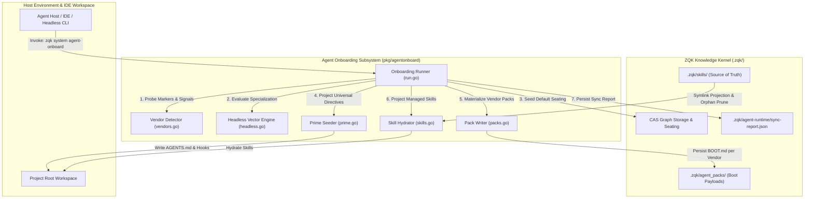
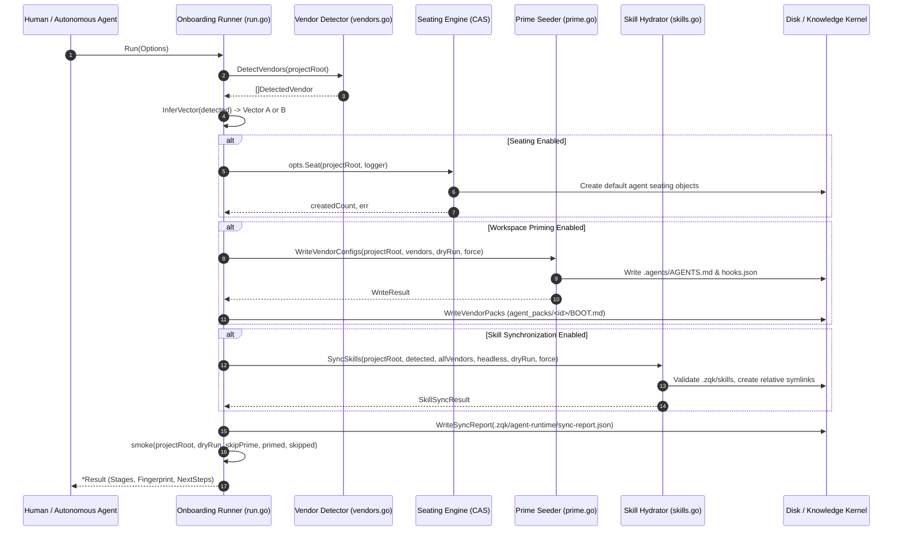
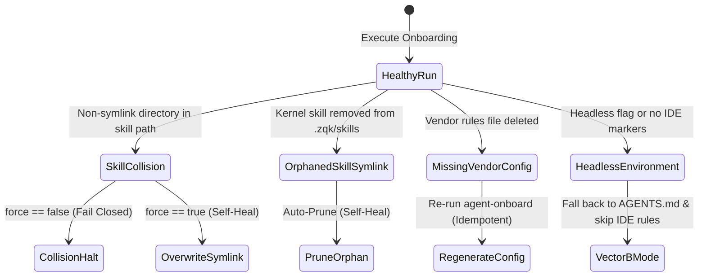

# Agent Onboarding & Environment Seeding Subsystem Guide

Comprehensive architectural, operational, and integration reference for the `pkg/agentonboard` subsystem in ZQK Core.

---

## 1. Architectural Overview

When autonomous software agents, human pair programmers, or IDE tools connect to a repository governed by the ZQK Knowledge Kernel, they require an unambiguous operational contract. In heterogeneous environments, different agent harnesses (e.g. Claude Code, Cursor, Windsurf, Antigravity, Copilot, Ollama, and CLI-based headless runtimes) expect workspace configuration files and directives in differing formats and filesystem locations.

The **Agent Onboarding & Environment Seeding Subsystem** (`pkg/agentonboard`) serves as the first-contact entry membrane for the workspace. It reconciles local editor environments with persistent Knowledge Kernel graph objects, primes operational directives, synchronizes kernel-managed skill definitions, and registers stable workspace identity fingerprints without mutating non-managed user files.



### Core Invariants

1. **Universal Directive Anchor (`AGENTS.md`)**:
   Regardless of detected IDE vendors or headless modes, `pkg/agentonboard` guarantees that `.agents/AGENTS.md` is populated with canonical kernel boot payload directives. This universal directive acts as the primary headless-safe interface.
2. **Non-Destructive Default & Explicit Force Protection**:
   Existing workspace configuration files and foreign symlinks or custom user files are never overwritten or deleted by default. Modifications or overwrites require explicit operator consent via `--force`.
3. **Dual Execution Vectors (Vector A vs. Vector B)**:
   - **Vector A (IDE & Interactive Hosts)**: Activated when IDE markers (such as `.cursor`, `.claude`, `.ide`, or `.windsurf`) are present. Provisions vendor-specific rules, symlinks skills into editor directories, and exposes interactive workflows.
   - **Vector B (Headless, Appliance & Edge Hosts)**: Activated in headless CLI environments, server appliances, or remote SSH/container workers. Skips desktop IDE rule files, generates edge signal probes, and relies exclusively on universal directives and kernel graph objects.
4. **Kernel as Single Source of Truth for Skills**:
   The authoritative origin for all reusable agent skills is `.zqk/skills/`. Workspace skill directories (such as `.agent/skills` and `.cursor/skills`) are projected views created via relative symlinks. Orphaned symlinks whose origin was removed from `.zqk/skills/` are cleaned automatically.
5. **Idempotent Execution & Fingerprinted Synchronization**:
   Repeated invocations of `zqk system agent-onboard` are completely idempotent. Each run calculates a SHA-256 workspace fingerprint combining project path, vector mode, and detected vendor set, recorded within `.zqk/agent-runtime/sync-report.json`.

---

## 2. Component Topology

The subsystem is organized into modular Go packages providing clear separation of concerns:

| Component | Implementation File | Primary Responsibilities |
| :--- | :--- | :--- |
| **Onboarding Runner** | `run.go` | Orchestrates the multi-stage pipeline: detection, session validation, agent seating, workspace priming, skill synchronization, and post-onboarding smoke validation. |
| **Vendor Registry & Detector** | `vendors.go` | Defines the canonical vendor table (`KnownVendors`), marker path heuristics, filter normalization, and local Ollama inference detection. |
| **Headless Vector Engine** | `headless.go` | Collects edge hints (GPU visible devices, DGX appliance release markers, SSH session detection, specialization tiers) and manages the market probe questionnaire. |
| **Prime Seeder** | `prime.go` | Formats and writes vendor configuration files, provisions anti-idle hook configurations (`hooks.json`), and handles JSON sync report persistence and loading. |
| **Pack Writer** | `packs.go` | Materializes isolated vendor boot definitions (`.zqk/agent_packs/<vendor>/BOOT.md`) containing base kernel guidance plus vendor-specific addenda. |
| **Skill Hydrator** | `skills.go` | Projects kernel skills into active IDE skill folders using relative symlinks, prunes unmanaged or orphaned projections, and guards against collisions. |
| **Payload Formatter** | `payload.go` | Generates the core markdown boot payload containing the 5-layer ontological cascade, anti-idleness protocols, and execution discipline. |

---

## 3. Multi-Agent Onboarding Lifecycle

The onboarding pipeline progresses through six deterministic execution stages:



### Stage Details

1. **Detection Stage (`detect`)**:
   Scans the workspace root for marker directories and configuration files. In addition to filesystem markers, it probes local TCP loopbacks (e.g. port 11434) and environment variables (`OLLAMA_HOST`, `LLM_PROVIDER`) to detect local air-gapped models.
2. **Authentication & Session Stage (`auth`)**:
   Verifies whether an authenticated session exists. In Community Edition, local offline sessions are accepted by default (`StageOK`).
3. **Seating Stage (`seat`)**:
   Invokes the seat provisioning delegate to create default agent seating records in kernel CAS storage (e.g., Lead Architect, Software Engineer, Quality Verification Craftsman).
4. **Workspace Priming Stage (`prime_workspace`)**:
   Emits `.agents/AGENTS.md` and vendor-specific rules files. When agent-hook vendors are detected, it configures `.agents/hooks.json` to prevent idle halts and enforce subagent context injection.
5. **Kernel Sync & Skill Stage (`prime_kernel`)**:
   Synchronizes skills from `.zqk/skills/` into editor directories (`.agent/skills`, `.cursor/skills`, `.claude/skills`). Persists the complete `sync-report.json` under `.zqk/agent-runtime/`.
6. **Smoke Verification Stage (`smoke`)**:
   Verifies that generated directives are accessible and intact on disk. Generates targeted `NextSteps` guidance based on detected execution vector (Vector A vs. Vector B).

---

## 4. Vendor Support & Directory Layout

The subsystem provides built-in adapter definitions for major agent platforms:

| Vendor ID | Display Name | Detection Markers | Target Configuration Files |
| :--- | :--- | :--- | :--- |
| `agents_md` | AGENTS.md / Universal | `AGENTS.md`, `.agents/AGENTS.md` | `.agents/AGENTS.md` |
| `ide` | Generic IDE / Cursor | `.ide`, `.iderules`, `.ide/mcp.json` | `.iderules` |
| `claude_code` | Claude Code | `.claude`, `CLAUDE.md` | `CLAUDE.md` |
| `cline` | Cline | `.clinerules`, `.cline` | `.clinerules` |
| `windsurf` | Windsurf | `.windsurfrules`, `.windsurf` | `.windsurfrules` |
| `gemini` | Gemini CLI | `.gemini`, `GEMINI.md` | `GEMINI.md` |
| `agent` | Antigravity / Agent | `.agent`, `ANTIGRAVITY.md` | `ANTIGRAVITY.md` |
| `openclaw` | OpenClaw | `.openclaw`, `OPENCLAW.md` | `OPENCLAW.md` |
| `ollama` | Ollama (Local Air-Gapped) | `.ollama`, `OLLAMA.md`, `local:11434` | `OLLAMA.md` |

### Filesystem Layout Example

A fully onboarded hybrid workspace exhibits the following directory structure:

```
my-project/
├── .agents/
│   ├── AGENTS.md            # Universal headless & agent directive surface
│   └── hooks.json           # Subagent pre-invocation and anti-idle hooks
├── .agent/
│   └── skills/              # Projected agent skills
│       ├── arch-design -> ../../.zqk/skills/arch-design
│       └── code-craft -> ../../.zqk/skills/code-craft
├── .cursor/
│   └── skills/              # Projected IDE skills
│       ├── arch-design -> ../../.zqk/skills/arch-design
│       └── code-craft -> ../../.zqk/skills/code-craft
├── .zqk/
│   ├── agent_packs/         # Regenerable vendor boot packs
│   │   ├── agents_md/
│   │   │   └── BOOT.md
│   │   └── ide/
│   │       └── BOOT.md
│   ├── agent-runtime/
│   │   └── sync-report.json # JSON record of sync status and fingerprint
│   └── skills/              # Authoritative kernel skills storage
│       ├── arch-design/
│       │   └── SKILL.md
│       └── code-craft/
│           └── SKILL.md
└── CLAUDE.md                # Claude Code entry point (if vendor detected)
```

---

## 5. Failure Modes & Self-Healing

The onboarding subsystem is engineered with defensive fallbacks and fail-safe protections:



### Specific Resilience Mechanisms

- **Skill Collision Protection**:
  If a non-symlink file or directory occupies a target skill destination (e.g. `.agent/skills/custom-tool`), the hydrator refuses to delete or overwrite it without `--force`. This protects human-authored local tools from accidental truncation.
- **Orphaned Skill Auto-Pruning**:
  When a skill pack is removed from `.zqk/skills/`, any corresponding symlink whose target path references `.zqk/skills/` is pruned automatically during synchronization, preventing broken references in editor panels.
- **Foreign Symlink Preservation**:
  Symlinks in `.agent/skills` or `.cursor/skills` pointing to arbitrary outside directories (e.g. personal global dotfiles) are preserved unless `--force` is specified.
- **Vector B Headless Degradation**:
  In automated pipelines where no GUI editor is running, running with `--headless` silences the creation of IDE-specific rule files (`.iderules`, `.windsurfrules`) and produces lean universal directives.

---

## 6. Verification & Test Coverage Invariant

To maintain the architectural integrity of the onboarding membrane, all changes to `pkg/agentonboard` are governed by continuous verification gates.

### Invariant Contract

- **Statement Coverage Threshold**: `pkg/agentonboard` requires strictly **>= 85.0% statement test coverage**.
- **Hermetic Testing**: All unit and boundary tests execute against isolated temporary directories (`t.TempDir()`).
- **Zero Swallowed Errors**: Error returns across filesystem operations, symlink creation, and JSON serialization are explicitly checked and wrapped using `errfmt`.
- **Targeted Verification Command**:

```bash
ZQK_ALLOW_FOREGROUND_GO_TEST=1 go test -v -timeout 30s -cover ./pkg/agentonboard
```

### Static Analysis and Code Formatting

```bash
gofmt -w pkg/agentonboard/
./bin/zqk-vet -suite hygiene,tree
sh scripts/open-core/check-public-release-payload.sh .
```
