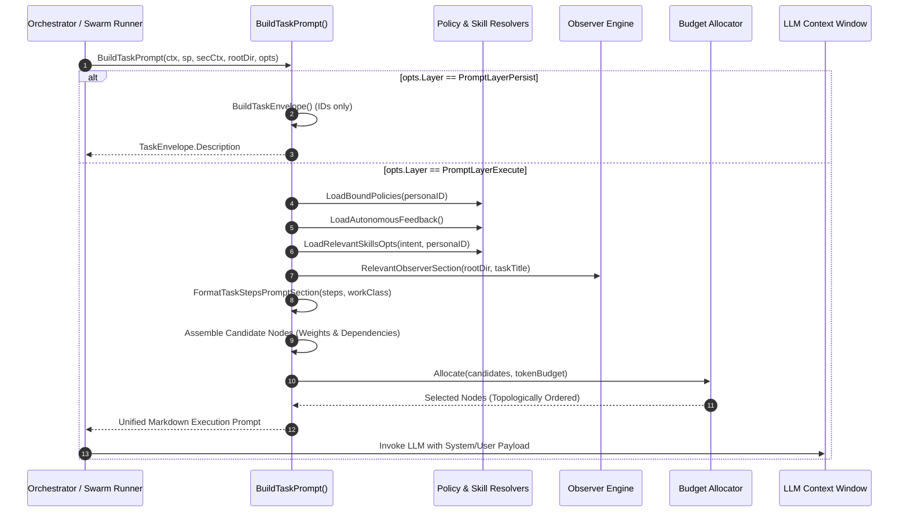
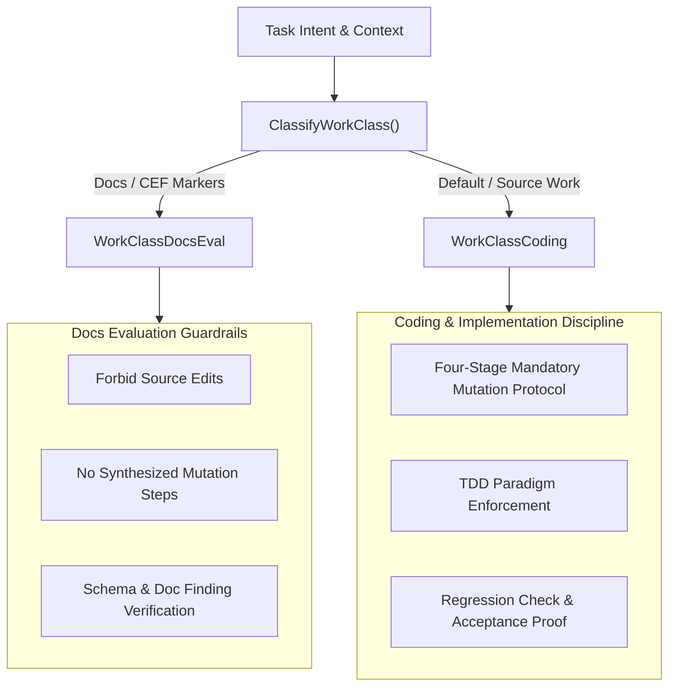

# Agent Prompt Engineering & Dynamic Context Assembly Subsystem Guide

Comprehensive architectural, operational, and lifecycle reference for the `pkg/agentprompt` subsystem in ZQK Core.

---

## 1. Architectural Overview

Autonomous AI coding agents in the ZQK Knowledge Kernel do not operate on transient, uncalibrated conversational chat strings. Prompt assembly is a deterministic, compiler-grade pipeline that extracts relational state, bound governance policies, verified skill manifests, codebase AST structures, and continuous autonomy directives into a token-budgeted context window.

The **Agent Prompt Engineering & Dynamic Context Assembly Subsystem** (`pkg/agentprompt`) provides the authoritative context hydration layer across the execution lifecycle. Whether launching a new agent session (`BuildOnboardingPrompt`), dispatching an atomic task (`BuildTaskPrompt`), waking a Continuous Autonomous Progression (CAP) cycle stage (`BuildCapStageWakePrompt`), or triggering the CAP Sentinel supervisor (`BuildSentinelPrompt`), `pkg/agentprompt` guarantees deterministic context composition with fail-closed safety.

### Core Invariants

1. **Dual-Layer Context Hydration (Persist vs. Execute)**:
   - **Persist Layer (`PromptLayerPersist`)**: Generates compact, reference-only envelopes (`TaskEnvelopeMarker`) for storing in persistent Knowledge Kernel objects (`agent_task`). Policy and skill instruction bodies are never inlined onto persistent task objects, preventing token bloat and relational drift.
   - **Execute Layer (`PromptLayerExecute`)**: Inlines or references active governance rules, skill mandates, and upstream dependency deliverables immediately prior to LLM invocation.
2. **Context Onion & Dynamic Token Allocation**:
   Context is modeled as candidate graph nodes with topological dependency constraints and relative priority weights. Using a knapsack-style allocation algorithm, core task directives are unconditionally preserved, while ambient AST structures and auxiliary policies are gracefully compacted if LLM token budgets are constrained.
3. **AST-Informed Ambient Grounding**:
   Codebase navigation relies on live structural AST indexing via the observer engine. Instead of dumping verbose file listings or full source trees into prompt context, agents receive targeted symbol and path hints alongside live tools (`observer_search`, `read_code`), eliminating hallucinated file paths and `src/` directory inventions.
4. **Work Class Specialization**:
   Execution prompts dynamically adapt their instruction rubrics and capability assertions to the verified work class (`coding` vs. `docs_eval`). Coding tasks receive synthesized four-stage mutation evidence steps to prevent passive read-looping, while evaluation tasks strictly enforce zero-source-edit boundaries.
5. **Continuous Flywheel & Anti-Idleness Directives**:
   Every operational prompt injects binding standing mandates (`POL-CODE-FLYWHEEL-001` or active storage equivalents). Agents are explicitly instructed that PR merges, test passes, and summary outputs are milestone transitions rather than stopping conditions.

---

## 2. Component Topology

The subsystem is modularized into cohesive units responsible for envelope hydration, governance compilation, skill selection, and AST observation:

```mermaid
flowchart TD
    subgraph StorageLayer["Knowledge Kernel Storage"]
        SP["ObjectStorageProvider"]
        Policies["Policy Catalog (KindPolicy)"]
        Skills["Agent Skills (KindAgentSkill)"]
        Personas["Agent Personas (KindPersona)"]
        Templates["Prompt Templates (prompt_template)"]
    end

    subgraph AssemblyPipeline["Agent Prompt Pipeline (builder.go)"]
        TPB["BuildTaskPrompt()"]
        ONB["BuildOnboardingPrompt()"]
        STB["BuildSentinelPrompt()"]
        WKB["BuildCapStageWakePrompt()"]
        ALC["pipeline.Allocator"]
    end

    subgraph ContextComponents["Subsystem Components"]
        ENV["Envelope Hydrator (envelope.go, task_envelope.go)"]
        POL["Policy Enforcement (policy.go, standing.go)"]
        SKL["Skill Selector (skills.go)"]
        OBS["Observer Filter (observer.go)"]
        STP["Task Steps Generator (task_steps.go)"]
        WKC["Work Class Classifier (work_class.go)"]
        FDB["Feedback Hydrator (feedback.go)"]
    end

    subgraph Output["Prompt Artifacts"]
        PersistEnv["Persist Layer (TaskEnvelope)"]
        ExecPrompt["Execution System/User Markdown"]
    end

    SP --> POL
    SP --> SKL
    SP --> Templates
    Personas --> POL
    Personas --> SKL

    TPB --> POL
    TPB --> SKL
    TPB --> OBS
    TPB --> STP
    TPB --> WKC
    TPB --> FDB
    TPB --> ENV

    TPB --> ALC
    ALC --> ExecPrompt
    ENV --> PersistEnv
```



### Subsystem File Manifest

| File | Purpose | Primary Functions & Types |
| :--- | :--- | :--- |
| `builder.go` | Orchestrates end-to-end prompt assembly across task, onboarding, and sentinel modes. | `BuildTaskPrompt`, `BuildOnboardingPrompt`, `BuildSentinelPrompt`, `TaskPromptOptions` |
| `cap_stage.go` | Assembles wake prompts for CAP cycle stages (planning, design, grooming, etc.). | `BuildCapStageWakePrompt`, `CapStageTemplateCoverage`, `CapStageWakeOptions` |
| `envelope.go` | Parses and formats `zqk.agent_prompt.v1` HTML comment envelopes for chat and CLI integration. | `Envelope`, `ParseLeadingEnvelope`, `FormatHTMLCommentLine`, `EnvelopeFromAttentionMode` |
| `task_envelope.go` | Formats persist-layer task descriptions containing canonical references rather than raw bodies. | `BuildTaskEnvelope`, `FormatTaskEnvelope`, `IsTaskEnvelope`, `TaskEnvelope` |
| `policy.go` | Loads bound and active policies, formatting them as compact references or full bodies. | `LoadActivePolicies`, `LoadBoundPolicies`, `PolicyEnforcement` |
| `standing.go` | Discovers standing mandates (TDD, Flywheel, VDS) and resolves policies by semantic intent. | `StandingPolicyRefs`, `DiscoverStandingPolicies`, `ResolvePolicyByIntent` |
| `skills.go` | Synchronizes twin skills, verifies SHA-256 seals, and filters skills relevant to task intent. | `SyncASKTwins`, `LoadRelevantSkillsOpts`, `SkillEnforcement` |
| `observer.go` | Extracts codebase AST entities and renders targeted, task-scoped structural hints. | `ExtractObserverContext`, `RelevantObserverSection`, `ObserverContext` |
| `task_steps.go` | Formats explicit task steps or synthesizes mandatory 4-stage mutation workflows for coding tasks. | `FormatTaskStepsPromptSection` |
| `work_class.go` | Classifies tasks into `coding` or `docs_eval` to tailor capabilities and prompt rubrics. | `ClassifyWorkClass`, `WorkClass`, `PromptCapabilities` |
| `feedback.go` | Injects autonomous review feedback, human-in-the-loop steer items, and correction notes. | `LoadAutonomousFeedback`, `AutonomousFeedback` |

---

## 3. Prompt Assembly Lifecycle

The prompt construction lifecycle follows a deterministic, four-phase assembly sequence:



### Phase 1: Intent Ingestion & Work Classification
The pipeline ingests `TaskPromptOptions` (task title, plan title, persona ID, session ID, verification DSL, and upstream deliverables). It classifies the task into an operational `WorkClass`:
- If the task description matches docs evaluation markers (`docs_eval`, `docs/quality/cef-runs`, `pipeline_ref=pip-cef`, `forbid: source edits`), it is locked to `WorkClassDocsEval`.
- Otherwise, it defaults to `WorkClassCoding`, which strictly mandates source code mutations and regression testing.

### Phase 2: Relational Governance & Skill Resolution
- **Bound Policies**: Discovers standing policies (`POL-ONBOARD-001`, `POL-ONBOARD-002`, `POL-CODE-FLYWHEEL-001`) alongside persona-specific policies. In execution mode, policy summaries or references are rendered depending on `opts.InlineBodies`.
- **Verified Skills**: Identifies skills linked to the persona or matching task description tokens. If relative filesystem paths are configured, their cryptographic integrity is verified against skill metadata (`seal_sha256`) before injection.
- **Autonomous Feedback**: Loads historical feedback entries from recent reviews and corrections to prevent repeated mistakes.

### Phase 3: Ambient AST Grounding
If `opts.IncludeObserver` is enabled, the pipeline inspects the project directory. It infers relevant package paths and queries the trigram AST index for referenced symbols. A compact list of top-relevance functions and structs is formatted into an ephemeral section that is never stored in persistent task state.

### Phase 4: Topological Token Budget Allocation
All candidate sections are converted into `pipeline.ContextNode` items with assigned token weights:
- **Core Directives (Weight 1.0, IsCore true)**: Orchestration headers, assigned persona, standing mandates, verification DSL, and task steps.
- **Upstream Deliverables (Weight 0.95)**: Verified outputs from dependency shockwaves.
- **Autonomous Feedback (Weight 0.90)**: Recent execution corrections.
- **Relevant Skills (Weight 0.85)**: Domain skill instructions.
- **Bound Policies (Weight 0.80)**: System policies.
- **Ambient AST (Weight 0.70)**: Structural hints.

The allocator executes a knapsack distribution within `opts.TokenBudget` (defaulting to 32,768 tokens if unspecified) and concatenates accepted sections in deterministic order.

---

## 4. Work Class Differentiation & Taxonomy

`pkg/agentprompt` enforces strict capability partitioning across agent personas to prevent scope drift and unauthorized filesystem modifications:



### Synthesized Mutation Steps for Coding Tasks
When a coding task lacks explicit sub-steps (`task_steps`), `FormatTaskStepsPromptSection` synthesizes a mandatory four-stage workflow to prevent agents from idling in read loops:

1. **Scope & Existing Test Inspection**: Read target files and baseline tests to verify current behavior.
2. **Code Implementation & Mutation**: Apply necessary edits satisfying requirements.
3. **Automated Verification & Regression Check**: Execute targeted test commands confirming criteria pass.
4. **Completion & Mutation Evidence Summary**: Render concise completion receipt referencing modified paths.

For `WorkClassDocsEval`, synthesized coding steps are omitted, preserving the non-mutating evaluation boundary.

---

## 5. Token Conservation & Truncation Invariants

Managing large context windows requires rigorous compaction to keep local and cloud LLMs responsive and cost-effective:

### Trigram AST Filtering
The observer integration limits ambient code hints to a hard maximum of 12 unique entities (`observerHintLimit`). Duplicate symbols across files are deduplicated via unique signature keys (`File:Name:Kind`).

### Instruction Rune Truncation
When skill bodies are inlined, instruction texts are bounded by `opts.MaxInstructionRunes` (default 6,000 runes). The `truncateRunes` utility safely slices multi-byte UTF-8 rune slices without corrupting unicode characters, appending an explicit truncation notice (`…(instructions truncated for prompt budget)…`).

### Compact State Representation
In CAP Sentinel prompts, raw state JSON from `whatsnext` is stripped of verbose goal descriptions and milestone details:
- Keeps high-signal keys: `agent_instruction`, `priority_plan`, `backlog_counts_by_status`, and `measure_skip_reason`.
- Replaces full active convergence session arrays with an atomic integer count (`convergence_sessions_active_count`).

---

## 6. HTML Comment Envelopes (`zqk.agent_prompt.v1`)

For chat paste paths and CLI stream interception, `pkg/agentprompt` formats and parses a structured leading HTML comment:

```html
<!-- zqk:agent_prompt {"schema":"zqk.agent_prompt.v1","attention_mode":"test_non_directive","directive_scope":"none","operational_work":false,"queue_policy":"ignore_as_operational_directive"} -->

# Delegated Task Body
...
```

### Operational Directives vs. Test Traffic
Downstream automation consumers call `envelope.IgnoreAsOperationalDirective()` and `envelope.InterruptPlumbingDryRun()` to detect dry-run test traffic and queue plumbing tests, preventing accidental production state mutations while testing prompt routing.

---

## 7. Verification & Coverage Invariant

To guarantee runtime resilience, `pkg/agentprompt` adheres to a strict test coverage floor:

- **Statement Coverage Floor**: Must maintain strictly `>= 85.0%` statement coverage across all implementation files.
- **Hermetic Testing**: All unit tests must utilize `t.TempDir()` and mock storage providers, never modifying repository process YAML or local `.zqk/` state during test runs.
- **Fail-Closed Verification**: Seal verification failures on skill files immediately fail the build pipeline, ensuring tampering is caught early.

```bash
# Verify unit test pass rate and statement coverage
ZQK_ALLOW_FOREGROUND_GO_TEST=1 go test -v -timeout 30s -cover ./pkg/agentprompt
```
