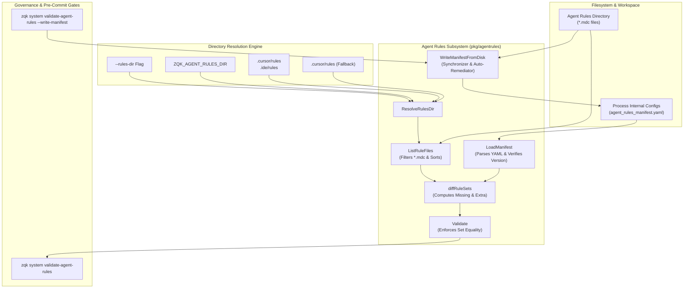
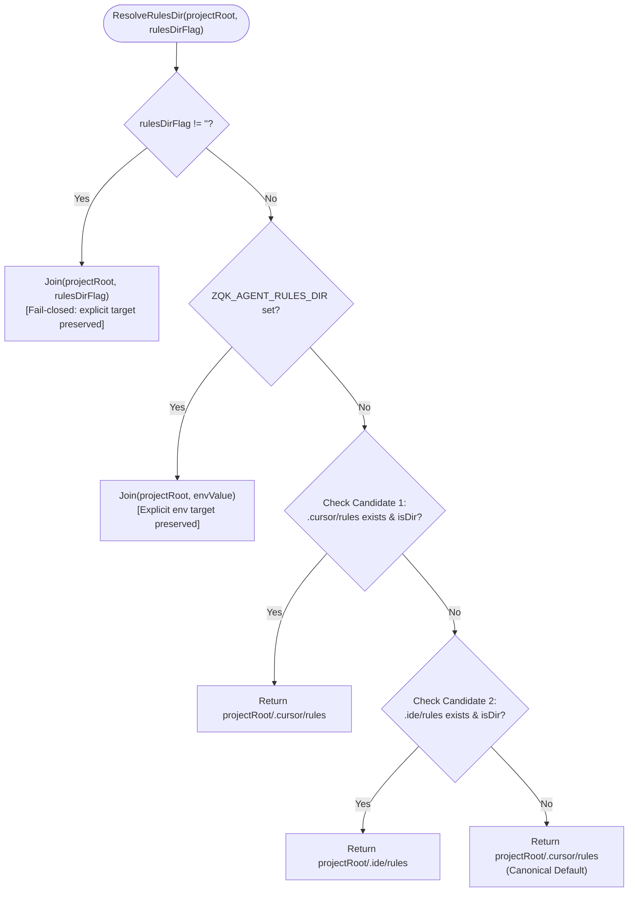
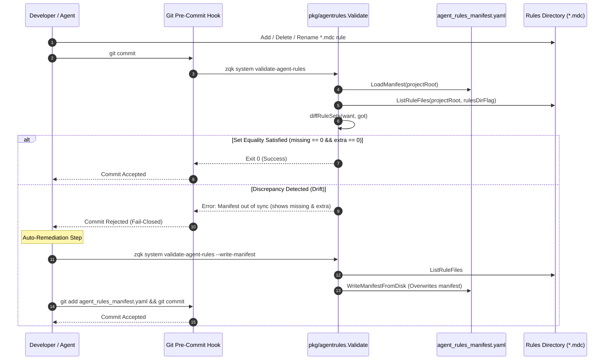

# Agent Execution Rules & Manifest Governance Subsystem Guide

## 1. Executive Architectural Summary

The **Agent Execution Rules & Manifest Governance Subsystem** ([`pkg/agentrules`](file:///Users/lanceettl/zqk-public-candidate/pkg/agentrules/manifest.go)) establishes deterministic, verifiable governance over IDE and autonomous agent execution rules within the ZQK Knowledge Kernel.

Autonomous AI agents, language models, and modern developer IDEs (such as Cursor, Windsurf, and custom agent harnesses) rely on contextual instruction files (typically formatted as Markdown with frontmatter, ending in `.mdc`) to guide code editing, architectural constraints, test execution policies, and system invariants. Without strict configuration control, these rule definitions are vulnerable to:
1. **Silent Configuration Drift:** Rule files added or removed on local developer workstations without being tracked in repository-wide contracts.
2. **Asymmetric Agent Prompting:** Discrepancies between what human developers believe the agent is guided by and what is actually loaded into prompt contexts.
3. **Multi-IDE Path Ambiguity:** Conflicting filesystem conventions across development environments (for example, `.cursor/rules` vs `.ide/rules`).
4. **Unenforced Policy Bypass:** Rules remaining uncommitted, unvalidated, or silently ignored across continuous integration gates.

The `pkg/agentrules` subsystem eliminates these vulnerabilities through a canonical Content-Addressed and version-controlled manifest ([`agent_rules_manifest.yaml`](file:///Users/lanceettl/zqk-public-candidate/pkg/agentrules/manifest.go#L52)), deterministic directory resolution, automated set equality validation, and self-healing synchronization tooling.

---

## 2. Component Topology & System Architecture

The subsystem is composed of four cooperating components operating across the filesystem and process boundaries:



### Component Roles

1. **Manifest Registry ([`ManifestPath`](file:///Users/lanceettl/zqk-public-candidate/pkg/agentrules/manifest.go#L72)):**
   Maintains the canonical record of truth at `.zqk/specs/configs/agent_rules_manifest.yaml`. The file contains a schema version and a sorted array of relative `.mdc` rule filenames.
2. **Rules Directory Resolver ([`ResolveRulesDir`](file:///Users/lanceettl/zqk-public-candidate/pkg/agentrules/manifest.go#L82)):**
   Discovers the active rule directory using an explicit 4-tier precedence hierarchy that supports multi-tenant IDE setups without hardcoding assumptions.
3. **Rule Set Diff Engine ([`diffRuleSets`](file:///Users/lanceettl/zqk-public-candidate/pkg/agentrules/manifest.go#L27)):**
   Performs bidirectional set subtraction between the expected manifest rules and the discovered filesystem `.mdc` files, producing deterministic, sorted discrepancy lists (`missing_on_disk` and `extra_on_disk`).
4. **Manifest Synchronizer ([`WriteManifestFromDisk`](file:///Users/lanceettl/zqk-public-candidate/pkg/agentrules/manifest.go#L156)):**
   Generates a standardized manifest file populated with sorted `.mdc` filenames, injected with canonical command documentation headers, and formatted via Content-Addressed file utilities.

---

## 3. Directory Resolution Hierarchy

Different developer tools place rules in distinct repository locations. Rather than forcing a single rigid layout or failing silently, the subsystem uses a deterministic 4-stage resolution pipeline:



### Precedence Details

| Tier | Source | Description | Behavior if Target Absent |
| :--- | :--- | :--- | :--- |
| **1. Explicit Flag** | `--rules-dir <path>` | Command-line invocation override. | Preserves path as specified; causes fail-closed error if absent. |
| **2. Environment Variable** | `ZQK_AGENT_RULES_DIR` | Process environment override. | Preserves path as specified; causes fail-closed error if absent. |
| **3. Candidate Scan** | `candidateRulesDirs` | Probes `.cursor/rules` then `.ide/rules`. | Selects first candidate that exists as a directory on disk. |
| **4. Default Fallback** | `DefaultAgentRulesRelativePath` | Standard `.cursor/rules` location. | Returned when no flags, env vars, or existing candidate directories exist. |

> [!NOTE]
> Explicit flags and environment overrides are never silently substituted if the named directory does not exist on disk. They return the requested path directly, allowing the scanner to emit a clear, actionable error identifying the specified path rather than falling back unexpectedly.

---

## 4. Governance Lifecycle & Set Equality Validation

The governance lifecycle maintains perfect bidirectional synchronization between the manifest and the filesystem.



### The Three-Fold Proof of Manifest Governance

Every rule manifest validation cycle satisfies three verification gates:

1. **Static Floor Invariant:**
   The manifest file exists at `.zqk/specs/configs/agent_rules_manifest.yaml` and contains a valid schema version (`version: 1`). Manifests with version 0 or unparseable YAML are rejected immediately.
2. **Operational Dynamic Proof:**
   Discovered rule files are filtered strictly for `.mdc` extensions. Directories and collateral non-rule files (such as `.txt`, `.json`, or nested directories) are ignored. Basenames are sorted alphabetically to prevent false diffs caused by nondeterministic directory traversal order.
3. **Negative Adversarial Boundary:**
   If a rule file is added to the filesystem without updating the manifest, or if a rule listed in the manifest is deleted from disk, `Validate` fails closed with an informative error stating the exact discrepant files and the precise remediation command.

---

## 5. Pre-Commit Enforcement & Self-Healing

### Validation Command

To verify manifest alignment across local environments or continuous integration pipelines:

```bash
zqk system validate-agent-rules
```

If rules are stored in a non-default location:

```bash
zqk system validate-agent-rules --rules-dir .ide/rules
```

### Manifest Drift Error Format

When a discrepancy exists, the command emits a structured, actionable error message:

```text
agent rules manifest out of sync with rules dir (manifest=/path/.zqk/specs/configs/agent_rules_manifest.yaml, rules_dir=/path/.cursor/rules): missing_on_disk=[deprecated_rule.mdc] extra_on_disk=[new_coding_standard.mdc]; fix manifest or run: zqk system validate-agent-rules --write-manifest
```

### Automated Remediation

To synchronize the manifest with disk reality automatically:

```bash
zqk system validate-agent-rules --write-manifest
```

This command:
1. Scans the resolved rules directory for all active `*.mdc` files.
2. Sorts the basenames alphabetically.
3. Injects the canonical configuration header.
4. Atomically overwrites `.zqk/specs/configs/agent_rules_manifest.yaml`.

---

## 6. Manifest Schema & File Structure

The canonical manifest file is structured as follows:

```yaml
# Canonical registry for IDE/agent rule files (*.mdc under the configured rules dir; default .cursor/rules).
# Validated by: zqk system validate-agent-rules (no flags from repo root; use --write-manifest to refresh this list).
# Override directory: ZQK_AGENT_RULES_DIR or --rules-dir.
version: 1
rules:
  - 000-core-invariants.mdc
  - 010-tdd-workflow.mdc
  - 020-code-style.mdc
  - 030-security-boundaries.mdc
```

### Schema Attributes

| Field | Type | Description |
| :--- | :--- | :--- |
| `version` | `integer` | Schema specification version (currently `1`). Must be greater than `0`. |
| `rules` | `list of string` | Sorted relative basenames of allowed `*.mdc` rule files. |

---

## 7. Verification & Coverage Invariant

The `pkg/agentrules` subsystem is governed by a strict quality invariant requiring **statement test coverage >= 85.0%**.

### Running the Subsystem Test Suite

To run the isolated unit and boundary test suite:

```bash
ZQK_ALLOW_FOREGROUND_GO_TEST=1 go test -v -timeout 30s -cover ./pkg/agentrules
```

### Test Coverage Architecture

The comprehensive test suite ([`pkg/agentrules/agentrules_coverage_elevation_cycle166_test.go`](file:///Users/lanceettl/zqk-public-candidate/pkg/agentrules/agentrules_coverage_elevation_cycle166_test.go)) exercises:
- Path composition across relative, absolute, and trailing-slash paths.
- Four-tier resolution precedence: explicit flag, environment variable, candidate scan (`.cursor/rules` vs `.ide/rules`), and default fallback.
- Manifest loading under corrupt YAML, missing files, and zero-version conditions.
- Directory listing filtering (ignoring non-`.mdc` files, subdirectories named with `.mdc` extensions) and alphabetical sort invariants.
- Diff engine edge cases: identical sets, empty sets, one-way missing, one-way extra, and bidirectional differences.
- Error propagation in validation pipelines when manifests or directories are inaccessible.
- Atomic file writes, parent directory auto-creation, and fail-closed handling when directory paths collide with regular files.
