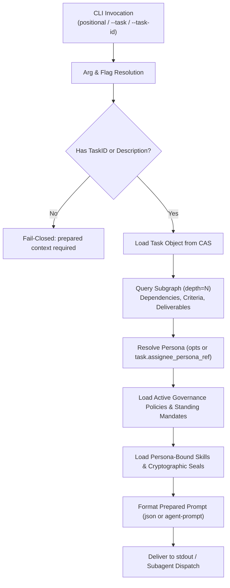

# Agent Task Envelope Execution Guidance and Command Syntax Conventions

Comprehensive architectural, operational, and command syntax reference for Agent Task Envelope resolution and `prepare-context` execution in the ZQK Knowledge Kernel.

---

## 1. Architectural Overview & Design Philosophy

In the ZQK Knowledge Kernel, autonomous coding agents do not operate on ungrounded conversational strings, nor do persistent objects store bloated static instructions. Instead, task generation and worker execution follow a strict **Dual-Layer Context Hydration Model**:

1. **Persist Layer (`PromptLayerPersist`)**:
   - Represents the persistent state stored in CAS under `agent_task` (`.zqk/process/agent_tasks/`).
   - Strictly contains dynamic task facts (plan references, personas, problem statements, upstream deliverables) and relational object IDs (policy references, skill references).
   - Marked by `zqk_task_envelope_v1` in `TaskEnvelopeMarker`.
   - Never embeds static policy bodies, skill instruction bodies, or massive AST code censuses directly onto the task object. This invariant guarantees token budget conservation, prevents relational drift, and ensures changes to policies or skills propagate instantly to all future executions.

2. **Execute Layer (`PromptLayerExecute`)**:
   - Assembled just-in-time immediately prior to worker subagent dispatch or local execution.
   - Performed by `zqk agent prepare-context` (or programmatic callers like `AssemblePreparedContext`).
   - Inlines active policies, seals verified skills, injects AST observer hints, and hydrates upstream verified deliverables into a complete, token-budgeted prompt.

To bridge the persist layer and execute layer, every generated task envelope embeds a standard **Execution Resolution Header**:

```markdown
Resolve at execute: `zqk object get <id>`, `zqk agent prepare-context <ATK>`, or `zqk workflow whats-next`.
```

This instruction explicitly directs receiving agents on how to dynamically resolve object references without cold-starting or assuming missing context.

---

## 2. Command Syntax Conventions: `zqk agent prepare-context`

The `zqk agent prepare-context` command is the central entrypoint for assembling an agent's execution context.

### 2.1 Positional vs. Flag Invocations

To ensure maximum ergonomic flexibility across automated orchestrators, human operators, and legacy task envelopes, `zqk agent prepare-context` supports both positional arguments and flag aliases:

| Invocation Style | Syntax | Notes |
| :--- | :--- | :--- |
| **Canonical Positional (Preferred)** | `zqk agent prepare-context <task_id>` | Canonical modern syntax used in generated envelopes and CLI help. |
| **Flag Alias (`--task-id`)** | `zqk agent prepare-context --task-id <task_id>` | Supported alias matching task envelope headers and legacy scripts. |
| **Flag Alias (`--task`)** | `zqk agent prepare-context --task <task_id>` | Standard single-word flag alias for consistency with other CLI commands. |
| **Ad-Hoc / Unminted Task** | `zqk agent prepare-context --description "<text>"` | Generates context for ad-hoc tasks not yet minted into the kernel. |

### 2.2 Precedence and Resolution Semantics

When invoking `zqk agent prepare-context`:

1. **Positional Precedence**:
   If a positional task ID argument is provided, it is accepted as the primary task ID.
   - If a flag (`--task` or `--task-id`) is also provided with the same task ID, they match and resolution succeeds seamlessly.
   - If a flag is provided with a conflicting task ID, the positional argument takes precedence.
2. **Flag Fallback**:
   If no positional argument is provided, the CLI inspects `--task` and `--task-id`.
   - If `--task` is supplied, its value is used as the task ID.
   - If `--task-id` is supplied, its value is used as the task ID.
   - If both `--task` and `--task-id` are supplied with matching values, resolution succeeds.
3. **Negative Adversarial Boundary (Conflicting Flags & Malformed Identifiers)**:
   - If both `--task` and `--task-id` are provided without a positional argument and their values differ (e.g. `zqk agent prepare-context --task ATK-1 --task-id ATK-2`), the command fails-closed immediately with a clear, actionable diagnostic:
     ```text
     conflicting flags: --task="ATK-1" and --task-id="ATK-2"; specify only one task flag or supply a single positional argument
     ```
   - If a malformed task identifier containing whitespace or invalid characters (e.g. path traversal `..` or forbidden symbols `/\"'<>|&;$`+"`") is provided in either positional arguments or flags (e.g. `zqk agent prepare-context "ATK 100"` or `--task "ATK/bad"`), the command fails-closed immediately with validation error diagnostics:
     ```text
     malformed task identifier "ATK 100": must not contain whitespace
     malformed task identifier "ATK/bad": contains invalid characters
     ```
4. **Mandatory Input Gate**:
   If neither a task ID (positional or flag) nor an ad-hoc `--description` is supplied, the command refuses to execute:
   ```text
   prepared context required: task_id or description
   ```

---

## 3. Options & Flags Reference

| Flag | Type | Default | Description |
| :--- | :--- | :--- | :--- |
| `--task <id>` | `string` | `""` | Task ID alias (alternative to positional `task_id` or `--task-id`). |
| `--task-id <id>` | `string` | `""` | Task ID alias (alternative to positional `task_id` or `--task`). |
| `--persona-ref <id>` | `string` | `""` | Persona identifier (`PER-*`) for skill and prompt binding. |
| `--description <text>` | `string` | `""` | Ad-hoc task description when no persistent task ID is given. |
| `--depth <int>` | `int` | `1` | Related-object subgraph exploration depth for task context assembly. |
| `--tdd` | `bool` | `true` | Include Test-Driven Development (TDD) governance guidance. |
| `--format <format>` | `string` | `""` | Output format (`json`, `agent-prompt`, `yaml`, etc.). |

---

## 4. Context Assembly Pipeline

When `zqk agent prepare-context` executes, it performs the following deterministic hydration steps via `AssemblePreparedContext`:



1. **Storage Tuple Extraction**:
   Retrieves transactional security context and object storage provider from the active workspace.
2. **Task & Subgraph Query**:
   Reads the target `agent_task` object from CAS. Queries downstream and upstream dependency nodes up to `--depth` generations.
3. **Upstream Deliverable Splicing**:
   If upstream dependencies have completed and recorded artifacts (`artifacts: [...]`), they are rendered in the prompt under `Upstream Verified Deliverables` so the worker builds upon verified prior work.
4. **Policy & Skill Compilation**:
   Discovers active standing policies (`POL-*`) and binds the target persona's skills (`ASK-*`), verifying cryptographic integrity seals.
5. **AST Observer Hints**:
   Injects AST navigation symbols and directives to prevent hallucinated paths while avoiding monolithic source dumps.

---

## 5. Traceability and Verification

This specification satisfies the following Knowledge Kernel contracts:

- **Requirement**: `REQ-1793982003787461000-df6b6627` (Agent Task Context Preparation Instruction Parity)
- **Criteria**:
  - `CRIT-1793982054170819000-c69772a1`: Static Floor Invariant: Task envelope template instructs valid CLI invocation for agent prepare-context (`zqk agent prepare-context <ATK>` / `<task-id>`).
  - `CRIT-1793982057457048000-cb586dda`: Operational Dynamic Proof: Verify agent prepare-context successfully accepts both canonical positional syntax and --task aliases.
  - `CRIT-1793982060215231000-fd3d7d94`: Negative Adversarial Boundary: Enforce validation failure when conflicting or malformed task identifiers are provided.
  - `CRIT-1793982062768548000-ee156eec`: Compliance Documentation: Update and maintain AGENT_TASK_ENVELOPE_INSTRUCTIONS.md documenting canonical invocation conventions per POL-DOC-001.
- **Policies**:
  - `POL-DOC-001` (Mandatory documentation clarity and completeness)
  - `POL-DEFAULT-f746cccc03ce5694` (Test-Driven Development and Continuous Verification)
  - `POL-DEFAULT-60a14e239d552b9e` (Fail-Closed Safety and Invariant Gate Enforcement)
