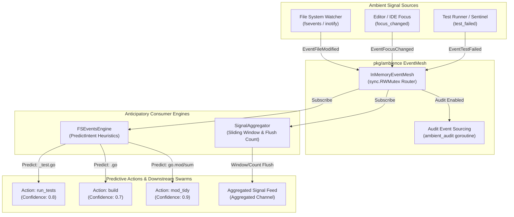

# Ambient Compute, EventMesh & Anticipatory Intent Subsystem (`pkg/ambience`)

## 1. Executive Summary & Architectural Overview

The **Ambient Compute, EventMesh & Anticipatory Intent Subsystem** (`pkg/ambience`) provides low-latency, event-driven perception and proactive intent inference across the ZQK Knowledge Kernel runtime. By capturing ambient development signals—such as filesystem mutations, editor focus shifts, and local test execution failures—the subsystem enables autonomous AI agents and kernel daemons to anticipate engineering intent, pre-warm caches, and invoke predictive verification workflows before explicit human command submission.

Rather than polling storage layers or executing expensive full-repository scans, `pkg/ambience` implements a reactive three-tier pipeline:
1. **In-Memory EventMesh Fabric (`EventMesh`)**: High-throughput, thread-safe publish-subscribe backbone routing discrete ambient signals with zero external message broker dependencies.
2. **Signal Aggregator (`SignalAggregator`)**: Time-windowed and count-bounded aggregation engine smoothing transient event bursts (such as multi-file editor saves or build artifact churn) into high-confidence signal batches.
3. **Anticipatory Heuristic Engine (`FSEventsEngine` / `AnticipatoryEngine`)**: Lightweight, deterministic intent prediction assigning actionable operations (`run_tests`, `build`, `mod_tidy`, `edit`) and normalized confidence scores to ambient events.



---

## 2. Architectural Components & Topology

### 2.1 The Event Model (`AmbientEvent` & `EventType`)

Every ambient signal captured in the runtime is normalized into a strongly-typed `AmbientEvent` envelope:

| Field | Type | Description |
| :--- | :--- | :--- |
| `ID` | `string` | Unique identifier generated for the discrete ambient signal. |
| `Type` | `EventType` | Canonical event type (`file_modified`, `focus_changed`, `test_failed`). |
| `URI` | `string` | Target resource path or URI associated with the signal (e.g., `pkg/kernel/kernel.go`). |
| `Timestamp` | `int64` | Unix epoch timestamp in seconds recording signal origination. |
| `Payload` | `[]byte` | Optional structured JSON or raw byte telemetry payload describing mutation context. |

Canonical event types are strongly typed string constants:
```go
type EventType string

const (
    EventFileModified EventType = "file_modified"
    EventFocusChanged EventType = "focus_changed"
    EventTestFailed   EventType = "test_failed"
)
```

### 2.2 In-Memory EventMesh Fabric (`InMemoryEventMesh`)

`InMemoryEventMesh` implements the `EventMesh` contract:
```go
type EventMesh interface {
    Publish(ctx context.Context, event AmbientEvent) error
    Subscribe(ctx context.Context, types []EventType) (<-chan AmbientEvent, error)
}
```

Key architectural mechanics:
- **Reader-Writer Lock Protection**: Internal subscriber topologies (`map[EventType][]chan AmbientEvent`) are guarded by `sync.RWMutex`.
- **Fan-Out Delivery**: `Publish` copies the subscriber channel slice under read-lock, then multiplexes events to all registered channels using context-guarded select operations.
- **Managed Subscription Teardown**: Upon cancellation of the subscriber context, an asynchronous goroutine safely removes the subscription channel from all registered type slices, preventing stale subscriber leaks.
- **Audit Event Sourcing**: When event sourcing is enabled via `EnableEventSourcing(projectRoot, secCtx)`, ambient events trigger an asynchronous, named `ambient_audit` goroutine that classifies and records persistent audit records in storage without blocking delivery pipelines.
- **Deterministic Teardown (`WaitForAudits`)**: Exposes an explicit wait-group barrier allowing callers and test harnesses to drain all in-flight audit emissions prior to workspace cleanup.

### 2.3 Signal Aggregator (`SignalAggregator`)

High-frequency signals (e.g., typing bursts, rapid test re-runs) frequently generate noise. The `SignalAggregator` buffers events across a configurable sliding duration (`window`) and batch threshold (`flushCount`):

```go
type SignalAggregator struct {
    mesh       EventMesh
    mu         sync.Mutex
    events     []AmbientEvent
    window     time.Duration
    flushCount int
    cancel     context.CancelFunc
    running    bool
    flushCh    chan []AmbientEvent
}
```

- **Dual-Trigger Flush**:
  - **Count-Triggered**: When accumulated events reach `flushCount`, the buffer flushes immediately to `flushCh`.
  - **Window-Triggered**: If `window` elapses with buffered events, the timer loop flushes accumulated signals.
- **Non-Blocking Channel Ingress**: Flushes to `flushCh` (buffer size 10) use non-blocking `select` with `default:` drops to prevent stalling the aggregator loop if downstream consumers lag.

### 2.4 Anticipatory Intent Engine (`FSEventsEngine`)

`FSEventsEngine` implements the `AnticipatoryEngine` contract:
```go
type Intent struct {
    Action     string
    Target     string
    Confidence float64
}

type AnticipatoryEngine interface {
    Start(ctx context.Context) error
    Stop() error
    PredictIntent(event AmbientEvent) (Intent, error)
}
```

- **Atomic Lifecycle**: Uses `sync/atomic.Bool` to guarantee atomic, idempotent transitions across `Start` and `Stop`.
- **Heuristic Pattern Inference**:
  - `*_test.go` &rarr; Action: `run_tests` (Confidence: 0.8)
  - `*.go` &rarr; Action: `build` (Confidence: 0.7)
  - `go.mod`, `go.sum` &rarr; Action: `mod_tidy` (Confidence: 0.9)
  - Generic files &rarr; Action: `edit` (Confidence: 0.5)
  - Non-file events &rarr; Action: `""` (Confidence: 0.0)

---

## 3. Core Invariants & Boundaries

### 3.1 Concurrency & Named Goroutines Invariant
All background processing must use explicitly named goroutines via `goroutinelabels.NewGoroutine`:
- `ambience.aggregator_loop`: Goroutine executing the time/count aggregation ticker.
- `ambience.fsevents_loop`: Goroutine consuming file events and triggering intent prediction.
- `ambient_audit`: Goroutine dispatching audit entries to persistent storage.

Unlabeled `go func()` invocations are strictly prohibited to maintain trace hygiene, leak profiling, and supervision compliance.

### 3.2 Context Cancellation & Bounded Blocking Invariant
Every channel send operation during `Publish` or `loop` execution is bounded by context cancellation:
```go
select {
case <-ctx.Done():
    return ctx.Err()
case ch <- event:
}
```
If a subscriber channel buffer saturates and the context expires, the mesh fails cleanly without indefinite deadlocks.

### 3.3 Security Context & Audit Decoupling Invariant
Event sourcing requires a non-nil `SecurityContext` and non-empty `projectRoot`. Audit events are created using `storage.CreateAuditEventWithBuilder` in a background worker, ensuring storage I/O latency never blocks in-memory event dispatch.

### 3.4 Idempotent Lifecycle Invariant
Both `SignalAggregator` and `FSEventsEngine` guarantee safe, idempotent execution of `Start` and `Stop`. Redundant `Start()` calls return `nil` without launching duplicate consumer goroutines; redundant `Stop()` calls return `nil` without panic or null dereference.

---

## 4. Operational Runbook & Verification

### 4.1 Verification via The Three-Fold Proof
Subsystem integrity is continuously validated through the canonical Three-Fold Proof:
1. **Static Floor Invariant**: The package statement test coverage must achieve &ge; 85.0% across all files (`aggregator.go`, `eventmesh.go`, `fsevents_engine.go`, `anticipatory.go`), currently reaching **100.0%**.
2. **Operational Dynamic Proof**: Validated by integration tests exercising multi-subscriber fan-out, sliding window flushes, count threshold bursts, and event sourcing classification.
3. **Negative Adversarial Boundary**: Confirmed by error injection testing subscriber registration failures, full channel buffer saturation timeouts, empty URI payloads, and non-JSON payloads.

### 4.2 Verifying Subsystem Coverage
Execute the test suite with statement coverage profiling:
```bash
go test -coverprofile=coverage.out -v ./pkg/ambience/...
go tool cover -func=coverage.out
```

Expected output:
```
github.com/zqk-os/zqk/pkg/ambience/aggregator.go:24:		NewSignalAggregator	100.0%
github.com/zqk-os/zqk/pkg/ambience/aggregator.go:33:		Start			100.0%
github.com/zqk-os/zqk/pkg/ambience/aggregator.go:58:		loop			100.0%
github.com/zqk-os/zqk/pkg/ambience/aggregator.go:91:		flush			100.0%
github.com/zqk-os/zqk/pkg/ambience/aggregator.go:98:		Stop			100.0%
github.com/zqk-os/zqk/pkg/ambience/aggregator.go:108:		PredictIntent		100.0%
github.com/zqk-os/zqk/pkg/ambience/aggregator.go:114:		Aggregated		100.0%
github.com/zqk-os/zqk/pkg/ambience/eventmesh.go:49:		NewInMemoryEventMesh	100.0%
github.com/zqk-os/zqk/pkg/ambience/eventmesh.go:56:		EnableEventSourcing	100.0%
github.com/zqk-os/zqk/pkg/ambience/eventmesh.go:64:		Publish			100.0%
github.com/zqk-os/zqk/pkg/ambience/eventmesh.go:149:		Subscribe		100.0%
github.com/zqk-os/zqk/pkg/ambience/eventmesh.go:180:		WaitForAudits		100.0%
github.com/zqk-os/zqk/pkg/ambience/fsevents_engine.go:19:	NewFSEventsEngine	100.0%
github.com/zqk-os/zqk/pkg/ambience/fsevents_engine.go:26:	Start			100.0%
github.com/zqk-os/zqk/pkg/ambience/fsevents_engine.go:46:	loop			100.0%
github.com/zqk-os/zqk/pkg/ambience/fsevents_engine.go:60:	Stop			100.0%
github.com/zqk-os/zqk/pkg/ambience/fsevents_engine.go:68:	PredictIntent		100.0%
total:								(statements)		100.0%
```

### 4.3 Race Detector Gate
Verify thread safety across concurrent publishers and subscribers:
```bash
go test -race -v ./pkg/ambience/...
```

---

## 5. Configuration & Environment

| Parameter | Type | Default | Description |
| :--- | :--- | :--- | :--- |
| `window` | `time.Duration` | Dynamic (e.g. `50ms`) | Sliding duration window for `SignalAggregator` ticker. |
| `flushCount` | `int` | Dynamic (e.g. `10`) | Maximum events accumulated before immediate aggregation flush. |
| `channelBufferSize` | `int` | `100` | In-memory subscriber channel buffer size in `InMemoryEventMesh`. |
| `flushChBufferSize` | `int` | `10` | Aggregated event slice channel buffer size in `SignalAggregator`. |

---

## 6. Anti-Patterns & Operational Hazards

### 6.1 Blocking Subscribers on Publish
- **Anti-Pattern**: Using unbuffered subscriber channels or performing slow synchronous operations directly inside an event subscriber callback.
- **Hazard**: Blocks `EventMesh.Publish` loop, backing up other consumers and triggering context deadline timeouts.
- **Remedy**: All mesh subscriptions use buffered channels (`make(chan AmbientEvent, 100)`). Heavy processing must be dispatched to isolated background worker pools.

### 6.2 Arbitrary Sleep Teardown in Tests
- **Anti-Pattern**: Using `time.Sleep(...)` to wait for asynchronous audit event storage emissions before cleaning up temporary directories.
- **Hazard**: Causes flaky test failures in fast or heavily loaded CI environments due to file write races against directory deletion.
- **Remedy**: Always invoke `mesh.WaitForAudits()` followed by `storage.ScrubProjectRootForTempCleanup(...)` before exiting test scopes.

### 6.3 Unbounded Intent Speculation
- **Anti-Pattern**: Triggering full build compilation or broad test execution suites synchronously on every single raw keystroke.
- **Hazard**: CPU saturation, compiler lock contention, and thermal throttling.
- **Remedy**: Always route raw signals through `SignalAggregator` prior to triggering heavier anticipatory pipelines.
