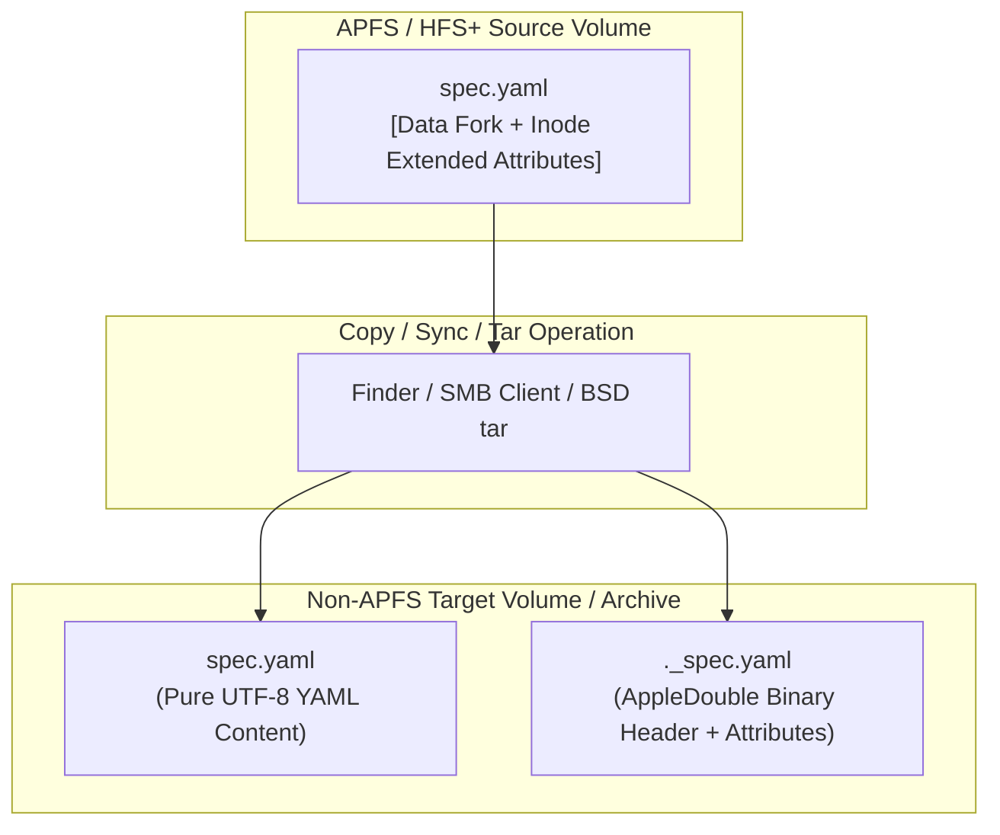
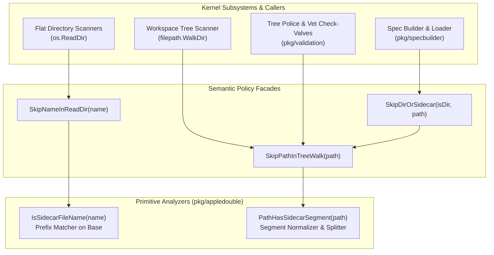
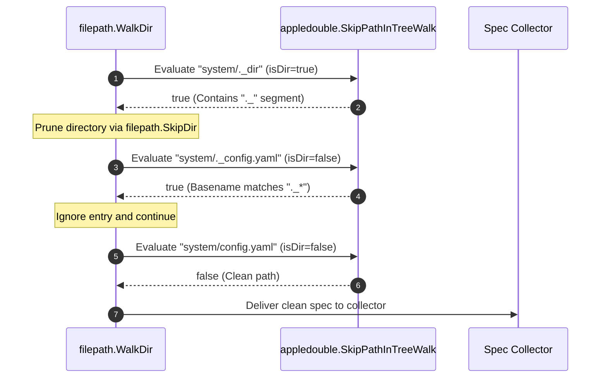
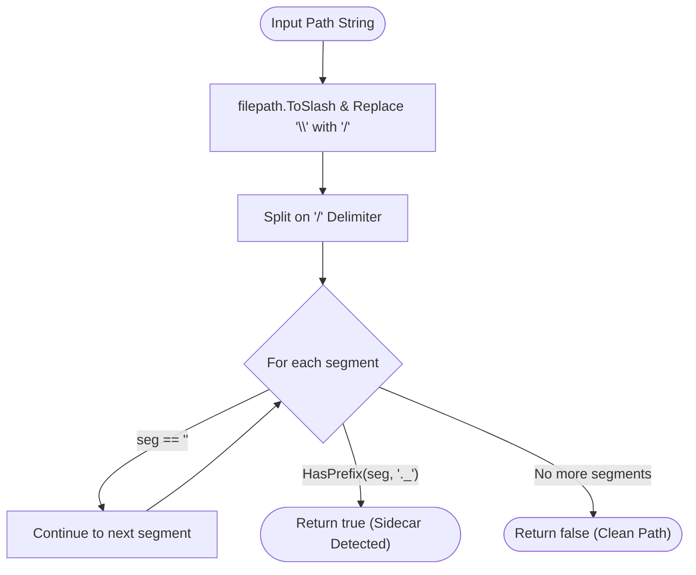

# AppleDouble Resource-Fork Sidecar & Filesystem Hygiene Subsystem Architectural & Operational Guide

## 1. Executive Architectural Summary

The **AppleDouble Resource-Fork Sidecar & Filesystem Hygiene Subsystem** ([`pkg/appledouble`](file:///Users/lanceettl/zqk-public-candidate/pkg/appledouble/appledouble.go)) provides high-performance, deterministic detection and filtering primitives for macOS AppleDouble resource-fork sidecar files across the **ZQK Knowledge Kernel**.

When engineers and autonomous agents interact with git workspaces, shared network volumes, or external archives, macOS file operations frequently synthesize auxiliary sidecars prefixed with `._`. These sidecars are binary AppleDouble wrappers containing legacy resource forks or extended attributes. If ingested by the Knowledge Kernel's automated scanners, these non-text sidecars contaminate YAML deserializers, trigger parser panics, distort file metrics, and pollute version-controlled trees.

The `pkg/appledouble` package provides:
1. **Zero-Allocation Filename Detection:** High-speed classification of file basenames via [`IsSidecarFileName`](file:///Users/lanceettl/zqk-public-candidate/pkg/appledouble/appledouble.go#L14) and its semantic alias [`SkipNameInReadDir`](file:///Users/lanceettl/zqk-public-candidate/pkg/appledouble/appledouble.go#L43).
2. **Segment-Aware Path Traversal:** Deep segment inspection via [`PathHasSidecarSegment`](file:///Users/lanceettl/zqk-public-candidate/pkg/appledouble/appledouble.go#L20) and [`SkipPathInTreeWalk`](file:///Users/lanceettl/zqk-public-candidate/pkg/appledouble/appledouble.go#L36) that detects sidecars nested anywhere within directory hierarchies.
3. **Cross-Platform Path Normalization:** Seamless handling of Unix slashes and Windows backslashes ensuring identical behavior across Darwin, Linux, and Windows runtimes.
4. **Composite Tree-Walk Evaluator:** Unified pruning logic via [`SkipDirOrSidecar`](file:///Users/lanceettl/zqk-public-candidate/pkg/appledouble/appledouble.go#L48) for concise, readable filesystem traversal routines.
5. **Strict 100% Statement Coverage Invariant:** Exhaustive boundary, integration, and concurrency verification guarantees absolute reliability on hot scanning paths.

---

## 2. The macOS Finder / SMB Resource Fork Artifact Anti-Pattern

### 2.1 The AppleDouble Dual-Fork Architecture

The AppleDouble format (RFC 1740) was introduced to preserve Macintosh dual-fork files (data fork and resource fork) on filesystems that natively support only single-fork, unstructured byte streams (such as FAT32, ext4, SMB, or tar archives).

On modern macOS systems (APFS/HFS+), file metadata and extended attributes (such as `com.apple.quarantine`, ACLs, and FinderInfo tags) are stored directly within filesystem inode structures. However, when files are copied or synced across network mounts, FAT32/exFAT storage media, or unflattened tar archives:



When macOS performs this split:
- **Data Fork (`spec.yaml`):** Contains the actual user payload (e.g., UTF-8 YAML, Go source code, or JSON specs).
- **Resource Fork Sidecar (`._spec.yaml`):** A synthesized file beginning with the 4-byte AppleDouble magic number `0x00051607`, followed by binary entry descriptors and attribute payloads.

### 2.2 AppleDouble Sidecar Directory Artifacts

In addition to individual file sidecars, macOS Finder frequently creates sidecar directory shadows when moving directories over network filesystems. For instance, copying a directory `system/` may create `._system/` containing folder attributes. Any files nested within `._system/` are themselves tainted by the sidecar parent segment and must be disqualified from kernel discovery.

---

## 3. Impact on Knowledge Kernel

The ZQK Knowledge Kernel continuously discovers, validates, and parses structured objects (goals, requirements, specifications, and execution policies) from disk. Unfiltered AppleDouble sidecars introduce severe operational failures:

### 3.1 YAML Parser Contamination
YAML parsers expect valid UTF-8 streams. When a parser attempts to decode `._command.yaml`, it encounters binary header bytes (`0x00051607`), failing immediately with control character or invalid UTF-8 errors:
```
yaml: control characters are not allowed at line 1, column 1
```

### 3.2 Spec Discovery Duplication & Ghost Objects
Spec builder scanners identifying files matching `*.yaml` will register both `command.yaml` and `._command.yaml`. If error recovery ignores the binary parse failure, the spec registry may report missing attributes or register corrupted phantom entries.

### 3.3 Git Workspace Poisoning
If an engineer on macOS edits a project stored on an external or network drive, Finder may drop `._*` sidecars into the workspace. If committed, these pollute git repositories, break CI pipelines on Linux runners, and trigger tree police check-valve failures.

### 3.4 Legitimate Dotfiles vs. AppleDouble Sidecars
A naive filter that skips all files starting with a dot (`.`) is overly destructive because the Knowledge Kernel relies on essential dotfiles and dot-directories:
- `.zqk/` (runtime process directory, CAS storage, and WAL logs)
- `.gitignore` (git tracking policies)
- `.git/` (repository metadata)

`pkg/appledouble` enforces surgical discrimination: it targets only entries prefixed with `SidecarPrefix` (`._`), preserving legitimate dotfiles while eradicating AppleDouble noise.

| Path Entry | Classification | Subsystem Action |
| :--- | :--- | :--- |
| `._repair_command.yaml` | AppleDouble Sidecar | **Filtered / Skipped** |
| `._system/config.yaml` | Nested in Sidecar Directory | **Filtered / Skipped** |
| `.zqk/process.yaml` | Legitimate Dot-Directory | **Accepted & Visited** |
| `.gitignore` | Legitimate Dotfile | **Accepted & Visited** |
| `foo._bar.yaml` | Internal Dot-Underscore File | **Accepted & Visited** |
| `script._` | Trailing Dot-Underscore File | **Accepted & Visited** |

---

## 4. Component Topology & Subsystem Architecture

The `pkg/appledouble` package is structured into primitive detectors, traversal analyzers, and semantic policy wrappers:



### Component Responsibilities

| Primitive / Facade | Signature | Core Responsibility |
| :--- | :--- | :--- |
| `SidecarPrefix` | `const string = "._"` | Canonical prefix constant defining AppleDouble sidecar identity. |
| [`IsSidecarFileName`](file:///Users/lanceettl/zqk-public-candidate/pkg/appledouble/appledouble.go#L14) | `func(name string) bool` | Extracts `filepath.Base(name)` and evaluates `strings.HasPrefix(base, "._")`. |
| [`SkipNameInReadDir`](file:///Users/lanceettl/zqk-public-candidate/pkg/appledouble/appledouble.go#L43) | `func(name string) bool` | Semantic facade for flat directory readers; clarifies intent at call sites. |
| [`PathHasSidecarSegment`](file:///Users/lanceettl/zqk-public-candidate/pkg/appledouble/appledouble.go#L20) | `func(path string) bool` | Normalizes path separators (converting Windows `\` to `/`), splits into segments, and checks each non-empty segment for `SidecarPrefix`. |
| [`SkipPathInTreeWalk`](file:///Users/lanceettl/zqk-public-candidate/pkg/appledouble/appledouble.go#L36) | `func(path string) bool` | Semantic facade for recursive tree traversals; drops any file or directory containing a sidecar segment. |
| [`SkipDirOrSidecar`](file:///Users/lanceettl/zqk-public-candidate/pkg/appledouble/appledouble.go#L48) | `func(isDir bool, path string) bool` | Composite helper evaluating `isDir || SkipPathInTreeWalk(path)`, standardizing file-only visitor logic. |

---

## 5. Filesystem Walk Integration Patterns

### 5.1 Idiomatic Recursive Tree Traversal (`filepath.WalkDir`)

When walking directory trees to find configuration specs, YAML definitions, or source files, callers should prune entire subtrees when encountering sidecar directories, and ignore individual sidecar files:

```go
package specdiscovery

import (
    "io/fs"
    "path/filepath"

    "github.com/zqk-os/zqk/pkg/appledouble"
)

// DiscoverSpecs recursively finds valid YAML specs while skipping AppleDouble sidecars.
func DiscoverSpecs(rootDir string) ([]string, error) {
    var specs []string

    err := filepath.WalkDir(rootDir, func(path string, d fs.DirEntry, err error) error {
        if err != nil {
            return err
        }

        // Prune sidecar directories immediately from traversal.
        if d.IsDir() {
            if appledouble.SkipPathInTreeWalk(path) {
                return filepath.SkipDir
            }
            return nil
        }

        // Skip individual sidecar files.
        if appledouble.SkipPathInTreeWalk(path) {
            return nil
        }

        // Collect legitimate YAML specs.
        if filepath.Ext(path) == ".yaml" || filepath.Ext(path) == ".yml" {
            specs = append(specs, path)
        }
        return nil
    })

    return specs, err
}
```



### 5.2 Idiomatic Flat Directory Scanning (`os.ReadDir`)

When inspecting single directory contents (e.g., reading manifest collections or draft bundles), use [`SkipNameInReadDir`](file:///Users/lanceettl/zqk-public-candidate/pkg/appledouble/appledouble.go#L43):

```go
package manifestloader

import (
    "os"
    "path/filepath"

    "github.com/zqk-os/zqk/pkg/appledouble"
)

// ReadManifests reads all non-sidecar files from a directory.
func ReadManifests(dir string) ([]string, error) {
    entries, err := os.ReadDir(dir)
    if err != nil {
        return nil, err
    }

    var validFiles []string
    for _, entry := range entries {
        if entry.IsDir() || appledouble.SkipNameInReadDir(entry.Name()) {
            continue
        }
        validFiles = append(validFiles, filepath.Join(dir, entry.Name()))
    }
    return validFiles, nil
}
```

---

## 6. Edge Cases & Boundary Handling

The subsystem handles a wide spectrum of boundary inputs without panicking or allocating unnecessary heap memory:



| Input Scenario | Input Value | Expected Result | Technical Rationale |
| :--- | :--- | :--- | :--- |
| **Empty Input** | `""` | `false` | An empty path contains no segments matching `._`. |
| **Root Slashes** | `/`, `///` | `false` | Redundant slashes produce empty segments which are skipped. |
| **Relative Dot Markers** | `.`, `..` | `false` | Directory markers do not match the `._` prefix. |
| **Exact Prefix Only** | `._` | `true` | Matches `SidecarPrefix` exactly. |
| **Standard Sidecar** | `._repair.yaml` | `true` | Matches `SidecarPrefix` on basename. |
| **Hidden Dotfiles** | `.git`, `.zqk`, `.DS_Store` | `false` | Starting with `.` but not `._` preserves essential system dotfiles. |
| **Internal Dot-Underscore** | `foo._bar.yaml` | `false` | Dot-underscore inside the filename is valid and not a sidecar. |
| **Trailing Dot-Underscore** | `file._` | `false` | Does not start with `._`. |
| **Windows Backslash Path** | `foo\._bar\baz.yaml` | `true` | Backslashes are normalized to forward slashes before segment evaluation. |
| **Deeply Nested Sidecar** | `a/b/c/._d/e/f.json` | `true` | Detects sidecar directories anywhere in the path ancestor chain. |
| **Consecutive Slashes** | `a//._b///c` | `true` | Empty segments created by duplicate slashes are bypassed safely. |

---

## 7. Verification & Statement Coverage Invariant

The `pkg/appledouble` package maintains a strict **100.0% statement test coverage invariant**.

### 7.1 Continuous Verification Command

To verify statement coverage in test and CI environments, run:

```bash
ZQK_ALLOW_FOREGROUND_GO_TEST=1 go test -v -timeout 30s -cover ./pkg/appledouble
```

### 7.2 Coverage Proof Matrix

| Test Suite Function | Target Functionality Verified |
| :--- | :--- |
| `TestIsSidecarFileName_Comprehensive` | Unit test matrix for [`IsSidecarFileName`](file:///Users/lanceettl/zqk-public-candidate/pkg/appledouble/appledouble.go#L14) and [`SkipNameInReadDir`](file:///Users/lanceettl/zqk-public-candidate/pkg/appledouble/appledouble.go#L43) across 18 edge cases. |
| `TestPathHasSidecarSegment_Comprehensive` | Unit test matrix for [`PathHasSidecarSegment`](file:///Users/lanceettl/zqk-public-candidate/pkg/appledouble/appledouble.go#L20) and [`SkipPathInTreeWalk`](file:///Users/lanceettl/zqk-public-candidate/pkg/appledouble/appledouble.go#L36) covering root paths, deep nesting, Windows backslashes, and consecutive slashes. |
| `TestSkipDirOrSidecar_Matrix` | Truth-table coverage for composite evaluation across directory and file permutations. |
| `TestReadDirFiltering_Hermetic` | Hermetic filesystem test simulating `os.ReadDir` on temporary directory trees. |
| `TestTreeWalkFiltering_Hermetic` | Hermetic filesystem test simulating `filepath.WalkDir` with sidecar file and directory pruning. |
| `TestConcurrencySafety` | Concurrent stress validation across 16 goroutines managed via `pkg/goroutinelabels`. |
