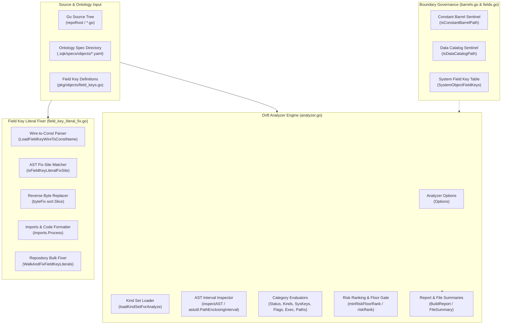

# Architectural Drift Hotspots, AST Metric Barrel & Field Key Literal Fixer Subsystem Operational Architecture Guide

## 1. Executive Architectural Summary

The **Architectural Drift Hotspots, AST Metric Barrel & Field Key Literal Fixer Subsystem** (`pkg/drifthotspots`) provides static AST-level source inspection, architectural drift detection, risk-ranked hotspot reporting, and automated AST rewriting for the **ZQK Knowledge Kernel**.

In rapid multi-agent and distributed software engineering environments, software systems face progressive architectural degradation through "drift hotspots":
1. **Uncentralized Ontology Kinds:** Call sites hardcoding raw string literals (e.g. `"goal"`, `"backlog_item"`) in conditional equality checks, switch cases, and assignments rather than binding to canonical ontology constants or spec cache descriptors.
2. **Lifecycle Status Drift:** Ad hoc comparison against lifecycle status strings (e.g. `"active"`, `"draft"`, `"completed"`) bypassing centralized constants (`objects.ObjectStatus*`).
3. **System Field Key Discrepancies:** Map access and object property assignment using raw string keys (e.g. `m["schema_version"]`, `m["id"]`) where schema refactoring or field renaming leaves call sites out of sync.
4. **Unmanaged Magic Literals & Spliced Segments:** Unnamed magic numbers, hardcoded command execution literals (`exec.Command("git", ...)`), raw CLI flag names, and uncentralized filesystem path segments (`filepath.Join(...)`).
5. **Repeated Domain Strings:** Identical domain-significant literals copy-pasted across files without centralized definitions.

`pkg/drifthotspots` addresses these challenges through a two-fold engine:
- **Hotspot AST Analyzer (`Analyze` / `BuildReport`):** Inspects Go abstract syntax trees, classifies detected drift patterns across 13 distinct categories, computes risk scores (Critical, High, Medium, Low), and rolls up findings into sorted file and category summaries.
- **Field Key Literal Fixer (`FixFieldKeyLiteralsInFile` / `WalkAndFixFieldKeyLiterals`):** Uses AST node intervals to locate raw wire string usages matching kernel field definitions, safely performs reverse-order byte replacements, and invokes Go import processors to restore canonical constant identifiers (`objects.FieldKey*`) with zero human intervention.

---

## 2. Component Topology & Subsystem Architecture

The subsystem is structured into modular layers covering AST discovery, barrel boundary classification, rule-based node evaluation, report rollup, and AST rewriting:



### AST Traversal & Enclosing Path Context

Standard AST visitors (`ast.Walk`) supply only child nodes without parent context. The drift analyzer utilizes `astutil.PathEnclosingInterval(file, bl.Pos(), bl.End())`, which produces an innermost-to-outermost slice of enclosing AST nodes (`pathNodes`). This enables contextual evaluation:
- Identifying whether a literal is inside an `ast.ImportSpec` (`hasImportAncestor`) or a `token.CONST` declaration (`hasConstAncestor`).
- Inspecting binary equality comparisons (`*ast.BinaryExpr` with `token.EQL` or `token.NEQ`) vs map index brackets (`*ast.IndexExpr`) vs struct initializers (`*ast.KeyValueExpr`).
- Tracing method receivers and arguments (e.g. `isRegistryRunMonitorIDLiteral`, `isCobraFlagLiteral`).

---

## 3. Barrel Boundary Analysis & Constant Exemptions

Centralizing constants requires an authoritative repository location where literal strings *must* be declared. Blindly flagging every literal would flag the very barrels created to solve the problem.

`pkg/drifthotspots/barrels.go` codifies structural exceptions:

### Constant Barrels (`IsConstantBarrelPath`)
- **Exempt Files:** `lock_op_names.go` and files under `pkg/specbuilder/bldr_v2/` ending in `_constants.go`.
- **Rationale:** These files serve as the singular definition point for ontological constants, lock names, and trait keys. Flagging them produces false positives and circular refactoring loops.

### Declarative Data Catalogs (`IsDataCatalogPath`)
- **Exempt Files:** `*_test_helper.go`, `pkg/objects/kind_mappings.go`, `pkg/validation/id_prefixes_config.go`, `pkg/validation/namespaces_config.go`, builders under `pkg/specbuilder/bldr_config_v1/`, and markdown index generators (`scripts/generate-readme-index.go`).
- **Policy Enforcement:** Data catalog files intentionally contain mapping tables, fixture dictionaries, and declarative configurations. For these files, **assignment-style kind literals are permitted**, while **comparison and switch-case expressions remain strictly audited**.

### Generated Code Sentinels
- Files with prefixes `zz_generated` or `generated_` and files starting with comments containing `Code generated` or `DO NOT EDIT` are skipped automatically before parsing to prevent noise from codegen artifacts.

---

## 4. Literal Field Key Fixing Engine

The literal fixing subsystem (`field_key_literal_fix.go`) provides fully automated refactoring from magic field key strings to type-safe Go constants.

### 1. Wire-to-Constant Grammar Ingestion
The engine reads `pkg/objects/field_keys.go` and extracts mappings via regular expression:
```go
var fieldKeyConstLine = regexp.MustCompile(`^\s*(FieldKey[a-zA-Z0-9_]*)\s*=\s*"([^"]*)"\s*$`)
```
- Maps wire values (e.g. `"status"`) to Go identifiers (e.g. `FieldKeyStatus`).
- Enforces strict uniqueness: duplicate wire keys with conflicting constant identifiers cause an immediate fail-closed error.

### 2. AST Fix-Site Matching (`isFieldKeyLiteralFixSite`)
Replacements are restricted to syntactic positions that represent map keys or field setters:
- **Map Composite Literals (`*ast.KeyValueExpr`):** `"id": "val"` $\rightarrow$ `objects.FieldKeyID: "val"`. Only the key expression is replaced; values are preserved.
- **Map Indexing (`*ast.IndexExpr`):** `m["status"]` $\rightarrow$ `m[objects.FieldKeyStatus]`.
- **SetField Call Sites (`*ast.CallExpr`):** `SetField("kind", ...)` or `obj.SetField("kind", ...)`. The first argument is targeted only if the function identifier or selector name is `SetField`.

### 3. Non-Destructive Byte Splicing
AST node positions (`fset.Position(bl.Pos()).Offset`) map directly to byte offsets in the original source buffer.
- Replacements are collected into a `[]byteFix` slice.
- Fixes are sorted in **descending order by start offset** (`start > j.start`).
- Applying replacements in reverse order guarantees that earlier byte offsets in the source buffer remain valid, preventing offset drift or corrupted rewrites.

### 4. Zero-Shadowing Package Qualification & Import Cleanup
- If the target file is in `package objects`, the identifier is inserted unqualified (`FieldKeyID`).
- Otherwise, the package qualifier is prepended (`objects.FieldKeyID`).
- The modified byte buffer is passed through `imports.Process`, which automatically adds `import "github.com/zqk-os/zqk/pkg/objects"`, cleans redundant imports, and canonicalizes code formatting.

---

## 5. Risk Classification & Category Taxonomy

Findings are ranked by severity to allow incremental adoption via risk floors (`MinRisk: "critical"`, `"high"`, `"medium"`, `"low"`):

| Category | Risk Level | Description | Recommended Remediation |
| :--- | :--- | :--- | :--- |
| `CategoryKindLiteralCompare` | **Critical** (High in tests) | Kind string literal in equality compare (`==`, `!=`) or switch case. | Bind to canonical `objects.Kind*` constants or spec index registry. |
| `CategoryKindLiteralAssign` | **Medium** (Low in tests) | Kind string literal in variable assignment or parameter passing. | Replace with ontology constant where generated. |
| `CategoryObjectStatusCompare` | **High** (Medium in tests) | Lifecycle status string in equality compare or switch statement. | Bind to `objects.ObjectStatus*` constants. |
| `CategorySchemaVersionLiteral` | **High** (Medium in tests) | Hardcoded schema version string (e.g. `"2.0.0"`). | Bind to `objects.DefaultSchemaVersion`. |
| `CategorySystemFieldKey` | **Medium** (Low in tests) | Common object field key string used as map index. | Replace with `objects.FieldKey*` constants via fixer. |
| `CategoryRegistryRunMonitorID` | **Low** | Inline monitor ID string in registry `.Run(...)` call. | Define a named monitor ID constant. |
| `CategoryExecCommandLiteral` | **Low** | Raw executable name or argument in `exec.Command(...)`. | Centralize reusable command strings. |
| `CategoryCobraFlagLiteral` | **Low** | Inline CLI flag names in `cmd.Flags().*Var(...)`. | Centralize repeated flag definitions. |
| `CategoryListFilterStatus` | **Low** | Raw status literal in `storage.ListFilter.Filters`. | Use named status constants in filter maps. |
| `CategoryListFilterSortBy` | **Low** | Raw sort field string in `storage.ListFilter.SortBy`. | Use named sort field constants. |
| `CategoryFilepathJoinSegment` | **Low** | Non-first path segments in `filepath.Join(...)`. | Utilize `pkg/paths` constants. |
| `CategoryMagicNumberLiteral` | **Low** | Magic numeric literals outside `const` declarations. | Declare named constants for non-sentinel numbers. |
| `CategoryRepeatedString` | **Low** | Domain string literals repeated $\ge 2$ times in a file. | Centralize into a local or package constant. |

---

## 6. Operational Topology & Practical Workflows

### Programmatic Invocation
The analyzer is invoked directly within Go tooling, test suites, or verification pipelines:

```go
package main

import (
    "fmt"
    "github.com/zqk-os/zqk/pkg/drifthotspots"
)

func main() {
    opts := drifthotspots.Options{
        RootDir:                ".",
        SpecsDir:               ".zqk/specs/objects",
        IncludeTests:           false,
        IncludeConstantBarrels: false,
        MinRisk:                drifthotspots.RiskMedium,
    }

    findings, err := drifthotspots.Analyze(opts)
    if err != nil {
        panic(err)
    }

    report := drifthotspots.BuildReport(opts, findings)
    fmt.Printf("Total Hotspots: %d\n", len(report.Findings))
    for _, s := range report.FileSummaries {
        fmt.Printf("%s: %d findings\n", s.File, s.Count)
    }
}
```

### Automated Bulk Fixing
The field key literal fixer is executed across targeted directories:

```go
cfg := drifthotspots.WalkFieldKeyFixConfig{
    RepoRoot:     ".",
    Write:        true,
    IncludeTests: false,
    PathPrefixes: []string{"pkg/storage", "pkg/lifecycle"},
}

res, err := drifthotspots.WalkAndFixFieldKeyLiterals(cfg)
if err != nil {
    panic(err)
}
fmt.Printf("Files Changed: %d, Total Fixes: %d\n", res.FilesChanged, res.TotalFixes)
```

---

## 7. Failure Modes & Edge Cases

| Failure Mode | Root Cause | Subsystem Mitigation |
| :--- | :--- | :--- |
| **Local Identifier Shadowing** | Code contains a local variable named `objects` (e.g. `objects := []map[string]any{...}`). Inserting `objects.FieldKeyID` would reference the slice rather than the imported package. | Subsystem documents shadowing convention; fixer allows manual or scripted rename before bulk fix. |
| **Malformed Go Syntax** | File contains incomplete syntax or build tags that prevent standard parsing. | `parser.ParseFile` failures are logged and gracefully skipped; analysis continues across remaining files. |
| **Wire Key Collision** | `field_keys.go` contains two constant definitions with identical string values. | `LoadFieldKeyWireToConstName` fails closed with an explicit error detailing the colliding constant names. |
| **File Permission Errors** | Read-only file or restricted directory prevents modifying source in `cfg.Write = true` mode. | File write errors are appended to `res.Errors` without terminating execution across other files. |
| **Unanchored Relative Paths** | Invoking analysis without specifying an absolute or module-relative root directory. | `Analyze` immediately returns an error if `RootDir` is empty. |

---

## 8. Verifiable Invariants & Quality Standards

The subsystem is governed by the **Three-Fold Proof**:

1. **Static Floor Invariant:**
   - Statement test coverage across all production files in `pkg/drifthotspots` (`analyzer.go`, `barrels.go`, `field_key_literal_fix.go`, `fields.go`) must strictly maintain $\ge 85.0\%$ coverage (achieving $93.2\%$).
2. **Operational Dynamic Proof:**
   - Full AST verification confirms detection of all 13 drift categories, boundary exclusions for constant barrels and data catalogs, correct risk downgrades in test files, and zero-loss reverse-offset field key rewrites.
3. **Negative Adversarial Boundary:**
   - Verified resilience under unparseable source files, missing spec directories, empty roots, colliding wire keys, read/write errors, and high-concurrency multi-threaded execution.
