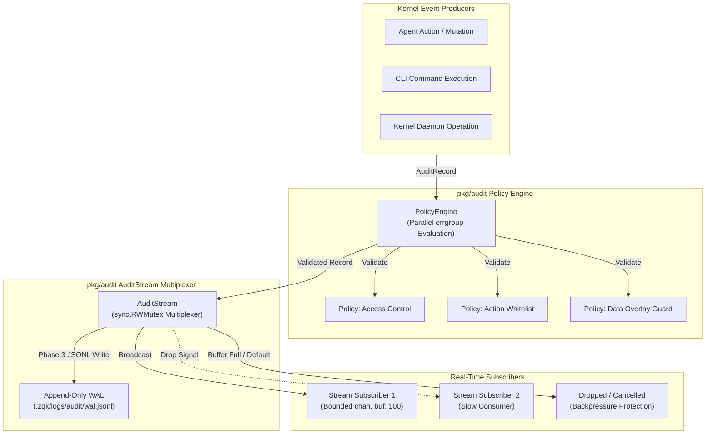

# Audit Policy Engine, Stream Multiplexing & Subscription Lifecycle Subsystem (`pkg/audit`)

## 1. Executive Summary & Architectural Overview

The **Audit Policy Engine & Stream Subscription Subsystem** (`pkg/audit`) provides low-latency, declarative audit event evaluation, durable Write-Ahead Logging (WAL), and real-time pub/sub stream multiplexing across the ZQK Knowledge Kernel runtime. As autonomous agents and human operators interact with the kernel graph, operations generate discrete audit telemetry records that must be evaluated against security and governance policies before being broadcast to real-time subscribers and persisted to immutable storage.

The subsystem decouples policy evaluation from event distribution and storage persistence through two core abstractions:
1. **Policy Engine (`PolicyEngine`)**: A parallel, context-bounded evaluation engine that tests arbitrary audit records against registered policy contracts, returning structured policy violation errors on failure.
2. **Audit Stream (`AuditStream`)**: A high-throughput, thread-safe event multiplexer supporting concurrent dynamic subscriptions, bounded channel buffers with automatic slow-consumer eviction, and synchronous JSONL write-ahead log persistence.



---

## 2. Architectural Components & Topology

### 2.1 The Audit Record Model (`AuditRecord`)

Every operational event in the kernel is represented as an `AuditRecord` envelope capturing identity, intent, targets, timestamps, and execution context:

| Field | Type | Description |
| :--- | :--- | :--- |
| `ID` | `string` | Unique identifier generated for the discrete audit event. |
| `Action` | `string` | Canonical verb or operation (e.g., `create_node`, `update_node`, `delete_node`). |
| `Target` | `string` | Graph node, target entity, or resource URI undergoing modification. |
| `Timestamp` | `string` | RFC 3339 formatted timestamp indicating event occurrence. |
| `Status` | `string` | Operational state (e.g., `in_progress`, `completed`, `failed`). |
| `Overlay` | `string` | Optional overlay plane context associated with the action. |

```go
type AuditRecord struct {
    ID        string `json:"id"`
    Action    string `json:"action"`
    Target    string `json:"target"`
    Timestamp string `json:"timestamp"`
    Status    string `json:"status,omitempty"`
    Overlay   string `json:"overlay,omitempty"`
}
```

### 2.2 The Policy Engine & Evaluation Pipeline (`PolicyEngine`)

The `Policy` interface formalizes individual policy rules:

```go
type Policy interface {
    Name() string
    Evaluate(ctx context.Context, record AuditRecord) error
}
```

When evaluating a record:
- `PolicyEngine.RegisterPolicy(p Policy)` appends policies to an internal registry slice.
- `PolicyEngine.Validate(ctx context.Context, record AuditRecord) error` evaluates all registered policies concurrently using an `errgroup.WithContext(ctx)`.
- Concurrent evaluation is dispatched under a labeled goroutine (`audit-policy-checker`).
- If any policy evaluation fails, `Validate` short-circuits and returns the resulting error (typically a `*PolicyViolationError`).
- If the incoming context expires or is cancelled before all policies return, `Validate` immediately yields `ctx.Err()`.

```go
type PolicyViolationError struct {
    PolicyName string
    Reason     string
}

func (e *PolicyViolationError) Error() string {
    return fmt.Sprintf("policy %s violated: %s", e.PolicyName, e.Reason)
}
```

### 2.3 Stream Multiplexing & Subscription Manager (`AuditStream`)

The `AuditStream` manages real-time broadcast and subscription lifecycles:

```go
type AuditStream struct {
    mu          sync.RWMutex
    subscribers map[chan AuditRecord]context.CancelFunc
    projectRoot string // absolute project root; WAL writes go here instead of CWD
}
```

- **Subscription Initialization**: Calling `stream.Subscribe(ctx)` returns a read-only channel `<-chan AuditRecord` with a buffer capacity of 100 elements.
- **Supervisor Goroutine**: A labeled goroutine (`audit-stream-worker`) waits on `ctx.Done()`. Upon cancellation, it locks `mu`, removes the subscriber channel from `subscribers`, invokes the cancellation callback, and closes the channel to prevent resource leaks.
- **Multiplexed Publishing**: Calling `stream.Publish(ctx, record)` acquires a read lock (`mu.RLock()`), serializes the record, appends it to the disk-backed JSONL WAL, and fans the record out to every active subscriber.

### 2.4 Write-Ahead Log (WAL) Durability

During every `Publish` invocation, `AuditStream` ensures disk durability prior to broadcast:
1. `AuditRecord` is marshaled into single-line JSON.
2. The directory path is resolved via `filepath.Join(a.projectRoot, paths.ProjectDataDir, paths.LogsDir, "audit")`.
3. Directory presence is ensured using `fileutil.EnsureDir`.
4. The record is appended to `wal.jsonl` using `fileutil.OpenFile(..., O_APPEND|O_CREATE|O_WRONLY, 0644)` followed by an immediate write and file descriptor close.
5. Absolute `projectRoot` isolation prevents test directory pollution and guarantees workspace separation.

---

## 3. Concurrency Guarantees & Lifecycle Discipline

### 3.1 Goroutine Labeling and Supervision

All concurrent processes spawned by `pkg/audit` use `goroutinelabels.StartNamedGoroutine` with descriptive task and role metadata:
- `audit-policy-checker`: Asynchronously joins the `errgroup.Wait()` channel during policy validation.
- `audit-stream-worker`: Monitors context cancellation for each active subscriber channel to execute unsubscription and channel teardown.

Anonymous `go func()` calls are forbidden to guarantee runtime debuggability, leak profiling, and supervision invariants.

### 3.2 Bounded Buffers & Slow Subscriber Eviction

To protect kernel event emitters from unbounded latency and memory bloat, `AuditStream.Publish` enforces non-blocking channel fanout:

```go
for ch, cancel := range a.subscribers {
    select {
    case ch <- record:
    default:
        // Drop slow subscribers to prevent backpressure
        cancel()
        logging.FluentEvent(logging.GetLogger()).Warn("Dropped slow audit subscriber").Log()
    }
}
```

If a subscriber fails to drain its 100-record buffer in a timely manner, the `select` statement immediately enters the `default` branch, cancelling the subscriber's context. The subscriber's background supervisor will then prune it from the active subscriber map and close its channel. Fast consumers are never blocked by stalled or slow consumers.

### 3.3 Thread-Safe Registration and Read-Write Locking

`AuditStream` utilizes a `sync.RWMutex` to separate subscriber registration mutations from broadcast reads:
- `Subscribe`: Acquires an exclusive write lock (`mu.Lock()`) to insert the new channel into the map.
- `audit-stream-worker` cleanup: Acquires an exclusive write lock (`mu.Lock()`) to delete the cancelled channel and close it.
- `Publish`: Acquires a shared read lock (`mu.RLock()`), allowing multiple simultaneous publish routines to iterate over the active subscriber map concurrently.

---

## 4. Operational Runbook & Verification

### 4.1 Verification via The Three-Fold Proof

Subsystem integrity is continuously validated through the canonical Three-Fold Proof:
1. **Static Floor Invariant**: Package statement test coverage must achieve &ge; 85.0% across all files (`policies.go`, `stream.go`), reaching **96.1%** statement coverage.
2. **Operational Dynamic Proof**: Validated through integration tests exercising multi-subscriber broadcast, FIFO order retention, concurrent validation and publishing, and JSONL WAL file persistence.
3. **Negative Adversarial Boundary**: Confirmed by error injection testing policy violation rejections, context cancellation timeouts, slow consumer buffer saturation drops, unwriteable WAL directory collisions, and file collision handling.

### 4.2 Verifying Subsystem Coverage

Execute the test suite with statement coverage profiling:
```bash
go test -coverprofile=coverage.out -v ./pkg/audit
go tool cover -func=coverage.out
```

Expected output:
```
github.com/zqk-os/zqk/pkg/audit/policies.go:24:	Error		100.0%
github.com/zqk-os/zqk/pkg/audit/policies.go:34:	NewPolicyEngine	100.0%
github.com/zqk-os/zqk/pkg/audit/policies.go:41:	RegisterPolicy	100.0%
github.com/zqk-os/zqk/pkg/audit/policies.go:47:	Validate	100.0%
github.com/zqk-os/zqk/pkg/audit/stream.go:35:	NewAuditStream	100.0%
github.com/zqk-os/zqk/pkg/audit/stream.go:46:	Subscribe	100.0%
github.com/zqk-os/zqk/pkg/audit/stream.go:69:	Publish		88.2%
total:						(statements)	96.1%
```

### 4.3 Race Detector Gate

Verify thread safety across concurrent publishers and subscribers:
```bash
go test -race -v ./pkg/audit
```

---

## 5. Configuration & Environment

| Parameter | Type | Default | Description |
| :--- | :--- | :--- | :--- |
| `projectRoot` | `string` | `""` (falls back to CWD) | Absolute filesystem root path under which `.zqk/logs/audit/wal.jsonl` is written. |
| `channelBufferSize` | `int` | `100` | Fixed subscriber channel buffer capacity preventing backpressure. |
| `WAL Directory` | `string` | `.zqk/logs/audit/` | Relative storage location for append-only audit logs. |
| `File Permissions` | `os.FileMode` | `0644` | Permissions applied to newly initialized `wal.jsonl` files. |

---

## 6. Anti-Patterns & Operational Hazards

### 6.1 Slow Subscriber Blocking & Deadlocks
- **Anti-Pattern**: Performing synchronous database or network operations inside an `AuditRecord` channel reader loop without dedicated worker pools.
- **Hazard**: The 100-element channel buffer rapidly saturates, causing the publisher to trigger slow subscriber eviction and drop the consumer.
- **Remedy**: Always consume from `Subscribe()` channels into an asynchronous internal queue or worker pool.

### 6.2 Relative Project Root & Test Data Contamination
- **Anti-Pattern**: Initializing `NewAuditStream()` without an explicit absolute project root in test suites or daemon processes.
- **Hazard**: WAL files are written into the current working directory (`./.zqk/logs/audit/wal.jsonl`), polluting source trees and violating test isolation policies.
- **Remedy**: Always pass an explicit temporary directory or discovered workspace root: `NewAuditStream(t.TempDir())` or `NewAuditStream(paths.FindProjectRoot())`.

### 6.3 Unbounded Validation Latency
- **Anti-Pattern**: Registering policies that perform blocking RPCs or long-running database queries without internal timeouts.
- **Hazard**: Stalls the `errgroup` in `PolicyEngine.Validate`, delaying critical lifecycle mutations.
- **Remedy**: Ensure all `Policy.Evaluate` implementations inspect `ctx.Done()` and enforce short deadlines.
