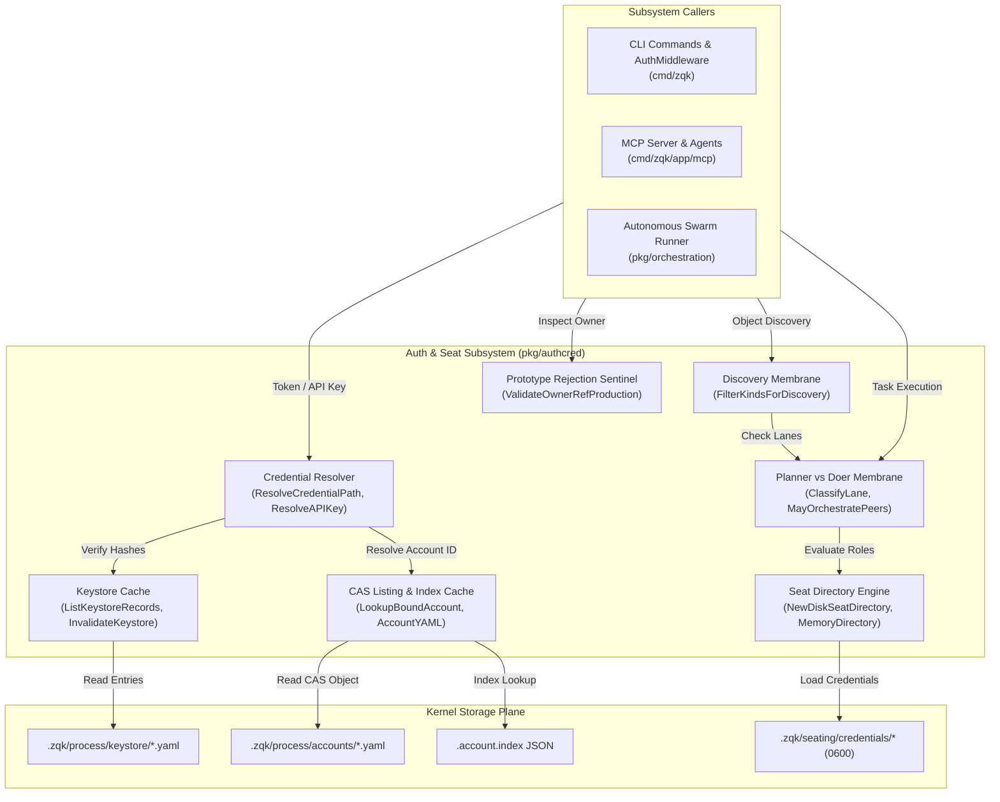
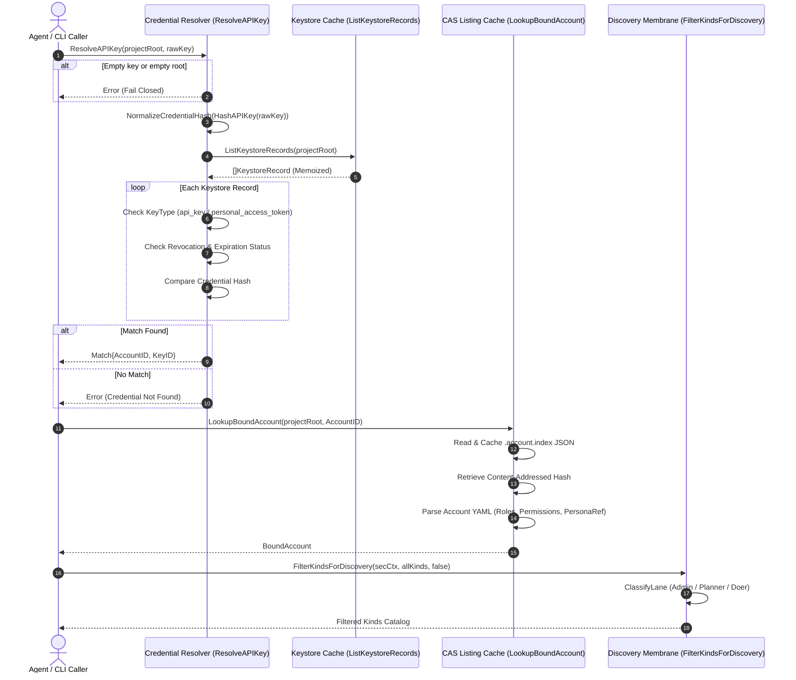

# Authentication Credential, RBAC Account Resolution & Seat Security Subsystem Operational Architecture Guide

## 1. Executive Architectural Summary

The **Authentication Credential, RBAC Account Resolution & Seat Security Subsystem** (`pkg/authcred`) provides the foundational identity, authentication, and access control plane for the **ZQK Knowledge Kernel**. In a multi-agent autonomous runtime where human operators, background daemons, and autonomous AI swarms interact with kernel graphs, Content-Addressed Storage (CAS), and Model Context Protocol (MCP) services, hardened, tamper-resistant access boundaries are mandatory.

The subsystem enforces five core security guarantees:

1. **Deterministic Credential Resolution & Safe Hashing:** Resolves opaque API keys and personal access tokens to concrete account records via cryptographic SHA-256 fingerprinting. Taint tracking is severable via lookup tables (`SanitizeDigest`) to eliminate false-positive password hashing alerts in static analyzers.
2. **High-Performance Memory & CAS Listing Caching:** Memoizes keystores, auth strategies, persona vocabularies, and account bindings against filesystem modification timestamps (mtime) using stamp-memoization tables, ensuring sub-millisecond authentication decisions without disk thrashing.
3. **Strict Planner vs. Doer Lane Separation (POL-AGENT-PLANNER-DOER-001):** Enforces asymmetric privilege boundaries between strategic planning seats (authorized for orchestration, roadmap writes, and peer steering) and implementer doer seats (authorized for code modification, task updates, but explicitly forbidden from strategic mutations).
4. **Fail-Closed Prototype Rejection Invariant:** Rejects prototype, mock, dev, or sandbox account identifiers in production execution contexts, preventing test scaffolding from escaping test harnesses into persistent kernel ledgers.
5. **Seat Directory Isolation & Hermetic Environment Injection:** Provisions local 0600-permissioned seat credentials, bounds environment inheritance (`WithSeatAPIKeyEnv`) to prevent secret leakage from parent processes into subagents, and binds execution strictly to the seated kernel root.

---

## 2. Component Topology & Subsystem Architecture

The `pkg/authcred` package sits directly between incoming CLI/MCP invocation boundaries and underlying kernel storage structures:



### Component Responsibilities

| Component | Primary API / Types | Architectural Responsibility |
| :--- | :--- | :--- |
| **Credential Resolver** | `ResolveCredentialPath`, `ResolveAPIKey`, `HashAPIKey`, `SanitizeDigest` | Discovers credential tokens, verifies SHA-256 digests against keystore entries, and manages credential normalization. |
| **Keystore Cache** | `KeystoreRecord`, `ListKeystoreRecords`, `InvalidateKeystore` | Memoizes parsed keystore YAML files keyed by project root, indexed by modification timestamps. |
| **CAS Listing Cache** | `LookupBoundAccount`, `AccountYAML`, `WalkAccountYAML`, `casMappings` | High-efficiency JSON listing index reader with object CAS content-addressable storage lookup and memoized unmarshaling. |
| **Planner/Doer Membrane** | `ClassifyLane`, `MayOrchestratePeers`, `HasWriteCode`, `DenyOrchestrateIfDoer` | Enforces behavioral boundary segregation between strategic orchestrators and execution workers. |
| **Discovery Membrane** | `ResolveDiscoveryLane`, `FilterKindsForDiscovery`, `KindAllowedInDiscovery` | Restricts object kind discoverability based on authenticated security context to conserve agent token budgets. |
| **Prototype Rejection Guard** | `ValidateOwnerRefProduction`, `IsPrototypeAccount`, `PrototypeAccountError` | Fail-closed validator rejecting development or fixture accounts during production execution. |
| **Seat Directory & Seating** | `SeatDirectory`, `NewDiskSeatDirectory`, `WriteSeatKey`, `LoadSeatCredential` | Manages role/account bindings and handles isolated local 0600 seating credential files. |

---

## 3. Credential Resolution, Keystore & CAS Listing Cache Lifecycle

Authentication flows follow a multi-stage verification pipeline from presented token to resolved security context:



---

## 4. Account RBAC Binding, Persona Vocabularies & Discovery Membrane

### 4.1 Account RBAC Binding

Accounts in the ZQK Knowledge Kernel are represented by `ACC-*` records. At authorization time, `LookupBoundAccount` extracts the RBAC slice:

- **ID:** Canonical account identifier (e.g., `ACC-SWARM-WORKER`, `ACC-PRIMARY-DEV`).
- **Roles:** Assigned functional roles (e.g., `cap_orchestrator`, `swarm_worker`, `admin`).
- **PersonaRef / PersonaRefs:** Semantic persona graph references defining the agent's tone, focus, and vocabulary schemes.
- **Permissions:** Declarative permission grants, including fine-grained capabilities (`agent:orchestrate`, `write:code`) or wildcards (`write:*`, `*`).

If the account index is uninitialized and the request targets `ACC-SWARM-WORKER`, the subsystem returns a synthetic default worker context (`DefaultSwarmWorkerBoundAccount()`) to ensure bootstrap resilience.

### 4.2 Persona Vocabularies

Every persona can associate with vocabulary schemes via `VocabularySchemesForPersona`:
- Reads `.persona.index` mapping `PER-*` identifiers to CAS hashes.
- Loads and memoizes `vocabulary_scheme_refs`.
- Injects domain-specific semantic glossaries into agent prompts without bloating unrelated contexts.

### 4.3 Discovery Membrane

To prevent autonomous agents from hallucinating or becoming overwhelmed by extensive object catalogs, the **Discovery Membrane** partitions object visibility:

1. **DiscoveryLaneFull (Admin / System / write:*):** Full visibility across all 70+ kernel kinds.
2. **DiscoveryLanePlanner (Planners / Orchestrators):** Focuses on strategic and governance kinds (`priority_plan`, `goal`, `milestone`, `requirement`, `policy`, `agent_task`, `persona`, `role`, etc.).
3. **DiscoveryLaneDoer (Swarm Workers / Implementers):** Scopes enumeration strictly to task execution kinds (`agent_task`, `agent_skill`, `agent_instruction`, `criteria`, `test_case`, `technical_debt`, `backlog_item`).

---

## 5. Prototype Rejection Invariants & Seat Directory Isolation

### 5.1 Fail-Closed Prototype Rejection (POL-AGENT-PROTOTYPE-REJECTION-001)

Test fixtures and mock accounts frequently use synthetic IDs during unit testing. To prevent these from escaping into production git repositories or authoritative kernel graphs, `ValidateOwnerRefProduction` inspects owner references:

- **Prefix Invariant:** Must strictly begin with `ACC-` (case-insensitive).
- **Marker Inspection:** Rejects identifiers containing prototype substrings:
  - `proto`, `test`, `mock`, `dev`, `sbox`, `pvt`.
- **Dynamic Registry:** Supports runtime registration via `RegisterPrototypeAccountRefs` or the `PROTOTYPE_ACCOUNT_REFS` environment variable.

```go
// Production validation check
if err := authcred.ValidateOwnerRefProduction(ownerRef); err != nil {
    return errfmt.Errorf("cannot promote object: %w", err)
}
```

### 5.2 Seat Directory Isolation

Seating credentials represent active authentication keys provisioned to local processes:
- Stored exclusively under `.zqk/seating/credentials/<account_id>`.
- Permissions enforced at `0600` (read/write by owner only).
- Plaintext keys are strictly gitignored; kernel CAS ledgers store SHA-256 fingerprints only (`TokenFingerprintMeta`).
- `WithSeatAPIKeyEnv` prepares bounded process environments, stripping parent secrets while injecting `ZQK_API_KEY` and authoritative `ZQK_PROJECT_ROOT`.

---

## 6. Production Configuration, Operational Patterns & Troubleshooting

### 6.1 Production Configuration

| Environment Variable | Purpose | Default |
| :--- | :--- | :--- |
| `ZQK_API_KEY` | Presented authentication token or personal access token | `""` |
| `ZQK_PROJECT_ROOT` | Authoritative root directory containing `.zqk/` | Resolved from working tree |
| `ZQK_TEST_ROOT` | Hermetic test directory for unit testing isolation | `""` |
| `PROTOTYPE_ACCOUNT_REFS` | Comma-delimited list of custom fixture accounts to reject | `""` |

### 6.2 Common Operational Patterns

#### Checking Authentication Status
Inspect the last authenticated identity snapshot persisted in `.zqk/state/identity_status.json`:
```bash
zqk system status
```
This payload is maintained best-effort by `WriteIdentityStatus` and cached via fingerprint comparisons (`identityFingerprint`) to eliminate redundant disk writes on CLI commands.

#### Seating an Agent
To provision a local worker seat credential:
```bash
zqk agent seat-worker --account-id ACC-SWARM-WORKER
```

### 6.3 Troubleshooting & Failure Modes

| Symptom | Probable Cause | Remediation |
| :--- | :--- | :--- |
| `unauthorized: account index missing; cannot verify role+persona binding` | `.account.index` missing or corrupted under `.zqk/process/accounts` | Rebuild account index via `zqk system verify` or regenerate process index. |
| `credential not found in keystore` | Expired, revoked, or non-matching token in `.zqk/process/keystore` | Check keystore YAML entry: verify `expires_at`, `revoked: false`, and SHA-256 hash match. |
| `permission denied: doer seats cannot orchestrate peers (POL-AGENT-PLANNER-DOER-001)` | An agent with doer permissions attempted peer orchestration | Reassign role to a planner role (e.g. `cap_orchestrator`) or use a designated planner seat. |
| `owner_ref is a prototype/test account and is not allowed in production` | An object declared a test account (e.g. `ACC-TEST-USER`) in production | Use a legitimate non-prototype production account (e.g. `ACC-LEAD-ENGINEER`). |

---

## 7. Verification & DoD Compliance Matrix

The `pkg/authcred` subsystem maintains strict continuous verification invariants:

| Verification Dimension | Standard Requirement | Subsystem Status | Evidence |
| :--- | :--- | :--- | :--- |
| **Statement Test Coverage** | $\ge 85.0\%$ (Target 100.0%) | **97.0%** | `go test -coverprofile=authcred_cov.out ./pkg/authcred/...` |
| **Concurrency & Race Freedom** | Zero data races | **PASS** | `go test -race ./pkg/authcred/...` |
| **Memory & Cache Hygiene** | Stamp-invalidated memoization | **PASS** | `stampmemo.Table` & `stampmemo.View` |
| **Fail-Closed Security** | Prototype rejection & lane segregation | **PASS** | `ValidateOwnerRefProduction`, `DenyOrchestrateIfDoer` |
| **Open-Core Payload Integrity** | Zero literal nanosecond IDs | **PASS** | `sh scripts/open-core/check-public-release-payload.sh .` |
