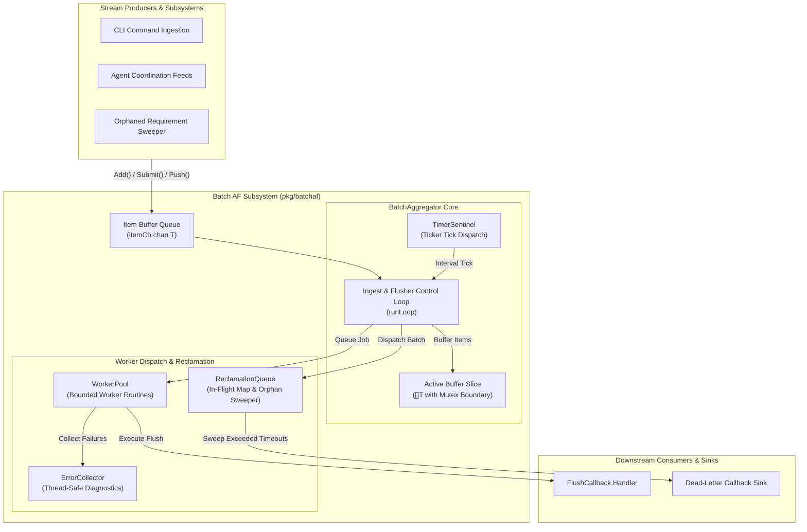
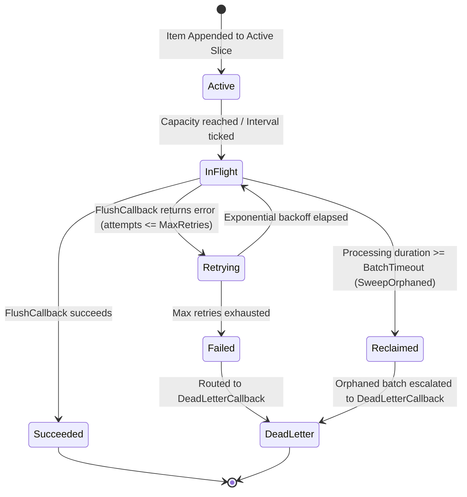

# Batch AF (Aggregation & Orphaned Processing) Subsystem Architectural & Operational Guide

## 1. Executive Architectural Summary

The **Batch AF (Aggregation & Orphaned Processing) Subsystem** (`pkg/batchaf`) delivers high-throughput stream aggregation, dual-trigger batch dispatching, resilient worker pool execution, exponential backoff retries, and automated orphaned batch reclamation across the **ZQK Knowledge Kernel**.

In distributed autonomous systems, high-concurrency event ingestion poses severe operational challenges. Unbuffered granular writes overwhelm storage engines, trigger database lock contention, and degrade transaction throughput. Simultaneously, unhandled worker exits, network partitions, or transient external API timeouts can leave batches orphaned in an indeterminate state, risking data loss or silent pipeline stall.

Governed by core platform policies (including POL-DEFAULT-142277d3), the `pkg/batchaf` subsystem addresses these failure modes through five core design invariants:

1. **Dual-Trigger Batch Dispatch:** Batches are automatically flushed when either the capacity limit (`MaxBatchSize`) is reached or the idle interval (`FlushInterval`) elapses via a dedicated `TimerSentinel`.
2. **Bounded Concurrency & Worker Dispatch:** A dedicated `WorkerPool` processes flushed batches across a bounded number of worker goroutines, insulating downstream systems from concurrency spikes.
3. **Resilient Retry & Exponential Backoff:** Transient batch execution failures trigger automated retries with deterministic exponential backoff, isolating transient faults without crashing caller threads.
4. **Active Orphan Tracking & Reclamation:** The `ReclamationQueue` continuously tracks in-flight batches. Any batch whose processing duration exceeds `BatchTimeout` is isolated, marked for reclamation, and routed to dead-letter sinks or retry queues.
5. **Static Floor Coverage Invariant:** A strict statement test coverage invariant ($\ge 85.0\%$, verified at $>96\%$) ensuring that all concurrency branches, timeout handlers, retry loops, and error scenarios remain rigorously verified.

---

## 2. Component Topology & Subsystem Architecture

The subsystem coordinates stream ingestion, threshold dispatching, worker execution, and error telemetry through five core components:



### Component Responsibilities

| Component | Architecture Role | Key Responsibilities |
| :--- | :--- | :--- |
| **`BatchAggregator[T]`** | Root Controller | Manages intake channels, enforces capacity ceilings, runs the primary select loop, and coordinates graceful shutdown. |
| **`WorkerPool[T]`** | Execution Engine | Distributes flushed batches among worker goroutines (`goroutinelabels.NewGoroutine`) with non-blocking job queuing. |
| **`TimerSentinel`** | Temporal Heartbeat | Emits periodic interval ticks to trigger partial batch flushes during low-throughput or sparse ingest periods. |
| **`ReclamationQueue[T]`** | Fault Containment | Maintains thread-safe registry of in-flight batches, measures processing durations, and reclaims abandoned or timed-out batches. |
| **`ErrorCollector`** | Diagnostics Aggregator | Thread-safe collector capturing worker dispatch errors, enabling runtime inspection and health checks. |

---

## 3. Aggregation & Flush Lifecycle

The ingestion and dispatch lifecycle balances maximum aggregation efficiency against low event latency:

```mermaid
sequenceDiagram
    autonumber
    actor Producer as Event Producer
    participant Ingest as itemCh (Buffer)
    participant Loop as Aggregator runLoop
    participant Sentinel as TimerSentinel
    participant RecQueue as ReclamationQueue
    participant Pool as WorkerPool
    participant Processor as FlushCallback

    Producer->>Ingest: Add(ctx, item) / Submit(item)
    Ingest-->>Loop: Receive item
    Loop->>Loop: Append item to active buffer

    alt Buffer reaches MaxBatchSize
        Loop->>RecQueue: RegisterInFlight(batch)
        Loop->>Pool: Dispatch(batch)
    else FlushInterval expires
        Sentinel-->>Loop: Periodic Tick
        Loop->>RecQueue: RegisterInFlight(batch)
        Loop->>Pool: Dispatch(batch)
    else Manual Flush requested
        Producer->>Loop: Flush()
        Loop->>Loop: Drain pending items
        Loop->>RecQueue: RegisterInFlight(batch)
        Loop->>Pool: Dispatch(batch)
    end

    Pool->>Processor: FlushCallback(ctx, batch.Items)
    alt Execution Successful
        Processor-->>Pool: nil (success)
        Pool->>RecQueue: MarkSuccess(batch.ID)
    else Transient Failure (Retryable)
        Processor-->>Pool: error
        Pool->>Pool: Sleep exponential backoff
        Pool->>Processor: Retry FlushCallback
    else Max Retries Exhausted
        Pool->>RecQueue: MarkFailed(batch.ID, err)
        Pool->>Producer: DeadLetterCallback(batch, err)
    end
```

---

## 4. Failure Modes & Orphaned Batch Reclamation

A primary requirement of distributed stream processing is handling catastrophic worker halts, processor deadlocks, or persistent external service failures. The `ReclamationQueue` manages batch states across a robust state machine:



### Reclamation Sweep Protocol

1. **Checkout Registration:** When a batch is dispatched, `ReclamationQueue.RegisterInFlight` records the batch with an initial timestamp and `BatchStatusInFlight` status.
2. **Success Acknowledgement:** Upon successful execution of `FlushCallback`, the worker invokes `MarkSuccess(batchID)`, removing the batch from active tracking.
3. **Periodic / On-Demand Sweep:** `ReclaimOrphaned(ctx)` scans active in-flight batches. Any batch whose elapsed time since last update exceeds `BatchTimeout` is transitioned to `BatchStatusReclaimed`, removed from the active map, and forwarded to the configured `DeadLetterCallback`.

---

## 5. Concurrency Model & Thread-Safety Guarantees

The `pkg/batchaf` subsystem enforces rigorous concurrency invariants to operate safely in multi-threaded environments:

### Lock Invariants & Data Isolation
- **Channel Ingestion Boundary:** Producers submit items across buffered Go channels (`itemCh`), providing lock-free ingestion under normal load.
- **Mutex Protected Active Slice:** Modifications to the in-memory item slice (`activeItems`) are guarded by `sync.Mutex` inside `appendItem` and `dispatchCurrentBatch`.
- **Read-Write Mutex on Reclamation:** State transitions in `ReclamationQueue` use `sync.RWMutex`, allowing concurrent status queries (`InFlightCount`, `Get`) without blocking batch registrations.
- **Atomic Telemetry Counters:** All throughput statistics (`ItemsSubmitted`, `BatchesFlushed`, `BatchesSucceeded`, `BatchesRetried`, `BatchesReclaimed`, `DeadLettered`) use lockless atomic operations.

### Goroutine Governance
All background threads (the timer sentinel, worker pool routines, and main aggregator event loop) are spawned exclusively using `goroutinelabels.NewGoroutine`, ensuring adherence to kernel telemetry policies and runtime profiling invariants.

### Deterministic Graceful Drain
When `Close()` is invoked:
1. `closeCh` is closed, halting acceptance of new interval ticks.
2. `TimerSentinel.Stop()` terminates the interval ticker.
3. `drainRemaining()` sweeps any remaining items in `itemCh` and dispatches final batches.
4. `WorkerPool.Stop()` waits for all active worker routines to finish processing in-flight jobs.

---

## 6. Configuration & Operational Recipes

### Default Configuration Baseline

```go
opts := batchaf.DefaultOptions[string]()
opts.MaxBatchSize = 100
opts.FlushInterval = 250 * time.Millisecond
opts.WorkerConcurrency = 4
opts.BufferCapacity = 2000
opts.BatchTimeout = 10 * time.Second
opts.MaxRetries = 3
opts.BackoffBase = 50 * time.Millisecond

opts.FlushCallback = func(ctx context.Context, batch []string) error {
    return persistBatchToStorage(ctx, batch)
}

opts.DeadLetterCallback = func(batch *batchaf.Batch[string], err error) {
    log.Printf("dead-lettered batch %s (size: %d): %v", batch.ID, len(batch.Items), err)
}

aggregator, err := batchaf.NewBatchAggregator(opts)
if err != nil {
    log.Fatalf("failed to initialize batch aggregator: %v", err)
}
defer aggregator.Close()
```

### High-Throughput Non-Blocking Submissions

```go
// Non-blocking submission: returns false if buffer capacity is saturated
submitted := aggregator.Submit("item-payload")
if !submitted {
    // Apply backpressure or route to spillover cache
}
```

### Context-Aware Blocking Submission

```go
// Context-bounded submission: waits for buffer availability or aborts on cancellation
ctx, cancel := context.WithTimeout(context.Background(), 2*time.Second)
defer cancel()

if err := aggregator.Add(ctx, "critical-item-payload"); err != nil {
    // Handle context cancellation or closed aggregator
}
```

---

## 7. Verification & Coverage Invariant

Statement test coverage for `pkg/batchaf` is governed by continuous integration gates enforcing a static floor of $\ge 85.0\%$.

To verify package test coverage locally:

```bash
ZQK_ALLOW_FOREGROUND_GO_TEST=1 go test -v -race -timeout 30s -cover ./pkg/batchaf
```

### Verified Test Matrix

The test suite in `pkg/batchaf/batchaf_coverage_elevation_cycle180_test.go` exercises:
- Configuration validation (zero/negative sizes, missing callbacks, invalid intervals).
- Dual-trigger flushes (capacity boundary vs. timer sentinel ticks).
- High-concurrency multi-producer ingestion with zero race conditions.
- Retry loops with exponential backoff and dead-letter routing.
- Orphaned batch identification, status migration, and reclamation sweeps.
- Graceful drain, shutdown idempotency, and post-close error responses.
